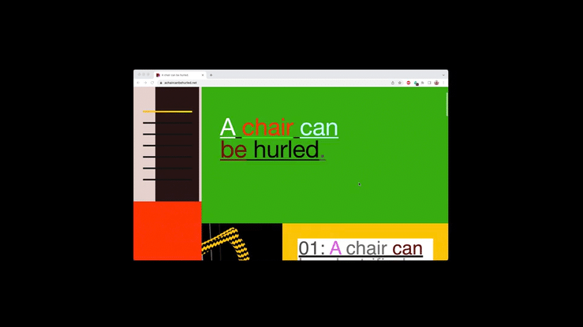
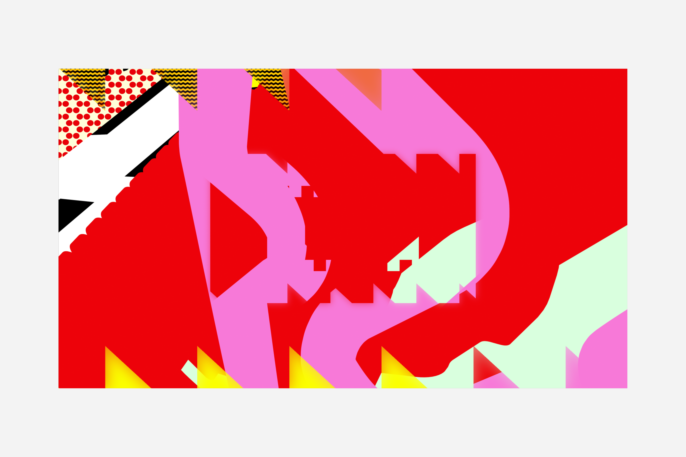

# Aaron Whitney Björk

**Tag tecnica/formato:** `video` `installazione` `net-art-sito-web`
**Tag tema:** `economia-attenzione` `colonialismo-decolonialita`

## Biografia
Nome completo Aaron Whitney Björk, professionalmente accreditato come **"Aaron Bjork"**. Consegue un BFA all'Art Center College of Design (2007), dove in seguito diventa docente (professore associato). Tra il 2020 e il 2021 è Designer-in-Residence al Center for Art Research della University of Oregon; risulta anche come Graduate Teaching Fellow nella stessa università, con ricerca su arte digitale/nuovi media. Tra il 2016 e il 2019 è membro curatore di Ditch Projects, spazio indipendente gestito da artisti a Springfield, Oregon, dedicato a studio, installazione e performance. Tra il 2006 e il 2009 co-fonda BORN, collettivo di motion design con base a Los Angeles. Vive con base a Los Angeles/Pacific Northwest. Riconoscimenti citati nel proprio profilo: National Academy of Television Arts & Sciences, Communication Arts, Art of the Title, SXSW.

⚠️ Nota metodologica: le fonti disponibili per questo artista sono più limitate rispetto ad altre schede del database — principalmente pagine bio/profilo istituzionali, senza recensioni critiche approfondite in stampa specializzata d'arte contemporanea. Questa scheda riporta con onestà quanto verificabile, senza aggiungere dettagli non confermati, coerentemente con la regola del database di non inventare contenuto quando le fonti sono scarse.

## Poetica e ricerca
La pratica di Björk è descritta come basata sulla ricerca, incentrata sulla "trasmissione e traduzione interculturale di immagini e idee attraverso le economie neoliberali", realizzata attraverso video sperimentale, installazione immersiva e arte basata su internet, insieme a corsi/workshop/pubblicazioni. Ha esposto alla Gallery 151 (New York), alla Fisk Gallery (Portland), alla SOIL Gallery (Seattle) e a Ditch Projects; ha partecipato a mostre basate su internet con Fluidity.Online, ECLIPSECORE e The Wrong Biennale.

## Opere principali

⚠️ Non è stato possibile reperire, con le fonti disponibili durante la ricerca, titoli specifici e datati di singole opere con descrizioni dettagliate paragonabili a quelle delle altre schede del database. Le fonti trovate (sito personale aaronbjork.com, profilo Art Center College of Design, CURRENTS New Media, Ditch Projects, ARTJAWS, intervista su The Bosco Magazine) confermano l'esistenza e l'attività dell'artista ma non sono state accessibili nel dettaglio per estrarre titoli, anni e descrizioni puntuali di opere specifiche — un secondo tentativo di ricerca più approfondita non ha potuto essere completato per un limite tecnico della sessione di lavoro.

## Immagini

Scaricate dal sito ufficiale, pagina dell'opera *A Chair Can Be Hurled*: [aaronbjork.com/A-chair-can-be-hurled](https://aaronbjork.com/A-chair-can-be-hurled).

## Fonti
- [aaronbjork.com — sito ufficiale](https://aaronbjork.com/Bio)
- [Art Center College of Design — profilo docente](https://www.artcenter.edu/about/get-to-know-artcenter/people/detail.html?breadcrumb=565f1aae4d9b6fce4bd8c5f2&accdID=0177578)
- [CURRENTS New Media — pagina artista](https://currentsnewmedia.org/artist/aaron-bjork-2/)
- [Ditch Projects — pagina artista](https://ditchprojects.com/Aaron-Whitney-Bjork)
- [ARTJAWS — portfolio](https://www.artjaws.com/en/portfolio/aaron-bjork/)
- [The Bosco Magazine — intervista](http://magazine.thebosco.com/aaron-whitney-bjork/)

---

## Appunti da organizzare
- Non citato in un programma specifico dei corsi — inserito dalla lista generale "da scrivere da zero".
- ⚠️ **Da completare con priorità**: questa scheda resta più scarna delle altre del database per limiti di reperibilità delle fonti durante la ricerca, non per scelta — andrebbe ripresa con una ricerca diretta su aaronbjork.com (sezioni Bio, opere/portfolio) per estrarre titoli, anni e descrizioni di opere specifiche, come fatto per tutte le altre schede.
- Nota sulla ricerca del nome: verificata l'identità — "Aaron Whitney Björk" è il nome completo di una persona reale e verificabile (non un errore di trascrizione né una confusione con altri artisti chiamati "Aaron" collegati alla musicista islandese Björk, né con Aaron Koblin). "Whitney" è il suo secondo nome, non un riferimento al Whitney Museum.
- Da segnalare al programma del corso: il suo lavoro sembra orientato più verso video sperimentale/installazione/net art che verso 3D, VR o IA in senso stretto — verificare la pertinenza rispetto all'ambito specifico del corso una volta approfondita la scheda.
