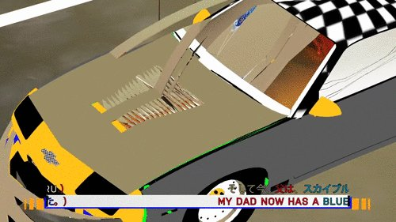
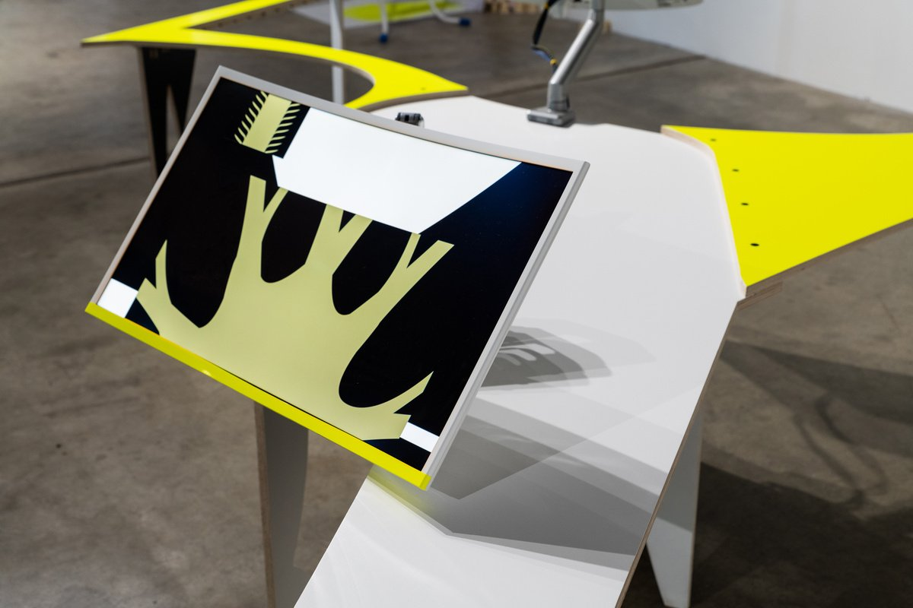
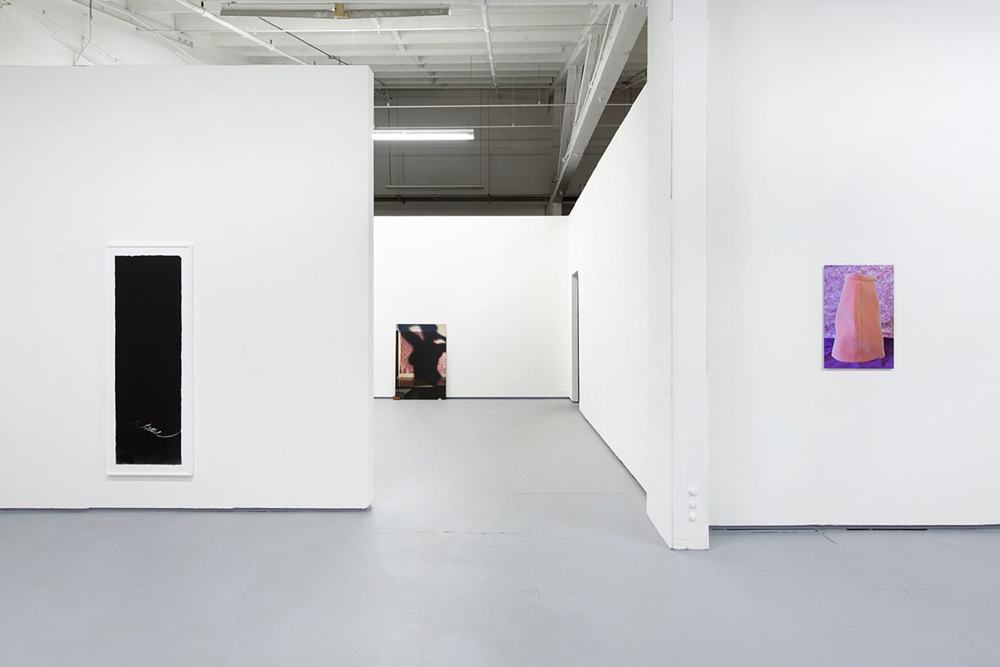
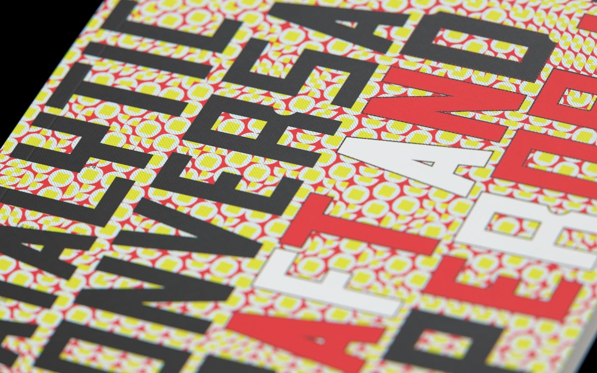
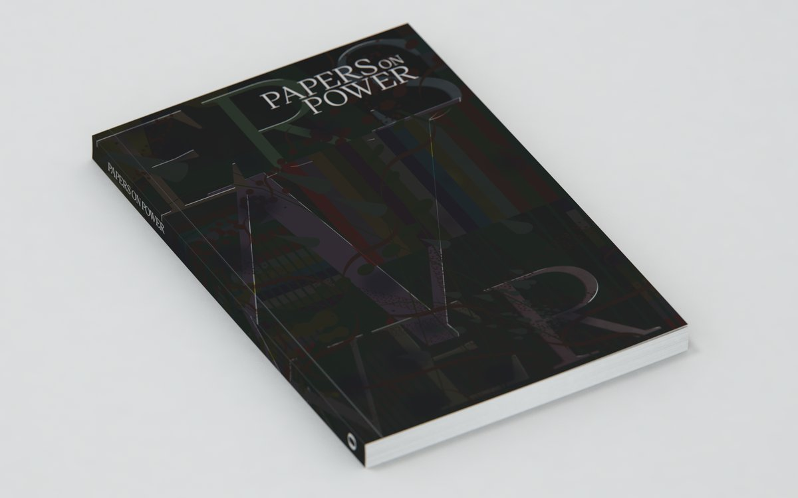

# Aaron Whitney Björk

**Tag tecnica/formato:** `video` `installazione` `net-art-sito-web`
**Tag tema:** `economia-attenzione` `colonialismo-decolonialita`
**Stato:** scheda parziale: la fonte principale è il sito personale, senza recensioni critiche in stampa specializzata · da verificare: la pagina «Nature Faces» del sito

## Biografia
Nome completo Aaron Whitney Björk, professionalmente accreditato come **"Aaron Bjork"**. Consegue un BFA all'Art Center College of Design (2007), dove in seguito diventa docente (professore associato). Tra il 2020 e il 2021 è Designer-in-Residence al Center for Art Research della University of Oregon; risulta anche come Graduate Teaching Fellow nella stessa università, con ricerca su arte digitale/nuovi media. Tra il 2016 e il 2019 è membro curatore di Ditch Projects, spazio indipendente gestito da artisti a Springfield, Oregon, dedicato a studio, installazione e performance. Tra il 2006 e il 2009 co-fonda BORN, collettivo di motion design con base a Los Angeles. Vive con base a Los Angeles/Pacific Northwest. Riconoscimenti citati nel proprio profilo: National Academy of Television Arts & Sciences, Communication Arts, Art of the Title, SXSW. Ha esposto alla Gallery 151 (New York), alla Fisk Gallery (Portland), alla SOIL Gallery (Seattle) e a Ditch Projects; ha partecipato a mostre basate su internet con Fluidity.Online, ECLIPSECORE e The Wrong Biennale.

Nell'intervista rilasciata a The Bosco Magazine, Björk si descrive come artista multidisciplinare con base nel Pacific Northwest la cui pratica evoca una risposta viscerale definita "vulgar, playful and most importantly honest" ("volgare, giocosa e soprattutto onesta"); racconta di produrre la maggior parte del proprio lavoro al computer, pur mantenendo un interesse per le cineprese analogiche per la qualità distintiva di colore e grana della pellicola.

## Poetica e ricerca
La pratica di Björk è descritta come basata sulla ricerca, incentrata sulla "trasmissione e traduzione interculturale di immagini e idee attraverso le economie neoliberali", realizzata attraverso video sperimentale, installazione immersiva e arte basata su internet, insieme a corsi/workshop/pubblicazioni.

Temi ricorrenti individuati nelle descrizioni delle singole opere (vedi sotto): l'automobile come "medium affettivo" e come artefatto delle economie del lavoro post-industriali (*Platform Bazaar*, *When we trip, we trip together*); la memetica biologica, visiva, tematica e sonora legata alla circolazione globale di immagini, stili di vita e idee (*Best guess for this image*); la domesticità e l'oggetto quotidiano — in particolare la sedia — come dispositivo attraverso cui esplorare stati affettivi e paramnesici (*A chair can be hurled*); la città in trasformazione durante la pandemia, con riferimento esplicito alla crisi degli sfratti e dei senzatetto (*Abstractions*). Accanto alla produzione artistica, Björk ha un versante curatoriale ed editoriale sviluppato durante la residenza come Designer-in-Residence al Center for Art Research (CFAR) dell'University of Oregon (2020-2021): ha curato/progettato la pubblicazione collettiva *Craft and the Hyperobject* e il progetto *Papers on Power*, entrambi centrati sull'idea di raccogliere voci multiple attorno a un concetto-cornice (l'iperoggetto di Timothy Morton nel primo caso, il potere nel secondo) piuttosto che produrre un discorso critico univoco.

## Opere principali

### Best guess for this image: Chevy bow tie exhaust tips (2018)
**Descrizione:** mostra personale presentata dalla Portland 'Pataphysical Society, a cura di Ryan Huff. Opera/installazione composta da video monocanale, audio, stampa a pigmenti UltraChrome e vinile adesivo. Esplora la "memetica" biologica, visiva, tematica e sonora legata agli scambi globali di idee e stili di vita.

**Fonte:** aaronbjork.com; The Portland 'Pataphysical Society.

### Platform Bazaar (2019)
**Descrizione:** installazione video-sonora multicanale ambientata (concettualmente) nel sito della ex fabbrica NUMMI (New United Motor Manufacturing, Inc.) di Fremont, California — la joint venture tra General Motors e Toyota attiva per oltre 26 anni. Artefatti "appiattiti" provenienti dalla fabbrica vengono sintetizzati, tradotti e riassemblati in una postazione di lavoro digitale, mettendo in evidenza la metamorfosi della forza lavoro e la soggettivazione dell'utente digitale nel passaggio dal lavoro industriale a quello delle piattaforme.

**Fonte:** aaronbjork.com/Platform-Bazaar.

### When we trip, we trip together (2019)
**Descrizione:** installazione site-specific su larga scala, presentata da Ditch Projects (Springfield, Oregon) dal 16 febbraio al 10 marzo 2019. Prosegue l'indagine dell'artista sull'automobile come "medium affettivo", nel contesto più ampio della sua ricerca sugli artefatti digitali, internet e la politica neoliberale.

**Fonte:** ditchprojects.com/We-Trip-Together; aaronbjork.com.

### A chair can be hurled (2020-2022)
**Descrizione:** mostra/progetto online (achaircanbehurled.net) realizzato durante la residenza come Designer-in-Residence al Center for Art Research dell'University of Oregon. Usa come cornice visiva un appartamento con carte da parati dai colori "nucleari", per un'esperienza descritta come paramnesiaca. Comprende cinque film brevi realizzati per il progetto: *A chair can be electrified*, *A chair is a place for rest*, *A chair can spin*, *A chair can idle* e *Chair as Essence*. Uno dei film della serie, con il titolo *Outdoors / A Chair Can Be Electrified* (video monocanale), è stato presentato al festival CURRENTS New Media (edizione 2023, Santa Fe).
**Fonte:** aaronbjork.com/A-chair-can-be-hurled; achaircanbehurled.net; currentsnewmedia.org.

### Craft and the Hyperobject (2020)
**Descrizione:** pubblicazione collettiva, progettata graficamente da Björk nel ruolo di Designer-in-Residence al Center for Art Research (CFAR) dell'University of Oregon. Documenta una "Catalytic Conversation" del CFAR tenutasi il 29 gennaio 2020, con la partecipazione — tra gli altri — di Anthea Black, Garth Clark e Sonja Dahl, per esplorare il concetto di "craft" (artigianato/mestiere) attraverso la cornice dell'"iperoggetto" coniata da Timothy Morton nel libro *Hyperobjects: Philosophy and Ecology after the End of the World* (2013).

**Fonte:** aaronbjork.com/Craft-and-The-Hyperobject; namitawiggers.com.

### Papers on Power (2020-2021)
**Descrizione:** progetto editoriale/curatoriale ospitato su aaronbjork.com, commissionato dal Center for Art Research dell'University of Oregon durante la residenza di Björk. Un gruppo di artisti e operatori culturali con esperienze diverse è stato invitato a rispondere alla domanda "What is power?" in relazione alla propria pratica, in formato libero (saggio accademico, photo-essay, o forme sperimentali), con un limite indicativo di 1200 parole pensato come punto di partenza speculativo più che come vincolo.

**Fonte:** aaronbjork.com/Papers-On-Power.

### Abstractions (mostra collettiva, WVMSFF)
**Descrizione:** partecipazione a "Abstractions", rassegna della piattaforma WVMSFF, con un'opera che fa riferimento all'immaginario della città in trasformazione durante la pandemia, affrontando temi legati alla crisi degli sfratti di massa e dei senzatetto nei centri urbani.
**Fonte:** wvmsff.com/abstractions.

### Delivery Van Delivery (GIF art, ARTJAWS)
**Descrizione:** opera GIF di 6 secondi che mostra un furgone da consegna precipitare da un cielo azzurro vivido e schiantarsi davanti alla camera. Distribuita tramite ARTJAWS, piattaforma/mercato dedicato all'arte digitale.
**Fonte:** artjaws.com/en/artjaws-shop/delivery-van-delivery.

## Interviste e talk
- [The Bosco Magazine — intervista](http://magazine.thebosco.com/aaron-whitney-bjork/)
- [Namita Gupta Wiggers — Catalytic Conversation: Craft and the Hyperobject](http://www.namitawiggers.com/catalytic-conversation-craft-and-the-hyperobject)

## Fonti
- [aaronbjork.com — sito ufficiale](https://aaronbjork.com/Bio)
- [Art Center College of Design — profilo docente](https://www.artcenter.edu/about/get-to-know-artcenter/people/detail.html?breadcrumb=565f1aae4d9b6fce4bd8c5f2&accdID=0177578)
- [CURRENTS New Media — pagina artista](https://currentsnewmedia.org/artist/aaron-bjork-2/)
- [Ditch Projects — pagina artista](https://ditchprojects.com/Aaron-Whitney-Bjork)
- [ARTJAWS — portfolio](https://www.artjaws.com/en/portfolio/aaron-bjork/)
- [aaronbjork.com — Platform Bazaar](https://aaronbjork.com/Platform-Bazaar)
- [Ditch Projects — When we trip, we trip together](https://ditchprojects.com/We-Trip-Together)
- [aaronbjork.com — A chair can be hurled](https://aaronbjork.com/A-chair-can-be-hurled)
- [achaircanbehurled.net — sito del progetto](https://www.achaircanbehurled.net/)
- [aaronbjork.com — Best guess for this image: Chevy bow tie exhaust tips](https://aaronbjork.com/Best-guess-for-this-image-Chevy-bow-tie-exhaust-tips)
- [The Portland 'Pataphysical Society — Aaron Whitney Bjork: Best guess for this image](https://www.patapdx.com/aaron-whitney-bjork-best-guess-for-this-image)
- [ARTJAWS — Delivery Van Delivery](https://www.artjaws.com/en/artjaws-shop/delivery-van-delivery/)
- [WVMSFF — Abstractions](https://www.wvmsff.com/abstractions)
- [aaronbjork.com — Papers On Power](https://aaronbjork.com/Papers-On-Power)
- [aaronbjork.com — Craft and The Hyperobject](https://aaronbjork.com/Craft-and-The-Hyperobject)

## Crediti delle immagini
- *A chair can be hurled*: immagini scaricate dal sito ufficiale [aaronbjork.com](https://aaronbjork.com/A-chair-can-be-hurled). Per le altre opere non è stata trovata ancora nessuna immagine.
- *Best guess for this image: Chevy bow tie exhaust tips*: immagine dalla pagina [aaronbjork.com](https://aaronbjork.com/Best-guess-for-this-image-Chevy-bow-tie-exhaust-tips); diritti dei rispettivi titolari, uso didattico.
- *Craft and the Hyperobject*: immagine dalla pagina [aaronbjork.com](https://aaronbjork.com/Craft-and-The-Hyperobject); diritti dei rispettivi titolari, uso didattico.
- *Papers on Power*: immagine dalla pagina [aaronbjork.com](https://aaronbjork.com/Papers-On-Power); diritti dei rispettivi titolari, uso didattico.
- *Platform Bazaar*: immagine dalla pagina [aaronbjork.com](https://aaronbjork.com/Platform-Bazaar); diritti dei rispettivi titolari, uso didattico.
- *When we trip, we trip together*: immagine dalla pagina [ditchprojects.com](https://ditchprojects.com/We-Trip-Together); diritti dei rispettivi titolari, uso didattico.
