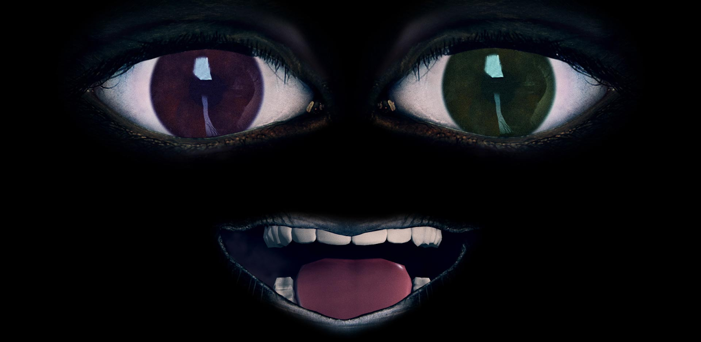
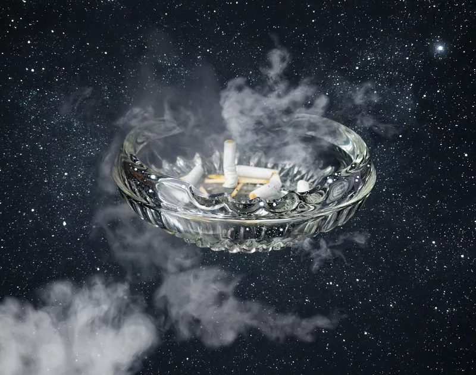

# Agnieszka Polska

**Tag tecnica/formato:** `video` `animazione-2d` `installazione`
**Tag tema:** `memoria-archivio` `ecologia-ambiente` `capitalismo-lavoro`
**Stato:** un'immagine nella sezione Crediti non è identificata (opera da verificare)

## Biografia
Artista visiva polacca, nata nel 1985 a Lublino, vive e lavora a Berlino. Studia all'Accademia di Belle Arti di Cracovia e alla Universität der Künste di Berlino. Ha esposto al Museum of Modern Art di Varsavia, alla Tate Modern, all'Hamburger Bahnhof di Berlino, alla Biennale di Venezia (2019), alla Biennale di Sydney e al New Museum di New York. Nel 2017 ha ricevuto il Preis der Nationalgalerie.

## Poetica e ricerca
Polska lavora principalmente con video, animazione digitale e installazioni audiovisive immersive, indagando le intersezioni tra memoria collettiva, responsabilità morale e comunicazione nell'era digitale. Nelle sue opere il linguaggio dell'animazione diventa un mezzo per dare voce a soggetti assenti o dimenticati — artisti scomparsi, figure storiche marginali, persino idee non realizzate — creando ambienti visivi dove una voce filtrata e artificiale guida lo spettatore in una riflessione sul proprio ruolo nel presente.

## Opere principali
### How the Work is Done (2011)
**Descrizione:** animazioni di architetture socialiste in rovina.
**Lettura critica:** riflessione sull'utopia modernista e sul fallimento delle ideologie collettive.

### Future Days (2013)
**Descrizione:** un aldilà popolato da artisti concettuali defunti, sospesi in una dimensione paradisiaca dove discutono del significato dell'arte.
**Lettura critica:** meditazione sulla fine della storia e sull'eredità dell'arte concettuale.

### The New Sun / What the Sun Has Seen (2017)
**Descrizione:** il Sole come entità parlante e onnisciente che interroga l'umanità sulla propria apatia di fronte alle crisi ecologiche e sociali.
**Lettura critica:** tono elegiaco e grande scala visiva evocano un senso di colpa collettivo per la perdita del futuro; la voce narrante rappresenta la coscienza globale in un mondo iperconnesso ma moralmente disorientato.

### The Demon's Brain (2018-2019)
**Descrizione:** intreccia fonti storiche medievali e teoria economica contemporanea, attraverso lettere immaginate di un mercante del XIV secolo.
**Lettura critica:** riflessione sull'ansia del debito e sulla continuità della logica capitalista nel tempo — i sistemi di potere restano invariati, solo digitalizzati.
**Video:** [talk con estratto dell'opera (YouTube)](https://www.youtube.com/watch?v=iFSb162j4Ts)

### Altre opere (elenco esteso, da approfondire)

Elenco costruito con ricerca aggiuntiva rispetto alla scheda Drive originale, per dare un panorama più ampio della produzione dell'artista — prima e dopo il periodo coperto dal materiale iniziale. Descrizioni brevi, da sviluppare.

- **Garden** (2010) — tra le prime opere dell'artista.
- **Sensitization to Colour** (2010) — lavoro dei primi anni, ancora da documentare nel dettaglio.
- **Watery Rhymes** (2014) — video.
- **Ask the Siren** (2017) — video.
- **The Happiest Thought** (2019) — video.
- **Perfect Lives** (2019) — video.
- **Hurrah, We Are Still** (2020) — video.
- **The Thousand-Year Plan** (2021) — video.
- **The Longing Gaze** (2021) — video.
- **The Book of Flowers** (2023) — video, presentato tra gli altri a Lo Schermo dell'Arte.

Esposizioni/proiezioni recenti (2023-2024): MUDAM Lussemburgo (2023), 24ª Biennale di Sydney (2024), 14ª Biennale di Shanghai (2024).

## Interviste e talk
- **Video:** [Talk dell'artista (YouTube)](https://www.youtube.com/watch?v=fXBHhsfMg2s)

## Fonti
- [zak-branicka.com — galleria dell'artista](https://www.zak-branicka.com/artists/agnieszka-polska)
- [culture.pl — profilo artista](https://culture.pl/en/artist/agnieszka-polska)
- [The New Sun (video)](https://www.youtube.com/watch?v=B30QlvuaRD8)
- [What the Sun Has Seen (video)](https://www.youtube.com/watch?v=dQcA7G-b0jE)
- [Video/opera aggiuntivo 1 (YouTube)](https://www.youtube.com/watch?v=Ba4-EfUxPMI)
- [Video/opera aggiuntivo 2 (YouTube)](https://www.youtube.com/watch?v=Kbl0N2QJkMo)
- [Video/opera aggiuntivo 3 (YouTube)](https://www.youtube.com/watch?v=fydVzT2GnZs)
- [Documentazione aggiuntiva (Vimeo)](https://vimeo.com/446830355)
- [MUDAM Luxembourg — collezione](https://www.mudam.com/collection/agniezka-polska)
- [Nosbaum Reding — biografia](https://www.nosbaumreding.com/en/artists/biography/77/agnieszka-polska-bio)
- [Galerie Georg Kargl — pagina artista](https://www.georgkargl.com/en/artist/agnieszka-polska)
- Portfolio/sito ufficiale personale: **non individuato** — da cercare.

## Crediti delle immagini

