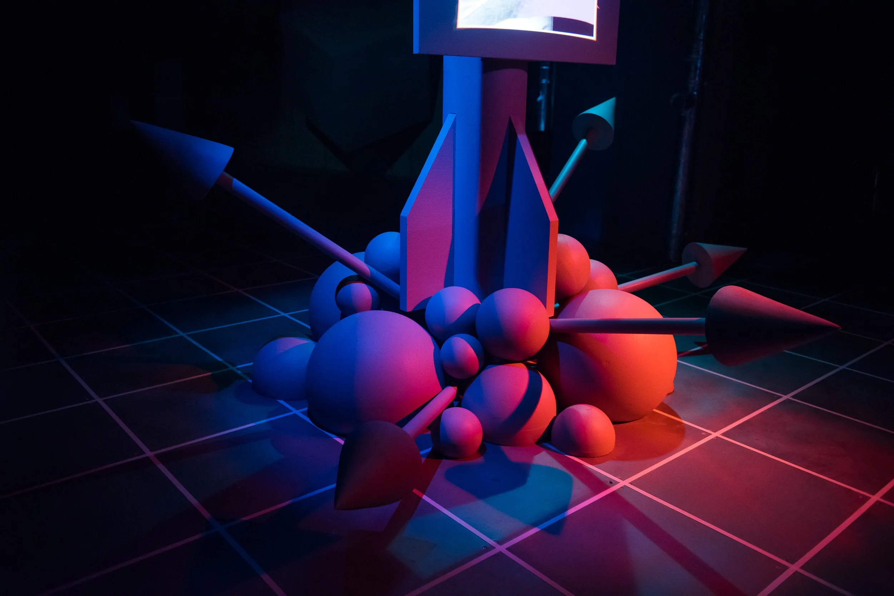
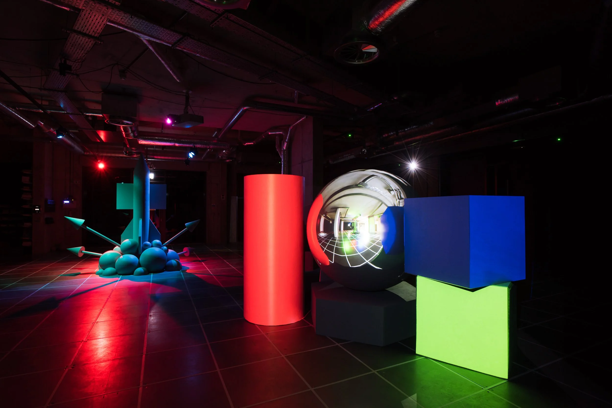
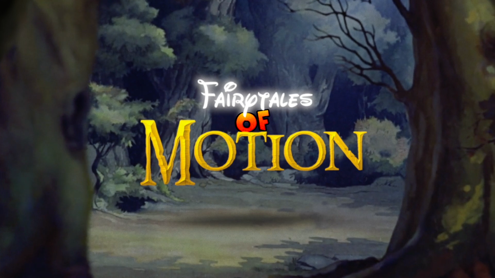
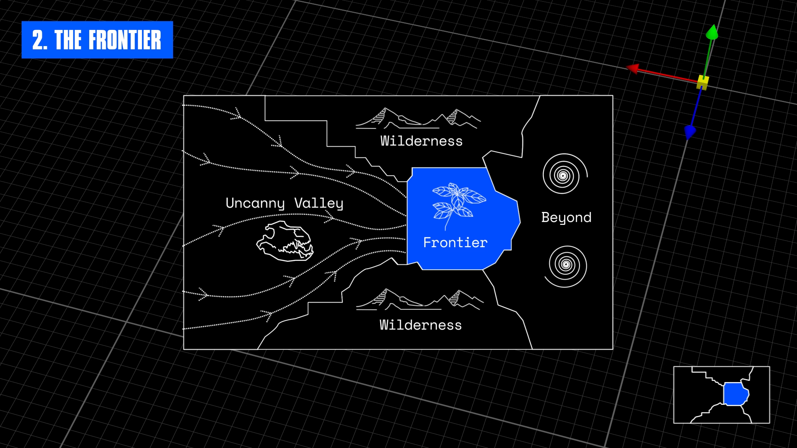
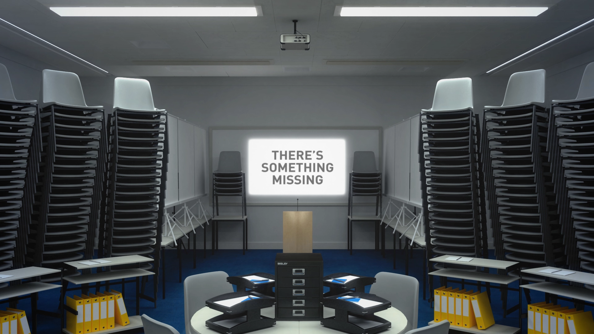

# Alan Warburton

**Tag tecnica/formato:** `video` `modellazione-3d`
**Tag tema:** `storia-computer-grafica` `economia-attenzione` `corpo-identita`
**Tag corso:** `TAD-DCV` `TAD-AVM` `M3D`
**Stato:** rivista il 2026-11-01 sulle pagine dell'artista e sui testi citati · tolte tre opere di una fonte non affidabile, che non risultano da nessuna parte · luogo di residenza attuale [verificare]

## Biografia
Artista, animatore e video-saggista britannico, nato nel 1980 in Scozia ([LABoral](https://laboralcentrodearte.org/en/artists-curators-and-researchers/alan-warburton-2/)). Viene da una formazione nelle pratiche critiche; ha vinto online un posto per studiare animazione 3D alla Escape Studios di Londra e ha lavorato per circa dieci anni nell'industria dell'animazione e degli effetti visivi ([It's Nice That, 2019](https://www.itsnicethat.com/articles/alan-warburton-digital-111019); [arebyte](https://www.arebyte.com/alan-warburton-rgbfaq)). Ha un dottorato pratico al Vasari Centre della Birkbeck, University of London, sui dataset sintetici e sulla visione artificiale. Si definisce *applied media theorist*. Personali da arebyte e The Photographers' Gallery; collettive al Carnegie Museum of Art, Somerset House, Centquatre, Baltic e RMIT ([sito dell'artista](https://alanwarburton.co.uk/about)). È stato in residenza alla Somerset House.

## Poetica e ricerca
Warburton lavora dall'interno dell'industria della computer grafica: ne conosce gli strumenti, i tempi e chi li usa, e ne fa la materia dei suoi video. I suoi saggi trattano software, lavoro, genere ed epistemologia visiva ([sito dell'artista](https://alanwarburton.co.uk/about)). L'asse di tutta l'opera è una domanda sulla produzione più che sulla ricezione: chi fa le immagini digitali, con quali scorciatoie tecniche e con quali conseguenze. In *Goodbye Uncanny Valley* il fotorealismo è una battaglia vinta e la domanda diventa che cosa viene dopo; in *RGBFAQ* le stesse scorciatoie della grafica diventano la base su cui si addestrano le macchine.

La stessa attenzione al lavoro distingue la sua posizione nel mondo dell'arte. Warburton critica chi firma opere in 3D fatte da tecnici non accreditati e sostiene che per discutere del software bisogna usarlo ([It's Nice That, 2019](https://www.itsnicethat.com/articles/alan-warburton-digital-111019)). Dal 2023 applica lo stesso metodo all'IA generativa: non la boicotta, la usa per smontarla ([ODI](https://culture.theodi.org/the-wizard-of-ai/)).

## Opere principali
### RGBFAQ (2020, 27'38")
**Corso:** `M3D` `TAD-DCV`
**Temi:** `dataset-e-addestramento` `realismo-sintetico`
**Descrizione:** video-saggio commissionato da arebyte con il sostegno di Arts Council England. Ripercorre la computer grafica dalla Seconda guerra mondiale e dai Bell Labs degli anni Sessanta agli studi di effetti visivi degli anni Novanta e al machine learning su GPU, fino ai dataset sintetici, immagini generate al computer usate come *ground truth* per addestrare la visione artificiale. Alla arebyte Gallery di Londra è stato un «video-saggio spaziale», proiettato su grandi sculture geometriche (17 ottobre – 15 dicembre 2020 e 17 – 30 maggio 2021). Audio di David Kamp. Sviluppato nel dottorato alla Birkbeck e al Frank-Ratchye STUDIO for Creative Inquiry di Carnegie Mellon ([sito dell'artista](https://alanwarburton.co.uk/rgbfaq); [arebyte](https://www.arebyte.com/alan-warburton-rgbfaq)).
**Lettura critica:** le scorciatoie adottate dalla grafica dei primi decenni rischiano di essere una base fragile per la tecnologia che ora ci si costruisce sopra: il mondo virtuale non è pulito e stabile come sembra. Il saggio introduce l'«immagine esplosa», l'immagine scomposta nei suoi strati di dati (vedi Approfondimenti).

**Approfondimento:** [alanwarburton.co.uk/rgbfaq](https://alanwarburton.co.uk/rgbfaq)

### Fairytales of Motion (2019, 7'18")
**Corso:** `TAD-AVM` `M3D`
**Temi:** `avatar-e-corpo-virtuale`
**Descrizione:** video-saggio commissionato da Tate Britain, animato con Ewan Jones Morris; It's Nice That lo collega a Tate Exchange. Ripercorre la storia industriale dell'animazione, in particolare le librerie di movimenti standardizzati e riproducibili che hanno prodotto vocabolari di gesti archetipici ([sito dell'artista](https://alanwarburton.co.uk/fairytales)).
**Lettura critica:** dal motion capture alla sorveglianza e all'analisi dell'andatura, mette in dubbio il legame tra rappresentazione visiva e identità individuale: le convenzioni nate per il cartone animato sono entrate nell'intrattenimento e ora alimentano la profilazione algoritmica.

**Approfondimento:** [alanwarburton.co.uk/fairytales](https://alanwarburton.co.uk/fairytales)

### Goodbye Uncanny Valley (2017, 14'38")
**Corso:** `M3D` `TAD-DCV`
**Temi:** `realismo-sintetico`
**Descrizione:** video-saggio scritto e animato da Warburton, con il supporto di Tom Pounder e Wieden + Kennedy e musica di Cool 3D World. Mappa la traiettoria storica e i confini concettuali della CGI fotorealistica, a partire da una tesi: «la battaglia per la CGI fotorealistica è stata vinta» ([sito dell'artista](https://alanwarburton.co.uk/goodbye-uncanny-valley)).
**Lettura critica:** dopo la conquista della valle perturbante il saggio disegna tre zone: la *Frontiera*, la CGI industriale dei blockbuster dove contano scala e velocità; *Oltre la frontiera*, tra politica delle immagini della post-verità e fotorealismo «teorico», come il buco nero visualizzato per *Interstellar*; la *Natura selvaggia*, gli artisti sperimentali che espongono costruzione e lavoro invece di nasconderli.

**Approfondimento:** [alanwarburton.co.uk/goodbye-uncanny-valley](https://alanwarburton.co.uk/goodbye-uncanny-valley)

### Spectacle, Speculation, Spam (2016, 10'49")
**Descrizione:** primo video-saggio di Warburton, realizzato per l'evento di animazione sperimentale *Edge of Frame* alla Whitechapel Gallery di Londra, come conferenza preregistrata ([sito dell'artista](https://alanwarburton.co.uk/spectacle-speculation-spam)).
**Lettura critica:** oppone la CGI commerciale, lo «spettacolo», a quella dell'arte contemporanea, la «speculazione»: per Warburton entrambe mancano la realtà materiale e il valore industriale del lavoro con il software, e l'immagine digitale finisce in «spam». Critica l'estetica di Hito Steyerl e l'approccio «manageriale» di chi affida la produzione ai tecnici, e guarda piuttosto all'animazione sperimentale, come *Ugly Dynamics* di Nikita Diakur ([Creative Applications, 2017](https://www.creativeapplications.net/news/spectacle-speculation-spam-alan-warburton-on-the-contemporary-digital-image)).

### Primitives (2017, 6'00")
**Descrizione:** film a tre canali commissionato da ENCAC, realizzato con la danzatrice Anya Kravchenko e il Centro nazionale di arte drammatica francese, con coro generativo di Daniel Romero. Registra i movimenti di Kravchenko con un Kinect e li usa per guidare una folla digitale nel software Golaem Crowd ([sito dell'artista](https://alanwarburton.co.uk/primitives); [NGV](https://www.ngv.vic.gov.au/primitives)).
**Lettura critica:** il software di simulazione di folle serve al cinema per mettere in scena conflitti, disastri e morte; Warburton non programma la folla per combattere e morire, ma ne allarga i parametri per chiedere come il codice definisca libertà e agency.

### Homo Economicus (2018, 6'00")
**Corso:** `TAD-DCV`
**Temi:** `norma-e-standardizzazione`
**Descrizione:** simulazione CGI a tre canali sugli uomini del distretto finanziario di Londra, che modificano e mercificano il proprio corpo. Parte da interviste audio a uomini della City; una voce piatta di sintesi legge le testimonianze, mentre modelli di uomo d'affari da archivio si gonfiano e sgonfiano. Sostenuto dalla Cockayne Foundation e da Somerset House Studios, con audio di Nick Ryan ([sito dell'artista](https://alanwarburton.co.uk/homo-economicus); [It's Nice That, 2019](https://www.itsnicethat.com/articles/alan-warburton-digital-111019)).
**Lettura critica:** il corpo maschile non è solo strumento di potere ma luogo di vulnerabilità. Warburton nota che molti intervistati negavano di sentirsi vulnerabili proprio mentre raccontavano storie che dicevano il contrario.

**Approfondimento:** [alanwarburton.co.uk/homo-economicus](https://alanwarburton.co.uk/homo-economicus)

### Psychometrics (2015, 3'03")
**Corso:** `TAD-DCV` `TAD-AVM`
**Temi:** `lavoro-digitale-e-piattaforme`
**Descrizione:** commissionato dal festival *Outcasting: Fourth Wall* di Cardiff. Video in CGI sull'ossessione per il miglioramento della prestazione: oratori dei TED venerati come idoli, amici che diventano marchi e marchi che diventano amici, manuali di auto-aiuto intercambiabili con le filosofie aziendali ([sito dell'artista](https://alanwarburton.co.uk/psychometrics)).
**Lettura critica:** il testo dell'opera usa il linguaggio del management come comandamento personale («riduci l'entropia, massimizza la coerenza, diventa un'industria di uno»).

**Approfondimento:** [alanwarburton.co.uk/psychometrics](https://alanwarburton.co.uk/psychometrics)

### The Wizard of AI (2023, 19'19")
**Descrizione:** video-saggio commissionato da Hannah Redler-Hawes per il programma Data as Culture dell'Open Data Institute. È realizzato quasi interamente con strumenti di IA generativa (Runway, Midjourney, Stable Diffusion, DALL-E 3, Pika, HeyGen) e narrato da una guida senza volto ([ODI](https://culture.theodi.org/the-wizard-of-ai/)).
**Lettura critica:** il presente è un tempo di *wonder-panic*: il film passa dall'entusiasmo per le nuove possibilità estetiche ai danni per chi lavora nella cultura, ai pregiudizi dei modelli, alla domanda su come immaginare il futuro con sistemi addestrati sul passato (vedi Approfondimenti).

### Image Empire (2026, 3'36")
**Descrizione:** fiaba animata con una *Field Guide* di accompagnamento, su come reale e virtuale si fondono nei modelli di IA. Deriva dalla ricerca di dottorato ed è pensata per la diffusione su LinkedIn. Commissionata dal National Videogame Museum con l'Open Data Institute e il Leverhulme Centre for the Future of Intelligence di Cambridge ([sito dell'artista](https://alanwarburton.co.uk/image-empire)).

## Approfondimenti
Materiale per la didattica, rivisto il 2026-11-01. Le voci con link sono state lette sulla fonte, salvo dove è indicato il contrario.

### Parole dell'artista
- **Il lavoro dietro l'immagine.** Molti, dice Warburton, non si rendono conto di quante decisioni entrino in un film in CG. Il periodo più prolifico, tra il 2012 e il 2016, è stato anche il più faticoso; dal 2017 lavora con un tocco più leggero ([It's Nice That, 2019](https://www.itsnicethat.com/articles/alan-warburton-digital-111019)).
- **Come nasce un saggio.** Paragona il suo processo a quello di un comico che prepara un numero, «ma senza le risate», e descrive il video-saggio spaziale come un incrocio tra un tutorial di software e il treno fantasma ([arebyte](https://aos.arebyte.com/contents/tobias-revell-alan-warburton/)).
- **Pratica tecnica critica.** Presentando *Spectacle, Speculation, Spam*, lo colloca oggi vicino alla *critical technical practice* di Philip Agre e alla meccanologia di Gilbert Simondon ([sito dell'artista](https://alanwarburton.co.uk/spectacle-speculation-spam)).
- **Rottura epistemologica.** Sull'IA generativa parla di una svolta durevole per le industrie culturali, non di una moda. Ammette che gli strumenti sono problematici e toccano il suo stesso lavoro, ma sceglie di sperimentarli per demistificarli ([ODI](https://culture.theodi.org/the-wizard-of-ai/)).

### Letture critiche e concetti
- **L'immagine come luogo di lavoro (Levitt).** Deborah Levitt, su *RGBFAQ*, sostiene che le immagini in CGI siano sempre composite, incroci di modellazione, rigging, animazione e luci. L'«immagine esplosa» le mostra come spazi di lavoro: fabbriche, sale operatorie, macchine da ufficio. Warburton parla di *hyperimage*, un'immagine con segnalibri, interruttori e leve al suo interno. Levitt lega il tutto alla «fenomenotecnica» di Bachelard e allarga la formula di Agamben: l'umano come animale che renderizza. Il saggio è anche un argomento a favore della ricerca-creazione ([arebyte](https://www.arebyte.com/text-deborah-levitt-on-rgbfaq)).
- **Grafica e visione, due gemelli.** Nel testo di *RGBFAQ*, pubblicato nel reader *im/possible images* curato da Rosa Menkman (2021), la grafica computerizzata nasce con Edward Zajac ai Bell Labs nel 1963 e si separa dalla visione artificiale; oggi le due si ritrovano nei dati sintetici. Esempio dal testo: nel 2018 uno studio canadese produce 86.000 bagni in 3D per addestrare un robot delle pulizie. Levitt legge lo stesso ritorno come «doppio apparato dell'immagine computazionale».
- **Spam e artigianato (Creative Applications).** La recensione di *Spectacle, Speculation, Spam* mette a fuoco la tensione tra il lucido ma vuoto e il carico di teoria ma grezzo: da qui la proposta di guardare all'animazione sperimentale con il software ([Creative Applications, 2017](https://www.creativeapplications.net/news/spectacle-speculation-spam-alan-warburton-on-the-contemporary-digital-image)).
- **Wonder-panic e pharmakon (Battista).** Anna Battista, sul suo blog *Irenebrination*, collega il *wonderpanic* di *The Wizard of AI* all'idea di Bernard Stiegler della tecnologia come rimedio e veleno. Segnala anche un punto delicato: per alcune parti Warburton ha dato a Midjourney le proprie opere, contribuendo così ad addestrarlo ([Irenebrination, 2023](https://www.irenebrination.com/2023/12/11/wizard-of-ai-alan-warburton/)).

### Per la didattica
- Leggere *RGBFAQ* insieme a un esercizio tecnico: esportare i render pass di una scena e guardarli come «immagine esplosa».
- Discutere *Spectacle, Speculation, Spam*: è giusto chiedere agli artisti di saper usare gli strumenti che criticano? Confronto con Hito Steyerl, che Warburton critica nel saggio.
- *Primitives* accanto a *Poor Magic* di Rafman: lo stesso tipo di software di simulazione di folle, con due risposte diverse.
- *The Wizard of AI* apre una domanda di metodo: usare i modelli per criticarli significa anche nutrirli?
- Warburton ha un contributo nel *3D Additivist Cookbook*: *3D Print Simulator* (2015), una texture che simula le stampe 3D.

### Da leggere
Non letti in questa revisione:
- [Filmmaker Magazine — «Glitches in the Matrix: Adventures in the CGI Wilderness»](https://filmmakermagazine.com/tag/homo-economicus) (il sito rifiuta la lettura automatica)
- [Somerset House — mostra *24/7*](https://www.somersethouse.org.uk/node/1044) (pagina non raggiungibile), con gli autoritratti scansiti dei sonnellini in uno studio di effetti visivi a Pechino, citati da arebyte
- Il saggio di dottorato alla Birkbeck, di cui il sito non dà ancora i riferimenti

## Interviste e talk
- [arebyte — testo di Katrina Sluis su *RGBFAQ*](https://aos.arebyte.com/contents/katrina-sluis-alan-warburton/) (testo breve, non un'intervista)
- [arebyte — testo di Tobias Revell su *RGBFAQ*](https://aos.arebyte.com/contents/tobias-revell-alan-warburton/) (testo breve, non un'intervista)
- [arebyte — Rebecca Edwards in conversazione con Alan Warburton](https://aos.arebyte.com/contents/rebecca-edwards-in-conversation-with-alan-warburton/) (non letta)
- [Studio for Creative Inquiry — RGBFAQ Video Essay](https://studioforcreativeinquiry.org/?p=17131)

## Fonti
- [alanwarburton.co.uk](https://alanwarburton.co.uk)
- [Alan Warburton — About](https://alanwarburton.co.uk/about)
- [RGBFAQ](https://alanwarburton.co.uk/rgbfaq) · [arebyte — RGBFAQ](https://www.arebyte.com/alan-warburton-rgbfaq)
- [Fairytales of Motion](https://alanwarburton.co.uk/fairytales)
- [Goodbye Uncanny Valley](https://alanwarburton.co.uk/goodbye-uncanny-valley)
- [Spectacle, Speculation, Spam](https://alanwarburton.co.uk/spectacle-speculation-spam)
- [Primitives](https://alanwarburton.co.uk/primitives) · [NGV — Primitives](https://www.ngv.vic.gov.au/primitives)
- [Homo Economicus](https://alanwarburton.co.uk/homo-economicus)
- [Psychometrics](https://alanwarburton.co.uk/psychometrics)
- [The Wizard of AI — Open Data Institute](https://culture.theodi.org/the-wizard-of-ai/)
- [Image Empire](https://alanwarburton.co.uk/image-empire)
- [LABoral — Alan Warburton](https://laboralcentrodearte.org/en/artists-curators-and-researchers/alan-warburton-2/)
- [It's Nice That — Alif Ibrahim, 11 ottobre 2019](https://www.itsnicethat.com/articles/alan-warburton-digital-111019)
- [arebyte — Deborah Levitt, «Image/Work: Notes on Warburton's RGBFAQ»](https://www.arebyte.com/text-deborah-levitt-on-rgbfaq)

## Crediti delle immagini
Immagini dal sito ufficiale [alanwarburton.co.uk](https://alanwarburton.co.uk). Le due di *RGBFAQ* sono vedute dell'installazione, con foto di Max Colson indicate dalla pagina dell'opera. Controllate a vista il 2026-11-01. *Spectacle, Speculation, Spam*, *Primitives*, *The Wizard of AI* e *Image Empire* sono ancora senza immagine.
