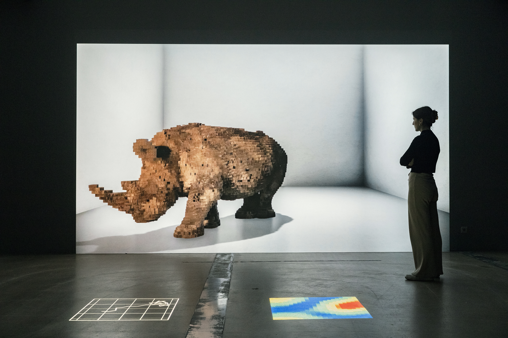

# Alexandra Daisy Ginsberg

**Tag tecnica/formato:** `ai-generativa` `installazione` `data-visualization`
**Tag tema:** `ecologia-ambiente` `intelligenza-artificiale-critica` `colonialismo-decolonialita`

## Biografia
Nata nel 1982, artista, designer e scrittrice britannica. Consegue un MA (Cantab) in Architettura all'Università di Cambridge (2004); è visiting student ad Harvard (2005-2006); consegue un MA in Design Interactions al Royal College of Art di Londra (2009), il dipartimento fondato e diretto da Anthony Dunne e Fiona Raby, programma fondativo dello speculative/critical design contemporaneo; completa un dottorato per pratica (PhD) al Royal College of Art (2017), con una tesi intitolata "Better", che interroga come i sogni di futuri "migliori" plasmino ciò che viene progettato, in relazione a design e biologia sintetica (Dunne ne è co-relatore, secondo alcune fonti). Vive e lavora a Londra. Design Fellow del progetto "Synthetic Aesthetics" (finanziato da NSF ed EPSRC britannico, ospitato da Stanford University e University of Edinburgh, 2010-2013); curatrice del programma "V&A Late: Synthetic Aesthetics" al Victoria & Albert Museum di Londra (2014). Curatrice/autrice principale di *Synthetic Aesthetics: Investigating Synthetic Biology's Designs on Nature* (MIT Press, 2014), con Jane Calvert, Pablo Schyfter, Alistair Elfick e Drew Endy. Riconoscimenti: World Technology Award – Design (2011); London Design Medal for Emerging Talent (2012); menzione speciale, VIDA Art & Artificial Life International Awards (2010, per *Growth Assembly*); Future 50 di *Icon Magazine* (2013); candidature ai Designs of the Year del Design Museum di Londra (2011 e 2015); Dezeen Changemaker Award (2019); Rapoport Award for Women in Art & Tech (2019); Breakthrough of the Year, Science in the Arts, Falling Walls (2020); Grand Prize for Artistic Exploration del premio S+T+ARTS della Commissione Europea (2023, per *Pollinator Pathmaker*). Prima retrospettiva: "Better Nature", Vitra Design Museum Gallery, Weil am Rhein (2019, sei progetti).

## Poetica e ricerca
La pratica di Ginsberg fonde speculative/critical design — l'eredità del Design Interactions del RCA sotto Dunne & Raby — con una collaborazione diretta e continuativa con scienziati praticanti: biologi sintetici, ricercatori di IA (in particolare Google DeepMind), scienziati dell'olfatto, ecologi. Il suo lavoro interroga la perdita di biodiversità, la "de-estinzione", l'idea di "natura artificiale" e l'etica dell'ingegnerizzazione della vita. In diverse interviste dichiara che le biotecnologie, per quanto ingegnose, "non risolveranno i problemi che abbiamo creato", e che la perdita di biodiversità "mi tortura... e alimenta il mio stesso panico morale". Ha anche criticato esplicitamente i limiti dello speculative design come forma — mettendone in discussione la criticità, l'elitarismo e il pubblico ristretto da galleria, pur continuando a usarlo. Paola Antonelli, curatrice senior di Architettura e Design al MoMA, scrive di lei: "la chiarezza, l'eleganza estetica e intellettuale che Ginsberg trasmette nella propria arte uniscono un innegabile talento nel design a una profonda passione per la scienza" — Antonelli l'ha inserita nella selezione "The Select Ten" di MoMA/Metropolis Magazine (2013) e ha organizzato il panel del MoMA "Synthetic Aesthetics: New Frontiers in Contemporary Design" (ottobre 2014). Dal 2019 in poi la sua pratica viene ampiamente descritta (da *Domus*, *DAMN°*, *Studio International*, *Freunde von Freunden*) come uno spostamento dallo "speculative design" propriamente detto verso il "progettare per/con la natura" — usando sistemi viventi e strumenti algoritmici come medium stesso, non solo come espediente narrativo fittizio, culminando in *Pollinator Pathmaker*.

## Opere principali

### E. chromi (2009, con James King e il team iGEM 2009 dell'Università di Cambridge)
**Descrizione:** batteri (E. coli) modificati geneticamente con parti di DNA standardizzate ("BioBrick") per secernere pigmenti visibili; il progetto ipotizzava un sistema diagnostico ("Scatalog") in cui batteri intestinali modificati avrebbero cambiato il colore delle feci per segnalare una malattia. Vince il Grand Prize a iGEM 2009. Esposto in "Talk to Me" al MoMA (2011).
**Lettura critica:** una delle prime opere a rendere visibile e discutibile per il grande pubblico, attraverso un oggetto di design accattivante, un principio tecnico altrimenti astruso della biologia sintetica.

### Growth Assembly (2009, con Sascha Pohflepp)
**Descrizione:** progetto di tesi MA al RCA: sette illustrazioni ad acquerello in stile storia naturale (più una stampa in tipo C) che immaginano piante modificate geneticamente per "far crescere" oggetti/strumenti manufatti invece di produrli industrialmente — una critica alla produzione dipendente da estrazione e trasporto. Menzione speciale ai VIDA Art & Artificial Life Awards 12.0 (2010).
**Lettura critica:** un esempio paradigmatico di speculative design nel senso di Dunne & Raby — un oggetto "impossibile" usato per rendere visibile e discutibile un sistema di produzione alternativo.

### The Substitute (2019)
**Descrizione:** installazione video/sonora immersiva che "resuscita" digitalmente il rinoceronte bianco settentrionale (Ceratotherium simum cottoni), funzionalmente estinto, realizzata dopo la morte nel 2018 di Sudan, l'ultimo maschio della specie. Il movimento/comportamento del rinoceronte è generato con ricerca IA di Google DeepMind (un agente artificiale che impara a navigare il proprio recinto virtuale); la sua immagine e il suo suono sono costruiti da 23 ore di filmati dell'ultima mandria, e la sua forma/suono si spostano da astratti/voxelizzati a realistici man mano che "impara". Pone la domanda del perché gli umani perseguano la de-estinzione/nuove forme di vita trascurando le specie a rischio esistenti. Nella collezione permanente del Cooper Hewitt, Smithsonian Design Museum; mostrata anche come parte di "The Lost Rhino" al Natural History Museum di Londra.
**Lettura critica:** *Smithsonian Magazine* le ha dedicato un ampio approfondimento — l'opera funziona come una critica diretta e insieme dolorosa alla logica della de-estinzione, mostrando quanto sia più facile "resuscitare" digitalmente una specie che proteggerne una ancora vivente.
**Video:** [documentazione dell'opera (YouTube)](https://www.youtube.com/watch?v=Z_J0DtSSSZM)

### Machine Auguries (2019-, serie ricorrente/site-specific)
**Descrizione:** installazione sonora e luminosa di un "coro dell'alba" di canto degli uccelli generato dall'IA, compresso a circa 10 minuti, costruita addestrando una GAN (Generative Adversarial Network) — due reti neurali in chiamata e risposta — su migliaia di registrazioni sul campo di specie di uccelli iconiche per ciascuna città ospitante, in collaborazione con ornitologi e archivisti sonori locali. Interroga come l'inquinamento acustico urbano e la tecnologia stiano omogeneizzando ed erodendo il canto e le popolazioni degli uccelli. Prima versione: Somerset House/A/D/O by MINI, Londra (2019); versioni successive al Toledo Museum of Art (Ohio, 2023) e al Bildmuseet di Umeå, Svezia (2024-25, prima personale svedese).
**Lettura critica:** *Artnet News* le ha dedicato un ampio articolo — l'opera usa la stessa tecnologia (le GAN) che genera in altri contesti volti o immagini false per generare invece un suono che è al tempo stesso artificiale e un lutto per un fenomeno naturale in declino.
**Video:** [documentazione (Vimeo)](https://vimeo.com/445507497)

### Pollinator Pathmaker (dal 2021, in espansione)
**Descrizione:** strumento algoritmico, sviluppato con orticoltori, scienziati dell'impollinazione e Google Arts & Culture, che progetta schemi di piantumazione ottimizzati per le preferenze sensoriali degli impollinatori piuttosto che per l'estetica umana; descritto come ambizione di diventare "la più grande opera d'arte climate-positive al mondo". Uno strumento pubblico gratuito permette a chiunque di generare la propria "edizione" del piano di piantumazione. Prime due installazioni viventi aperte nel 2022: un'aiuola di 55 metri all'Eden Project, Cornovaglia, e undici aiuole (circa 250 metri) nei Kensington Gardens, commissionate dalla Serpentine di Londra. Prima edizione internazionale commissionata da LAS Art Foundation, aperta nel giugno 2023 fuori dal Museum für Naturkunde di Berlino. Vince il Grand Prize for Artistic Exploration del premio S+T+ARTS della Commissione Europea (2023).
**Lettura critica:** l'opera che porta a compimento lo spostamento della pratica dell'artista dallo speculative design fittizio a un intervento reale, vivente e in crescita nel paesaggio — non un'immagine o un oggetto di un giardino possibile, ma un giardino reale progettato algoritmicamente.

### Resurrecting the Sublime (dal 2019, con Sissel Tolaas e Christina Agapakis)
**Descrizione:** collaborazione con la ricercatrice olfattiva Sissel Tolaas e la biologa sintetica Christina Agapakis (Ginkgo Bioworks), con il sostegno di IFF Inc. Usa DNA estratto da esemplari di erbario ottocenteschi (Harvard University Herbaria) di specie di fiori resi estinti dalla distruzione coloniale dell'habitat, per ricostruire computazionalmente le loro molecole odorose, poi ricrea e diffonde questi odori in installazioni immersive a vetrina — inquadrata esplicitamente non come "de-estinzione" ma come un modo per rendere percepibile l'assenza e la perdita ecologica/coloniale. Mostrata alla Biennale di Architettura di Venezia 2021 ("One Planet", con Christina Agapakis e Sissel Tolaas).
**Lettura critica:** *Scientific American* e *Big Think* ne hanno discusso l'originalità nel collegare esplicitamente perdita ecologica e violenza coloniale attraverso il senso meno esplorato dall'arte contemporanea, l'olfatto.

## Immagini

Scaricate dal sito ufficiale: [daisyginsberg.com/work/the-substitute](https://www.daisyginsberg.com/work/the-substitute) e [daisyginsberg.com/work/pollinator-pathmaker](https://www.daisyginsberg.com/work/pollinator-pathmaker).

## Fonti
- [daisyginsberg.com — sito ufficiale](https://www.daisyginsberg.com/)
- [MoMA — pagina artista](https://www.moma.org/artists/39480)
- [MoMA — Talk to Me, E. chromi](https://www.moma.org/interactives/exhibitions/2011/talktome/objects/145508/)
- [Cooper Hewitt, Smithsonian Design Museum — The Substitute, collezione](https://collection.cooperhewitt.org/objects/2318798865/)
- [Serpentine Galleries — Pollinator Pathmaker](https://www.serpentinegalleries.org/whats-on/alexandra-daisy-ginsberg-pollinator-pathmaker/)
- [Ars Electronica — S+T+ARTS Prize, Pollinator Pathmaker](https://ars.electronica.art/starts-prize/en/pollinator-pathmaker/)
- [Smithsonian Magazine — su The Substitute](https://www.smithsonianmag.com/smithsonian-institution/northern-white-rhino-extinct-two-minutes-digital-comback-180974295/)
- [Artnet News — su Machine Auguries](https://news.artnet.com/art-world/alexandra-daisy-ginsberg-machine-auguries-ai-toledo-museum-2300348)
- [Scientific American — su Resurrecting the Sublime](https://www.scientificamerican.com/article/guerilla-artist-daisy-ginsberg-recreates-scent-of-extinct-flowers/)
- [Biennale di Venezia — One Planet, Resurrecting the Sublime](https://www.labiennale.org/en/architecture/2021/one-planet/christina-agapakis-alexandra-daisy-ginsberg-sissel-tolaas)
- [MIT Press — Synthetic Aesthetics (libro, 2014)](https://mitpress.mit.edu/9780262534017/synthetic-aesthetics/)

---

## Appunti da organizzare
- Non citata in un programma specifico dei corsi — inserita dalla lista generale "da scrivere da zero" per la rilevanza nell'ambito della biologia sintetica, dell'IA critica e dell'ecologia speculativa.
- ⚠️ Non confermati: un ruolo accademico attuale specifico (trovata solo un'affiliazione al programma ACT del MIT, nessun titolo di professoressa/tutor confermato in un'istituzione britannica); se il Victoria & Albert Museum possieda un'opera dell'artista in collezione permanente (confermato solo il suo ruolo curatoriale nel 2014); un intervento TED.com specifico (riportato da agenzie di speaker ma non trovata una pagina ufficiale ted.com).
- Video/talk ulteriori: [Barbican Meets: Alexandra Daisy Ginsberg (YouTube)](https://www.youtube.com/watch?v=l7jvXfxEHP0); canale Vimeo dell'artista con documentazione dei progetti: [vimeo.com/daisyginsberg](https://vimeo.com/daisyginsberg).
