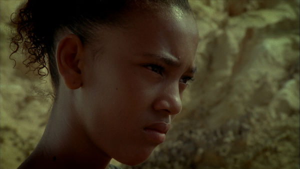
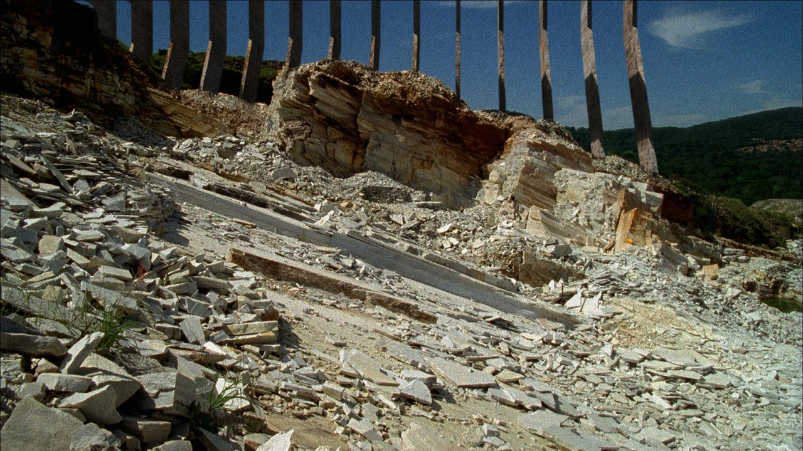
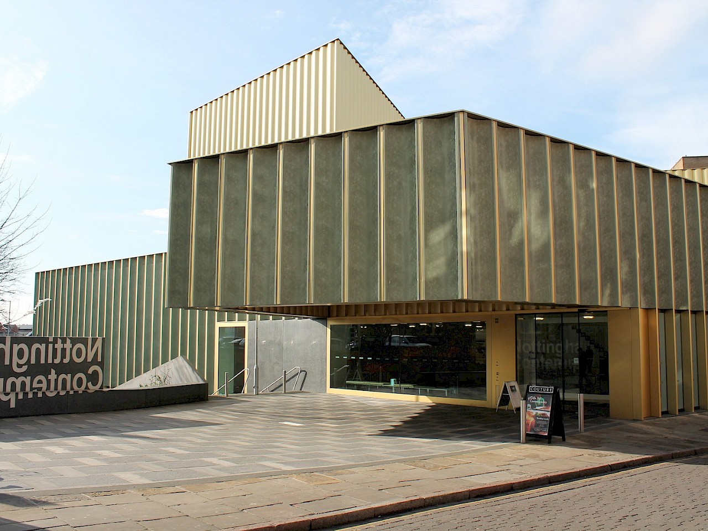
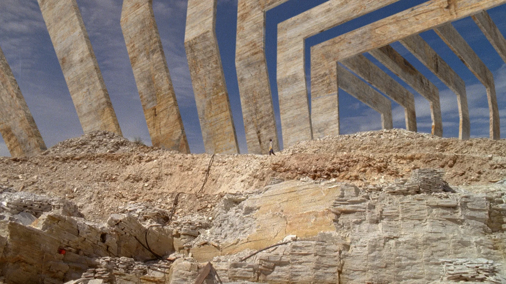

# Ana Vaz

**Tag tecnica/formato:** `video` `installazione`
**Tag tema:** `ecologia-ambiente` `colonialismo-decolonialita`
**Stato:** scheda parziale, scritta a partire da fonti web (Wikipedia, siti di festival e gallerie); alcune fonti traducono *A idade da pedra* come *The Stone Age* · non ancora assegnata a un corso · immagini da verificare (diritti degli autori)

## Biografia
Artista e cineasta brasiliana nata a Brasília nel 1986. Si forma all'RMIT University di Melbourne e a Le Fresnoy - Studio National. Esordisce con il cortometraggio sperimentale *Sacris Pulso* (2008). Le sue opere sono nelle collezioni di Kadist (Parigi), Cnap (Parigi), Pinacoteca di São Paulo e Frac Bretagne; nel 2025 ha una personale alla Secession di Vienna.

## Poetica e ricerca
Il suo metodo è il collage: unisce materiali trovati e girati, mescolando etnografia e speculazione per esplorare gli attriti e le finzioni impressi in ambienti coltivati e selvatici e nei loro molteplici abitanti.

## Opere principali

### É Noite na América (It Is Night in America)
**Descrizione:** Primo lungometraggio, girato intorno allo zoo di Brasília; premiato al FIDOCS e a Entrevues Belfort.

⚠️ Nessuna immagine trovata.

### Apiyemiyekî? (2019/2020)
**Descrizione:** Film di circa 28 minuti, titolo inglese *13 Ways of Looking at a Blackbird*; premio al Punto de Vista. Le fonti divergono sull'anno.

⚠️ Nessuna immagine trovata.

### The Age of Stone (A idade da pedra)
**Descrizione:** Film del 2013 (titolo portoghese *A idade da pedra*) di 29 minuti, coproduzione Francia-Brasile, in portoghese, girato in 16mm e trasferito in HD. Ambientato nel sertão arido dell'altopiano centrale brasiliano, immagina una struttura monumentale e rilegge le origini di Brasília; l'alba iniziale richiama *A Idade da Terra* (1980) di Glauber Rocha. Alcune fonti traducono il titolo come *The Stone Age*.

## Fonti
- [Le Fresnoy — Ana Vaz](https://www.lefresnoy.net/en/ecole/etudiant/445/)
- [Mudam — Ana Vaz](https://www.mudam.com/whats-on/exhibitions/ana-vaz)
- [IFFR — Ana Vaz](https://iffr.com/en/persons/ana-vaz)

## Crediti delle immagini
Immagini da verificare: provengono da pagine di festival, gallerie, siti degli artisti e piattaforme, e restano di proprietà degli autori.
- The Age of Stone (1): [lux.org.uk](https://lux.org.uk/?p=5149) · Immagine promozionale / fotogramma ufficiale, diritti degli autori; uso didattico
- The Age of Stone (2): [www.visionsdureel.ch](https://www.visionsdureel.ch/en/film/2014/the-age-of-stone/) · Immagine promozionale / fotogramma ufficiale, diritti degli autori; uso didattico
- The Age of Stone (3): [nottinghamcontemporary.org](https://nottinghamcontemporary.org/whats-on/ana-vaz-cosmovisions/) · Immagine promozionale / fotogramma ufficiale, diritti degli autori; uso didattico
- The Age of Stone (4): [vimeo.com](https://vimeo.com/71850799) · Immagine promozionale / fotogramma ufficiale, diritti degli autori; uso didattico
