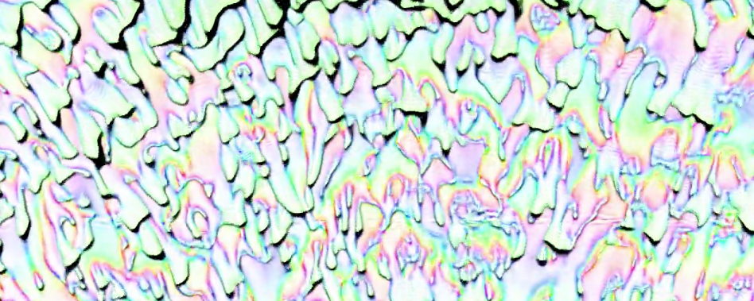
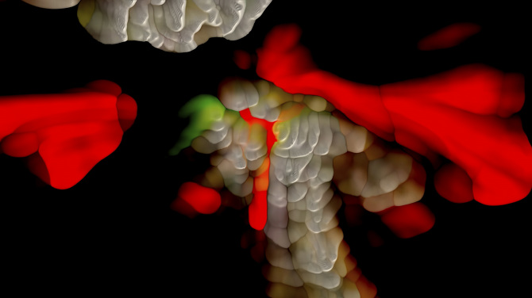
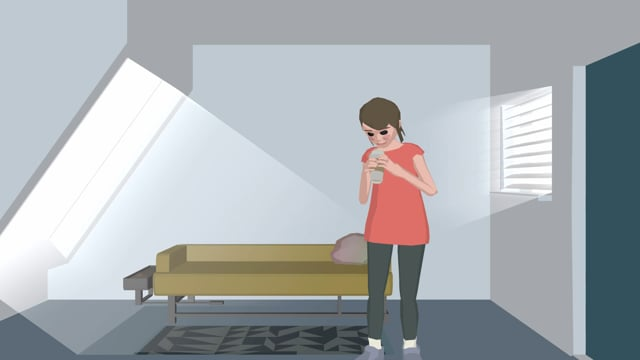

# Andrew Benson

**Tag tecnica/formato:** `video` `live-visual-vjing` `procedurale-generativo`
**Tag tema:** `storia-computer-grafica` `temporalita-non-lineare` `performance-audiovisiva`
**Stato:** attenzione all'omonimia: «Andrew Benson» è un nome molto comune, non confonderlo con altri artisti

## Biografia
Artista statunitense, noto anche con lo pseudonimo/handle **pixlpa**. Consegue un BFA in Pittura al San Francisco Art Institute (SFAI), dove in seguito insegna nel dipartimento Art + Technology. Con base a San Francisco durante gli anni dell'insegnamento allo SFAI, risulta oggi con base a Los Angeles. Ha dato contributi sostanziali al software MaxMSP/Jitter di Cycling '74, in particolare come autore della lunga serie di tutorial pratici **"Jitter Recipes"** — un ampio insieme di esempi pratici su sintesi video, grafica OpenGL, feedback video e tecniche di visual dal vivo, distribuito attraverso il sito e il Package Manager di Cycling '74, e che ha influenzato direttamente le tecniche glitch di altri artisti (una remix glitch di "Kill Your Co-Workers" di Beeple/Flying Lotus cita esplicitamente la "Recipe 37 (Shatter)" come propria ispirazione). Ha anche costruito strumenti basati su browser/WebGL, tra cui uno strumento di pittura con feedback video chiamato "Motion Brush". Ha collaborato su visual dal vivo con Aphex Twin, M.I.A., Clipping e Matmos — la collaborazione meglio documentata è quella tecnica con l'artista visivo Weirdcore per lo show dal vivo di Aphex Twin, costruendo patch/sistemi video Max/MSP che Weirdcore ha usato insieme a visual basati su Kinect per il mapping di volti/folla. Ha diretto "Totally Normal", cortometraggio digitale per la serie *Off the Air* di Adult Swim (episodio "NEWNOW", 2015/16). Vende edizioni digitali limitate su Sedition.

⚠️ Non confermati: alcuni strumenti/app chiamati "Cross Cut" o "Cathode" talvolta attribuiti a questo artista — nessuna fonte trovata a conferma; il suo contributo effettivo e documentato allo sviluppo di strumenti è la serie Jitter Recipes e lo strumento browser "Motion Brush". Nessuna conferma di un ruolo formale come curatore dei Vimeo Staff Picks.

## Poetica e ricerca
La pratica di Benson è descritta costantemente attorno a feedback video, software personalizzato in tempo reale e un approccio "pittorico" al digitale: "Le sue animazioni e i lavori video sperimentali attingono a un approccio pittorico al materiale e al colore che è inconfondibilmente digitale, e incorporano una batteria di processi software personalizzati e dispositivi elettronici" (Le Random). Nella pagina Vimeo dell'opera "To Be RGB For You", accosta il lavoro a una citazione della critica d'arte Rosalind Krauss (1976) sul feedback video, che descrive "la spirale di feedback del video" come produttrice di "una sorta di caduta senza peso nello spazio sospeso del narcisismo" — un riferimento diretto al celebre saggio di Krauss "Video: The Aesthetics of Narcissism" (*October*, vol. 1, primavera 1976), un solido ancoraggio teorico per un'unità didattica sull'estetica del feedback video. Il blog Prosthetic Knowledge, punto di riferimento per la net art e l'arte tecnologica sperimentale, ha presentato più volte le sue demo WebGL glitch/feedback, collocandolo nella scena dell'arte generativa/glitch basata su browser. Vice/Creators Project gli ha dedicato due profili. Il suo lavoro per lo show dal vivo di Aphex Twin viene discusso nel contesto della pratica visiva di Weirdcore da *Dazed* e *It's Nice That*. *Frieze* ha incluso il suo lavoro "Gubble" in un programma video curato per Frieze New York (2019) — un punto di validazione curatoriale/critica istituzionale.

## Opere principali
### Jitter Recipes, serie di tutorial (in corso, per Cycling '74)
**Descrizione:** serie numerata e in corso di esempi/"ricette" per Jitter, che copre sintesi video, grafica OpenGL, feedback video e tecniche di visual dal vivo — pacchettizzata e distribuita attraverso il Package Manager di Cycling '74. Ha influenzato direttamente le tecniche glitch di altri artisti.
**Lettura critica:** il contributo più concreto e citabile dell'artista allo sviluppo di strumenti — lo colloca come costruttore di infrastrutture per la comunità dei visual dal vivo/VJ, non solo come autore di opere video.

**Approfondimento:** [Cycling '74 — "Artist Focus: Andrew Benson"](https://cycling74.com/articles/artist-focus-andrew-benson)

### Deserted (2016)
**Descrizione:** video di 9:51 minuti, meditazione digitale sull'idea del deserto ed evocazione autobiografica della propria infanzia vicino al deserto del Mojave in California — reimmagina la texture arida del clima (feldspato, sabbia, creosoto, cieli profondi) con strati di feedback senza input, pittura digitale, effetti di colore malfunzionanti e distorsione dell'immagine guidata dalla camera. Girato in un unico lungo piano sequenza usando software video personalizzato in tempo reale.
**Lettura critica:** inquadra il feedback video/glitch come medium del paesaggio e della memoria — direttamente utile per un'unità didattica su compressione digitale/feedback/astrazione.
**Video:** [Deserted, film integrale (Vimeo)](https://vimeo.com/179940829)

**Approfondimento:** [Undervolt & Co. — pagina dell'opera](https://undervolt.co/Andrew-Benson)

### Gubble (2019)
**Descrizione:** presentato da Frieze/LIFEWTR a Frieze New York 2019 (programma artisti Series 7). Trae ispirazione da Philip K. Dick, "esplorando una rete di feedback in costante evoluzione e instabile mentre le forme si sviluppano e si distruggono".
**Lettura critica:** validazione istituzionale tramite il programma video curato di Frieze; lega tematicamente i visual generativi/di feedback a motivi fantascientifici/di instabilità.

**Approfondimento:** [Frieze — "Watch: Andrew Benson, Gubble"](https://www.frieze.com/video/watch-andrew-benson-gubble) · [Undervolt & Co. — pagina dell'opera](https://undervolt.co/Andrew-Benson)

### Totally Normal (2015/2016, per Adult Swim)
**Descrizione:** cortometraggio digitale diretto da Benson, "che presenta una visione strana del nostro futuro tecnologico", proiettato nell'episodio "NEWNOW" della serie *Off the Air* di Adult Swim, con musica di Zach Schimpf.
**Lettura critica:** mostra il passaggio dalla pratica sperimentale/da galleria glitch alla televisione via broadcast/animazione per adulti — un esempio utile del percorso professionale reale possibile per artisti di questo ambito.

**Approfondimento:** [Vimeo — Totally Normal](https://vimeo.com/161102117) · [Prosthetic Knowledge — su Totally Normal](https://prostheticknowledge.tumblr.com/post/143857920136/totally-normal-digital-short-by-andrew-benson-made)

## Interviste e talk
- [Dazed — Weirdcore su Aphex Twin/M.I.A., con menzione di Benson](https://www.dazeddigital.com/music/article/37384/1/weirdcore-aphex-twin-mia-visuals-interview)

## Fonti
- [pixlpa.com — sito ufficiale](https://pixlpa.com)
- [Vimeo — profilo ufficiale dell'artista](https://vimeo.com/pixlpa)
- [Le Random — profilo artista](https://www.lerandom.art/artists/andrew-benson)
- [Cycling '74 — "Artist Focus: Andrew Benson"](https://cycling74.com/articles/artist-focus-andrew-benson)
- [Frieze — "Watch: Andrew Benson, Gubble"](https://www.frieze.com/video/watch-andrew-benson-gubble)
- [Vice/Creators — "Psychedelic Visuals From Andrew Benson (aka Pixlpa)"](https://www.vice.com/en/article/psychedelic-visuals-from-andrew-benson-aka-pixlpa/)
- [Undervolt & Co — approfondimento su Deserted](https://undervolt.co/Andrew-Benson)
- [Prosthetic Knowledge — su Totally Normal](https://prostheticknowledge.tumblr.com/post/143857920136/totally-normal-digital-short-by-andrew-benson-made)
- [CDM/Create Digital Music — remix ispirata alle Jitter Recipes](https://cdm.link/learning-maxmsp-and-jitter-and-remixing-beeple-50-recipes-results/)

## Crediti delle immagini
Immagine per ciascuna delle quattro opere, inclusa sotto la relativa descrizione in "Opere principali". Fotogrammi Vimeo via servizio di thumbnail pubblico per Deserted e Totally Normal (video privi di immagine statica scaricabile dalla pagina); immagini dirette per Jitter Recipes (Cycling '74) e Gubble (Undervolt & Co.).
