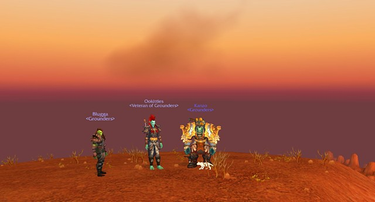
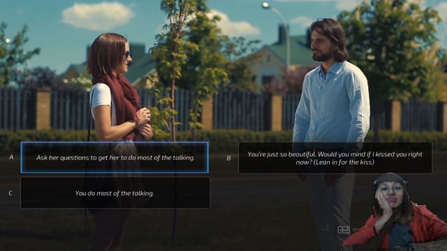

# Angela Washko

**Tag tecnica/formato:** `videogioco-simulazione` `performance-dal-vivo`
**Tag tema:** `genere-queerness` `game-culture` `performance-audiovisiva` `performance-nei-mondi-virtuali`
**Tag corso:** `TAD-DCV` `TAD-AVM`

## Biografia
Artista che realizza interventi femministi dentro spazi di gioco online multiplayer.

## Poetica e ricerca
Washko usa la performance e il dialogo diretto con i giocatori per far emergere le dinamiche di genere delle community videoludiche — spazi che descrive come geograficamente, politicamente, economicamente e socialmente più diversificati di molti spazi pubblici fisici, ma spesso ostili e misogini verso le donne. Il suo lavoro rende visibile, attraverso l'intervento performativo dal vivo, come queste community trattino il tema del femminismo e del genere.

## Opere principali
### Playing a Girl / The Council on Gender Sensitivity and Behavioral Awareness in World of Warcraft (dal 2012)
**Corso:** `TAD-AVM` `TAD-DCV`
**Temi:** `performance-nei-mondi-virtuali`
**Descrizione:** intervento performativo dentro *World of Warcraft*: Washko fonda un "consiglio" fittizio e facilita discussioni sul genere e sul femminismo con i giocatori direttamente nel gioco, incluse conversazioni su avatar di genere diverso dal proprio e su vittim-blaming.
**Lettura critica:** usa lo spazio ludico come laboratorio sociale per un sondaggio dal vivo sull'opinione pubblica americana riguardo al ruolo delle donne.

**Approfondimento:** [angelawashko.com — The Council on Gender Sensitivity and Behavioral Awareness in World of Warcraft](https://angelawashko.com/section/383766-The%20Council%20on%20Gender%20Sensitivity%20and%20Behavioral%20Awareness%20in%20World%20of%20Warcraft.html)

### Weaponizing Courtship (2020, Fotomuseum Winterthur, mostra *SITUATIONS/Strike*)
**Corso:** `TAD-DCV` `TAD-AVM`
**Temi:** `guerra-e-militare` `desiderio-e-intimita`
**Descrizione:** performance-per-video commissionata che indaga l'integrazione della tecnologia militare nei videogiochi e nella cultura della seduzione online; include *The Game: The Game*, dating simulator femminista critico verso i pick-up artist, e un playthrough critico di *Super Seducer*.
**Lettura critica:** traccia una storia di come la visione e la tecnologia militari siano state incorporate nei giochi per computer, e di come queste stesse convenzioni tornino nelle pratiche di seduzione maschile online.

**Approfondimento:** [angelawashko.com — Weaponizing Courtship](https://angelawashko.com/artwork/4801953-Weaponizing%20Courtship.html) · [Fotomuseum Winterthur — SITUATIONS/Strike](https://www.fotomuseum.ch/en/explore/situations/157382)

## Interviste e talk
- _Nessuna ancora: da aggiungere._

## Fonti
- [angelawashko.com](https://angelawashko.com)
- [Weaponizing Courtship — Fotomuseum Winterthur](https://www.fotomuseum.ch/en/explore/situations/157382)
- [Cutscenes: Critical Optimism — Angela Washko's Online Interventions (MUBI Notebook)](https://mubi.com/it/notebook/posts/cutscenes-critical-optimism-angela-washko-s-online-interventions)

## Crediti delle immagini
Immagine e link di approfondimento per ciascuna delle due opere, inclusi sotto la relativa descrizione in "Opere principali", scaricate dal sito ufficiale [angelawashko.com](https://angelawashko.com) (fotogramma Vimeo via servizio di thumbnail pubblico per Weaponizing Courtship).
