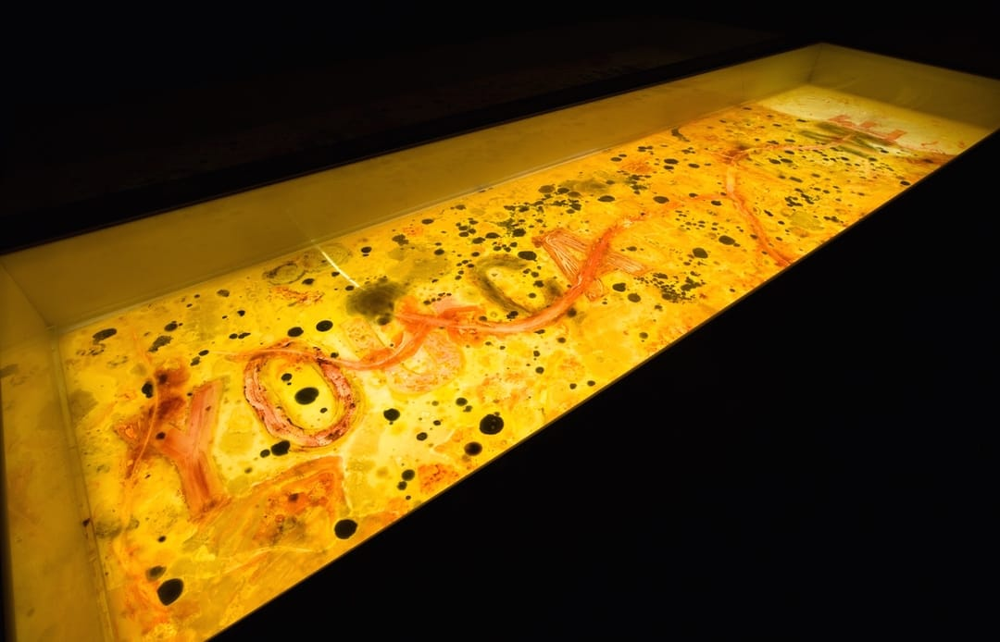
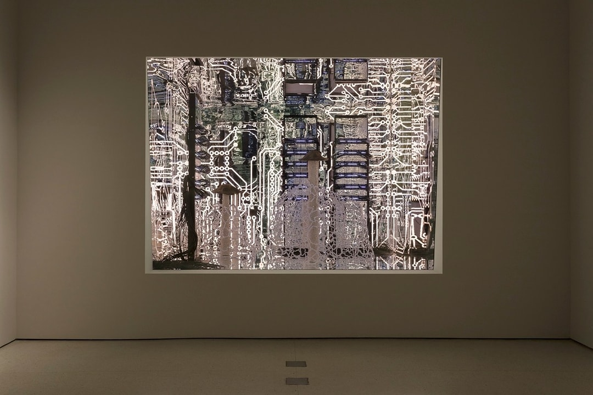
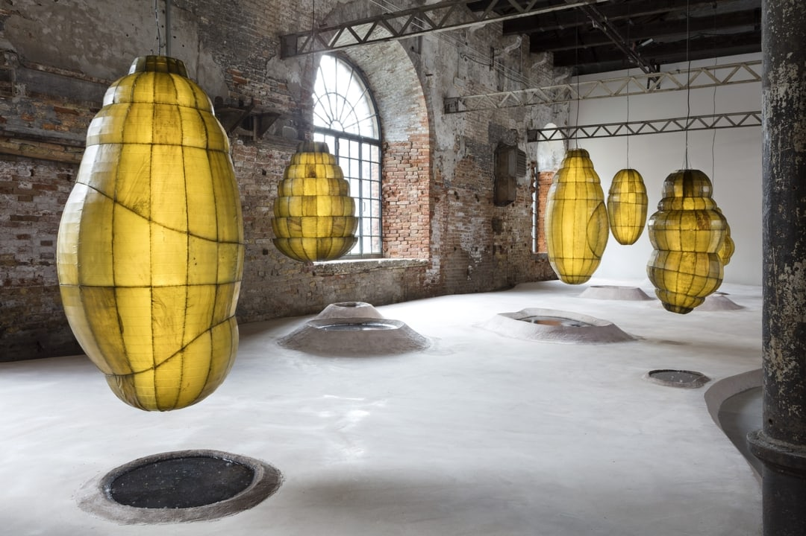
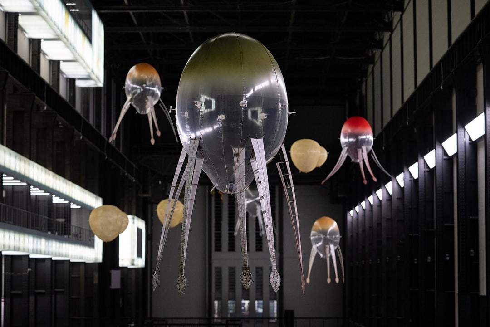
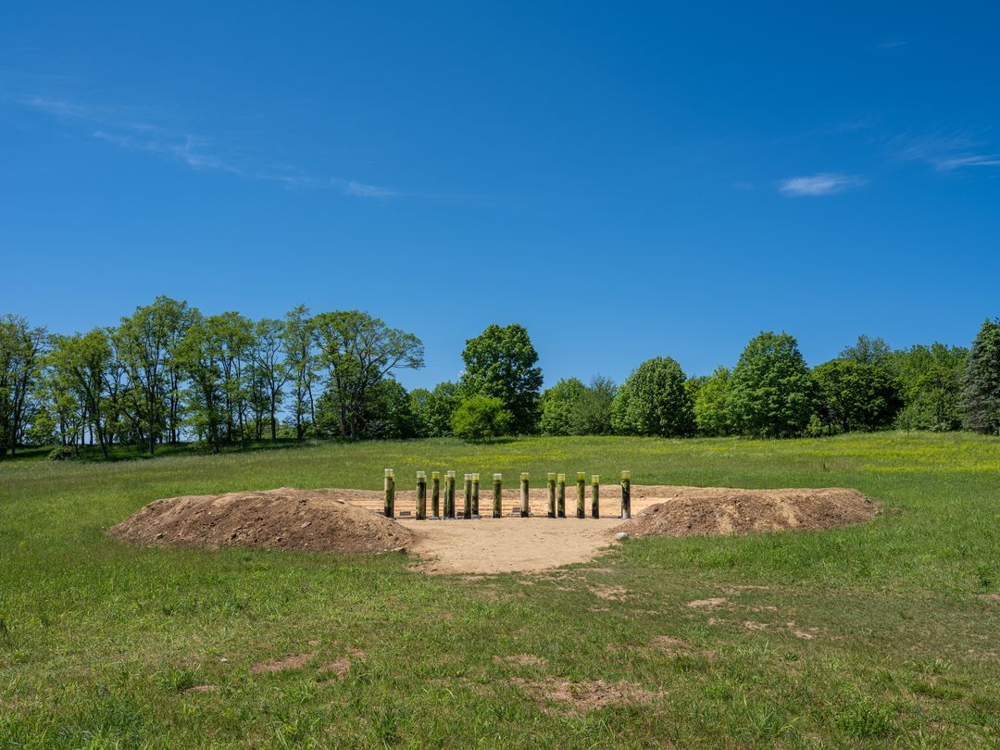

# Anicka Yi

**Tag tecnica/formato:** `installazione` `intelligenza-artificiale-generativa`
**Tag tema:** `ecologia-ambiente` `genere-queerness` `colonialismo-decolonialita`

## Biografia
Nata nel 1971 a Seoul, Corea del Sud. La famiglia emigra quando ha circa due anni, vivendo prima in Alabama, poi in Florida, poi nella California meridionale; la madre lavora in un'azienda biomedica, il padre, ingegnere, diventa pastore protestante. Frequenta l'Hunter College di New York e la University of California, Los Angeles, senza però una formazione artistica accademica formale — inizia a fare arte solo attorno ai trent'anni, dopo aver lavorato a Londra come stylist di moda e copywriter pubblicitaria; il primo lavoro artistico documentato risale al 2008, con il collettivo "Circular File". Vive e lavora a New York, con studio a Brooklyn. Riconoscimenti: Louis Comfort Tiffany Foundation Award (2011); Hugo Boss Prize 2016 (Guggenheim, 100.000 dollari), la cui giuria elogia il suo "peculiare abbraccio del disagio nei suoi esperimenti con tecnologia, scienza e i mondi vegetale e animale". Nel 2021-22 realizza la Hyundai Commission per la Turbine Hall della Tate Modern, il suo progetto più ambizioso fino a quel momento. Rappresentata da Gladstone Gallery, 47 Canal ed Esther Schipper; dal marzo 2026 entra anche nella scuderia di Pace Gallery (prima personale da Pace prevista nel 2027).

⚠️ Non verificato: un'eventuale formazione specifica in filosofia — le fonti confermano solo la frequentazione di Hunter College e UCLA, senza formazione artistica accademica, ma nessuna fonte diretta conferma un indirizzo di studio in filosofia.

## Poetica e ricerca
Yi descrive la propria pratica attraverso il concetto di una "biopolitica dei sensi" — come la percezione sensoriale, in particolare l'olfatto, sia culturalmente e politicamente condizionata, non neutra. Collabora sistematicamente con scienziati e ingegneri: il biologo sintetico Tal Danino (opere batteriche, dal 2015), biologi molecolari e chimici forensi della Columbia University (per *Immigrant Caucus*, 2017), ingegneri robotici e biologi per gli "aerobi" della Tate. Distingue quella che chiama "Artificial General Intelligence" da una propria "Artificial Physical Intelligence" — macchine intese come "specie" incarnate ed evolutive dentro un ecosistema, non software disincarnato: una distinzione centrale nel progetto per la Turbine Hall. In un'intervista recente (2026) dichiara: "Rifiuto l'intero modello di IA a rinforzo (reinforcement learning) oggi popolare... Dobbiamo pensare alla fisica dell'IA" (citazione da verificare sulla fonte diretta prima di riportarla testualmente). Descrive il proprio studio come un "ecosistema" di collaboratori umani e non umani: "Il mio studio funziona più come un ecosistema che come un laboratorio, e io sono un nodo al suo interno, insieme a scienziati, macchine, microbi e materiali." Il catalogo *Metaspore* (Pirelli HangarBicocca, 2022) include saggi dello storico dell'arte Giovanni Aloi e della professoressa Rachel Lee, oltre a una conversazione tra Yi e il micologo Merlin Sheldrake. *Artforum* ha recensito la commissione alla Tate paragonandola a "The Weather Project" di Olafur Eliasson.

## Opere principali

### You Can Call Me F (2015, The Kitchen, New York)
**Descrizione:** installazione multisensoriale su contagio, femminismo e reti femminili. In collaborazione con il biologo sintetico Tal Danino, fa crescere un "batterio collettivo" coltivato da campioni di saliva/tampone prelevati da circa cento donne della propria cerchia (amiche, donne del mondo dell'arte), producendo odore e crescita di muffa per tutta la durata della mostra. Opera centrale: *Grabbing At Newer Vegetables*, un testo ("YOU CAN CALL ME F") dipinto in agar/campioni biologici che viene progressivamente oscurato dalla crescita batterica.
**Lettura critica:** letta criticamente come un accostamento tra la paura del contagio/igiene e la paura patriarcale delle reti di solidarietà femminile — il corpo collettivo delle partecipanti diventa letteralmente il materiale dell'opera.

**Approfondimento:** [anickayistudio.biz/exhibitions/you-can-call-me-f](https://www.anickayistudio.biz/exhibitions/you-can-call-me-f)

### The Hugo Boss Prize 2016: Anicka Yi, Life Is Cheap (2017, Solomon R. Guggenheim Museum, New York)
**Descrizione:** mostra personale assegnata come parte dell'Hugo Boss Prize, curata da Katherine Brinson e Susan Thompson. Fonde biotecnologia e arte concettuale con batteri viventi, aromi sintetici e robotica di ispirazione entomologica, realizzata con biologi molecolari e chimici forensi. Opere chiave: *Immigrant Caucus* (2017) — tre contenitori in stile disinfestazione che spruzzano un profumo derivato chimicamente (con scienziati della Columbia University) dal sudore di donne asiatico-americane e da emissioni di formiche carpentiere, affrontando gli stereotipi razzializzati e di genere attraverso l'olfatto; *Force Majeure* (2017) — una stanza rivestita di piastrelle di agar innestate con batteri raccolti nella Koreatown e nella Chinatown di New York, che continuano a crescere e scolorire durante l'esposizione.
**Lettura critica:** la *Village Voice* recensisce la mostra sottolineando come insegni al pubblico "a vedere con il naso" — un rovesciamento diretto della gerarchia sensoriale che privilegia la vista nell'esperienza museale tradizionale.

**Approfondimento:** [anickayistudio.biz/exhibitions/life-is-cheap](https://www.anickayistudio.biz/exhibitions/life-is-cheap) · [Guggenheim Museum](https://www.guggenheim.org/exhibition/the-hugo-boss-prize-2016)

### Biologizing the Machine (tentacular trouble) (2019, 58ª Biennale di Venezia, "May You Live in Interesting Times")
**Descrizione:** installazione di "sculture proteiformi": falene animatroniche dentro forme luminose simili a crisalidi, costruite con alghe stirate, oltre ad acrilico, LED, acqua e pompe; esplora il biofilm — l'accumulo di melma che i canali di Venezia devono continuamente contrastare — come modello di "co-adattamento" tra umano e macchina. Una versione ampliata, *Biologizing the Machine (spillover zoonotica)* (2022) — sette vetrine con colonne di Winogradsky (ecosistemi batterici/algali) — viene commissionata per *Metaspore*, Pirelli HangarBicocca, Milano (2022), la sua prima mostra italiana.
**Lettura critica:** applica per la prima volta esplicitamente la "biopolitica dei sensi" alle macchine, non solo ai corpi umani — un passaggio concettuale importante verso il lavoro successivo alla Tate.

**Approfondimento:** [anickayistudio.biz/exhibitions/may-you-live-in-interesting-times](https://www.anickayistudio.biz/exhibitions/may-you-live-in-interesting-times)

### In Love With The World (Hyundai Commission) (2021-22, Turbine Hall, Tate Modern, Londra)
**Descrizione:** il progetto più ambizioso della carriera dell'artista fino a quel momento: "aerobi" robotici morbidi gonfiati a elio — sculture volanti autonome in due "fenotipi" modellati sulla vita oceanica e sul ciclo vitale dei funghi (uno ispirato al ciclo vitale della medusa Aurelia), progettati con specialisti di droni in modo che ogni aerobio segua percorsi di volo generati dall'IA e risponda al calore corporeo dei visitatori. Accompagnata da "paesaggi olfattivi" mutevoli diffusi nella sala, evocativi di ere geologiche/evolutive profonde (l'atmosfera terrestre di epoche precedenti). Curata da Achim Borchardt-Hume, Mark Godfrey e Carly Whitefield.
**Lettura critica:** *Artforum* la accosta a "The Weather Project" di Olafur Eliasson come esempio di intervento ambientale totale nella Turbine Hall — ma qui l'ambiente non è atmosferico/luminoso bensì biologico e olfattivo, un ecosistema artificiale a tutti gli effetti.

**Approfondimento:** [anickayistudio.biz/exhibitions/in-love-with-the-world](https://www.anickayistudio.biz/exhibitions/in-love-with-the-world) · [Tate Modern — comunicato stampa](https://www.tate.org.uk/press/press-releases/hyundai-commission-anicka-yi-love-world)

### Message from the Mud (2026, Storm King Art Center, New York)
**Descrizione:** prima grande commissione all'aperto dell'artista: un'estetica da "scavo archeologico" — terra grezza ammassata attorno a una piscina centrale, con venti colonne di Winogradsky (dal nome dello scienziato del suolo Sergei Winogradsky) che emergono dall'acqua, riempite di materia organica che fa crescere colonie stratificate di alghe/cianobatteri/microbi dai colori vividi, usando campioni di acqua e terra prelevati dagli stessi South Ponds di Storm King.
**Lettura critica:** un "ritratto microbiologico" del paesaggio specifico del sito — la scala del lavoro si sposta dalla galleria chiusa all'intero paesaggio del parco di sculture, mantenendo però lo stesso metodo di coltivazione biologica in tempo reale.

**Approfondimento:** [anickayistudio.biz/exhibitions/message-from-the-mud](https://www.anickayistudio.biz/exhibitions/message-from-the-mud)

## Immagini

Immagine e link di approfondimento per ciascuna delle cinque opere, inclusi sotto la relativa descrizione in "Opere principali", scaricate dal sito ufficiale [anickayistudio.biz](https://www.anickayistudio.biz/).

## Fonti
- [anickayistudio.biz — sito ufficiale](https://www.anickayistudio.biz/)
- [Tate Modern — Hyundai Commission, comunicato stampa](https://www.tate.org.uk/press/press-releases/hyundai-commission-anicka-yi-love-world)
- [Guggenheim Museum — The Hugo Boss Prize 2016](https://www.guggenheim.org/exhibition/the-hugo-boss-prize-2016)
- [Pirelli HangarBicocca — guida alla mostra Metaspore](https://pirellihangarbicocca.org/en/bubble/exhibition-guide-anicka-yi/)
- [Storm King Art Center — comunicato stampa (PDF)](https://stormking.org/wp-content/uploads/2026/03/SKAC_PR_2026-Exhibition-and-Program-Details.pdf)
- [Gladstone Gallery — pagina artista](https://gladstonegallery.com/artist/anicka-yi/)
- [Artforum — recensione della Hyundai Commission](https://www.artforum.com/print/reviews/202301/anicka-yi-89900)
- [Village Voice — recensione della mostra al Guggenheim](https://www.villagevoice.com/anicka-yi-teaches-viewers-to-see-with-their-noses-at-the-guggenheim/)
- [Ca' Foscari University Venezia — capitolo accademico open-access sulla biopolitica in Anicka Yi](https://edizionicafoscari.unive.it/media/pdf/books/978-88-6969-757-9/978-88-6969-757-9-ch-08.pdf)
- [ArtNews — "5 Works to Know"](https://www.artnews.com/list/art-news/artists/anicka-yi-most-famous-works-1234606704/)

---

## Appunti da organizzare
- Non citata in un programma specifico dei corsi — inserita dalla lista generale "da scrivere da zero" per la rilevanza nell'ambito della biotecnologia e dell'ecologia speculativa nell'arte contemporanea.
- ⚠️ Da verificare direttamente prima di citarla testualmente in classe: la citazione 2026 sull'IA a rinforzo, riportata solo tramite fonte secondaria.
- Opera aggiuntiva da approfondire: *The Flavor Genome* (2016, video 3D di 22 minuti girato in Amazzonia, proiettato al Whitney Biennial 2017).
- Mostra recente più estesa in Asia: "There Exists Another Evolution, But In This One" (Leeum Museum of Art, Seoul, 2024; UCCA Center for Contemporary Art, Pechino, 2025).
- Video ulteriori da vedere in aula: [Tate, "In Love With The World – Anicka Yi at the Tate Modern" (YouTube)](https://www.youtube.com/watch?v=ggIGIflcknQ); [Art21/PBS, "Anicka Yi in 'Bodies of Knowledge'" (studio visit)](https://art21.org/watch/art-in-the-twenty-first-century/s11/anicka-yi-in-bodies-of-knowledge/).
