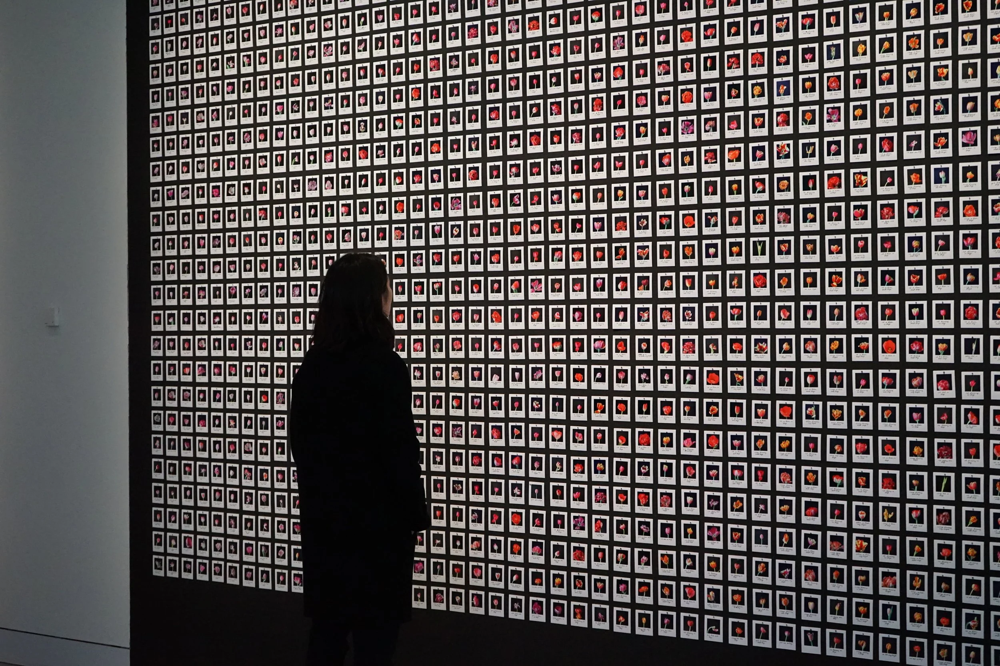
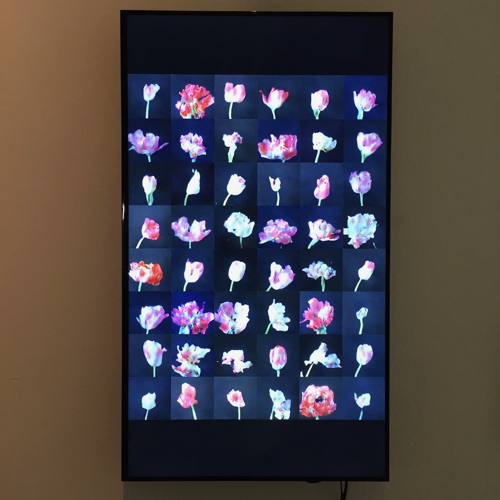
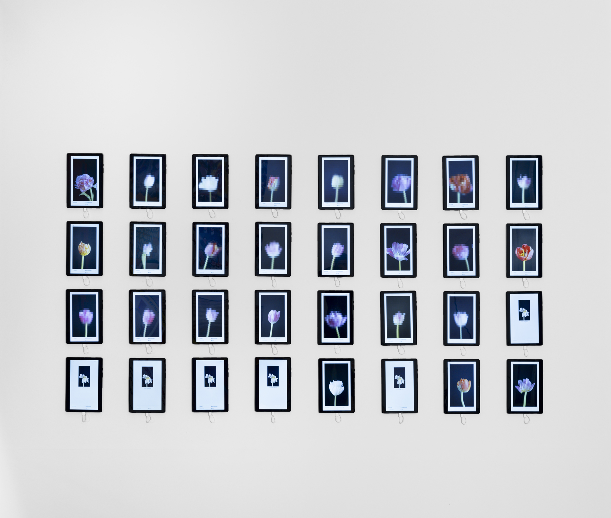
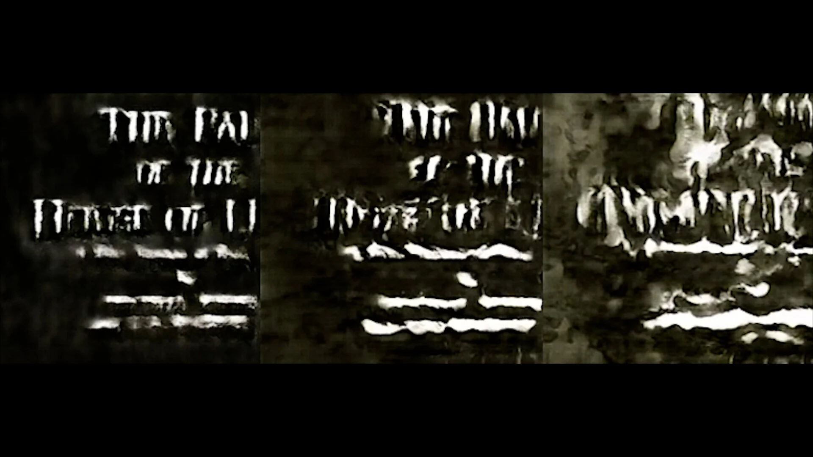
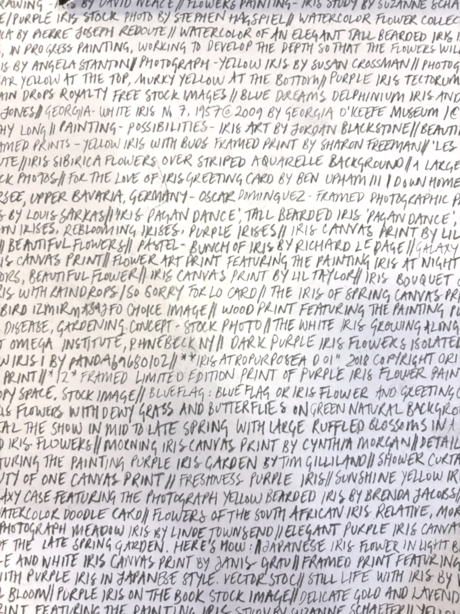
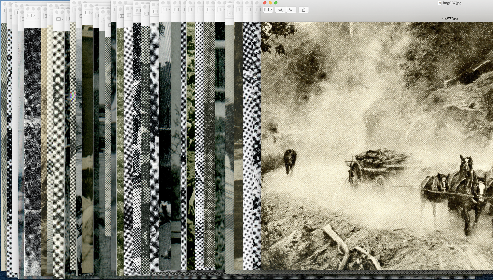

# Anna Ridler

**Tag tecnica/formato:** `ai-generativa` `data-visualization` `fotografia`
**Tag tema:** `capitalismo-lavoro` `intelligenza-artificiale-critica` `genere-queerness`

## Biografia
Nata nel 1985 a Londra, cresciuta in parte tra Atlanta (Georgia, Stati Uniti) e il Regno Unito. Consegue un BA in Letteratura e Lingua Inglese a Oxford (2007) e un MA in Information Experience Design al Royal College of Art (2017). Visiting scholar all'Università di Leeds (2018), poi fellowship al Creative Computing Institute della University of the Arts London (UAL). Vive e lavora a Londra. Vince il DARE Art Prize 2018-19 (Opera North/University of Leeds Cultural Institute), commissione di 15.000 sterline su memoria e neuroscienze ("Learning the Brain"). Riceve una menzione d'onore al Prix Ars Electronica 2019 (categoria AI & Life Art). Nel 2020 è artista in residenza (con Caroline Sinders) tra Edimburgo e il laboratorio Ars Electronica di Linz. È fellow del programma EU EMAP (European Media Art Platform) e ha svolto residenze S+T+ARTS (progetto "Water Capitalism") e alla Delfina Foundation. Opere nelle collezioni di Whitney Museum, Victoria & Albert Museum, M+ Hong Kong e ZKM Karlsruhe (da verificare singolarmente sui database di ciascun museo). Rappresentata dalla Galerie Nagel Draxler; mostrata e venduta anche tramite Kate Vass Galerie (Zurigo) e Avant Arte.

## Poetica e ricerca
Ridler inizia a usare il machine learning come materiale artistico nel 2017, scegliendo deliberatamente di costruire a mano i propri insiemi di dati di addestramento (fotografando, disegnando, etichettando) invece di usare dataset esistenti già raccolti — "in un momento in cui era ancora possibile addestrare [un modello] su un dataset interamente creato a mano". Questa scelta viene inquadrata sistematicamente come una posizione critica sul lavoro invisibile e sulle scelte ideologiche incorporate nei dati di addestramento dell'IA: attraverso anni di etichettatura manuale di decine di migliaia di immagini (tulipani, iris, fotografie di canali, voci di enciclopedia), Ridler mette in primo piano l'abilità, il tempo e la soggettività che entrano nella costruzione di un dataset — lavoro solitamente nascosto dall'inquadramento algoritmico/statistico. In diverse interviste collega il lavoro invisibile della costruzione di dataset alla storia, a metà Novecento, di "computer" come titolo professionale ricoperto prevalentemente da donne che svolgevano calcoli amministrativi/impiegatizi — collocando la propria pratica di etichettatura manuale dentro una storia più lunga di lavoro computazionale femminilizzato e non riconosciuto. L'opera più recente *Every Single Iris on the Internet* (2023) intreccia questa critica con la storia nascosta del dataset "Iris", il canonico dataset "hello world" del machine learning, pubblicato per la prima volta nel 1936 dallo statistico ed eugenista Ronald Fisher sulla rivista *Annals of Eugenics* — un'origine spesso rimossa dal modo in cui il dataset viene insegnato oggi. Nelle opere sui tulipani, la "tulip mania" olandese del 1637 — comunemente citata come la prima bolla finanziaria speculativa documentata della storia — viene usata come lente per leggere la speculazione tecnologica e finanziaria contemporanea, prima Bitcoin, poi NFT/mercati dell'arte su blockchain: il "virus del mosaico" (il vero patogeno vegetale che causava le striature pregiate dei "tulipani spezzati", la cui causa biologica era allora sconosciuta) diventa metafora della generazione di valore imprevedibile e incontrollabile, in parallelo sia con l'immagine generata dall'IA sia con la volatilità del prezzo delle criptovalute.

## Opere principali

### Myriad (Tulips) (2018)
**Descrizione:** installazione di 10.000 fotografie/stampe Polaroid di singoli tulipani, scattate a mano nell'arco di circa tre mesi (una stagione di fioritura) a Utrecht, Paesi Bassi; su ogni stampa Ridler scrive a mano i metadati (colore, condizione/pattern delle striature) — funziona sia come opera d'arte (un "patchwork vibrante" installativo) sia come letterale dataset di addestramento per il machine learning, usato in seguito per *Mosaic Virus*.
**Lettura critica:** mette in primo piano il lavoro di costruzione del dataset normalmente invisibile nei sistemi IA — *Bloomberg* ha dedicato all'opera un articolo dal titolo "A British Artist Gathered 10,000 Tulips to Show AI Is Beautiful". Candidata ai Beazley Designs of the Year 2019 (Design Museum, Londra).

**Approfondimento:** [annaridler.com/works/myriad-tulips](https://annaridler.com/works/myriad-tulips)

### Mosaic Virus (2018, versione aggiornata 2019)
**Descrizione:** installazione video (formato variabile secondo le fonti: schermo singolo o a più canali) di tulipani generati da IA (GAN) il cui colore, striatura e "fioritura" sono controllati in tempo reale dal prezzo in tempo reale del Bitcoin — quando il prezzo sale, i tulipani diventano più fortemente striati, in eco al fatto che i tulipani striati ("spezzati") erano la varietà più pregiata e costosa durante la tulip mania olandese degli anni 1630. Addestrata sul dataset di *Myriad (Tulips)* tramite una GAN.
**Lettura critica:** discussa da *Hyperallergic* ("Using AI to Produce 'Impossible' Tulips") e da *Fast Company* ("17th-century Tulip Mania is alive and well—on the blockchain") come un accostamento diretto e insieme critico tra due forme di volatilità del valore — quella storica del mercato dei bulbi e quella contemporanea delle criptovalute.
**Video:** [intervista sull'opera alla mostra Network Effects, Oodi Helsinki (Vimeo)](https://vimeo.com/399861718)

**Approfondimento:** [annaridler.com/works/mosaic-2018](https://annaridler.com/works/mosaic-2018)

### Bloemenveiling (2019, con David Pfau)
**Descrizione:** asta online di brevi video di tulipani generati da IA, realizzata in collaborazione con il ricercatore IA David Pfau, tramite smart contract su Ethereum. Ogni giorno viene messo all'asta un nuovo video di tulipano IA; le offerte (incluse quelle di bot progettati dagli stessi artisti per stimolare la domanda speculativa) avvengono on-chain, e lo smart contract avvia un conto alla rovescia per cui il video acquistato "appassisce" e scade dopo circa una settimana, imitando un vero fiore reciso — una critica alla scarsità artificiale e alle aste speculative, che cita le storiche osterie d'asta dei fiori olandesi dell'epoca della tulip mania.
**Lettura critica:** terza opera della serie sui tulipani/speculazione dopo *Myriad (Tulips)* e *Mosaic Virus* — discussa da *ARTnews* nel contesto più ampio delle "GAN e NFT" come strumenti degli artisti nello spazio cripto.

**Approfondimento:** [annaridler.com/works/bloemen](https://annaridler.com/works/bloemen)

### Fall of the House of Usher I e II (2017)
**Descrizione:** film animato di 12 minuti che rielabora l'adattamento cinematografico muto e sperimentale del 1929 di James Sibley Watson e Melville Webber del racconto di Poe (1839). Ridler realizza circa 200 disegni a inchiostro fatti a mano a partire da fotogrammi del film del 1929, li usa per addestrare una GAN pix2pix, e genera l'animazione fotogramma per fotogramma dall'output della rete — con momenti visibili di "collasso" verso la fine dell'opera, in cui la generazione della rete neurale si destabilizza, un'eco formale dei temi di decadimento e crollo del racconto e delle ansie contemporanee sull'IA stessa. *Fall of the House of Usher II* espone separatamente i 200 disegni a inchiostro originali come opera-dataset.
**Lettura critica:** una delle prime opere dell'artista a rendere esplicito, nella forma stessa dell'immagine, il momento in cui il sistema addestrato smette di "funzionare" correttamente — trasformando un difetto tecnico in climax narrativo.

**Approfondimento:** [annaridler.com/works/fall-1](https://annaridler.com/works/fall-1)

### Every Single Iris on the Internet (the first 100,000 images) (2023)
**Descrizione:** video che scorre attraverso 100.000 immagini etichettate "iris" estratte da LAION-5B (un dataset pubblico su larga scala comunemente usato per addestrare modelli di IA generativa), fermandosi quando incontra un link rotto ("iris fantasma"). Gioca sul doppio significato di "iris" (fiore/parte dell'occhio) e fa riferimento al canonico dataset Iris flower, creato dallo statistico Ronald Fisher e pubblicato per la prima volta sulla rivista *Annals of Eugenics* (1936).
**Lettura critica:** interroga le storie nascoste e i punti ciechi dei dataset fondativi del machine learning, e rivendica un modo di guardare le immagini lento, umano e attento, contro uno puramente statistico — Ridler ha dichiarato che l'obiettivo è guardare ogni immagine "con un occhio umano invece che come un semplice pattern compreso attraverso la significatività statistica".

**Approfondimento:** [annaridler.com/works/every_single_iris](https://annaridler.com/works/every_single_iris)

⚠️ Il sito ufficiale data quest'opera 2025, non 2023 come riportato sopra — discrepanza da verificare.

### Laws of Ordered Form (2020)
**Descrizione:** opera in più parti che usa immagini e testi tratti da enciclopedie vittoriane ed edoardiane per mostrare come le tassonomie e i sistemi di classificazione storici continuino a plasmare i dataset di immagini del machine learning contemporaneo. Commissionata come parte del programma digitale annuale "Data / Set / Match" della Photographers' Gallery di Londra sull'importanza dei dataset di immagini (Londra, 3 febbraio-30 luglio 2020); inclusa in seguito nella mostra "BIAS" alla Science Gallery Dublin.
**Lettura critica:** estende la critica dell'artista dai dataset costruiti da lei stessa ai dataset storici già esistenti (le enciclopedie), dimostrando come la classificazione non sia mai un atto neutro, in nessuna epoca.

**Approfondimento:** [annaridler.com/works/laws](https://annaridler.com/works/laws)

## Immagini

Immagine e link di approfondimento per ciascuna delle sei opere, inclusi sotto la relativa descrizione in "Opere principali", scaricate dal sito ufficiale [annaridler.com](https://annaridler.com).
- [annaridler.com — sito ufficiale, CV](https://annaridler.com/about/cv)
- [Bloomberg — "A British Artist Gathered 10,000 Tulips to Show AI Is Beautiful"](https://www.bloomberg.com/news/articles/2019-08-13/a-british-artist-gathered-10-000-tulips-to-show-ai-is-beautiful)
- [Victoria & Albert Museum — Myriad (Tulips), collezione](https://collections.vam.ac.uk/item/O1737545)

## Fonti
- [annaridler.com — sito ufficiale, CV](https://annaridler.com/about/cv)
- [Bloomberg — "A British Artist Gathered 10,000 Tulips to Show AI Is Beautiful"](https://www.bloomberg.com/news/articles/2019-08-13/a-british-artist-gathered-10-000-tulips-to-show-ai-is-beautiful)
- [Victoria & Albert Museum — Myriad (Tulips), collezione](https://collections.vam.ac.uk/item/O1737545)
- [Hyperallergic — "Using AI to Produce 'Impossible' Tulips"](https://hyperallergic.com/anna-ridler-tulipmania/)
- [Fast Company — su Mosaic Virus e la blockchain](https://www.fastcompany.com/90368357/17th-century-tulip-mania-is-alive-and-well-on-the-blockchain)
- [ARTnews — "GANs and NFTs: AI Artists in the Crypto Space"](https://www.artnews.com/list/art-in-america/features/gans-and-nfts-1234594335/anna-ridler-bloemenveiling/)
- [The Photographers' Gallery — Laws of Ordered Form](https://thephotographersgallery.org.uk/whats-on/anna-ridler-laws-ordered-form)
- [Science Gallery Dublin — mostra BIAS](https://dublin.sciencegallery.com/bias-exhibits/laws-of-ordered-form)
- [Open Data Institute — Data as Culture, profilo artista](https://culture.theodi.org/anna-ridler/)
- [Google Arts & Culture/Barbican — "Anna Ridler: can datasets create art?"](https://artsandculture.google.com/story/anna-ridler-can-datasets-create-art-barbican-centre/_gXholnI1pkrLg)

---

## Appunti da organizzare
- Non citata in un programma specifico dei corsi — inserita dalla lista generale "da scrivere da zero" per la rilevanza nell'ambito della critica ai dataset e del lavoro nell'IA generativa.
- ⚠️ Non verificati: titolo "ABS Digital Artist of the Year 2025" (fonte singola); citazione precisa della menzione d'onore Ars Electronica 2019; eventuale detenzione di opere nelle collezioni permanenti di Whitney, M+ Hong Kong e ZKM (da verificare sui rispettivi database museali). Non è stato possibile individuare articoli specifici su *The Guardian* o *Wired* nonostante la ricerca mirata — se citati in futuro, verificare direttamente su quei siti.
- Video ulteriori da vedere in aula: [Training the Archive/Ludwig Forum, intervista "From GANs to Stable Diffusion" (YouTube)](https://www.youtube.com/watch?v=8cbSp8CKhsc); [Photographers' Gallery, "Screen Walk with Anna Ridler"](https://thephotographersgallery.org.uk/whats-on/watch-screen-walk-anna-ridler).
