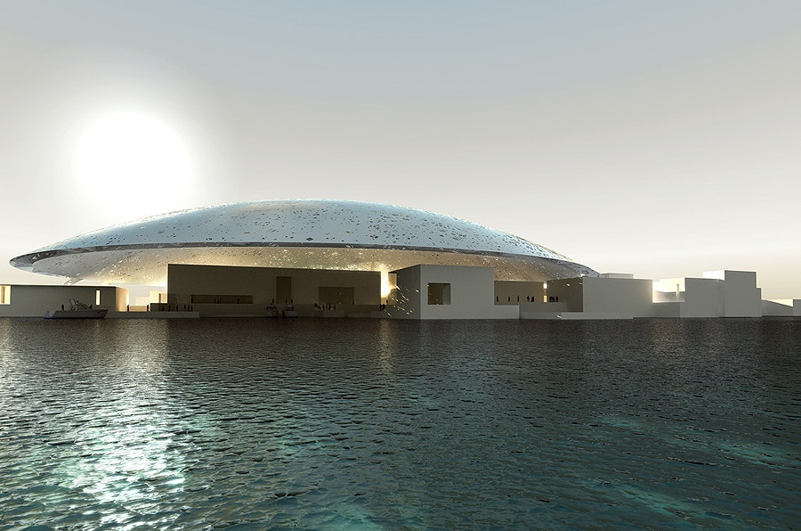
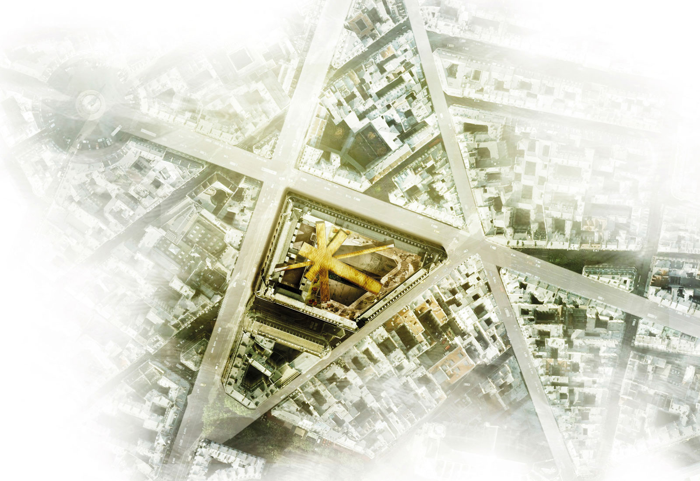
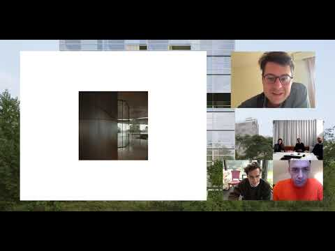

# ArtefactoryLab

**Tag tecnica/formato:** `modellazione-3d` `vr-ar` `animazione-2d`
**Tag tema:** `storia-computer-grafica`
**Tag corso:** `M3D`

## Biografia
ArtefactoryLab è uno studio parigino specializzato nella rappresentazione visiva di progetti di architettura, urbanistica e paesaggio. Secondo fonti multiple e indipendenti (la pagina "About" dello studio, Architizer, Mira World, VR Marketing), il team realizza le prime immagini nel **1999**, per poi estendere l'attività ai film animati alcuni anni dopo e aggiungere una divisione dedicata alla realtà virtuale nel **2016**. L'entità legale "ArtefactoryLab" (forma SARL) risulta invece immatricolata formalmente il 23 ottobre 2008 presso i registri delle imprese francesi — una discrepanza comune fra data di attività creativa informale e data di costituzione societaria formale, da non confondere nella scheda. Fra i soci/collaboratori storici confermati sia dai registri societari francesi sia da profili LinkedIn: **Eric Anton** (co-gerente, immagine/film, accreditato per i render del Louvre Abu Dhabi), **Renny Bossu** (VFX supervisor/compositor, co-gerente film), **Jens Arnold** (CG Artist, partner) e **Dominique Duchemin** (indicato in più fonti come co-fondatore). Lo studio conta indicativamente fra gli 11 e i 50 dipendenti. Il suo elenco clienti, riportato dallo stesso studio, comprende collaborazioni pluriennali con alcuni fra i più importanti studi di architettura al mondo: **Ateliers Jean Nouvel, Herzog & de Meuron, Renzo Piano Building Workshop, OMA, Frank Gehry**.

⚠️ Da trattare come pratica commerciale di CGI/VR architettonica, non come collettivo di arte contemporanea: non è stata reperita alcuna storia espositiva in gallerie d'arte né critica curatoriale dedicata allo studio in quanto tale — la visibilità critica dello studio proviene quasi interamente dalla stampa di settore (architettura, VFX) e da un singolo coinvolgimento istituzionale/educativo (vedi sotto, Sturm&Drang).

## Poetica e ricerca
ArtefactoryLab produce immagini, animazioni ed esperienze VR per conto di studi di architettura, spesso anni prima del completamento reale degli edifici raffigurati — un genere di immagine professionale che condivide con l'arte contemporanea le stesse tecniche (modellazione 3D, rendering, compositing entro un contesto urbano fotografato) ma con una funzione dichiaratamente diversa: informare fedelmente su un progetto reale, anziché costruire una finzione dichiarata. Un raro testo critico/accademico indipendente che discute esplicitamente un'immagine di ArtefactoryLab è il post del blog *Picturing Architecture* ("Des usages et réalismes de l'image d'architecture", 25 giugno 2013), che confronta un'immagine dello studio realizzata per un progetto OMA con un fotomontaggio dell'artista Victor Enrich: entrambi usano tecniche identiche, ma mentre il lavoro di Enrich viene letto come finzione/arte, l'immagine ArtefactoryLab/OMA è tenuta allo standard di "informare fedelmente" su un progetto reale. L'autore del blog sostiene che il rischio di inganno non risieda nella tecnica di rendering in sé, ma nel modo in cui queste immagini vengono usate e presentate da architetti, promotori immobiliari e stampa — un punto di vista utile per una lettura critica in aula del confine sempre più sottile fra CGI documentaria e CGI artistica.

## Opere principali
### Louvre Abu Dhabi, render per Ateliers Jean Nouvel (edificio completato 2017)
**Descrizione:** visualizzazioni CGI (render accreditati a Eric Anton) per il museo progettato da Jean Nouvel ad Abu Dhabi, caratterizzato da un'imponente cupola traforata che produce un effetto di "pioggia di luce". Le immagini vengono prodotte con diversi anni di anticipo rispetto al completamento reale dell'edificio.
**Lettura critica:** un caso di studio paradigmatico del ruolo persuasivo/anticipatorio della CGI architettonica in contesti di concorso e raccolta fondi — il confronto fra i render "dell'edificio completato" prodotti anni prima e la fotografia reale dell'edificio finito offre un ottimo spunto didattico sulla natura promissoria di questo genere di immagine.

**Approfondimento:** [architizer.com — ArtefactoryLab CGI rendering for AJNl Louvre Abu Dhabi](https://architizer.com/idea/115024/)

### La Poste du Louvre, render per Atelier(s) Alfonso Femia / 5+1AA, Parigi
**Descrizione:** immagini architettoniche/render per il progetto di ristrutturazione del celebre edificio della Poste du Louvre a Parigi, affiancate da un modello fisico in ceramica realizzato da Danilo Trogu.
**Lettura critica:** esempio della collaborazione dello studio con il patrimonio architettonico storico parigino, in dialogo con lo studio 5+1AA (Alfonso Femia, Gianluca Peluffo).

**Approfondimento:** [atelierfemia.com — La Poste du Louvre](https://www.atelierfemia.com/en/siglaprog/ppl/)

### Sturm&Drang Studio, partecipazione al programma di conversazioni (2021, Fondazione Prada × ETH Zürich)
**Descrizione:** ArtefactoryLab compare come ospite del ciclo di conversazioni pubbliche online "Sturm&Drang Studio" (a partire dal 7 aprile 2021), il programma educativo per 185 studenti dell'ETH Zürich che affianca la mostra "Sturm&Drang" all'Osservatorio Fondazione Prada di Milano (già scheda dedicata in questo database).
**Lettura critica:** ⚠️ correzione importante: il ruolo documentato dello studio è quello di **ospite del programma di conversazioni/workshop educativo** ("Studio"), non di artista con opere esposte nella mostra fisica in galleria — distinzione da mantenere con precisione in una scheda didattica.
**Video:** [YouTube — "STURM&DRANG STUDIO | Artefactory lab"](https://www.youtube.com/watch?v=pirOQxnV5Nk)

**Approfondimento:** [youtube.com/watch?v=pirOQxnV5Nk](https://www.youtube.com/watch?v=pirOQxnV5Nk)

## Interviste e talk
- _Nessuna ancora: da aggiungere._

## Fonti
- [artefactorylab.com — sito ufficiale](https://www.artefactorylab.com/en/)
- [artefactorylab.com — pagina progetti](https://www.artefactorylab.com/en/projets/)
- [Architizer — profilo studio](https://architizer.com/firms/artefactorylab/)
- [Architizer — Louvre Abu Dhabi per Ateliers Jean Nouvel](https://architizer.com/projects/artefactorylab-cgi-rendering-for-atelier-jean-nouvel-louvre-abu-dhabi/)
- [Pappers.fr — scheda societaria](https://www.pappers.fr/entreprise/artefactorylab-508638772)
- [Atelier(s) Alfonso Femia — La Poste du Louvre](https://www.atelierfemia.com/it/2014/01/la-poste-du-louvre-2/)
- [Picturing Architecture — "Des usages et réalismes de l'image d'architecture" (25 giugno 2013)](https://picturingarchitecture.wordpress.com/2013/06/25/sur-le-realisme-de-limage-darchitecture-et-son-rapport-a-lobjectivite/)
- [Fondazione Prada — pagina progetto Sturm&Drang Studio](https://www.fondazioneprada.org/project/sturmdrang-studio/?lang=en)
- [VR Marketing — profilo azienda](https://www.virtualrealitymarketing.com/company/artefactorylab/)
- [Vimeo — canale ufficiale](https://vimeo.com/artefactorylab)

## Crediti delle immagini
Immagine e link di approfondimento per ciascuna delle tre opere, inclusi sotto la relativa descrizione in "Opere principali". Il sito ufficiale [artefactorylab.com](https://www.artefactorylab.com/en/) usa una galleria WebGL/canvas non estraibile via markup, quindi le immagini sono state recuperate da fonti terze che le ospitano con credito allo studio (Architizer, atelierfemia.com, YouTube).
