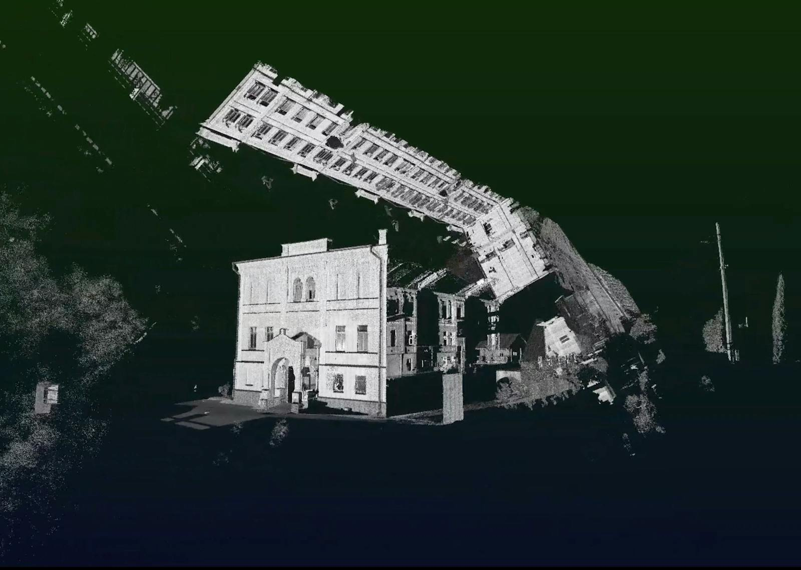
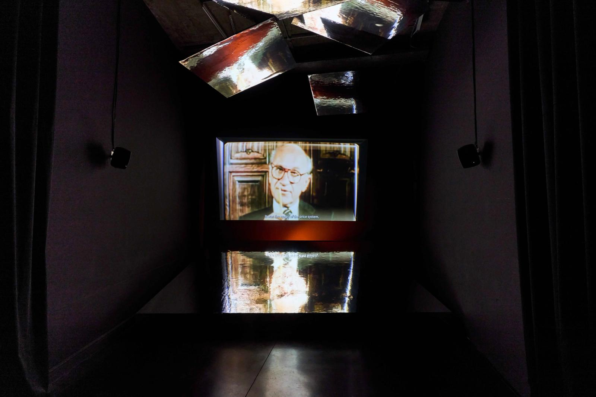
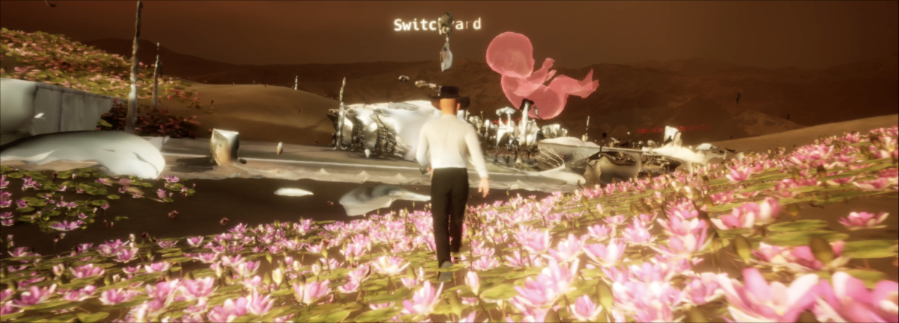
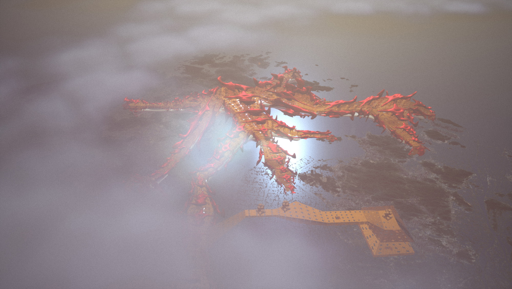
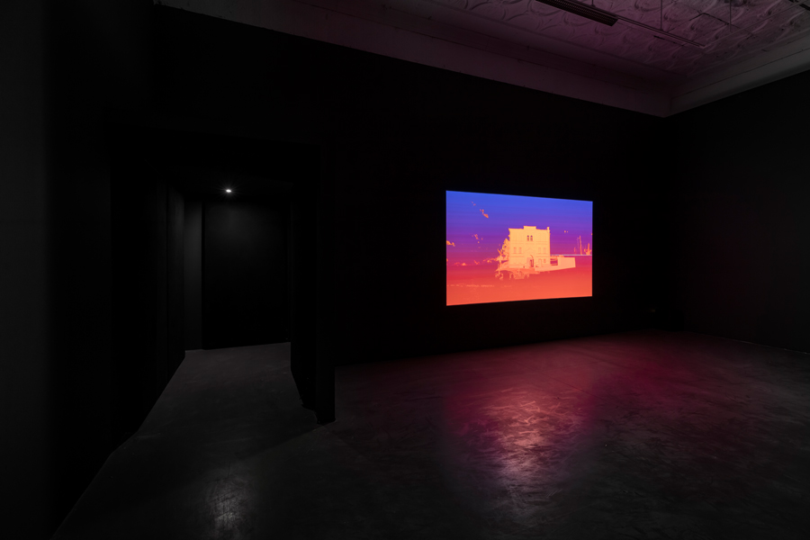

# Bahar Noorizadeh

**Tag tecnica/formato:** `video` `ai-generativa`
**Tag tema:** `capitalismo-lavoro` `temporalita-non-lineare`
**Tag corso:** `TAD` `AW`
**Stato:** testo in parte generato con IA: tre link della fonte originale non sono verificati

## Biografia
Artista, scrittrice e filmmaker. PhD in Art a Goldsmiths, University of London; associate lecturer alla RCA School of Architecture e alla Design Academy Eindhoven. Fondatrice di **Weird Economies**, piattaforma editoriale collettiva sugli immaginari economici. *(Anno di nascita indicato in una fonte non verificata come 1988 — da controllare.)*

## Poetica e ricerca
L'opera di Bahar Noorizadeh è un'indagine speculativa e teorica sulle infrastrutture invisibili che governano il presente: la finanza, la computazione, il tempo. Non si limita a rappresentare il capitalismo, ma ne sezione le logiche operative, rivelandone la natura intrinsecamente fittizia, irrazionale e "strana" (*weird*). La sua pratica funziona come un dispositivo diagnostico: usando una combinazione ibrida di CGI, film-saggio, documentario d'archivio e narrativa teorica, decostruisce la temporalità lineare del progresso capitalista, concentrandosi sulla "speculazione" nel suo doppio senso — quella finanziaria, che crea valore dal nulla, e quella artistica, che immagina futuri alternativi.

Il fulcro teorico della sua ricerca è il concetto di **"Weird Economy"** (Economia Stramba), sviluppato attraverso l'omonima piattaforma editoriale: un concetto che si distacca dalle critiche economiche tradizionali per abbracciare l'assurdità e l'irrazionalità al cuore della finanza contemporanea. Invece di vedere l'economia come sistema razionale, Noorizadeh la presenta come costrutto *fictionale*, un sistema di credenze che produce effetti reali — un'economia "stramba" perché sistema morto-vivente, parassita che si nutre di tempo e futuri possibili. L'approccio è affine alla **hauntology di Mark Fisher** (l'idea che il presente sia infestato da futuri perduti, che la cultura sia incapace di generare un "nuovo" autentico) e al suo **realismo capitalista** (l'idea che sia più facile immaginare la fine del mondo che la fine del capitalismo).

Un secondo asse della sua ricerca è l'**archeologia computazionale**: non solo la "nuova" IA, ma le genealogie perdute della computazione — i bivi storici in cui la tecnologia avrebbe potuto prendere una strada diversa da quella capitalista. Una forma di contro-fattualità storica ("cosa sarebbe successo se...") usata come strumento politico per sbloccare l'immaginazione, paralizzata dal realismo capitalista.

## Opere principali
### After Scarcity (2018)
**Descrizione:** film-saggio che combina filmati d'archivio sovietici (spesso didattici e propagandistici) con sequenze CGI di un avatar IA senza corpo, per raccontare il progetto cibernetico sovietico degli anni '60 — in particolare l'OGAS, tentativo di rete informatica pan-sovietica per pianificare l'economia — e la sua visione di un "socialismo automatizzato".
**Lettura critica:** un'opera *hauntologica*: Noorizadeh rianima il fantasma del socialismo cibernetico, un futuro perduto in cui automazione e IA erano immaginate come strumenti per superare scarsità e lavoro, non per massimizzare profitto e sorveglianza (come nel modello Silicon Valley). L'avatar IA media tra questo passato utopico fallito e il nostro presente distopico, chiedendo se un'altra forma di computazione sia ancora possibile.

**Approfondimento:** [dis.art/after-scarcity](https://www.dis.art/after-scarcity) · [KADIST — After Scarcity](https://kadist.org/work/after-scarcity/)

### Free to Choose
**Descrizione:** "fantascienza finanziaria" operistica narrata da Milton Friedman: nella Hong Kong del 1997 post-crollo, un CEO viaggia nel futuro per prendere in prestito denaro dal proprio sé più anziano; sullo sfondo, il mito di Friedman di Hong Kong come esempio di capitalismo puro senza pianificazione statale.
**Lettura critica:** smonta il mito neoliberista di Hong Kong come esempio di libero mercato — dimostra come, nonostante il primato storico nell'edilizia popolare pubblica, la città oggi detenga uno dei divari di ricchezza più profondi del pianeta; il sistema bancario del credito diventa una macchina del tempo del potere.

**Approfondimento:** [otolithgroup.org — Free to Choose](https://otolithgroup.org/public-programme/free-to-choose/)

### Teslaism: Economics after the end of the end of the future (2022)
**Descrizione:** videogioco musicale di corse in terza persona con Elon Musk e la sua auto a guida autonoma/amante/life coach, ambientato nella Berlino della Gigafactory; commissionato originariamente per la mostra *Tresor 31: Techno, Berlin, and the Great Freedom*.
**Lettura critica:** nomina il "Teslaismo" (che succede al Post-fordismo) come nuovo regime di produzione e consumo basato su storytelling finanziario e "imagineering" del futuro — il CEO teslaista come artista del collage che intreccia tweet, meme e balletti in narrazioni perennemente rimandate.

**Approfondimento:** [transmediale 2023 — Teslaism](https://2023.transmediale.de/en/artwork/teslaism-economics-at-the-end-of-the-end-of-the-future)

### The Red City of the Planet of Capitalism (2021)
**Descrizione:** installazione video (commissionata per il Padiglione tedesco "2038", Biennale di Architettura di Venezia 2021) che rivisita i progetti disurbanisti sovietici del 1929 di Mikhail Okhitovich e Moisei Ginzburg — pensati per eliminare la differenza tra città e campagna sostituendo la metropoli con una rete di infrastrutture, case mobili e servizi su scala URSS — ricostruiti in 3D a partire dai pochi disegni superstiti, con la voce narrante che legge la lettera di Ginzburg a Le Corbusier.
**Lettura critica:** traccia una genealogia alternativa e non capitalista dell'infrastruttura in rete — un "Web 0.0" cibernetico sovietico, la cui ambizione emancipatoria fu interrotta dal Grande Terrore (Okhitovich fu il primo architetto inviato nei campi).

**Approfondimento:** [e-flux Architecture — The Red City of the Planet of Capitalism](https://www.e-flux.com/architecture/cascades/391412/the-red-city-of-the-planet-of-capitalism/)

### Ultima Ratio (2022)
**Descrizione:** installazione video ipnotica dominata da astrazioni CGI fluide e renderizzate — liquidi metallici, forme algoritmiche che si fondono e trasformano, superfici digitali perfette — accompagnate da una narrazione teorica sulla "logica" (ratio) come principio operativo del capitale.
**Lettura critica:** esplora il **capitalismo computazionale**: la logica astratta (contratti smart, finanza algoritmica, ottimizzazione logistica) ha sostituito la politica come *ratio ultima* del potere; l'estetica CGI deliberatamente seducente e priva di attrito riflette la natura astratta, disincarnata e inumana di questo regime.

⚠️ **Discrepanza da verificare**: non risulta nessuna opera dell'artista intitolata semplicemente "Ultima Ratio (2022)" con la descrizione sopra (astrazioni CGI di liquidi metallici). L'unica opera con un titolo simile reperibile è *Ultima Ratio Δ Mountain of the Sun* (2017, 13 min) — un film girato dal vivo sull'industria dell'hashish nella valle della Bekaa, Libano, molto diverso nel contenuto da quanto descritto qui. L'immagine sotto documenta questa opera del 2017 (in mostra insieme ad *After Scarcity* a Mercer Union, Toronto, 2019); la descrizione testuale sopra potrebbe riferirsi a un'opera diversa non ancora identificata, o essere un errore di una sessione di ricerca precedente — da chiarire prima di usare questa scheda in aula.

**Approfondimento:** [Pejman Foundation — Ultima Ratio Δ Mountain of the Sun](https://pejman.foundation/ultima-ratio-δ-mountain-of-the-sun/) · [Mercer Union — governance machines and the future of futures](https://www.mercerunion.org/exhibitions/noorizadeh-governance-machines-and-the-future-of-futures)

## Interviste e talk
- _Nessuna ancora: da aggiungere._

## Fonti
- [baharnoorizadeh.com](https://baharnoorizadeh.com/)
- [After Scarcity (Vimeo)](https://vimeo.com/296563987)
- [The Red City of the Planet of Capitalism (Vimeo)](https://vimeo.com/540346330)
- [The Red City of the Planet of Capitalism — testo, e-flux](https://www.e-flux.com/architecture/cascades/391412/the-red-city-of-the-planet-of-capitalism/)
- Portfolio (PDF, ~37MB) — presente su Drive nella cartella ARTIST REFERENCES ("Bahar_Portfolio May.9.2023.pdf"), **non ancora archiviato nel repo**: supera il limite di download di questo strumento (10MB). Da scaricare manualmente e aggiungere a `contenuti/portfolio/bahar-noorizadeh-portfolio.pdf`.

## Crediti delle immagini
Immagine e link di approfondimento per ciascuna delle cinque opere, inclusi sotto la relativa descrizione in "Opere principali" — recuperate da fonti terze (dis.art, Otolith Group, transmediale, e-flux, Mercer Union) poiché il sito ufficiale [baharnoorizadeh.com](https://baharnoorizadeh.com/) è testuale, senza immagini incorporate.
