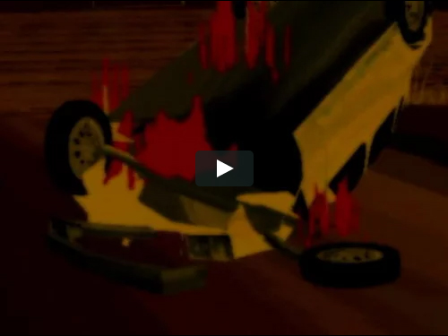
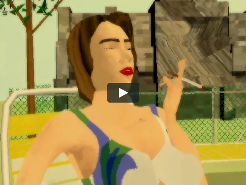
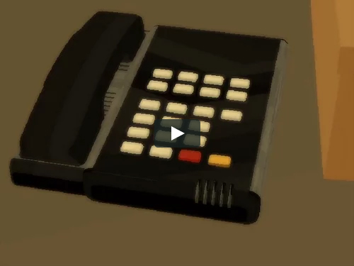
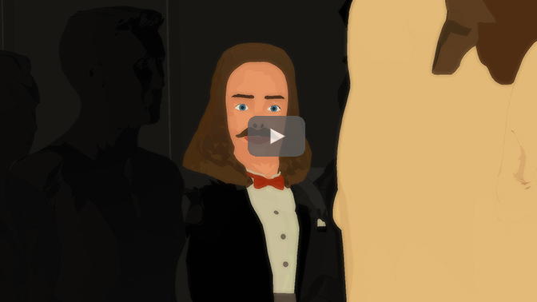
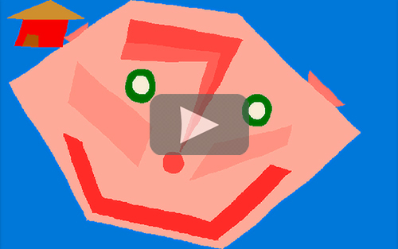

# Barry Doupé

**Tag tecnica/formato:** `modellazione-3d` `animazione-2d` `stampa-3d-scultura`
**Tag tema:** `corpo-identita` `genere-queerness` `temporalita-non-lineare`

## Biografia
Nato nel 1982 a Victoria, British Columbia, Canada. Consegue un Bachelor of Media Arts, indirizzo animazione, all'Emily Carr Institute of Art & Design (oggi Emily Carr University of Art and Design), laureandosi nel 2004. Vive e lavora a Vancouver. Il suo primo lungometraggio, *Ponytail*, viene completato nel 2008 e presentato in anteprima alla Whitechapel Gallery di Londra. I suoi lavori sono stati proiettati all'Ann Arbor Film Festival, agli Anthology Film Archives, al Centre Pompidou, alla Tate Modern, al MAC Lyon, a Pleasure Dome (Toronto), all'International Film Festival Rotterdam, a DOK Leipzig, al Chicago Underground Film Festival e alla Vancouver Art Gallery. È membro di The Lions, gruppo collaborativo di disegno. Riconoscimento: incluso nella longlist del Sobey Art Award 2024 (regione Pacifico), il principale premio canadese per l'arte contemporanea, amministrato dalla National Gallery of Canada e dalla Sobey Art Foundation. Rappresentato dalla galleria Wil Aballe Art Projects (WAAP), Vancouver; ha esposto anche alla Ghebaly Gallery (Los Angeles) e a Swallow (Vilnius, Lituania — sua prima mostra personale europea).

⚠️ Non confermata: alcuna rappresentanza presso la galleria Catriona Jeffries, talvolta ipotizzata in fonti secondarie — le fonti attuali indicano invece Wil Aballe Art Projects.

## Poetica e ricerca
Il lavoro di Doupé è descritto costantemente come CGI "grezza" e a basso costo, che evoca l'estetica dei primi videogiochi, usata per mettere in scena scenari narrativi elaborati, teatrali e spesso disgiunti. I film nascono da materiale del subconscio — esercizi di scrittura automatica e disegno automatico — producendo strutture narrative frammentate e "porose", una logica onirica, e ambienti/personaggi che diventano progressivamente meno identificabili e più surreali man mano che l'opera procede. I temi ricorrenti sono la fallibilità dell'interazione umana, sessualità e genere, mascolinità, violenza e umorismo, il corpo. Il curatore Jesse McKee (responsabile strategia di 221A, co-curatore della mostra "Vancouver Special: Ambivalent Pleasures" alla Vancouver Art Gallery, 2015) osserva come l'uso che Doupé fa di tecnologia obsoleta "infonda in ciò che normalmente si associa alla freddezza un calore nostalgico". Il Video Data Bank di Chicago (importante distributore statunitense di media art) lo descrive come noto per "animazione al computer grezza, indicativa dei primi videogiochi", popolata da "strani personaggi astratti" in "ambienti innaturali".

## Opere principali

### At the Heart of a Sparrow (2006)
**Descrizione:** animazione al computer di circa 29-30 minuti, parte di una terna di opere prodotte tra il 2004 e il 2006. Prosegue "l'esame di spazi psichici instabili" dell'artista, usando immagini familiari (una persona che spacca legna, sale le scale, un carro trainato da cavalli nel deserto, monache) che diventano progressivamente meno identificabili, oniriche, con ambienti e personaggi innaturali.
**Lettura critica:** distribuita dal Video Data Bank di Chicago — tra le prime opere a definire il metodo dell'artista di costruzione narrativa a partire da materiale del subconscio.

**Approfondimento:** [barrydoupe.ca/videos/at-the-heart-of-a-sparrow](https://www.barrydoupe.ca/videos/at-the-heart-of-a-sparrow)

### Ponytail (2008)
**Descrizione:** primo lungometraggio dell'artista, 92 minuti. Anteprima alla Whitechapel Gallery di Londra. Segue diversi personaggi "afflitti" e come trovano una risoluzione; l'artista lo descrive come un lavoro "audace e frammentato".
**Lettura critica:** consolida su formato lungo il metodo narrativo disgiunto già sviluppato nelle opere brevi precedenti.

**Approfondimento:** [barrydoupe.ca/videos/ponytail](https://www.barrydoupe.ca/videos/ponytail)

### The Colors That Combine to Make White Are Important (2012)
**Descrizione:** lungometraggio di 119 minuti che esplora le strutture di potere in una fabbrica giapponese di vetro in fallimento; due trame parallele (l'indagine su un dipendente sospetto; un dipinto rubato) convergono in quella che viene descritta come "un'esposizione grezza su genere e desiderio". Vince il premio per il miglior lungometraggio a Cinewest flEXiff 2012 (Sydney, Australia); anteprima statunitense all'Onion City Film Festival, Chicago, 2012.
**Lettura critica:** amplia il registro dell'artista dallo spazio psichico individuale a una critica più esplicita delle strutture di potere istituzionali/lavorative.
**Video:** [The Colors That Combine to Make White Are Important, estratto (Vimeo)](https://vimeo.com/49591657)

**Approfondimento:** [barrydoupe.ca/videos/the-colors-that-combine-to-make-white-are-important](https://www.barrydoupe.ca/videos/the-colors-that-combine-to-make-white-are-important)

### Distracted Blueberry (2019)
**Descrizione:** opera lunga e durazionale (durata riportata in modo incoerente tra le fonti, circa 4 ore e 33-35 minuti), cinque anni di produzione. Segue una band di arte performativa attraverso "incontri poetici"; esplora mascolinità, sessualità maschile, pulsione di morte, violenza, umorismo, "il nulla e il qualcosa". Contiene contenuto animato sessuale/violento esplicito.
**Lettura critica:** l'opera più ambiziosa in termini di durata e complessità tematica della carriera dell'artista — la lunghezza stessa diventa parte del dispositivo, richiedendo allo spettatore un impegno temporale insolito per un'opera d'animazione.
**Video:** [trailer di Distracted Blueberry (YouTube)](https://www.youtube.com/watch?v=0u363s-sa_4)

**Approfondimento:** [barrydoupe.ca/videos/distracted-blueberry](https://www.barrydoupe.ca/videos/distracted-blueberry) — ⚠️ pagina con contenuto esplicito, scelta l'immagine del trailer come la meno esplicita disponibile.

### Red House (2022)
**Descrizione:** cortometraggio di 3 minuti, animazione 2D disegnata a mano realizzata con computer Amiga e software Deluxe Paint IV; sound design di James Whitman. Esplora in modo giocoso "la metamorfosi in relazione alla stabilità e alla struttura dell'abitare".
**Lettura critica:** mostrato nella collettiva "Breaking the Joints" al Sapieha Palace di Vilnius (2025) — dimostra il ritorno dell'artista a tecnologie storiche (l'Amiga) dopo il lavoro in CGI più recente, in continuità con la sua serie di opere/dipinti realizzati con lo stesso computer durante la produzione di *Distracted Blueberry*.

**Approfondimento:** [barrydoupe.ca/videos/red-house](https://www.barrydoupe.ca/videos/red-house)

## Immagini

Immagine e link di approfondimento per ciascuna delle cinque opere, inclusi sotto la relativa descrizione in "Opere principali", scaricate dal sito ufficiale [barrydoupe.ca](https://www.barrydoupe.ca).
- [Video Data Bank — pagina artista](https://www.vdb.org/artists/barry-doupe)
- [Media Queer — biografia e filmografia](https://www.mediaqueer.ca/artist/barry-doupe)

## Fonti
- [Video Data Bank — pagina artista](https://www.vdb.org/artists/barry-doupe)
- [Media Queer — biografia e filmografia](https://www.mediaqueer.ca/artist/barry-doupe)
- [Wil Aballe Art Projects (WAAP) — sito della galleria](https://www.waapart.com/)
- [National Gallery of Canada — longlist Sobey Art Award 2024](https://www.gallery.ca/for-professionals/media/press-releases/2024-sobey-art-award-longlist-announced)
- [Vancouver Art Gallery — Vancouver Special: Ambivalent Pleasures (2015)](https://www.vanartgallery.bc.ca/exhibitions/vancouver-special-ambivalent-pleasures/)
- [Galleries West — su Vancouver Special](https://www.gallerieswest.ca/magazine/stories/vancouver-s-ambivalent-pleasures/)
- [Mousse Magazine — su "Breaking the Joints", Vilnius (2025)](https://www.moussemagazine.it/magazine/breaking-the-joints-sapieha-palace-vilnius-2025/)
- [e-flux — VERY BIG SHORTS, selectrospettiva](https://www.e-flux.com/events/520777/barry-doup-nbsp-very-big-shorts)
- [Art Viewer — mostra con Jeff Hallbauer, WAAP](https://artviewer.org/barry-doupe-and-jeff-hallbauer-at-wil-aballe-art-projects-waap/)

---

## Appunti da organizzare
- Non citato in un programma specifico dei corsi — inserito dalla lista generale "da scrivere da zero" per la rilevanza nell'ambito della CGI volutamente grezza/a basso costo applicata a narrazioni oniriche.
- ⚠️ Correzioni importanti: non risulta un'opera intitolata "Ginger" (2004) — probabile titolo non verificabile o errato, non includere. Non risulta un'opera intitolata "The Barley Field" (2017) — un'opera reale del 2017 è invece *Object Poems*, serie di nove brevi pezzi animati non narrativi su ritmo, colore e luce.
- Altre opere da approfondire: *100 AMIGA Paintings*/*Amiga Works* (2016, mostrato a Swallow, Vilnius, 2021-22); *Life and People* (2014, video HD di 22 minuti, unico lavoro non animato dell'artista, realizzato durante una residenza al Western Front, Vancouver).
- Video ulteriori: canale Vimeo dell'artista (include *Red House*, *Dots*, *Life and People*): [vimeo.com/user11335804](https://vimeo.com/user11335804).
