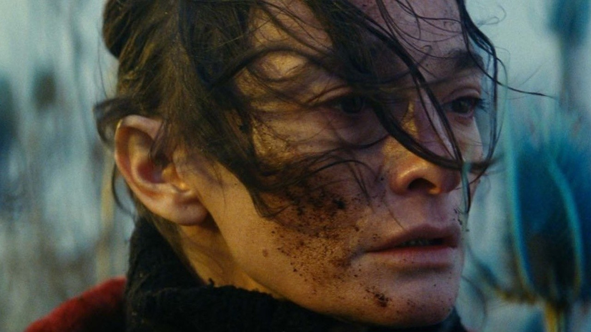

# Bertrand Mandico

**Tag tecnica/formato:** `video`
**Tag tema:** `corpo-identita` `genere-queerness`
**Stato:** scheda parziale, scritta a partire da fonti web (Wikipedia, siti di festival e gallerie); non ancora assegnata a un corso · immagini controllate (diritti degli autori)

## Biografia
Nato il 21 marzo 1971, regista e sceneggiatore francese. Il suo primo lungometraggio, *The Wild Boys* (2017), è stato nominato miglior film del 2018 dai *Cahiers du Cinéma*.

## Poetica e ricerca
I suoi film si interessano al corpo e alla fluidità di genere e incorporano fotografie ed elementi scritti.

## Opere principali

### Living Still Life (La résurrection des natures mortes, 2012)
**Descrizione:** Cortometraggio di circa 15 minuti, coproduzione francese (le fonti divergono su Belgio e Germania), presentato alla Mostra di Venezia nel settembre 2012 e poi a Clermont-Ferrand (2013). Un personaggio, Fièvre, colleziona animali morti e li riporta in vita attraverso film animati. Con Élina Löwensohn; musiche di Ghédalia Tazartès e Mandico.

### Lungometraggi
**Descrizione:** *The Wild Boys* (2017), *After Blue* (2021), *She Is Conann* (2023), *Dragon Dilatation* (2024), *Roma Elastica* (2026).

## Fonti
- [Wikipedia — Bertrand Mandico](https://en.wikipedia.org/wiki/Bertrand_Mandico)

## Crediti delle immagini
Immagini controllate il 2026-11-01: provengono dalle pagine indicate (festival, gallerie, siti degli artisti, piattaforme) e restano di proprietà degli autori.
- Living Still Life (La résurrection des natures mortes) (1): [mubi.com](https://mubi.com/en/films/living-still-life) · Immagine promozionale / fotogramma ufficiale, diritti degli autori; uso didattico
