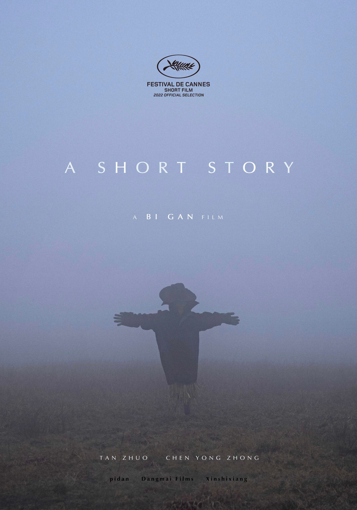

# Bi Gan

**Tag tecnica/formato:** `video`
**Tag tema:** `memoria-archivio` `temporalita-non-lineare`
**Stato:** scheda parziale, scritta a partire da fonti web (Wikipedia, siti di festival e gallerie); non ancora assegnata a un corso · immagini controllate (diritti degli autori)

## Biografia
Regista, sceneggiatore e produttore cinese nato a Kaili (Guizhou). Studia regia televisiva alla Shanxi University of Communications.

## Poetica e ricerca
Il suo primo lungometraggio, girato nella città natale, vince il premio per il miglior regista emergente e una menzione speciale per la miglior opera prima al Locarno Film Festival, oltre al premio per il miglior nuovo regista ai Golden Horse Awards.

## Opere principali

### Kaili Blues (2015)
**Descrizione:** Primo lungometraggio, girato a Kaili.

⚠️ Nessuna immagine trovata.

### Long Day's Journey Into Night (2018)
**Descrizione:** Secondo lungometraggio, coproduzione Cina-Francia, presentato a Cannes nella sezione Un Certain Regard.

⚠️ Nessuna immagine trovata.

### A Short Story (2022)
**Descrizione:** Cortometraggio di circa 14-15 minuti, in concorso per la Palma d'Oro del cortometraggio a Cannes 2022. Una favola dal punto di vista di un gatto: un gatto nero con impermeabile, interpellato da uno spaventapasseri, parte alla ricerca di una risposta.

### Resurrection (2025)
**Descrizione:** Lungometraggio più recente.

⚠️ Nessuna immagine trovata.

## Fonti
- [IFFR — Bi Gan](https://iffr.com/en/persons/bi-gan)
- [Cinema Chinese — Bi Gan (Brigitte Duzan)](https://chinesemovies.com.fr/cineastes_Bi_Gan.htm)

## Crediti delle immagini
Immagini controllate il 2026-11-01: provengono dalle pagine indicate (festival, gallerie, siti degli artisti, piattaforme) e restano di proprietà degli autori.
- A Short Story (1): [www.festival-cannes.com](https://www.festival-cannes.com/en/f/po-sui-tai-yang-zhi-xin/) · Immagine promozionale / fotogramma ufficiale, diritti degli autori; uso didattico
