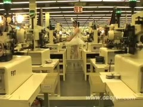
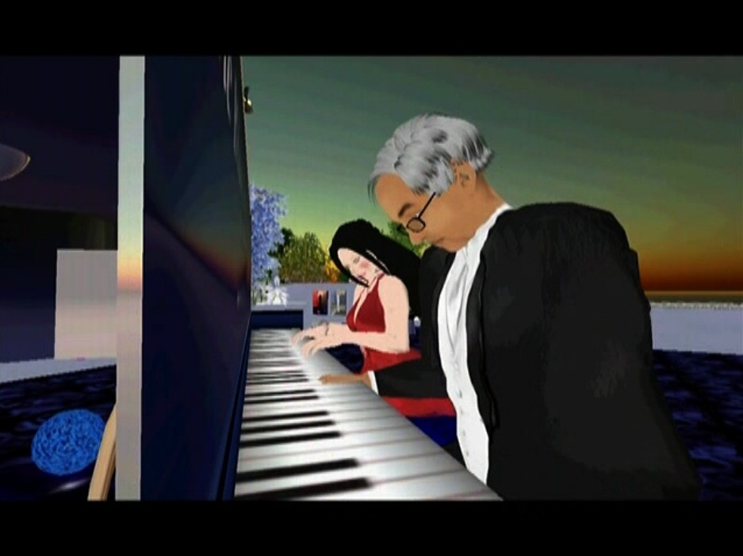
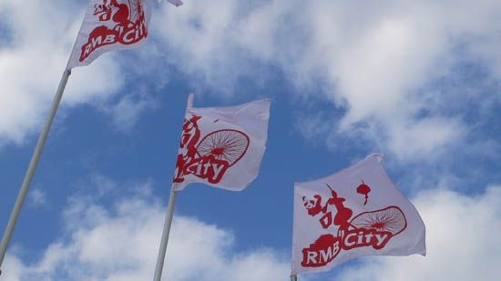
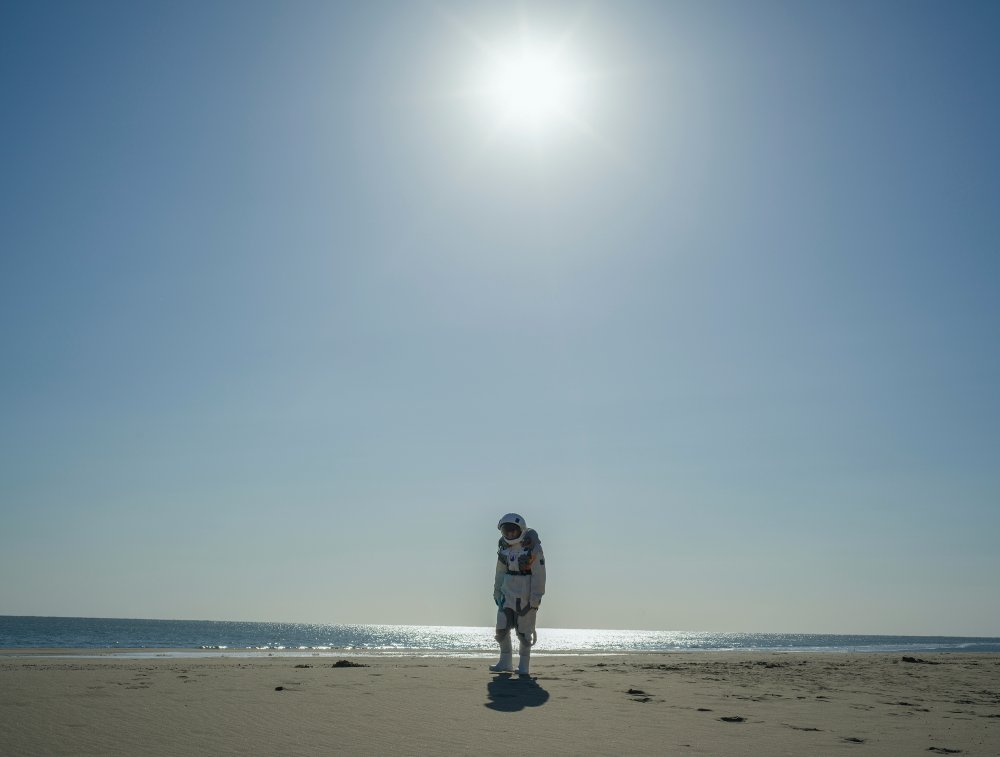
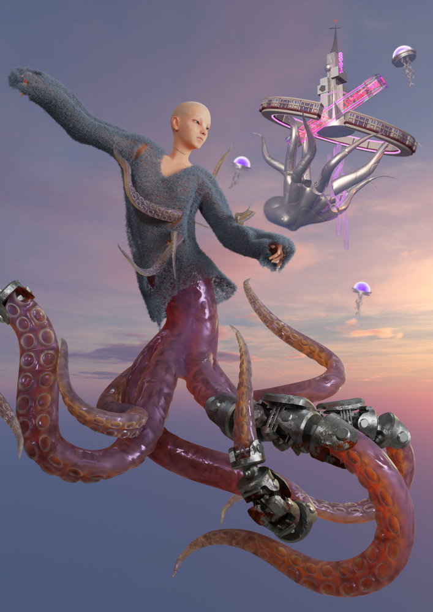

# Cao Fei

**Tag tecnica/formato:** `video` `mondi-virtuali-simulazione` `vr-ar` `performance-dal-vivo`
**Tag tema:** `capitalismo-lavoro` `mondi-virtuali-simulazione` `colonialismo-decolonialita`
**Tag corso:** `TAD-DCV` `AW`
**Stato:** date discordanti da verificare: la chiusura di RMB City (2011 secondo alcune fonti, fine 2012 secondo l'artista) · identità e età dell'avatar

## Biografia
Nata nel 1978 a Guangzhou, Cina. Consegue un BFA alla Guangzhou Academy of Fine Arts (2001). Vive e lavora a Pechino. Prime opere: la performance *The Little Spark* (1998), il primo film *Imbalance 257* (1999), poi *Rabid Dogs* (2002), *Burners* (2003), *COSPlayers* (2004). Nel 2007 rappresenta la Cina alla 52ª Biennale di Venezia (Padiglione cinese a cura di Hou Hanru) con il "China Tracy Pavilion" virtuale dentro Second Life. Nel 2016 il MoMA PS1 le dedica la sua prima mostra personale museale statunitense, "Cao Fei" (3 aprile-31 agosto 2016, a cura di Klaus Biesenbach con Jocelyn Miller). Nel 2020 le Serpentine Galleries di Londra presentano "Cao Fei: Blueprints", la sua prima grande mostra personale istituzionale nel Regno Unito, a cura di Hans Ulrich Obrist e Joseph Constable con Rebecca Lewin. Ha esposto anche a Tate Modern, Palais de Tokyo, Centre Pompidou, alla 56ª Biennale di Venezia, alla Sharjah Biennial 15 (2023) e al Lenbachhaus di Monaco ("Meta-mentary", 2024). Rappresentata da Vitamin Creative Space (Guangzhou) e Sprüth Magers (Berlino/Londra/Los Angeles/New York); in precedenza anche da Lombard-Freid Projects, New York.

## Poetica e ricerca
La pratica di Cao Fei si muove tra documentario e finzione speculativa, usando video, mondi virtuali, performance e installazione per esaminare la cultura giovanile cinese post-Rivoluzione Culturale, l'urbanizzazione rapida, il lavoro in fabbrica e migrante e — dal 2007 — il confine sfumato tra identità fisica e virtuale/digitale, prima attraverso Second Life (l'avatar China Tracy, *RMB City*) e più di recente attraverso piattaforme metaverso e fantascienza speculativa adiacente all'IA. Hans Ulrich Obrist, in un saggio per *Defining Contemporary Art* (Phaidon), la inquadra come guida di una generazione "postmediale" di giovani artisti cinesi che lavorano attraverso cultura pop e mass media, citando la serie *COSPlayers* (2004) come esempio precoce. Klaus Biesenbach, direttore del MoMA PS1, l'ha descritta come una delle artiste giovani più innovative provenienti dalla Cina, capace di mescolare commento sociale, estetica pop, riferimenti surrealisti e convenzioni documentarie. La critica Doretta Lau le ha dedicato il saggio "Cao Fei (and me)" su *ArtReview* (marzo 2016). Emily McDermott, su *frieze* (2024), recensendo la retrospettiva "Meta-mentary" al Lenbachhaus, descrive un percorso che si sposta da un utopismo tecnologico dai colori confetto verso un registro "oscuramente distopico". A proposito di *Whose Utopia*, l'artista dichiara che il proprio obiettivo era "liberare i lavoratori da una nozione standardizzata di produttività", descrivendo i lavoratori migranti ritratti come "anti-eroi... eroi senza nome, anonimi e non celebrati", la "forza di riserva" della competitività cinese nell'economia globale.

## Opere principali
### Whose Utopia (2006)
**Corso:** `TAD-DCV`
**Temi:** `performance-audiovisiva`
**Descrizione:** video in tre parti (circa 20 minuti) realizzato durante una residenza di sei mesi nella fabbrica di illuminazione OSRAM, Foshan, delta del fiume delle Perle. Le parti: "Imagination of Product" (lavoratori/macchine), "Factory Fairytale" (danzatori/musicisti messi in scena tra i macchinari), "My Future Is Not a Dream" (ritratti statici di lavoratori che guardano in camera). Prima di girare, Cao Fei sottopone ai lavoratori un questionario sul loro background e le loro aspirazioni.
**Lettura critica:** letta come risposta alla manifattura globalizzata "Made in China" — trasforma i lavoratori da forza produttiva anonima in soggetti con desideri e narrazioni proprie, senza però nascondere la durezza dell'ambiente di fabbrica.
**Video:** [estratto (Vimeo, Sprüth Magers)](https://vimeo.com/412341500)

**Approfondimento:** [MoMA — Whose Utopia, collezione](https://www.moma.org/collection/works/399823)

### i.Mirror by China Tracy (aka: Cao Fei) — Second Life Documentary Film (2007)
**Corso:** `AW`
**Temi:** `avatar-e-corpo-virtuale`
**Descrizione:** "documentario virtuale" di 28 minuti che segue l'avatar Second Life dell'artista, China Tracy, includendo una storyline romantica con un altro avatar, "Hug Yue". Presentato come parte del China Tracy Pavilion alla 52ª Biennale di Venezia (2007), dentro il Padiglione cinese ufficiale curato da Hou Hanru.
**Lettura critica:** complica la consueta paura che i mondi virtuali sostituiscano la realtà — mostra invece un'intimità e una connessione autentiche formatesi attraverso una relazione tra avatar, rivelando al tempo stesso le identità di "prima vita" dietro gli avatar.

**Approfondimento:** [MoMA — i.Mirror by China Tracy, collezione](https://www.moma.org/collection/works/118832)

### RMB City: A Second Life City Planning (2007-2011/2012)
**Corso:** `AW`
**Temi:** `architettura-e-citta`
**Descrizione:** città virtuale costruita da Cao Fei e dal suo studio dentro Second Life — un amalgama di iconografia delle megalopoli cinesi (la torre della CCTV, strutture che richiamano Tienanmen, un panda gigante, edifici fluttuanti). La costruzione inizia nel 2008, con una realizzazione in tempo reale presentata alla Serpentine Gallery di Londra (estate/autunno 2008); apertura al pubblico nel gennaio 2009. "RMB" sta per Ren Min Bi, la valuta cinese.
**Lettura critica:** riflette sullo sviluppo urbano costiero rapido della Cina sotto il capitalismo globale; secondo alcune fonti, Hans Ulrich Obrist, Julia Peyton-Jones e Anthony Gormley sarebbero entrati in RMB City tramite avatar per un'apertura in anteprima.

**Approfondimento:** [caofei.com — RMB City](https://www.caofei.com/works.aspx?id=56&year=-1&wtid=2)

### Nova (2019) e HX Project (2019-2020)
**Corso:** `TAD-DCV`
**Temi:** `architettura-e-citta`
**Descrizione:** *Nova* è un video HD di 109 minuti e 53 secondi, la produzione a più alto budget dell'artista fino a quel momento, che fonde fantascienza e film storico, ambientato nella città immaginaria di "Nova" — una reinvenzione futura di Hongxia (il quartiere di Pechino dove ha sede lo studio dell'artista) — incentrato su una scienziata informatica in missione segreta. *Nova* fa parte del più ampio HX Project, installazione in più parti dedicata al distretto del Teatro Hongxia di Pechino, ex polo industriale/elettronico di assistenza sovietica degli anni '50 dove sarebbe stato sviluppato il primo computer cinese: comprende una sala di proiezione per *Nova*, una sala archivistica/documentaria con una pubblicazione originale, una sala VR ("The Eternal Wave", 2020) e un'area di ricezione. Mostrato al Centre Pompidou e alla Sharjah Biennial 15 (2023).
**Lettura critica:** sposta la ricerca dell'artista sull'identità virtuale da Second Life a un impianto fantascientifico più ampio e a più alto budget, radicato però in un luogo fisico e storico specifico (il quartiere Hongxia) invece che in un non-luogo virtuale generico.

**Approfondimento:** [caofei.com — Nova](https://www.caofei.com/works.aspx?id=82&year=2019&wtid=3)

### Meta-mentary (2022) e Duotopia (2022-2024)
**Corso:** `AW` `TAD-DCV`
**Temi:** `avatar-e-corpo-virtuale`
**Descrizione:** *Meta-mentary* è un video HD verticale a canale singolo (28:17 minuti) in cui Cao Fei intervista persone per le strade di Pechino e altre città cinesi sulle loro opinioni riguardo al "metaverso", culminando in un vero "Metaverse Demonstration Mall" (centro commerciale virtuale riservato ai soci). *Duotopia* è un progetto sviluppato dentro Yuanbang Mega City, piattaforma metaverso cinese, con protagonista Oz — un avatar non binario e tentacolare "immaginato quindici anni dopo la nascita di China Tracy e RMB City" — presentato in una mostra personale da Sprüth Magers, Berlino (2023), che trasforma l'intero spazio della galleria con nuove opere su metaverso, VR e coscienza uomo-macchina.
**Lettura critica:** *frieze* inquadra la retrospettiva "Meta-mentary" al Lenbachhaus (2024), costruita attorno a questi lavori dell'era metaverso, come il tracciato di uno spostamento dall'utopismo tecnologico color confetto (come l'installazione gonfiabile *Asia One Octopus*, 2024) verso un registro "oscuramente distopico".

**Approfondimento:** [Sprüth Magers — Cao Fei, Duotopia](https://spruethmagers.com/exhibitions/cao-fei-duotopia-berlin/)

## Interviste e talk
- _Nessuna ancora: da aggiungere._

## Fonti
- [caofei.com — sito ufficiale, CV](https://www.caofei.com/about_cv.aspx)
- [Vitamin Creative Space — pagina artista](https://vitamincreativespace.com/en/?artist=caofei)
- [MoMA — pagina artista](https://www.moma.org/artists/35159-cao-fei)
- [MoMA PS1 — mostra personale 2016](https://www.moma.org/calendar/exhibitions/4945)
- [Serpentine Galleries — Cao Fei: Blueprints](https://www.serpentinegalleries.org/whats-on/cao-fei/)
- [M+ Museum — Whose Utopia, collezione](https://www.mplus.org.hk/en/collection/objects/whose-utopia-201285/)
- [M+ Magazine — "Cao Fei: Constructing 'Whose Utopia'"](https://www.mplus.org.hk/en/magazine/cao-fei-constructing-whose-utopia/)
- [ArtReview — Doretta Lau, "Cao Fei (and me)"](https://artreview.com/archive-march-2016-feature-cao-fei-and-me/)
- [frieze — Emily McDermott su Meta-mentary](https://www.frieze.com/article/cao-fei-meta-mentary-2024-review)
- [Sprüth Magers — mostra Duotopia, Berlino](https://spruethmagers.com/exhibitions/cao-fei-duotopia-berlin/)
- [Hyperallergic — recensione di Blueprints](https://hyperallergic.com/583983/cao-fei-blueprints-serpentine-galleries/)
- [Rhizome Anthology — RMB City](https://anthology.rhizome.org/rmb-city) — link dalle tracce, non aperto (il sito blocca le richieste automatiche) [verificare]

## Crediti delle immagini
Immagine e link di approfondimento per ciascuna delle cinque opere/gruppi di opere, inclusi sotto la relativa descrizione in "Opere principali", scaricate da MoMA, dal sito ufficiale [caofei.com](https://www.caofei.com) e da Sprüth Magers.
- [Vitamin Creative Space — pagina artista](https://vitamincreativespace.com/en/?artist=caofei)
- [MoMA — pagina artista](https://www.moma.org/artists/35159-cao-fei)
