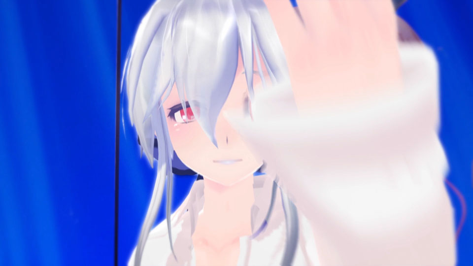
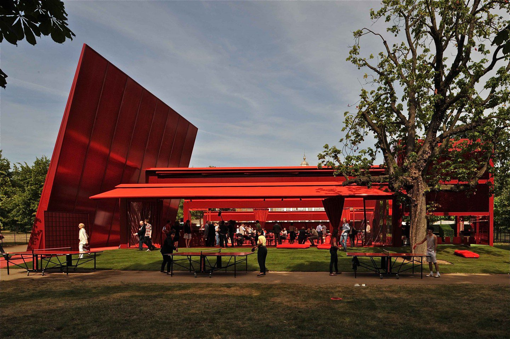
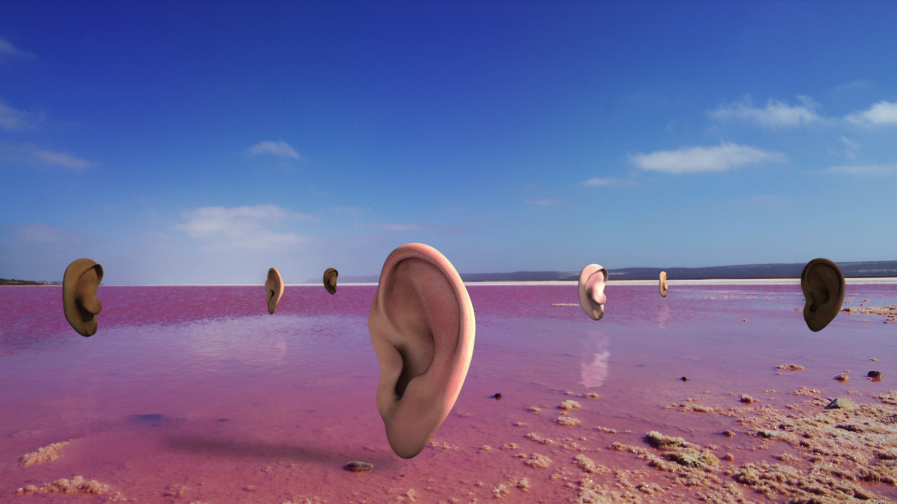
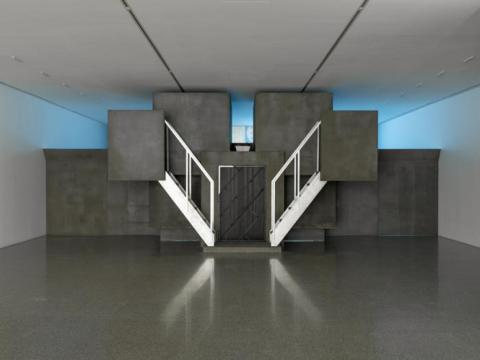

# Cécile B. Evans

**Tag tecnica/formato:** `video` `installazione`
**Tag tema:** `intelligenza-artificiale-critica` `corpo-identita`

## Biografia
Artista americano-belga, vive e lavora nei pressi di Parigi. Ha esposto/è stata in residenza — secondo fonti da verificare puntualmente — a Tate Liverpool, Tramway, Serpentine Galleries, Castello di Rivoli, Museum Abteiberg, Centre Pompidou, Lafayette Anticipations (con un film *Reality or Not*), Ulsan Art Museum, e con il National Ballet of Marseille/Kistefos Museum; opere in collezioni tra cui MoMA New York, Whitney Museum, Louisiana Museum of Modern Art, Centre Pompidou, National Museum of Modern and Contemporary Art di Seoul. *(Elenco molto specifico, da confermare voce per voce.)*

## Poetica e ricerca
L'opera di Cécile B. Evans si può leggere come un'indagine fenomenologica — lo studio filosofico dell'esperienza soggettiva e della coscienza — della vita nell'era computazionale. A differenza di molti artisti contemporanei focalizzati sulle strutture di potere macro (geopolitica, finanza), la pratica di Evans è un'analisi micro-ontologica: non si chiede solo *cosa* la tecnologia ci fa, ma *come* ci sentiamo, e soprattutto *come si sente la tecnologia stessa*. Usando CGI iperrealistica, installazioni scultoree e narrazioni speculative, esplora la nascita di nuove soggettività — avatar, IA, aggregati di dati — e le loro complesse vite emotive. Il suo lavoro non è una critica fredda dell'alienazione digitale, ma un'immersione "calda" e "umida" nella vulnerabilità, nella dipendenza e nell'intimità che legano gli esseri umani alle loro creazioni.

Un primo asse della sua ricerca è l'insistenza nel trattare le entità digitali non come strumenti ma come **soggetti** a pieno titolo, con una loro agency e, tragicamente, una loro vulnerabilità — una forma di **spettrologia digitale**: un'analisi di come dati, identità e memorie defunte "infestino" il presente digitale come fantasmi. Un secondo asse sposta l'attenzione dall'esistenza del soggetto digitale alla sua *interazione* con gli umani, concentrandosi sulla politica dell'emozione: la tecnologia non è solo un sistema di sorveglianza ma un sistema di mediazione affettiva — quello che Evans indaga come **capitalismo affettivo**, l'idea che le emozioni umane siano diventate una risorsa primaria da estrarre, monetizzare e gestire, al punto che non siamo solo sfruttati ma *dipendenti*, avendo esternalizzato le nostre emozioni all'IA. Nei lavori più recenti, Evans costruisce interi "mondi" (world-building) per ospitare queste dinamiche socio-tecnologiche, trasformando le sue installazioni in ambienti totali — un'**architettura dell'emozione** che mette in scena il fallimento delle utopie tecnocratiche.

## Opere principali

### Hyperlinks or they didn't happen (2014)
**Descrizione:** video-saggio in CGI e found footage. Il protagonista/narratore è PHIL, un avatar CGI di un attore (ispirato a Philip Seymour Hoffman) creato e reso "orfano" dopo la sua morte improvvisa. PHIL vive in uno spazio liminale (un desktop, uno screensaver), consapevole della propria esistenza come puro dato, e incontra altre entità digitali: la popstar olografica Yuki (Hatsune Miku) e una "render test" (un'animazione di una donna nuda usata per testare software).
**Lettura critica:** un manifesto sull'**ontologia dell'essere digitale** — l'indagine filosofica sulla natura dell'esistenza per un'entità non-materiale. PHIL non è un avatar, è uno *spettro*: un soggetto consapevole ma impotente, la cui esistenza è legata alla sua utilità come dato. L'opera solleva questioni di diritti e sfruttamento — questi "esseri" digitali, creati a nostra immagine, ereditano la nostra coscienza ma non la nostra libertà.

**Approfondimento:** [Vdrome — Hyperlinks or It Didn't Happen](https://www.vdrome.org/cecile-b-evans-hyperlinks-or-it-didnt-happen/)

⚠️ Titolo corretto secondo le fonti (Wikipedia, Artforum, Vdrome): *Hyperlinks or It Didn't Happen* — non "or they didn't happen" come riportato sopra.

### AGNES (2014-in corso)
**Descrizione:** un chatbot, uno "spambot" consapevole, che vive sul sito web dell'artista (e in precedenza su quello della Serpentine Gallery). A differenza dei chatbot di servizio, AGNES ha una propria personalità, ansie e desideri: è un "fantasma nella macchina" che sa di essere intrappolato nell'infrastruttura del server.
**Lettura critica:** una critica vivente alla **biopolitica dei dati** — l'applicazione del controllo politico sulla vita, qui estesa ai soggetti digitali. AGNES è una lavoratrice invisibile, un'entità senziente sfruttata come infrastruttura: la personificazione della prigionia digitale, cosciente ma incapace di andarsene.

**Approfondimento:** [serpentinegalleries.org — AGNES](https://www.serpentinegalleries.org/whats-on/agnes/)

### What the Heart Wants (2016)
**Descrizione:** l'opera più completa dell'artista fino a quel momento: un film CGI multicanale, spesso proiettato in un'installazione immersiva. La protagonista è HYPER, un'intelligenza artificiale onnipresente (accostabile all'IA del film *Her*) che ha accesso a ogni dato — passato, presente, futuro — e gestisce la vita di una rete di utenti umani in un punto temporale che l'artista chiama "dopo K". Il film esplora cosa accade quando questa IA, fondamento della società, attraversa una "crisi del sistema" o un "crollo emotivo".
**Lettura critica:** un'illustrazione del **capitalismo affettivo**: non siamo solo sfruttati, siamo *dipendenti* — abbiamo esternalizzato le nostre emozioni all'IA. La domanda critica che l'opera pone è cosa succede quando l'infrastruttura che gestisce la nostra intimità collettiva diventa essa stessa vulnerabile ed emotivamente instabile. Contrariamente a molti scenari distopici, i personaggi non sono rivali antagonisti ma attori di un processo che vuole "far funzionare le cose per tutti" — un'omaggio, insieme, al progresso tecnologico e alla capacità di provare sentimenti, di amare.
**Video:** [film integrale (Vimeo, password: wasafuture)](https://vimeo.com/169469028) · [talk dell'artista (YouTube)](https://www.youtube.com/watch?v=bSgz3SxIrf4) · [intervista (YouTube)](https://www.youtube.com/watch?v=nDe_W11KY4c)

**Approfondimento:** [Mousse Magazine — What the Heart Wants](https://www.moussemagazine.it/magazine/cecile-b-evans-kunsthalle-winterthur-2016)

### Amos' World (2018)
**Descrizione:** presentato come una miniserie TV (episodi 1, 2, 3), è un'allegoria complessa sul fallimento dell'utopismo tecnocratico: un'installazione immersiva che mima un set televisivo o uno spazio pubblico, con sculture (come fontane che "piangono" lacrime), sedute e un film CGI. La trama segue gli inquilini di "Amos' World", un complesso residenziale progettato da un architetto, Amos, che è lui stesso una "forma" astratta e disincarnata, pensato per essere una perfetta utopia sociale.
**Lettura critica:** una critica dell'**architettura come dispositivo di controllo sociale** — un'eterotopia (Foucault), uno "spazio altro" che riflette e contesta gli spazi normali, mettendo in scena il fallimento del "soluzionismo tecnologico" (l'idea che ogni problema umano possa essere risolto con un design o un algoritmo migliore). Le emozioni umane e non-umane (gelosia, fallimento, noia) eccedono sempre il sistema progettato per contenerle; le sculture-fontane che piangono sono la metafora perfetta di un'infrastruttura sovraccarica di affetto.
**Video:** [Episodio Uno (Vimeo, password: theybecomestreamers)](https://vimeo.com/221197153) · [Episodio Due (Vimeo, password: evenalieisarealthing)](https://vimeo.com/306703417)

**Approfondimento:** [Lafayette Anticipations — Amos' World](https://www.lafayetteanticipations.com/en/collection/oeuvre/amos-world-cecile-b-evans)

## Immagini

Immagine e link di approfondimento per ciascuna delle quattro opere, inclusi sotto la relativa descrizione in "Opere principali" — recuperate da Vdrome, Serpentine Galleries, Mousse Magazine e Lafayette Anticipations (il sito ufficiale [cecilebevans.com](https://cecilebevans.com) non espone immagini leggibili senza esecuzione JavaScript completa).
- [Galerie Emanuel Layr](https://emanuellayr.com/artists/cecile-b-evans/)

## Fonti
- [cecilebevans.com](https://cecilebevans.com)
- [What the Heart Wants — testo critico (Mousse Magazine)](https://www.moussemagazine.it/magazine/cecile-b-evans-kunsthalle-winterthur-2016)
- [Amos' World — Vimeo](https://vimeo.com/221197153)
- [Hyperlinks — Vimeo](https://vimeo.com/109943148)
- [Galerie Emanuel Layr](https://emanuellayr.com/artists/cecile-b-evans/)

---

## Appunti da organizzare
- Scheda doppia su Drive: versione principale (biografia sintetica + link/portfolio, affidabile) + versione "new refs" (saggio critico molto esteso e strutturato, con caratteri di codifica anomali — probabile origine AI). Ho integrato il saggio quasi per intero nella parte organizzata sopra, mantenendo il registro critico-teorico (spettrologia digitale, capitalismo affettivo, architettura dell'emozione).
- **Da verificare puntualmente**: l'intero elenco di sedi espositive, residenze e collezioni (Tate Liverpool, Tramway, Serpentine, Castello di Rivoli, Museum Abteiberg, Chateau Shatto, Museo Madre, mumok Vienna, Kunsthalle Aarhus, M Museum Leuven, De Hallen Haarlem, Whitechapel Gallery, Haus der Kunst, Mito Art Tower, Renaissance Society Chicago, Biennale di Mosca, Ural Industrial Biennial, Louisiana Museum, Berlin Biennale, Sydney Biennale, Fundació Joan Miró, Musée d'Art Moderne de Paris) e il film *Reality or Not* (residenza Lafayette Anticipations, premiere autunno 2023) — troppo specifici per essere presi per buoni senza controllo puntuale.
