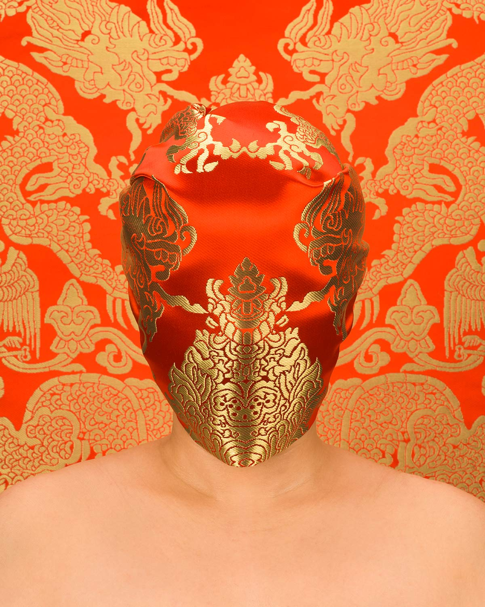
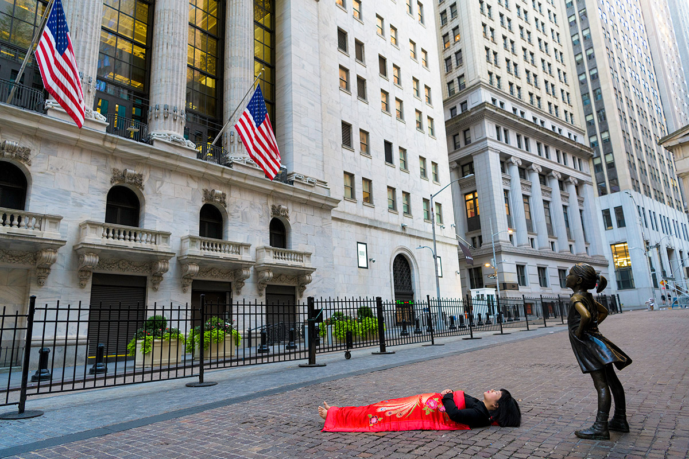
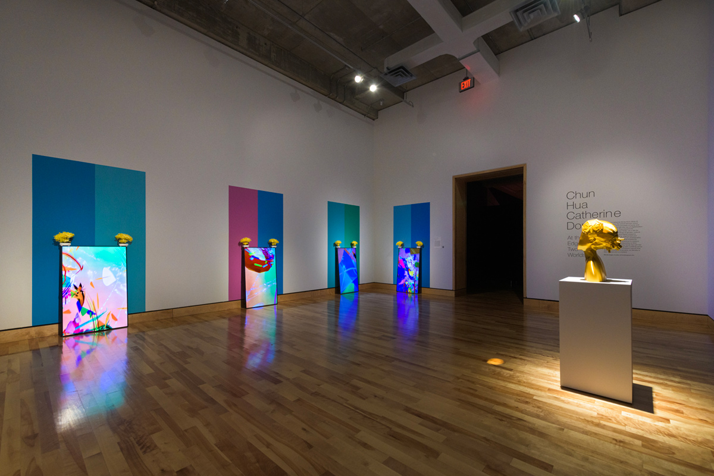

# Chun Hua Catherine Dong

**Tag tecnica/formato:** `performance-dal-vivo` `fotografia` `video`
**Tag tema:** `corpo-identita` `genere-queerness` `colonialismo-decolonialita`

## Biografia
Artista interdisciplinare nata in Cina, residente in Canada. MFA alla Concordia University (Montréal). Riconosciuta a livello internazionale con partecipazioni a MOMENTA Biennale de l'image, International Digital Art Biennial, Musée d'art contemporain de Montréal, Beijing International Art Biennale *(partecipazioni citate nella fonte originale, non ancora verificate singolarmente)*.

## Poetica e ricerca
Dong lavora in performance, fotografia, video e installazioni digitali, esplorando identità culturale, genere, sessualità, diaspora e appartenenza, con il corpo come archivio vivente della memoria individuale e collettiva. Il suo lavoro nasce da una tensione costante tra visibilità e invisibilità, tra imposizioni esterne e autodeterminazione: il corpo è insieme strumento e soggetto, campo di battaglia e mezzo di resistenza politica. La sua ricerca intreccia pratiche femministe, studi decoloniali e riflessioni sulla vita diasporica, confrontandosi con narrazioni stereotipate sui corpi asiatici — specialmente femminili — per svelare le violenze sottili e normalizzate che governano desiderio, controllo e rappresentazione. Integra spesso elementi della tradizione culturale cinese (abiti, ritualità, forme gestuali) per riattivare memorie che resistono nonostante la diaspora.

## Opere principali

### Skin Deep (2014)
**Descrizione:** parole cariche di esotizzazione e discriminazione razziale vengono proiettate sul corpo dell'artista tramite tecnologia di realtà aumentata.
**Lettura critica:** cortocircuito diretto tra proiezioni esterne stereotipate e identità intima — il corpo come superficie su cui si scrive lo stereotipo razziale.

**Approfondimento:** [chunhuacatherinedong.com/portfolio/skin-deep-2](https://chunhuacatherinedong.com/portfolio/skin-deep-2/)

### I Have Been There (2015–)
**Descrizione:** l'artista porta una fotografia del proprio volto davanti al corpo in diverse città del mondo.
**Lettura critica:** un gesto che riflette sul rapporto tra presenza e assenza, visibilità e cancellazione, migrazione e radicamento.

**Approfondimento:** [chunhuacatherinedong.com/portfolio/i-have-been-there-new-york](https://chunhuacatherinedong.com/portfolio/i-have-been-there-new-york/)

### The Wind that Cut Through the Sky (2019)
**Descrizione:** non ancora documentata nel dettaglio in questa scheda.

⚠️ Nessuna immagine: titolo non trovato nel portfolio del sito ufficiale attuale — da verificare se il titolo è corretto o l'opera è stata rimossa dal sito.

### Husband and Wife (2020)
**Descrizione:** non ancora documentata nel dettaglio in questa scheda.

⚠️ Nessuna immagine: titolo non trovato nel portfolio del sito ufficiale attuale (esistono lavori correlati come *Absent Husband* e *Husbands and I*, ma non un'opera con questo titolo esatto) — da verificare.

### Meet Me Halfway (2021)
**Descrizione:** non ancora documentata nel dettaglio in questa scheda.

**Approfondimento:** [chunhuacatherinedong.com/portfolio/meet-me-halfway](https://chunhuacatherinedong.com/portfolio/meet-me-halfway/)

## Immagini

Immagine e link di approfondimento per tre delle cinque opere, incluse sotto la relativa descrizione in "Opere principali", scaricate dal sito ufficiale — attenzione: l'URL corretto è **[chunhuacatherinedong.com](https://chunhuacatherinedong.com)**, non `catherinechundong.com` come riportato in precedenza (dominio inesistente/errato).
- [Centre CLARK — profilo artista](https://centreclark.com/en/artists/chun-hua-catherine-dong)

## Fonti
- [chunhuacatherinedong.com](https://chunhuacatherinedong.com)
- [Skin Deep](https://chunhuacatherinedong.com/portfolio/skin-deep-2/)
- [Artist Talk — Montréal Arts Interculturels](https://vimeo.com/308843796)
- [Documentazione performance "Skin Deep"](https://www.youtube.com/watch?v=w3UwWgUIhHY)
- [Centre CLARK — profilo artista](https://centreclark.com/en/artists/chun-hua-catherine-dong)
- [Art Asia Pacific — profilo artista](http://artasiapacific.com/Blog/ChunHuaCatherineDong)
- The Wind that Cut Through the Sky — pagina opera non trovata sul sito ufficiale [chunhuacatherinedong.com](https://chunhuacatherinedong.com)
- Husband and Wife — pagina opera non trovata sul sito ufficiale [chunhuacatherinedong.com](https://chunhuacatherinedong.com)
- [Meet Me Halfway — pagina opera](https://chunhuacatherinedong.com/portfolio/meet-me-halfway/)

---

## Appunti da organizzare
- Fonte: scheda in cartella "new refs" su Drive (nessuna versione precedente nella cartella principale REF).
- Partecipazioni a MOMENTA Biennale de l'image, International Digital Art Biennial, Musée d'art contemporain de Montréal, Beijing International Art Biennale — citate nella fonte, da verificare puntualmente.
- Le tre opere più recenti (*The Wind that Cut Through the Sky*, *Husband and Wife*, *Meet Me Halfway*) erano solo linkate senza descrizione nella fonte originale — da approfondire visitando il sito dell'artista.
