# Clement Valla

**Tag tecnica/formato:** `fotogrammetria-scansione` `stampa-3d-scultura` `fotografia`
**Tag tema:** `storia-computer-grafica` `intelligenza-artificiale-critica`
**Tag corso:** `M3D`

## Biografia
Nato nel 1979, vive e lavora a Providence (Rhode Island). BA alla Columbia University; MFA in Digital+Media alla Rhode Island School of Design (RISD), dove è professore e fondatore e responsabile del dipartimento Computation, Technology, and Culture, dopo esserne stato dean di Experimental and Foundation Studies. Rappresentato da bitforms gallery. Ha esposto allo ZKM di Karlsruhe, al Museum Morsbroich di Leverkusen, al Museo di Arte Moderna di Mosca, al V&A Dundee, al Dongdaemun Design Plaza di Seul, alla Biennale internazionale di Macao, al MU di Eindhoven e al Museum of the Moving Image di New York ([clementvalla.com — Info](https://clementvalla.com/info.html)).

## Poetica e ricerca
Valla indaga come i sistemi di visione artificiale percepiscono il mondo, e come esseri umani e computer siano sempre più intrecciati nel fare, vedere e leggere immagini. Il suo metodo non è produrre nuove immagini, ma **raccogliere e archiviare** artefatti visivi già generati da software — errori apparenti che, guardati da vicino, non sono affatto glitch casuali ma il risultato logico e coerente del funzionamento di un sistema. Il suo lavoro si muove costantemente al confine tra reale e virtuale, tra fotografia e rendering, tra dato e immagine "non pensata per il consumo umano".

## Opere principali
### Postcards from Google Earth (2010-in corso)
**Descrizione:** raccolta in corso di immagini catturate da Google Earth (rappresentazioni 3D della Terra basate su fotografia satellitare) in cui l'illusione di una superficie terrestre continua e senza cuciture "crolla" — ponti che si piegano su loro stessi, strade che si attorcigliano in forme impossibili. Valla non altera le immagini che trova: le documenta e ne traccia la progressiva scomparsa man mano che Google Earth migliora l'algoritmo e cancella le tracce dei propri limiti.
**Lettura critica:** non sono errori del sistema ma la sua logica più onesta — il momento in cui la fotogrammetria, forzando dati fotografici 2D in una superficie 3D continua, rivela il proprio funzionamento invece di nasconderlo dietro l'illusione del fotorealismo.

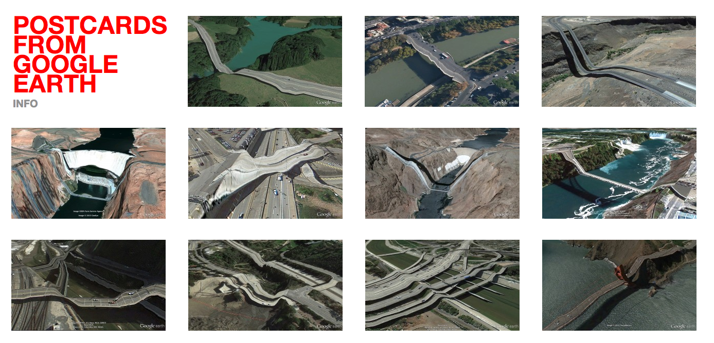

**Approfondimento:** [clementvalla.com — Postcards from Google Earth](https://clementvalla.com/work/postcards-from-google-earth/)

### Surface Survey (2014)
**Descrizione:** serie di stampe digitali e sculture stampate in 3D basate su texture map — dati visivi generati dal rendering di oggetti in modelli digitali 3D — raccolti da software che trasforma fotografie in modelli 3D.
**Lettura critica:** esplora il confine sempre più eroso tra reale e virtuale attraverso concetti di archeologia, software e immagini "non pensate per essere viste da un occhio umano" — un antecedente diretto delle "immagini operative" di Farocki e Paglen (già in database).

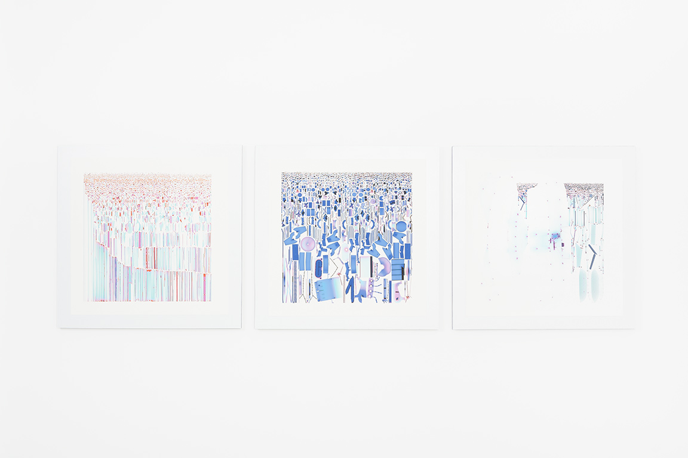

**Approfondimento:** [clementvalla.com — Surface Survey](https://clementvalla.com/work/surface-survey/)

### Seed Drawings (2011-in corso)
**Descrizione:** disegni realizzati da migliaia di persone, con software scritto dall'artista e stampa a getto d'inchiostro su carta. Un segno semplice viene inviato a un lavoratore di Amazon Mechanical Turk con una sola istruzione, «copia questo»; la copia passa al lavoratore successivo con la stessa istruzione, e così via. Nessuno vede l'originale: ognuno vede solo ciò che ha fatto la persona prima di lui. Dopo migliaia di passaggi il segno è finito dove il suo primo autore non poteva prevedere. I disegni finali sono composizioni sovrapposte di tutte le generazioni.
**Lettura critica:** registrano la forma dell'errore accumulato e il sistema di lavoro distribuito attraverso cui passano, in modo invisibile, la maggior parte delle immagini.

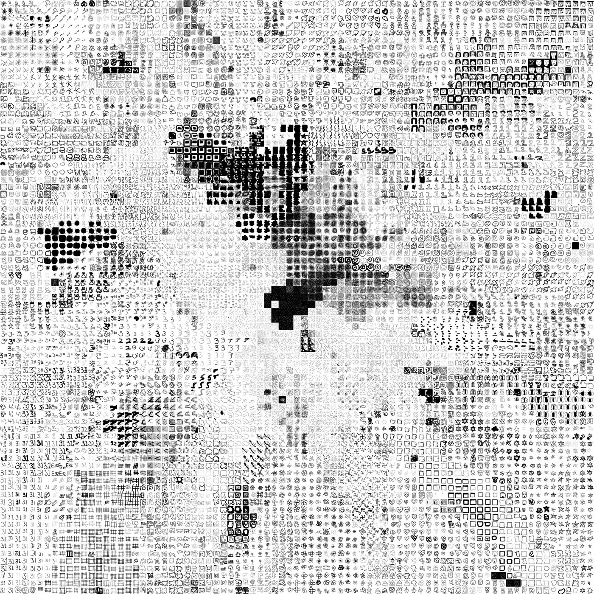

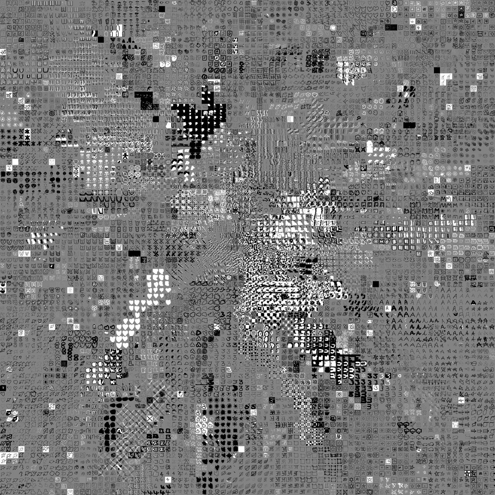

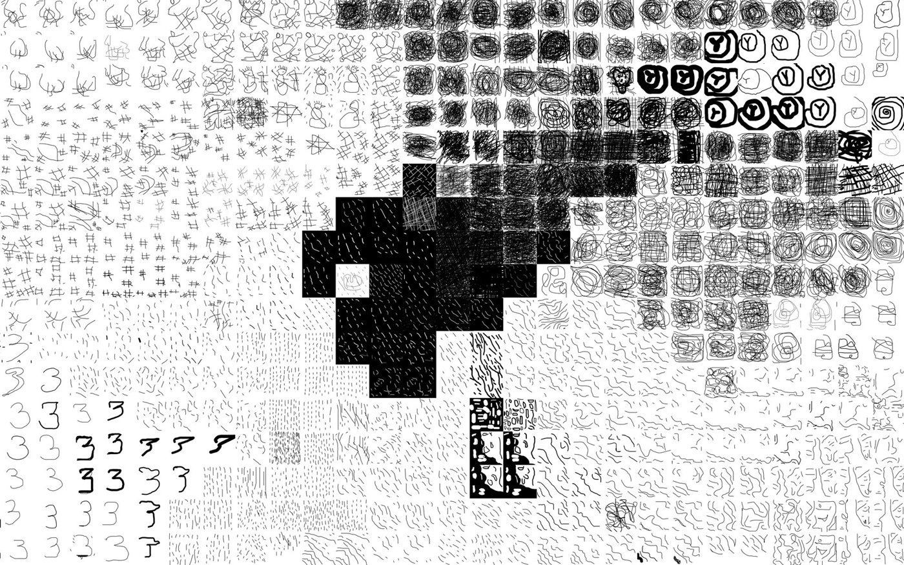

**Approfondimento:** [clementvalla.com — Seed Drawings](https://clementvalla.com/work/seed-drawings.html)

### Surface Proxy (2014-2015)
**Descrizione:** sculture di epoca medievale e classica del Metropolitan Museum of Art e del RISD Museum ricostruite come oggetti morbidi, in stampa a getto d'inchiostro su lino belga montato su sculture di schiuma fresate a controllo numerico. Una scansione fotogrammetrica produce un modello approssimativo dell'originale; il modello viene fresato in schiuma e la superficie fotografica dell'oggetto viene stampata su lino e tesa sopra. Il risultato ha la sagoma di un santo, di un capitello o di un'anfora, ma è una pelle di tessuto tirata su un'approssimazione. Presentata alla XPO Gallery di Parigi (2015); *Wrapped terracotta krater* (2015) è nella Carl & Marilynn Thoma Art Foundation. Fotografie: Vinciane Verguethen.
**Lettura critica:** è quello che un modello 3D è davvero, secondo l'artista: un'immagine avvolta attorno a un volume vuoto. La pietra diventa stoffa, l'intaglio diventa un'immagine dell'intaglio, e l'oggetto del museo un sostituto di sé stesso.

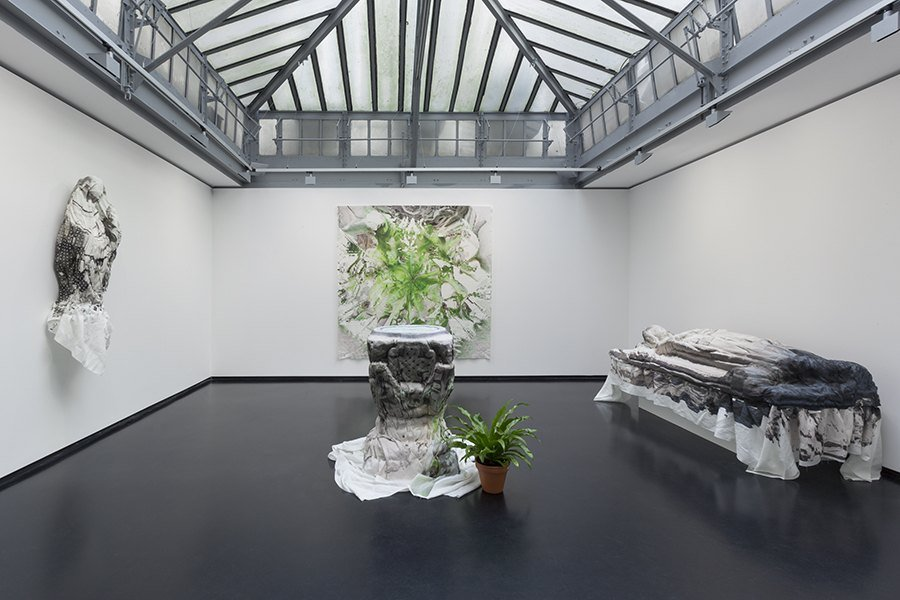

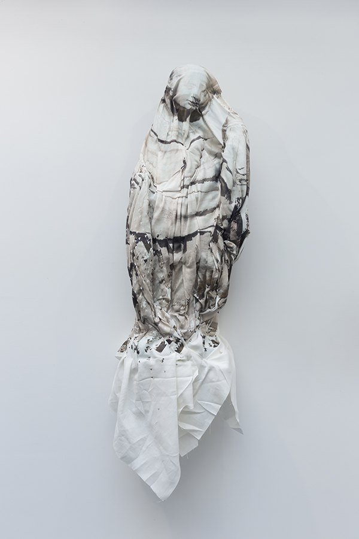

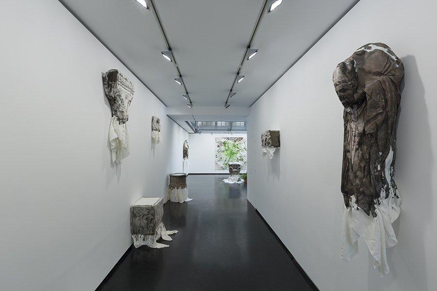

**Approfondimento:** [clementvalla.com — Surface Proxy](https://clementvalla.com/work/surface-proxy.html); **catalogo:** [*Surface Proxy*, XPO Gallery, Parigi, 2015 (PDF, 51 pagine)](https://clementvalla.com/texts/surface-proxy-xpo-2015.pdf), con il saggio di Christiane Paul «Surface Proxy: Reskinned Relics and Architectures of Mediation»

### pointcloud.garden (2019-in corso)
**Descrizione:** software personalizzato, scansioni 3D, schermi, proiezioni e carta da parati. Una scansione fotogrammetrica non produce un'immagine né un modello ma un elenco di punti misurati, ciascuno con coordinate spaziali e un campione di colore, senza nulla che li colleghi. Valla li mostra come punti, senza trasformarli in superfici. La telecamera si muove lentamente e senza mai ripetersi dentro il giardino: l'opposto di come di solito si comportano gli schermi. Dal 2024 le nuvole di punti sono anche il terreno su cui cresce il Gioco della vita di Conway, con un insieme di regole ampliato. Tra le presentazioni: Google, Gradient Canopy, Mountain View (2025, su commissione); Biennale internazionale d'arte di Macao (2023); Contemporary Istanbul (2022).
**Lettura critica:** il punto di una nuvola di punti ha la stessa doppia funzione di una tessera di mosaico o di un punto nel puntinismo: si guarda da solo e fa parte di un'immagine che esiste solo a distanza.

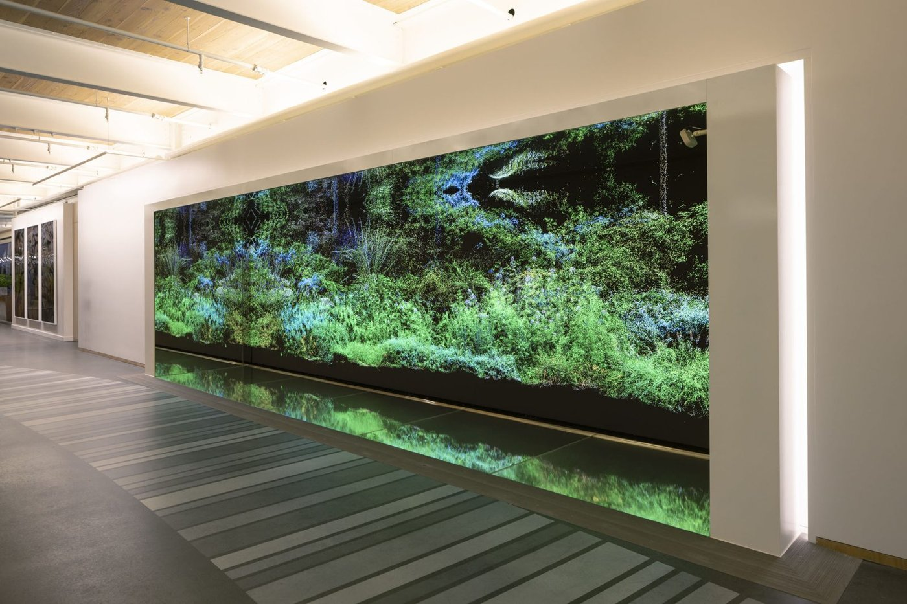

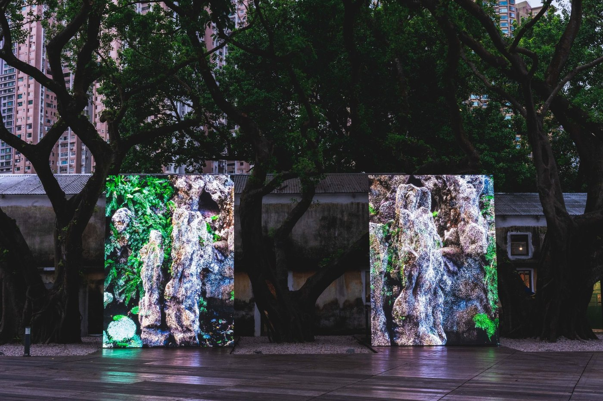

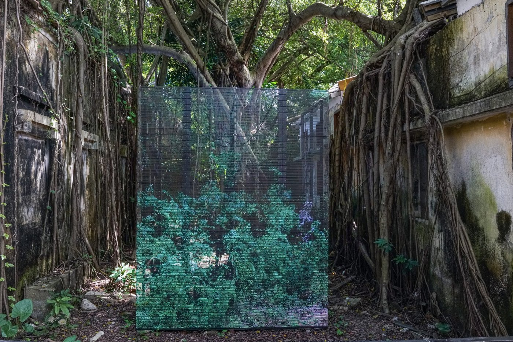

**Approfondimento:** [clementvalla.com — pointcloud.garden](https://clementvalla.com/work/pointcloud-garden.html); [pointcloud.garden](https://pointcloud.garden)

### Google Trees (2019-in corso, con Tobias Nolte)
**Descrizione:** lamiere d'acciaio piegate e saldate, stampa UV su laminazione a foglio, ricavate dai dati 3D di Google Maps. Un albero viene estratto dai dati della mappa 3D, la sua geometria è tradotta in file di fabbricazione e ne nasce una scultura d'acciaio a grandezza naturale, installata in un paesaggio simile (la stessa regione, la stessa luce). Installazioni: Villa Massimo, Roma (2026); Google Gradient Canopy, Mountain View (2025); Casa Bianca Art Site, Castelnuovo Calcea, Asti (2025); Campus Haspel, Wuppertal (2024).
**Lettura critica:** le fotografie delle sculture finite hanno un problema, quasi nessuno ci crede: gli alberi sembrano troppo nitidi e simmetrici, come un rendering inserito in una scena reale. Secondo l'artista è l'argomento centrale dell'opera: viviamo in un sistema di rappresentazione così condizionato dalle immagini prodotte dalle macchine che una fotografia di un oggetto reale non è più credibile come reale.

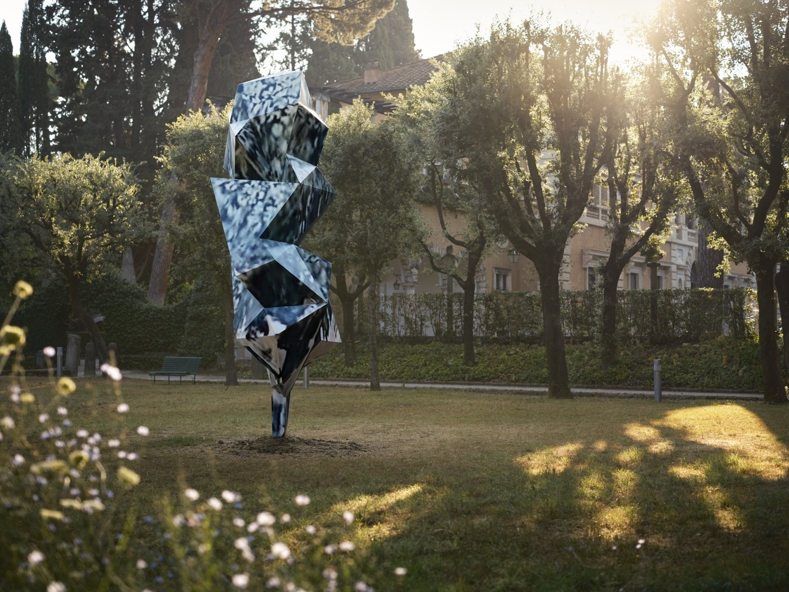

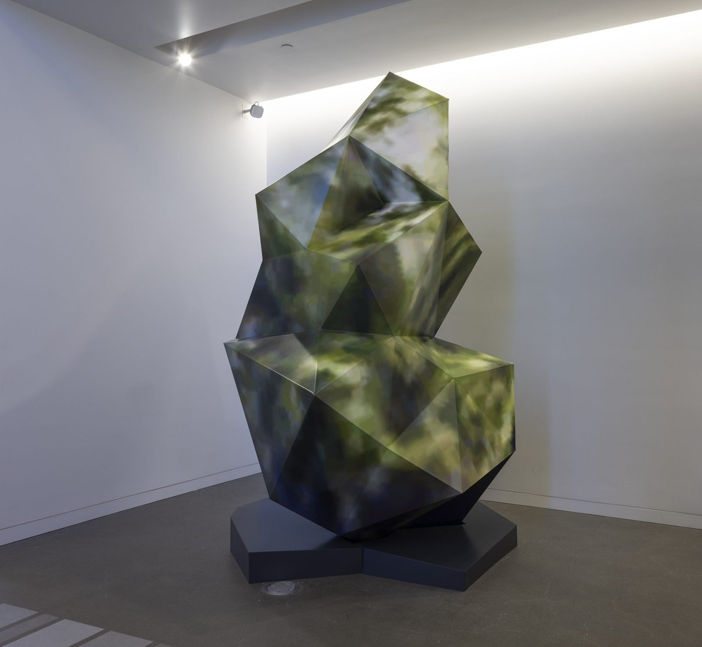

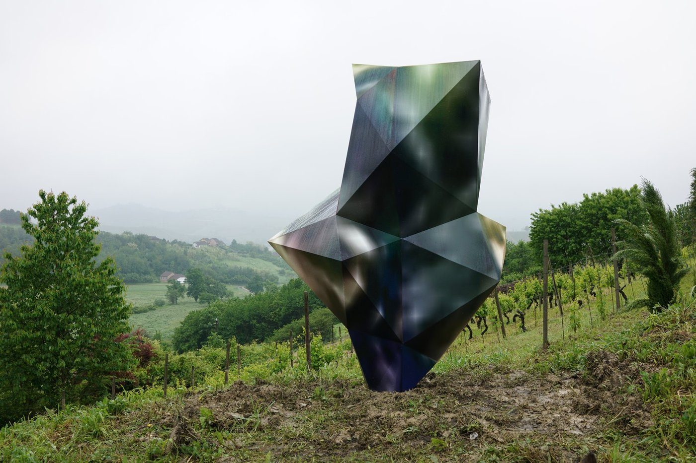

**Approfondimento:** [clementvalla.com — Google Trees](https://clementvalla.com/work/google-trees.html); [googletreewuppertal.com](https://googletreewuppertal.com)

### AI and Jig Thinking (2026, testo)
**Descrizione:** note di lavoro (v0.2, documento in aggiornamento) sul «jig thinking»: cosa succede quando artisti e designer costruiscono i propri strumenti, e l'IA rende questa costruzione veloce, specifica e usa-e-getta. Il *jig* è, in falegnameria, la dima che rende affidabile un taglio; in studio è un piccolo software scritto dall'artista per rendere ripetibile una mossa, trattabile un materiale o risolvibile una domanda. Si costruisce invece di affittarlo, è specifico invece che universale, e riflette chi lo usa. Non è un prodotto, non è un prompt, non è infrastruttura permanente e non sostituisce il mestiere.
**Lettura critica (la parte sull'insegnamento):** Valla descrive tre schemi osservati in aula. Il «problema del 90%»: il prompt porta al 90% ma l'output è monolitico, non si può iterare, si rigenera da capo. Il divario dei principianti: chi ha già basi usa l'IA per moltiplicarle, i principianti ne sono guidati. L'attrito come diagnostica: la fatica di tradurre un'intenzione in logica formale mostrava dove il pensiero si rompeva, e l'IA la toglie. Propone cinque capacità che l'insegnamento di studio allena e che l'IA rende più preziose: **sensibilità, intenzione, iterazione, critica e gioco**. Contrappone due modelli di origine delle idee (dall'interno dell'umano o dal lavoro con i materiali), richiamando l'ilemorfismo, Tim Ingold, Frei Otto e Gaudí, e *The Cult of Creativity* di Samuel Franklin (2023).

**Approfondimento:** [clementvalla.com — AI and Jig Thinking](https://clementvalla.com/texts/jig-thinking.html)

### Altri progetti (dal catalogo completo, 2010-oggi)
**Descrizione:** il catalogo sul sito dell'artista raccoglie 184 opere in 19 progetti. Oltre a quelli sopra: *copy+paste* (2024), *Featherworks* (2019-2020), *In Mineral Unconsciousness and Unobserved* (2018-2019), *Rock Screens* (2019), *Textilographs* (2019), *Flat Tire* (2017), *Parallel Lines on a Freeform Surface* (2016), *Plants and Grids* (2016), *Wrapped Terracotta* (2014-2015), *Forensic Still Life* (2014), *The Universal Texture Recreated* (2014), *Iconoclashes* (2013). Descrizioni da scrivere.

**Approfondimento:** [clementvalla.com — catalogo di tutte le opere](https://clementvalla.com/catalogue.html)

## Interviste e talk
- [AI in art and design education: a conversation (RISD, 2026, 1 ora)](https://www.youtube.com/watch?v=V19CPLepmsU)
- **Video:** [New Ways to See: Digital Art Criticism Now — Whitney Museum, 2016: panel con Christiane Paul, Nora Khan e Ian Cheng, moderato da Brian Droitcour](https://www.youtube.com/watch?v=TAgoFaR98cE)
- **Video:** [Macao Pointcloud Garden — film di Lam Sio Man per Art Macao (2023, 6 minuti)](https://www.youtube.com/watch?v=HSYJ6szlXV8)
- **Video:** [Meet Clement Valla — Google Arts & Culture (2025, 1 minuto)](https://www.youtube.com/watch?v=CZlJAo2EHpw)
- [The Universal Texture — Rhizome (2012): testo e video della talk](https://rhizome.org/editorial/2012/jul/31/universal-texture/)
- [Artist statement (settembre 2026)](https://clementvalla.com/texts/artist-statement.html)
- [AI and Jig Thinking (2026): testo dell'artista sull'IA nella pratica e nella didattica](https://clementvalla.com/texts/jig-thinking.html)

## Fonti
- [clementvalla.com — sito ufficiale](https://clementvalla.com/)
- [Postcards from Google Earth — clementvalla.com](https://clementvalla.com/work/postcards-from-google-earth/)
- [Surface Survey — clementvalla.com](https://clementvalla.com/work/surface-survey/)
- [clementvalla.com — Texts](https://clementvalla.com/texts.html), [Catalogue](https://clementvalla.com/catalogue.html), [Info](https://clementvalla.com/info.html)
- [designboom — Postcards from Google Earth](https://www.designboom.com/art/postcards-from-google-earth-by-clement-valla/)
- [Vice — Surface Survey](https://vice.com/en/article/mgpakn/become-a-digital-archaeologist-with-clement-vallas-surface-survey-exhibition)

## Crediti delle immagini
Immagine e link di approfondimento per entrambe le opere, inclusi sotto la relativa descrizione in "Opere principali", scaricate dal sito ufficiale [clementvalla.com](https://clementvalla.com/).
- *Seed Drawings*, *Surface Proxy*, *pointcloud.garden* e *Google Trees*: immagini scaricate dal sito ufficiale [clementvalla.com](https://clementvalla.com/); *Surface Proxy* fotografie di Vinciane Verguethen, *Google Trees* e *pointcloud.garden* (Gradient Canopy) fotografie come indicate sul sito; diritti dell'artista, uso didattico.
