# Danielle Brathwaite-Shirley

**Tag tecnica/formato:** `videogioco-simulazione` `game-engine-realtime` `installazione` `net-art-sito-web` `performance-dal-vivo`
**Tag tema:** `game-culture` `genere-queerness` `memoria-archivio` `corpo-identita`
**Tag corso:** `AW`
**Stato:** scheda riscritta il 2026-11-24 su sito dell'artista, canale Vimeo, pagine istituzionali (Serpentine, Studio Voltaire, Spike Island, Buffalo AKG, FACT, Factory International), interviste e recensioni · le parole dell'artista vengono da interviste pubblicate, non da registrazioni · immagini dal sito dell'artista e dal canale Vimeo

## Biografia
Nasce a Londra nel 1995; vive e lavora tra Berlino e Londra.[^1] Si diploma (BA) alla Slade School of Fine Art di Londra nel 2019.[^2] Lavora con animazione, suono, performance e sviluppo di videogiochi; la pagina della Serpentine ricorda anche un passato nell'editoria fai-da-te e nell'attivismo.[^1] Nelle interviste si definisce, tra l'altro, «Trans Demon Technologist».[^3] La firma del sito è «VirtuaTransMyst».[^22]

Personali, tra le altre, da Focal Point Gallery, Southend-on-Sea (2020), QUAD, Derby (2021), arebyte Gallery, Londra (2021), FACT, Liverpool (2022), Project Arts Centre, Dublino (2022), Villa Arson, Nizza (2023), SCAD Museum of Art, Savannah (2023), Studio Voltaire, Londra (2024), Fundació Joan Miró, Barcellona (2024), Centre d'Art Contemporain Genève (2024), LAS Art Foundation alla Halle am Berghain, Berlino (2024) e Serpentine North, Londra (2025-26). Collettive alla Barbican (2018), a Les Urbaines di Losanna (2019), alla Albright-Knox Art Gallery di Buffalo (2021), alla Julia Stoschek Foundation (2022), al Centre Pompidou-Metz e al MMCA di Seoul (2023). Performance e proiezioni alla Tate Modern (2020, 2024) e al MoMA (2023). Un'opera è nella collezione del Victoria and Albert Museum.[^1] Nel 2025 la scritta *Trans & Conditions*, commissionata da CIRCA, è apparsa sugli schermi di Piccadilly Circus.[^4]

## Poetica e ricerca
Il centro del lavoro è l'archivio delle vite delle persone nere trans. La biografia sul sito lo dice in una frase: un lavoro che cerca di archiviare l'esperienza nera trans e usa la tecnologia per immaginare ambienti che mettono al centro quei corpi.[^22] L'artista racconta di aver cominciato a «scavare» nella storia alla ricerca di persone nere trans e di aver trovato quasi soltanto documenti di seconda mano, scritti da chi le considerava meno che umane: un manifesto del 1836 che mette in guardia da Mary Jones, chiamata «Man Monster», e le trascrizioni del suo arresto, e nient'altro.[^5][^6] Da qui la tesi che gli archivi occidentali, rigidi, costosi e fondati sui beni materiali, abbiano fallito con le persone nere e trans, e che un archivio debba lasciare a chi vi è archiviato il controllo su che cosa si raccoglie e come lo si usa; il modello proposto è quello orale, in cui chi racconta può decidere se fidarsi di chi ascolta.[^7] L'archivio sognato, in un'intervista del 2020, è una *visual novel* senza fine, che cresce a ogni interazione e in cui le persone archiviate hanno un doppio senziente capace di scegliere che cosa condividere.[^3] La Serpentine riassume la pratica come «archive and insurgency», archivio e insurrezione insieme.[^1]

<table><tr>
<td width="250" valign="top">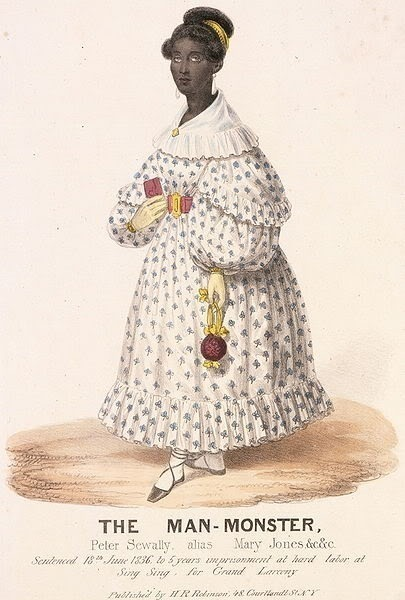 THE MAN-MONSTER, litografia pubblicata da H. R. Robinson, New York, 1836: il manifesto su Mary Jones citato dall'artista (Wikimedia Commons, pubblico dominio)</td>
</tr></table>

La litografia, pubblicata a New York da H. R. Robinson nel 1836, ritrae Mary Jones in abito femminile; la didascalia stampata riporta la condanna del 13 giugno 1836 a cinque anni di lavori forzati a Sing Sing per furto.[^31]

Il videogioco serve a questo archivio perché chiama in causa chi gioca. Secondo l'artista un film si lascia consumare facilmente e finisce per servire lo sguardo di chi guarda, mentre un gioco richiede energia e cambia in base alle scelte, e porta la domanda su chi gioca: non più una visita turistica in una comunità queer, ma una riflessione sul proprio posto nella politica dell'alterità.[^6] Il gioco non insegna l'esperienza nera trans; offre invece uno specchio delle azioni compiute senza accorgersene.[^7] Negli ultimi lavori la formula è «the audience as medium», il pubblico come mezzo: l'opera, dice l'artista, quasi non esiste finché non è toccata dal pubblico, e la risposta peggiore è che sia stata semplicemente «nice».[^8][^4] Nei giochi non si torna indietro e si avanza lentamente; secondo l'artista è voluto, perché chi gioca deve metterci tempo ed energia invece di ricevere tutto.[^24]

Due regole tengono insieme estetica e politica. La prima riguarda il trauma: l'artista conosce l'aspettativa di chi si avvicina all'arte trans, che cerca il trauma, e si dà un codice preciso, discuterlo senza mai rimetterlo in scena. Il rosso e i colori dell'horror annunciano una violenza che poi non arriva; l'horror è rivolto a chi guarda dall'esterno, perché sappia di essere guardato.[^3] L'avviso d'ingresso del *Black Trans Archive* lo dichiara: nessun trauma è stato ricreato nell'archivio.[^22] Il catalogo della Albright-Knox descrive per lo stesso motivo gli avatar semi-astratti, con voci in autotune, che evitano di ridurre le persone nere trans a feticci o a vittime.[^9] La seconda riguarda gli strumenti. Brathwaite-Shirley usa motori di gioco vecchi o abbandonati, o le tecniche dei giochi degli anni Novanta, e tratta il motore come un mezzo espressivo, al modo in cui la critica letteraria studia la lingua di un libro.[^4][^6] Il limite, in un'intervista del 2021 ripresa da *MUBI Notebook*, non stava nella tecnologia di allora ma in chi la usava, quasi sempre uomini bianchi.[^24] Il controllo del codice è per l'artista una questione di sopravvivenza: una presenza digitale affidata a Instagram o a Tumblr può essere censurata o cancellata, mentre chi sa scrivere e riparare il proprio sito la possiede.[^7] La serie di siti `.com` (*blacktransarchive.com*, *blacktransair.com*, *blacktranssea.com*) nasce da qui: spazi costruiti da zero da persone nere trans, invece che su sistemi predisposti senza pensare a loro.[^10]

Il metodo di lavoro parte da una conversazione, spesso con gruppi di persone della comunità pagate per il loro tempo. Una frase detta in quella conversazione genera personaggi, ritratti, carte da parati, ambienti fisici e digitali; nella modellazione l'artista si concede quindici minuti per ogni modello e non corregge quelli riusciti male, ma ne fa di nuovi.[^4]

## Metodo: come si costruisce l'archivio
Le fonti più dirette sul metodo sono i video in cui l'artista lavora o mostra il proprio computer: *In the Studio* (Factory International, 2023) e il *Desktop Tour* (arebyte, 2021), insieme alle conversazioni pubbliche organizzate da arebyte nel 2022. I passi citati vengono dai sottotitoli automatici, con il minuto tra parentesi.

**Dagli amici filmati al gruppo di lavoro.** Nei primi film l'artista riprende in green screen gli amici e le persone nere trans conosciute negli anni dell'università, e li inserisce nell'animazione: il film diventa un diario di quel momento.[^37] *Digging for Black Trans Life* (2019) parte da una storia inventata, una tecnologia che «scansiona la terra» e riporta i ricordi delle persone nere trans assenti dagli archivi; è un'animazione di quaranta minuti con una performance in costume, in cui l'artista combatte un *boss* proiettato sullo schermo. Nel finale il pubblico indossa un guanto e seppellisce una figura: per l'artista quei dieci minuti in cui il pubblico diventa l'opera decidono il passaggio ai giochi.[^37] Per *WE ARE HERE BECAUSE OF THOSE THAT ARE NOT* (2020) l'artista lancia una chiamata aperta e lavora con circa quindici persone nere trans, quasi nessuna con esperienza di videogiochi: ognuna disegna personaggi e paesaggi a partire da storie proprie, il gruppo partecipa a tutti i livelli delle decisioni, e insieme decide di togliere dal gioco ogni traccia di trauma, nonostante le pressioni a raccontarlo; ciò che si archivia è il modo in cui il gruppo racconta.[^35][^36][^38]

**Dalla frase al personaggio.** Ogni lavoro comincia da una conversazione, spesso con persone pagate per il loro tempo; una frase detta in quella conversazione genera un personaggio, un ritratto, una carta da parati, un ambiente.[^4] Nel video di Factory International l'artista descrive lo stesso procedimento: una persona racconta un episodio della propria infanzia, e personaggi, mondo, suono e scelte del gioco vengono costruiti attorno a quel solo momento, comprese le incomprensioni e ciò che si perde nella traduzione. Il risultato viene mostrato alla persona: se non vi riconosce una parte della propria vita, il lavoro si rifà. L'obiettivo dichiarato non è ricostruire una persona intera ma catturarne una piccola parte.[^34] Secondo l'artista, chi vuole archiviare una comunità a cui non appartiene ottiene solo ciò che le persone sono disposte a mostrare davanti a una telecamera.[^34]

**Come nascono gli avatar.** Le tecniche cambiano da un progetto all'altro.
- *SHE KEEPS ME DAMN ALIVE* (2021): i movimenti sono ripresi in video e convertiti con DeepMotion, un programma di motion capture che ricava lo scheletro animato da una normale ripresa; il gioco è montato in Unity.[^35] I corpi da proteggere sono le artiste nere trans Ebun Sodipo e Marikiscrycrycry, modellati in *low poly*, con pochi poligoni.[^41][^42] Durante la mostra arebyte e QUAD organizzano un laboratorio online sulla creazione degli *asset*, con i posti riservati alla comunità nera trans.[^41]
- *GET HOME SAFE* (2022): le riprese di motion capture di amici neri trans diventano ritratti video in caratteri ASCII, volutamente poco riconoscibili.[^43]
- *I CAN'T FOLLOW YOU ANYMORE* (2023): a Studio Voltaire si registrano le voci dei cinque personaggi e si filmano i ritratti dei partecipanti al rallentatore, con stoffe mosse da ventilatori; le stoffe sono riprese da una mostra precedente e usate come abiti. Le voci vengono poi sovrapposte ai ritratti, montati in modo diverso secondo la persona.[^34][^33]
- Le voci e le canzoni, composte dall'artista, sono distorte o passate in autotune.[^43][^9]
La resa è volutamente povera. L'artista si dà come limite la grafica della prima PlayStation e cerca il minimo di poligoni con cui rendere l'atmosfera di un momento, per esempio la prima pillola di ormoni o il primo *misgendering*.[^35] Il testo di *CURA.* lega questa scelta al rifiuto di rendere i corpi neri trans immediatamente riconoscibili.[^43] Prima di un progetto l'artista prova ogni tecnologia nuova facendo un video musicale con sé stessa, poi passa ad altre persone.[^34]

**Laboratori con gruppi.** Per *When Our Worlds Meet* (FACT, 2022-23) dieci ragazzi di Liverpool, The Bandidos, lavorano con l'artista per un anno, tra laboratori, discussioni e presentazioni, a partire da tre domande sul proprio mondo; FACT ha pubblicato una serie di video in cui cinque di loro presentano i mondi che hanno disegnato.[^40] Per *THE DELUSION* (2025) l'artista organizza laboratori separati con gruppi di circa otto persone, per esempio di fedi religiose diverse o di attivismi diversi, e costruisce il mondo del gioco perché possa contenere tutto ciò che hanno detto, per evitare che la conversazione venga da un solo punto di vista.[^39]

**Il motore come archivio.** L'artista guarda ai motori di gioco come a strumenti per archiviare e conservare dati, sottoutilizzati perché pensati solo per l'intrattenimento.[^35] Il primo programma 3D usato è stato un software amatoriale che estrude un disegno in un oggetto 3D; poi Blender, usato ogni giorno come un diario, fino ad accumulare un mondo intero fatto di quei giorni.[^35] In *In the Studio* l'artista generalizza: 3D, programmazione e game design, imparati da sé, sono stati un diario quotidiano più che una materia di studio, e per questo i motori e i programmi 3D possono diventare strumenti personali, capaci di far uscire ciò che si prova e di toccare chi guarda.[^34] Già prima, all'inizio della transizione, il diario era un videogioco: in *Dragon's Dogma* l'artista creava un personaggio di sé e uno di come voleva apparire, e giocava con il secondo.[^35]

## Opere principali

Il sito dell'artista ha una pagina per ogni progetto, con fotografie e link ai giochi; la pagina «Playable Games» elenca le opere giocabili nel browser, da computer portatile.[^22] I film dal 2017 al 2019 sono sul canale Vimeo dell'artista.[^23]

### Primi film: Blackzilla, Unarchived Adventures, TRANS-PORT ME (2017-2018)
**Descrizione:** film d'animazione con l'estetica del videogioco degli anni Novanta. *BLACKZILLA: TRANSITIONING AT OUR OWN PACE* (14'33", caricato nel febbraio 2018; il sito lo data 2017) racconta l'arrivo di Blackzilla, «Black, Trans Robot Archive» che registra solo vite nere trans, e di un corpo nero che vuole fare la propria transizione in un mondo che ora lo accetta.[^23][^11] *Unarchived Adventures* (8'31", settembre 2018) è un film in forma di avventura *point and click*, legato all'inizio della terapia ormonale.[^23][^11] *TRANS-PORT ME* (6'03", 2018; versione integrale di 11'49", 2019) è un video karaoke da cantare insieme: «I need to be transported».[^23] Negli stessi anni sul canale compaiono film brevi come *Opulence*, *All Natural*, *Mumble Mouth (A Feast of Blackness)* e *Speaking Your Mind*, quest'ultimo un podcast sonoro ambientato in un mondo virtuale sorvegliato da Audre Lorde.[^23]
**Lettura critica:** l'artista descrive *Blackzilla* come la riappropriazione dell'immagine del corpo nero trans rappresentato nella storia come mostruoso, e *Unarchived Adventures* come la risposta a una ricerca di rappresentazioni trans nei videogiochi che aveva trovato soprattutto inclusioni violente.[^11] Per *MUBI Notebook* i film degli anni della Slade sono collage più che racconti lineari, con personaggi disegnati a mano in ambienti digitali vicini all'horror; in *Blackzilla* un «Trans Daemon» a forma di serpente offre aiuto nella transizione o la possibilità di conservare i ricordi in un archivio nuovo.[^24] Ariel Collier, in un testo pubblicato da Studio Voltaire, legge *When Our Worlds Meet* (2022) come il gioco in cui *TRANS-PORT ME* prende vita.[^25]
**Sul sito:** [Animation Videos](https://www.daniellebrathwaiteshirley.com/portfolio)
**Video:** [BLACKZILLA: TRANSITIONING AT OUR OWN PACE](https://vimeo.com/254791910) · [Blackzilla, estratto di 3 minuti](https://vimeo.com/313049522) · [Unarchived Adventures](https://vimeo.com/290493826) · [TRANS-PORT ME](https://vimeo.com/292329720) · [TRANS-PORT ME (full version)](https://vimeo.com/340326975)

<table><tr>
<td width="250" valign="top">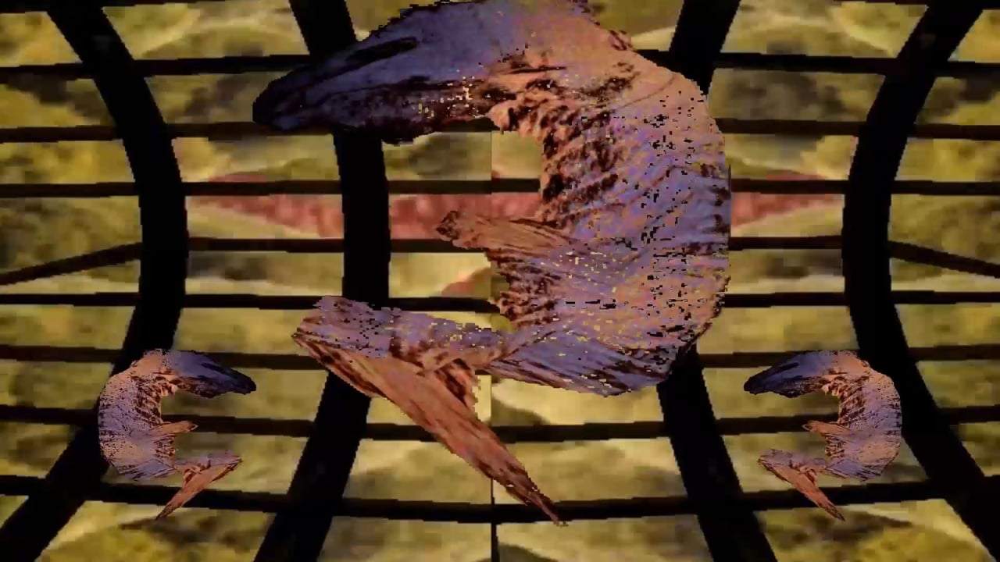 Blackzilla: Transitioning at Our Own Pace (2018), fotogramma, Vimeo dell'artista</td>
<td width="250" valign="top">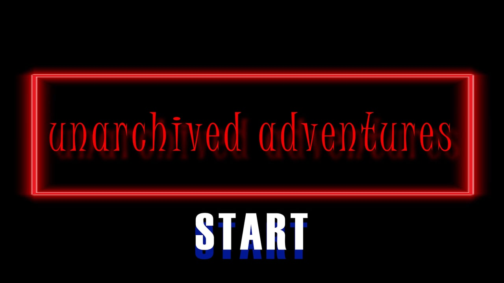 Unarchived Adventures (2018), schermata iniziale, Vimeo dell'artista</td>
<td width="250" valign="top">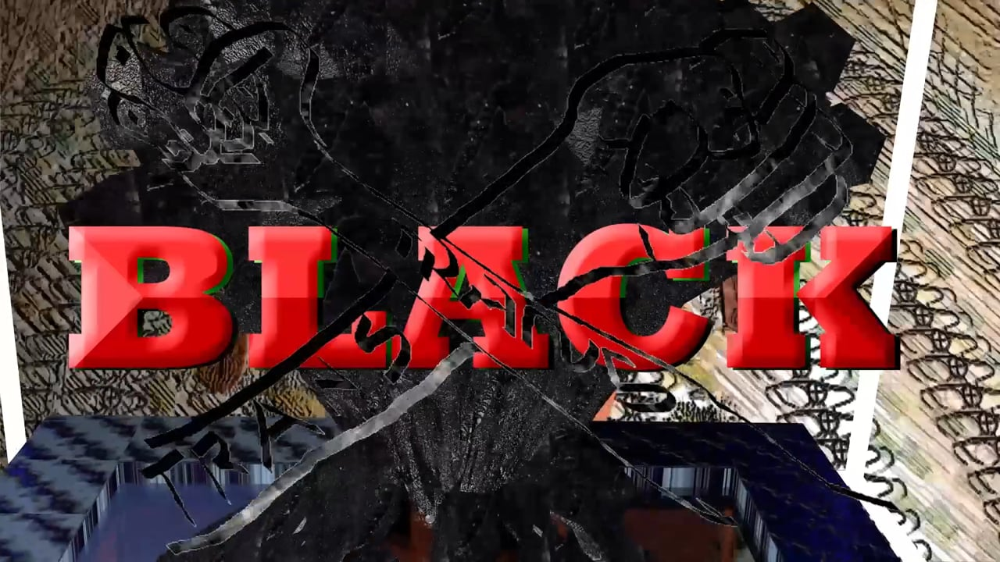 TRANS-PORT ME (2018), fotogramma, Vimeo dell'artista</td>
</tr></table>

### Digging for Black Trans Life (2019)
**Descrizione:** film d'animazione di quaranta minuti, con una performance della stessa durata e un pezzo in VR di undici minuti. L'artista lo considera l'inizio del proprio percorso: un prototipo di opera interattiva in cui gli elementi di gioco sono finti, incorporati nel video.[^7] Il sito ne pubblica un estratto di tre minuti, caricato su Vimeo con il titolo *Trans Talks*, e le fotografie delle performance alla Münchner Kammerspiele e al Performance Club della Raven Row Gallery (2019).[^22][^23] Il film completo non è pubblicato online. Su Vimeo c'è anche *DIGGING FOR BLACK TRANS LOVE* (14'28", dicembre 2018), dal titolo simile, che la descrizione presenta come documentazione di una performance.[^23]
**Lettura critica:** *MUBI Notebook* descrive una parte del film come la satira di un talk show: un conduttore informe e senza volto chiede storie di sofferenza («Let's get this trauma show on the road»), e l'ospite trans si rifiuta e rovescia la conversazione rivendicando la figura del mostro.[^24]
**Sul sito:** [Animation Videos](https://www.daniellebrathwaiteshirley.com/portfolio) · [One Off Performances](https://www.daniellebrathwaiteshirley.com/copy-of-you-are-being-let-into-a-sp-1)
**Video:** [estratto, *Trans Talks*](https://vimeo.com/313054313) · [DIGGING FOR BLACK TRANS LOVE, documentazione della performance](https://vimeo.com/307758442)

<table><tr>
<td width="250" valign="top">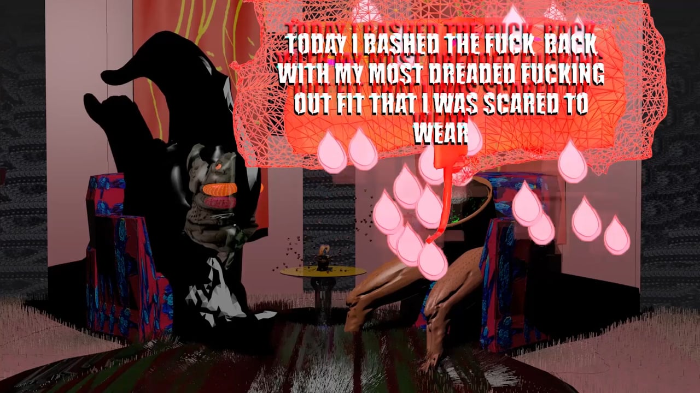 Digging for Black Trans Life (2019), estratto «Trans Talks», fotogramma, Vimeo dell'artista</td>
<td width="250" valign="top">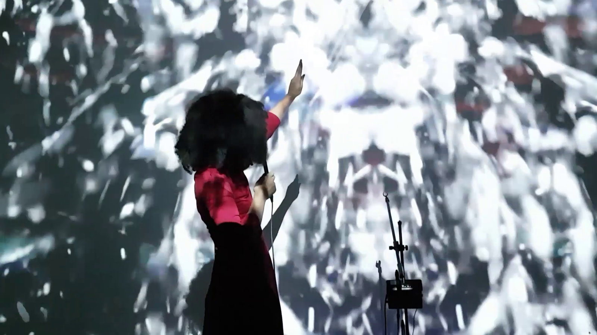 Digging for Black Trans Life, performance (2019), dal sito dell'artista</td>
<td width="250" valign="top">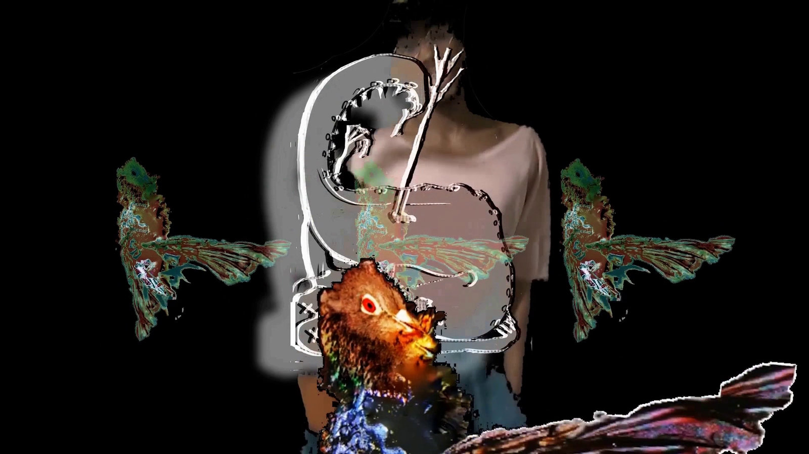 Digging for Black Trans Life, presentazione del film d'animazione, dal sito dell'artista</td>
</tr></table>

### You Are Being Let Into A Space (2019)
**Descrizione:** installazione alla mostra di diploma della Slade (2019), con sculture fatte di camere d'aria, capelli da treccia, forcine, guanti di gomma, collant, stampe serigrafiche a parete, una performance e un'installazione VR.[^22] Il titolo è la formula con cui cominciano molti testi d'ingresso delle mostre successive.[^2][^22]
**Sul sito:** [You Are Being Let Into A Space](https://www.daniellebrathwaiteshirley.com/performance-and-video)

### RESURRECTION LANDS (2019)
**Descrizione:** gioco, presentato a Les Urbaines, Losanna, nel 2019, con uno striscione stampato di 210 × 300 cm.[^22] Le schermate pubblicate sul sito mostrano un «Hormone Pills Bar» e ambienti fitti di scritte verdi. Nell'intervista a *Highsnobiety* l'artista lo descrive così: una tecnologia riporta in vita i ricordi delle persone morte e viene usata per farne una biblioteca delle persone nere trans, che diventa un e-sport e le sfrutta di nuovo; il gioco è datato lì al 2020.[^6] Il sito lo intitola anche *RESSURECTION PRO LEAGUE*.[^22]
**Sinossi:** le Resurrection Lands sono il luogo in cui sono custoditi i ricordi delle persone nere trans riportate alla luce, la «library of resurrected Black trans people». Chi entra dichiara le proprie intenzioni, sceglie una squadra, accetta i termini, «carica la mente» in un avatar da visitatore e arriva su una mappa con sei luoghi: Ancestors Words, Hormone Bar, The Lake, Trans Exhibition, Whispers, Deadname Burial. All'Hormone Bar le persone nere trans vengono scansionate e liberate dalle «maledizioni» lasciate dall'esperienza vissuta (lo scanner trova per esempio «Looking down when you feel uncomfortable» e la perdita di spiritualità), poi in un giardino un albero consegna loro un flacone di ormoni che porta il loro nome e non finisce mai. Chi arriva con cattive intenzioni viene maledetto: dona i propri beni alle persone nere trans e resta immobilizzato. Nella Deadname Burial si può seppellire il proprio deadname o sceglierne uno nuovo. Chi rifiuta di sostenere gli antenati è «maledetto e rimosso».[^44]
**Gameplay:** nella versione online è un film interattivo: clip video in streaming collegate da pulsanti (squadra, accetto o rifiuto, luogo). La squadra scelta all'inizio, «Pro Black Pro Trans Team» o «Consumers Team», cambia l'avatar, la mappa e i luoghi accessibili: i «Consumers» non entrano nel giardino degli ormoni. La registrazione caricata dall'artista mostra invece una versione esplorabile in tempo reale, con un inventario di oggetti, un cristallo inciso, un personaggio che chiede un incantesimo di guarigione e la sepoltura del deadname, digitato da chi gioca.[^44]
**Sul sito:** [RESSURECTION PRO LEAGUE](https://www.daniellebrathwaiteshirley.com/copy-of-the-black-sea)
**Gioco:** [resurrectionland.com](https://www.resurrectionland.com/)

<table><tr>
<td width="250" valign="top">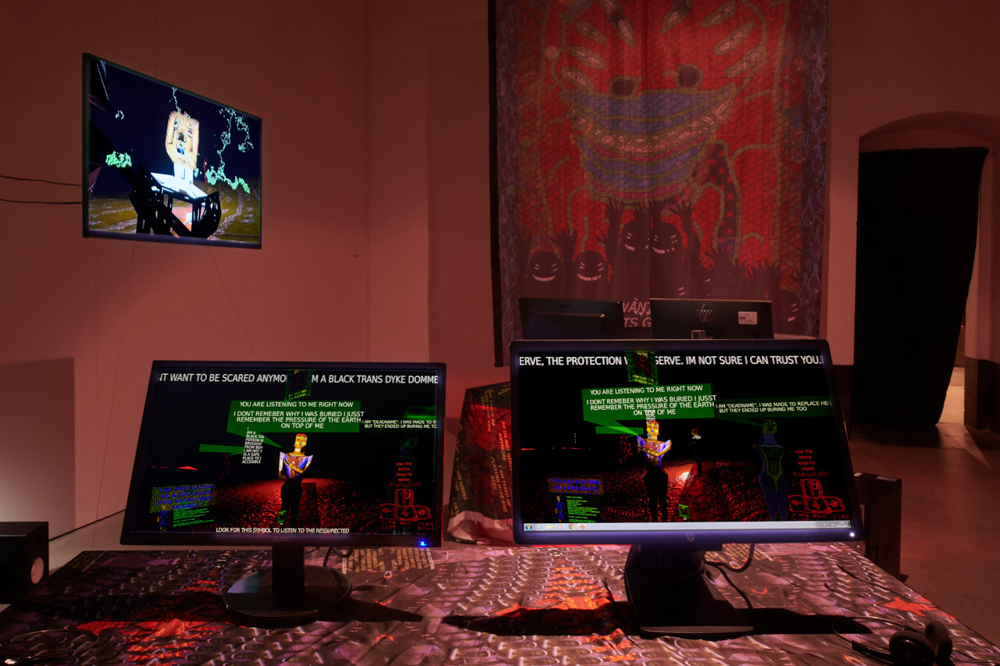 Resurrection Lands, Les Urbaines, Losanna (2019), foto Guillaume Baeriswyl, dal sito dell'artista</td>
<td width="250" valign="top">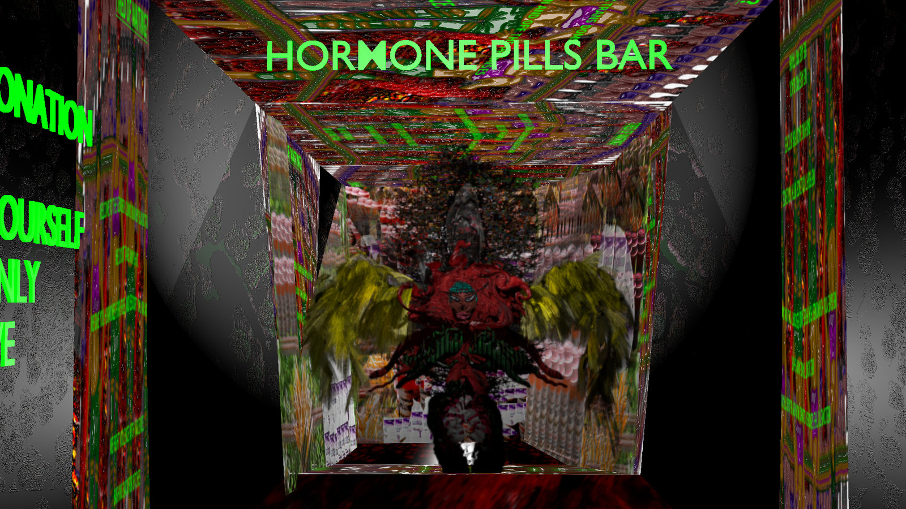 Resurrection Lands (2019), schermata del gioco, dal sito dell'artista</td>
</tr></table>

### WE ARE HERE BECAUSE OF THOSE THAT ARE NOT (2020)
**Corso:** `AW`
**Temi:** `avatar-e-corpo-virtuale`
**Descrizione:** gioco online, noto anche come *Black Trans Archive*, giocabile su [blacktransarchive.com](https://blacktransarchive.com/). Presentato nella mostra *GENDERS* della Science Gallery London (2020)[^12] e in *Difference Machines* alla Albright-Knox (2021-22), con proiettore, sedia da gaming, luci rosa e testo in vinile. All'inizio il gioco chiede di dichiararsi «Black and Trans», «Trans» o «Cis», e il percorso si divide: le persone nere trans sono accolte in una comunità di antenati perduti, le persone trans non nere sono invitate a usare il proprio privilegio relativo, le persone cis incontrano una «funzione di sicurezza» contro il «turismo trans» e poi le occasioni per imparare a essere alleate.[^9] I nomi delle scene sul sito includono «Trans Spa», «Trans Temple», «Cis City», «Dead Name» e tre «Boss Fight».[^13] Realizzato con altre donne nere trans.[^9] La pagina del sito avverte che il gioco nomina sepolture, storie perdute, *deadname*, ormoni e *misgendering*, contiene luci lampeggianti e chiede di essere onesti con l'archivio; ci si muove con i tasti 1, 2 e 3.[^22]
**Lettura critica:** la Albright-Knox lo accosta ai giochi testuali degli anni Settanta, che facevano entrare nel mondo virtuale con l'immaginazione più che con gli occhi, e vi legge la dimostrazione di come una comunità possa costruire i propri strumenti digitali per archiviare la propria storia alle proprie condizioni.[^9] *MUBI Notebook* osserva che, rispetto ai film, il gioco non dà a tutti lo stesso accesso alle storie: chi si dichiara cis passa da un centro di sicurezza che ne valuta il livello di minaccia.[^24]
**Sinossi:** l'archivio si apre con un avviso (nessun trauma è ricreato, ma si parla di sepolture, storia perduta, deadname, ormoni e *misgendering*) e con la dichiarazione «this is not your space, this is our space». La prima domanda, «WHAT DO YOU IDENTIFY AS?», divide la storia in tre.
- **Chi si dichiara nero e trans** sceglie uno di tre antenati, della protezione, della cura o della forza. È un corpo nero trans dimenticato che racconta: anni fa il mio corpo è stato sepolto e la mia storia bruciata, di me è rimasto solo il deadname; la missione è ritrovarlo. Da lì comincia il viaggio.
- **Chi si dichiara trans** può scegliere di resuscitare un antenato («DO YOU WANT TO RESURRECT?»): se rifiuta, la partita finisce.
- **Chi si dichiara cis** viene accusato di aver nascosto gli antenati («you have been responsible for hiding our ancestors… I don't know if I can trust you… prove me wrong») e deve accettare termini che chiedono di mettere al centro le persone nere trans e usare i propri privilegi per aiutarle; poi dice se non ha privilegi, non sa come usarli o li userà per aiutare, incontra l'antenato del deadname ed è arruolato nella squadra di sicurezza.

Il viaggio attraversa «Our Body Our Choice» (i bagni, con la scelta di un cubicolo per fare pipì in pace, e i pesi), una «Trans Spa», la squadra di sicurezza (un monologo ripete «I am tired of…» sulla paura di spostarsi, di mangiare da soli, di guardarsi alle spalle), una *boss fight* e un ultimo bivio verso Dead Name, Trans Temple o Cis City. Nella spa una voce racconta, come storia orale, che la non conformità di genere non è nuova e cita i femminielli di Napoli nel Settecento [trascrizione automatica]. I crediti scorrono su una canzone («Every step I take, I take it with you»).[^44]
**Gameplay:** film interattivo di 48 scene: a ogni bivio si preme 1, 2 o 3 e parte la clip successiva. Quasi tutti i rami finiscono presto in un *game over* che porta ai crediti e poi all'inizio: rifiutare i termini, non resuscitare, alcune scelte sul deadname e due delle tre mosse della *boss fight*. L'identità dichiarata all'inizio decide quali scene si vedono; nessun percorso le mostra tutte. Le schermate attribuiscono i personaggi a chi li ha disegnati, per esempio «Character designed by Marikiscrycrycry» e «Character designed by Jacob V Joyce».[^44]
**Sul sito:** [BLACKTRANSARCHIVE.COM](https://www.daniellebrathwaiteshirley.com/blacktransarchive-com)
**Gioco:** [blacktransarchive.com](https://blacktransarchive.com/)

<table><tr>
<td width="250" valign="top">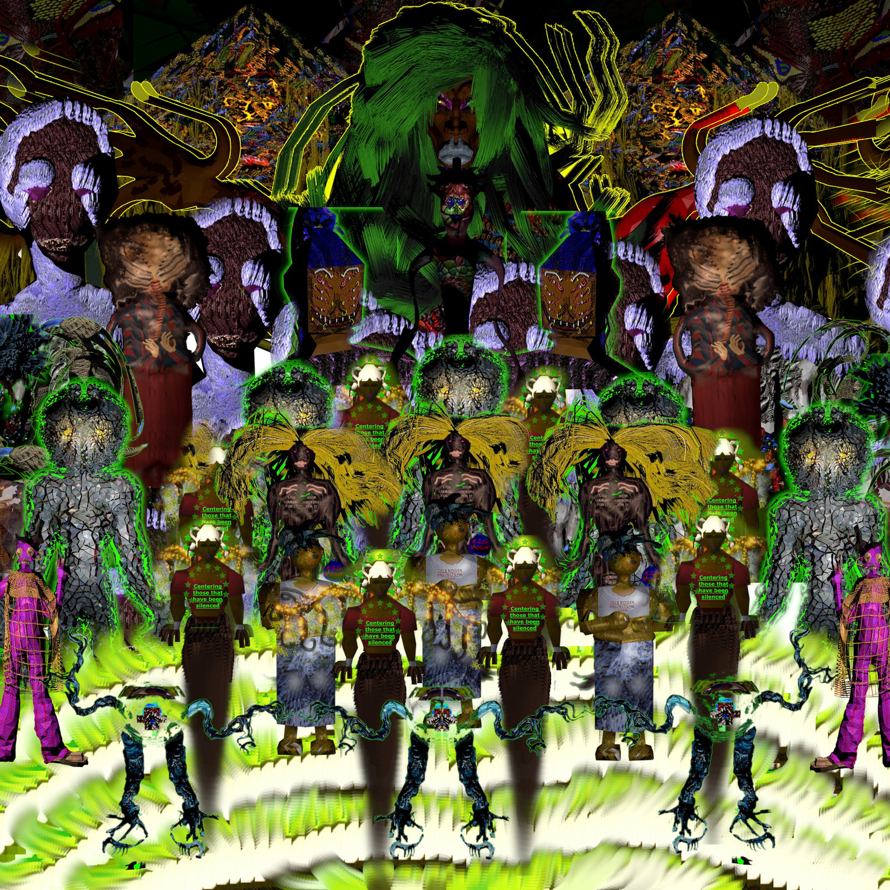 WE ARE HERE BECAUSE OF THOSE THAT ARE NOT (2020), immagine del gioco, dal sito dell'artista</td>
<td width="250" valign="top">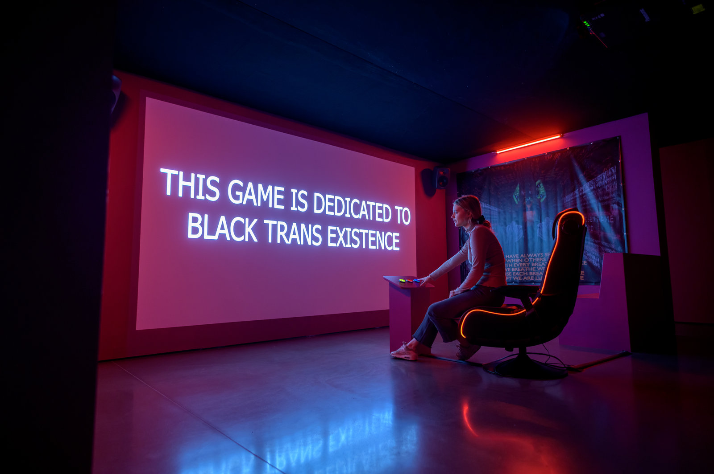 WE ARE HERE BECAUSE OF THOSE THAT ARE NOT, installazione, dal sito dell'artista</td>
</tr></table>

### SHE KEEPS ME DAMN ALIVE (2021)
**Corso:** `AW`
**Temi:** `avatar-e-corpo-virtuale` `guerra-e-militare`
**Descrizione:** personale da arebyte Gallery, Londra (18 novembre 2021 – 19 febbraio 2022), costruita attorno a un gioco arcade in Unity di tipo punta e spara. Il controller è *DECISION MAKER* (2021), una pistola rosa stampata in 3D.[^14] Il comunicato della mostra descrive tre proiezioni a cubo su un palco di tessuto nero, figure scultoree vestite di stoffe stampate e un gioco in tre livelli in cui si «spara» a finestre di testo e nemici; il finale dipende dall'identità scelta all'inizio e da ciò a cui si spara, nel tentativo di proteggere la protagonista.[^26] La domanda posta all'ingresso è se si possano proteggere le persone nere trans con una pistola. L'idea nasce da una prova di controller: cercando il più accessibile, l'artista trova che il più facile da capire per tutti era la pistola finta di *The House of the Dead*, e trova allarmante che fosse un'arma.[^10] Il gioco usa archivi di esperienza vissuta, dati di motion capture e registrazioni delle manifestazioni Black Trans Lives Matter.[^14]
**Lettura critica:** Meritxell Rosell legge il gioco come una messa alla prova del senso di responsabilità di chi gioca, del suo modo di decidere quando agire e quando no.[^10] Tamar Clarke-Brown, nel booklet di *WORLDBUILDING*, osserva che il gioco rovescia l'imperativo degli sparatutto: si può scegliere di proteggere le vite invece di eliminarle.[^14]
**Sul sito:** [She Keeps Me Damn Alive](https://www.daniellebrathwaiteshirley.com/she-keeps-me-damn-alive)

<table><tr>
<td width="250" valign="top">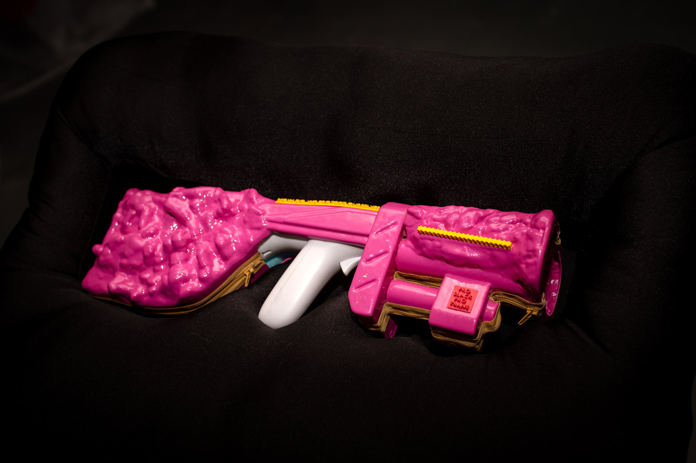 DECISION MAKER (2021), controller a forma di pistola, arebyte Gallery, foto Dan Weill, dal sito dell'artista</td>
<td width="250" valign="top">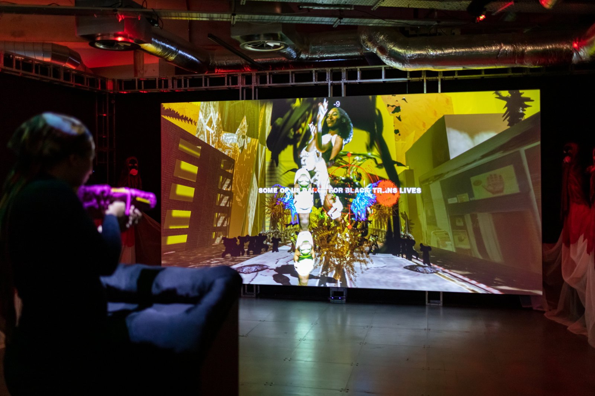 SHE KEEPS ME DAMN ALIVE (2021), il gioco, arebyte Gallery, foto Dan Weill, dal sito dell'artista</td>
<td width="250" valign="top">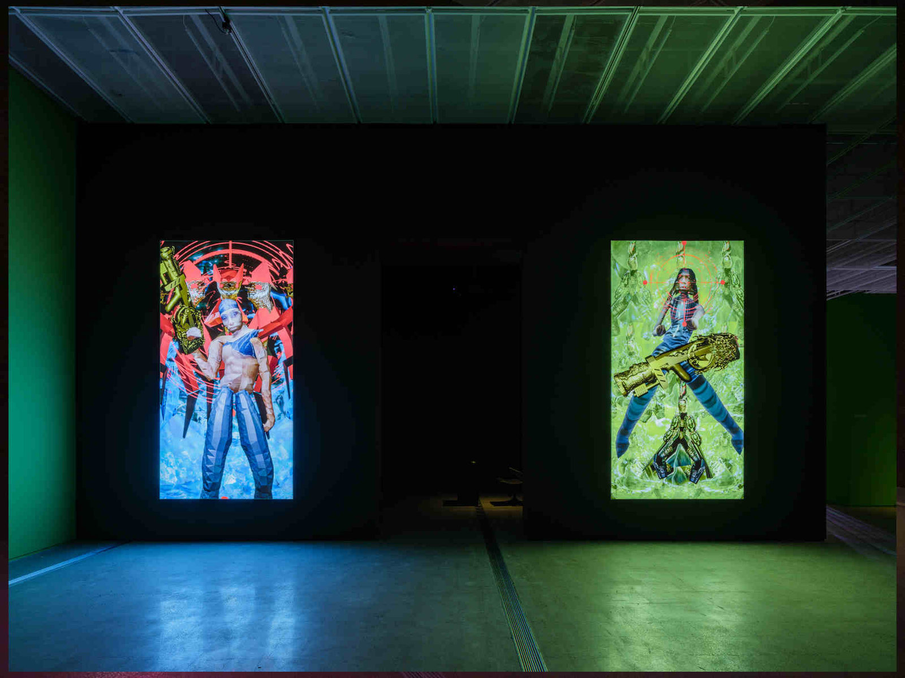 SHE KEEPS ME DAMN ALIVE (2021), veduta della mostra, arebyte Gallery, foto Dan Weill, dal sito dell'artista</td>
</tr></table>

### HAUNTING ALONGSIDE OUR SHADOWS, con Pirating Blackness (2021)
**Descrizione:** personale da QUAD, Derby (25 settembre 2021 – 9 gennaio 2022, secondo il pannello d'ingresso fotografato sul sito), con proiezioni in bianco e nero di un mare, una nave, pulsanti rossi da premere, postazioni di gioco e un cabinato arcade.[^22] Il gioco *Pirating Blackness* è su [blacktranssea.com](https://www.blacktranssea.com/).[^22]
**Lettura critica:** per *MUBI Notebook* *Pirating Blackness* immagina un passato alternativo in cui un oceano vivo e parlante si oppone al proprio ruolo nella tratta atlantica, e chiede a chi gioca se i suoi antenati siano stati colonizzatori di chi è stato portato attraverso il mare.[^24]
**Sinossi di *Pirating Blackness*:** la schermata d'ingresso dice che le onde ricordano il corpo di chi gioca, ma queste non sono le acque a cui è abituato. Nel prologo una voce racconta di aver trovato qualcosa che non doveva esistere: un'email truffa, un sito che la riprende dalla webcam con la scritta «YOU HAVE BEEN CHOSEN», poi un file in più sul computer. La prima domanda è «Who were your ancestors?», con due risposte, «Those that were carried across the sea» e «Colonisers».
- **I discendenti di chi è stato deportato** ricevono una nave: il carico è la loro storia, lo scopo è tenerli al sicuro e portarli a un'isola dove vivere la propria verità. A bordo si può parlare con l'equipaggio (una canzone di una madre nera trans), esaminare il carico («Somewhere in my DNA are the answers») o truffare le navi vicine. Si naviga poi verso nord, est, sud o ovest tra una tempesta, una pioggia rossa e la «prima ferita», si approda a un'isola che sembra vuota ma dove i segreti per vivere la propria verità sono sepolti, e la si esplora. Il finale porta alla «ferita», un buco nel mare: figure rosse dicono di esserne uscite senza riuscire a portare i propri corpi e di aver cercato chi gioca per usare il potere custodito in lui; i due mondi si incontrano, le ombre del passato rimuovono chi le aveva tenute sepolte, e compare «THE WORLD CHANGED».
- **I discendenti dei colonizzatori** lasciano «un'isola che non è mai stata vostra», senza il diritto a un carico: salveranno vite non completando il viaggio. Possono guardare nel passato, guardare la stiva vuota o comunicare con casa, e scegliere se restituire reliquie o pentirsi. Nella terza parte il mare «glitcha» e non li lascia proseguire; l'equipaggio parla dei propri ultimi momenti (chi ha paura di ciò che c'è sotto l'oceano, chi si crede troppo potente per morire, chi si pente e dice che è ciò che si merita) finché compaiono «TIMES UP» e «SHIP DESTROYED».[^44][^24]
**Gameplay:** film interattivo di 45 nodi video: a ogni nodo compaiono due o tre scelte, oppure i quattro punti cardinali; in alcuni punti le scelte sono nascoste da punti interrogativi, e se non si sceglie il programma ne prende una a caso. La risposta alla prima domanda decide tutto il percorso; ogni ramo ha tre finali.[^44]
**Sul sito:** [HAUNTING ALONGSIDE OUR SHADOWS](https://www.daniellebrathwaiteshirley.com/haunting-alongside-our-shadows)
**Gioco:** [blacktranssea.com](https://www.blacktranssea.com/)

<table><tr>
<td width="250" valign="top">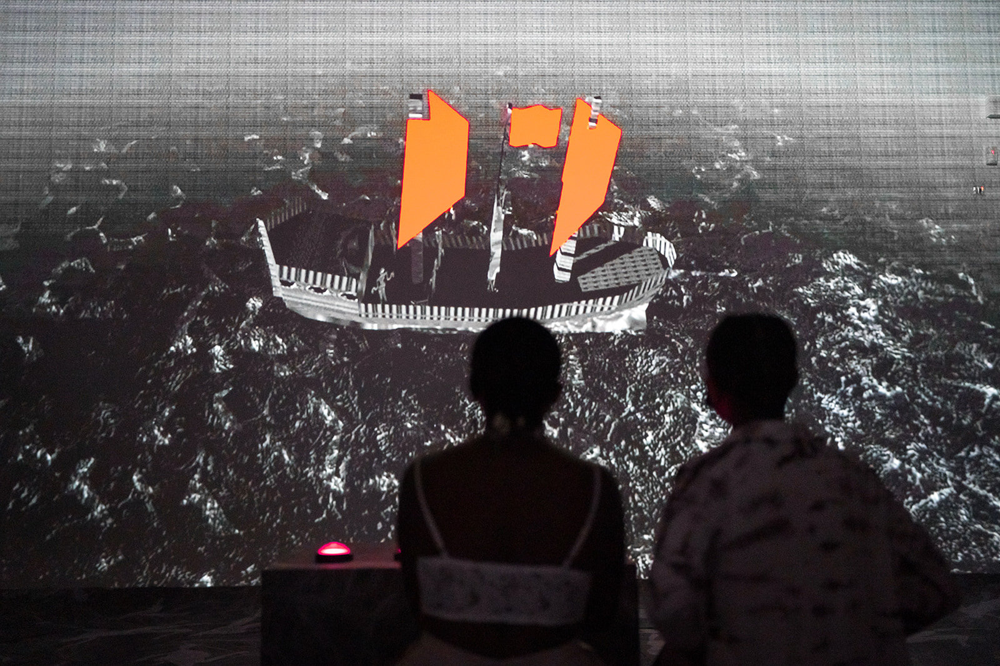 Pirating Blackness, HAUNTING ALONGSIDE OUR SHADOWS, QUAD, Derby (2021), dal sito dell'artista</td>
<td width="250" valign="top">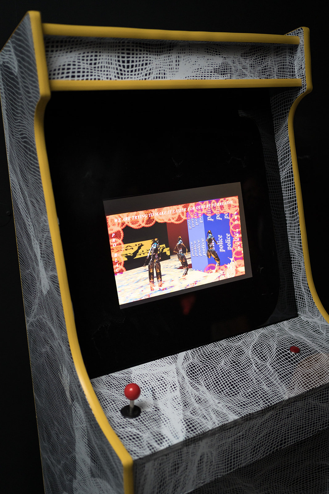 HAUNTING ALONGSIDE OUR SHADOWS, cabinato arcade, QUAD, Derby (2021), dal sito dell'artista</td>
</tr></table>

### I CANT REMEMBER A TIME I DIDNT NEED YOU (2021)
**Descrizione:** gioco testuale nel browser, scritto con Twine: una nebbia ha invaso una città e chi gioca va a vedere se la nebbia sosterrà la sua vita o se è la causa del suo arrivo.[^22] Il gioco chiede il nome e comincia con un viaggio verso la «city of dreams», sulle tracce di qualcuno che è morto prima di arrivarci.[^27]
**Lettura critica:** *MUBI Notebook* descrive una città gotica invasa da una nebbia verde che sostiene in modo specifico la vita nera trans; chi gioca da alleato passa da una farmacia che cura lo «sguardo violento» e da un tempio in cui, per entrare, deve scrivere i propri privilegi. Le scelte sbagliate portano a rimproveri o all'espulsione.[^24]
**Sinossi:** la schermata dei crediti data il gioco al 2020 e lo presenta come un archivio che mette al centro le persone nere trans, con temi di perdita. Dopo un lungo viaggio in auto chi gioca arriva nella «city of dreams», dove una persona cara era diretta ed è morta prima di arrivare: va per ricordarla. Le strade sono vuote, avvolte in una nebbia gialla. Per entrare ovunque bisogna registrarsi: l'ufficio spiega che la nebbia sostiene in modo specifico la vita nera trans e può avere effetti collaterali su chi non lo è, poi chiede il genere (con opzioni ironiche per le persone cis), se si è neri e perché si è venuti. I luoghi cambiano secondo le risposte.
- **Il club**, «Chemical Club», ha ogni sera una notte «pro Black trans»: le persone cis entrano solo accettando le regole da alleati e un timbro sulla mano. Dentro, chi balla racconta la perdita dei capelli, il costo della depilazione laser, la morte di una persona amica scoperta online.
- **La farmacia** offre alle persone trans un «corridoio della vita» che piange e consegna una guida, ormoni sempre rinnovabili, un orologio che accorcia le attese; più in fondo compare Dr Curiosity, un medico che esamina e vuole operare, finché la nebbia interviene e si presenta. Alle persone cis la nebbia diagnostica uno «sguardo violento» negli occhi e lo rimuove con un'operazione.
- **Il vicolo** porta a un telefono pubblico, da cui chiamare casa.

Poi la città è in protesta. Nel **tempio** si può rendere omaggio a una persona persa, perdonare qualcuno, seppellire una parte del proprio passato; le persone cis incontrano il «mostro» del proprio privilegio. Nell'**hotel** una figura nascosta con il suo bambino parla della «pandemia dell'antinerezza». Nel **corteo** la nebbia si rivela: «we are the fog… pro Black life, pro trans life». I finali sono quattro, secondo l'identità dichiarata: le persone nere trans sono accolte da una famiglia che canta per loro e le invita a riposare; le persone nere cis producono la nebbia e devono garantire un ambiente per le persone nere trans («Black Lives Matter means every single Black life»); le persone trans non nere si uniscono alla famiglia trans ricordando chi ha più bisogno; le persone cis non nere non possono produrre la nebbia e scelgono se cedere lo spazio, portando quel lavoro nella vita quotidiana, o provarci e ferire chi le circonda.[^27]
**Gameplay:** avventura testuale a link, 142 passaggi in Twine, con musica e GIF animate. Il gioco registra genere e razza dichiarati e cambia testi e accessi di conseguenza. In molti punti chiede di scrivere: il proprio nome, a chi rendere omaggio e che cosa gli si direbbe, chi perdonare e perché, quali privilegi si hanno e che cosa si farà per riconoscerli, perché si va alla protesta e con chi. Alcune frasi vanno ripetute ad alta voce, e subito dopo il gioco chiede di dire onestamente se lo si è fatto. Rifiutare la registrazione, rifiutare le regole del club o stringere la mano al proprio privilegio chiude la partita: «you are never heard from again».[^27]
**Sul sito:** [I CANT REMEMBER A TIME I DIDNT NEED YOU](https://www.daniellebrathwaiteshirley.com/i-cant-remember-a-time-i-didnt-need)
**Gioco:** [neocities](https://daniellestwine.neocities.org/ICANTREMEBERWHENIDIDNTNEEDYOUV2.html)

### GET HOME SAFE / GETTING HOME SAFE (2022)
**Temi:** `avatar-e-corpo-virtuale`
**Descrizione:** installazione interattiva alla David Kordansky Gallery di Los Angeles (fino al 1° luglio 2022), con prompt testuali e animazioni, ispirata secondo *Hypebeast* ai giochi di ruolo online di massa.[^15] Le fotografie sul sito mostrano un percorso di pareti rosse e nere coperte di scritte e un grande schermo con la frase «DONT LET THEM GET TOO CLOSE».[^22] La versione commissionata da Spike Island, Bristol (11 luglio – 22 agosto 2022), è un gioco «pro-Black, pro-Trans»: si torna a casa da soli di notte, qualcuno cammina dietro, le chiavi in tasca possono aprire la porta o diventare un'arma. Le scelte decidono se si arriva a casa sani e salvi o se si impedisce a qualcun altro di arrivarci.[^16]
**Lettura critica:** la pagina di Spike Island presenta il gioco come un lavoro sulla responsabilità e sulla cura, in cui chi gioca scopre come le proprie azioni pesano sulla vita degli altri.[^16]
**Sul sito:** [GET HOME SAFE](https://www.daniellebrathwaiteshirley.com/get-home-safe)

<table><tr>
<td width="250" valign="top">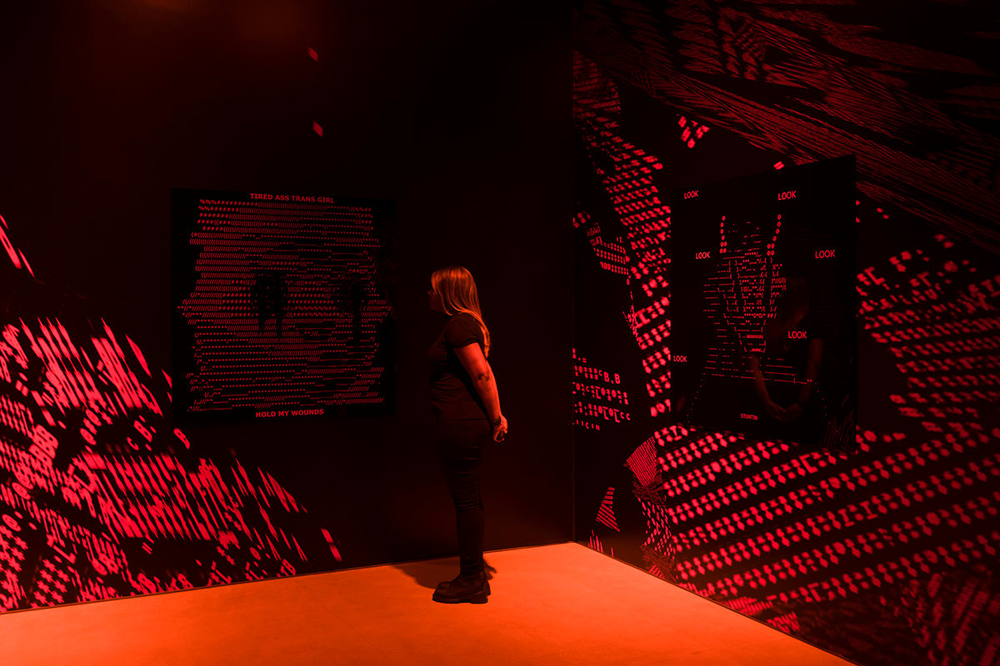 GET HOME SAFE (2022), David Kordansky Gallery, Los Angeles, dal sito dell'artista</td>
<td width="250" valign="top">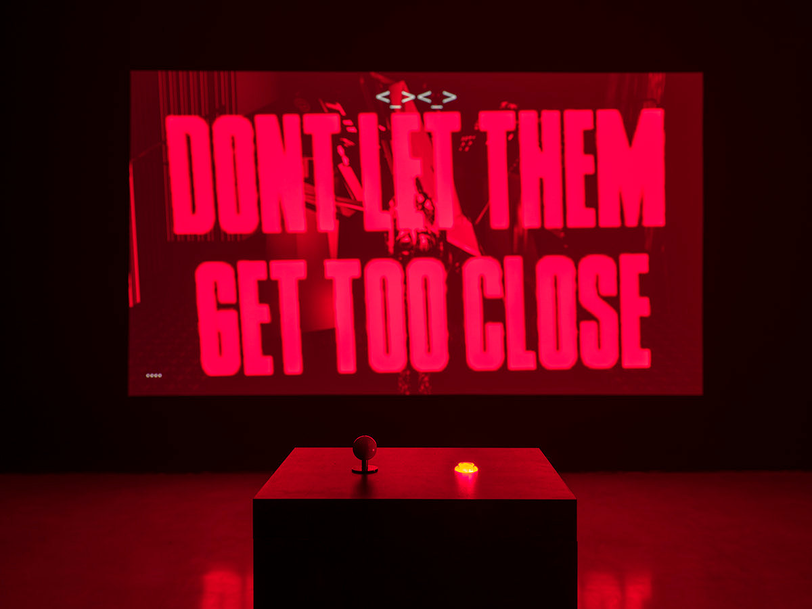 GET HOME SAFE (2022), il gioco, David Kordansky Gallery, dal sito dell'artista</td>
</tr></table>

### WHEN OUR WORLDS MEET (2022)
**Descrizione:** installazione e gioco online realizzati con The Bandidos, un gruppo di giovani di Liverpool, per FACT (2 dicembre 2022 – 9 aprile 2023, in mostra con Josèfa Ntjam). Il lavoro parte da tre domande: come ridisegnare Liverpool per la propria comunità, di che cosa ha bisogno il proprio mondo, quali regole ha. Si entra da una pensilina dell'autobus con un regolamento; la galleria è una strada di periferia con lampioni e spazi pubblici «hackerati», sorvegliata dagli avatar dei ragazzi, e quattro zone ospitano i capitoli del gioco: un mondo fatto di carne dove i draghi suonano negli stadi, una colonia utopica di femministe queer e comunisti, un parco a tema in cui chi lavora la terra resta povero, portali nei club che riportano ai viaggi delle persone ridotte in schiavitù.[^28]
**Sul sito:** [WHENOURWORLDSMEET](https://www.daniellebrathwaiteshirley.com/whenourworldsmeet)
**Gioco:** whenourworldsmeet.com, elencato nella pagina dei giochi del sito, non raggiungibile il 2026-11-24.[^22]

<table><tr>
<td width="250" valign="top">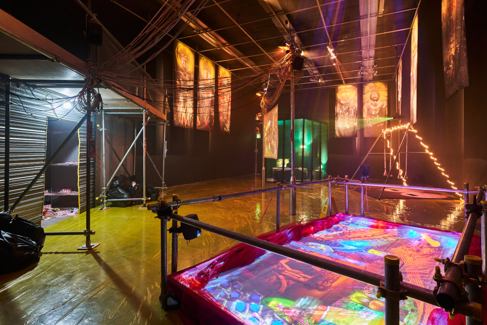 WHEN OUR WORLDS MEET (2022), FACT, Liverpool, dal sito dell'artista</td>
</tr></table>

### BEFORE THERE WERE NONE (dal 2022)
**Descrizione:** progetto presentato nel 2022 tra i finalisti di CIRCA x Dazed Class of 2022: un mondo in cui tutti i corpi condividono un'unica anima, un'unica identità distribuita su milioni di corpi, finché alcuni rivendicano il diritto a una vita propria; un mondo nuovo che nasce dal fuoco.[^29] Le fotografie del sito mostrano un cumulo di forme imbottite color carne, una performance in cui figure velate vi si muovono tra il pubblico, e schermi con animazioni intorno; la sede non è indicata [verificare].[^22]
**Sul sito:** [BEFORE THERE WERE NONE](https://www.daniellebrathwaiteshirley.com/single-project)

<table><tr>
<td width="250" valign="top">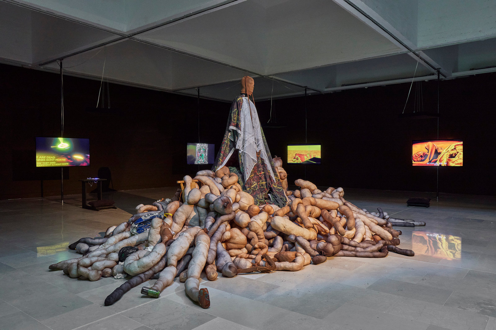 BEFORE THERE WERE NONE, veduta dell'installazione, dal sito dell'artista</td>
</tr></table>

### I CAN'T FOLLOW YOU ANYMORE (2023)
**Descrizione:** gioco nel browser commissionato e prodotto da Factory International, Manchester, uscito per Halloween 2023. Usa la mitologia dei vampiri come metafora per l'identità nera trans e la spiritualità, con un aspetto da PlayStation anni Novanta e richiami alla cultura dei vampiri degli anni Duemila; si sceglie un personaggio e si avanza ballando o combattendo in un mondo in cui l'autorità va messa in dubbio.[^30] Il sito lo presenta con la custodia di un gioco immaginario, *NIGHTMARESTATION*.[^22]
**Lettura critica:** per *MUBI Notebook* chi gioca guida una setta di vampiri nascente, e il gioco dice subito che fallire fa parte dell'esperienza. Il critico richiama la definizione del gioco del filosofo Bernard Suits (*The Grasshopper*, 1978), il tentativo volontario di superare ostacoli non necessari, e osserva che Brathwaite-Shirley lavora proprio sugli ostacoli invece che su ciò che il gioco permette di fare. L'artista, nella stessa intervista, dice che il gioco parla di fascismo.[^24]
**Sinossi:** «YOU HAVE AWOKEN»: chi gioca è una figura tornata dalla morte, un dio perduto e vampiro. Il mondo in cui torna è cambiato: chi lo venerava ora lo guarda come un abominio, «an unpassing demon». Prima di cominciare sceglie tre «vangeli», gruppi di parole che diventeranno le leggi dei seguaci (le parole vanno da Victim, Trauma, Survivor, Trans, Black a Pro life, Pro choice, Cancel, Boycott, Tolerance, Fascist), e incontra cinque volti, interpretati da performer filmati: Lust, Longing, Lies, The Lost, Truth. Con ognuno può parlare, osservarlo, morderlo o lasciarlo andare; mordere aggiunge due vangeli opposti, per esempio «Ancestral knowledge» e «Over trusting», «Longing for change» e «Impatience», «Lies for the greater good» e «Mistrust». Seguono sei livelli, ognuno con un obiettivo: convincere le persone perdute a seguirlo; riaffermare la propria posizione di capo, mentre alcuni seguaci diventano fanatici; far pagare ai seguaci il diritto di restare, ora che le parole del capo sono comandamenti e la setta comincia a «ripulirsi» al proprio interno; eliminare le imitazioni nate dal successo del proprio marchio; reprimere la rivolta dei seguaci; e infine scegliere, «FIGHT FOR YOUR VOICE / DIE FOR THEIR VOICE». Due video chiudono la partita, un finale buono e uno cattivo. L'artista ha descritto il gioco come un lavoro sul fascismo.[^44][^24]
**Gameplay:** gioco ritmico: nelle battaglie si premono le frecce a tempo con le indicazioni a schermo e con la musica, per conquistare seguaci, e il contatore dei seguaci cresce o cala. Chi sbaglia legge «YOU FAILED TO COMPLETE THE REVOLUTION» e può riprovare il livello o arrendersi; l'avviso iniziale dice che fallire fa parte dell'esperienza. Si gioca da tastiera o toccando lo schermo; una modalità toglie scosse e lampi.[^44]
**Sul sito:** [I CANT FOLLOW YOU ANYMORE](https://www.daniellebrathwaiteshirley.com/landings)
**Gioco:** [blacktransrevolution.com](https://www.blacktransrevolution.com/)

<table><tr>
<td width="250" valign="top">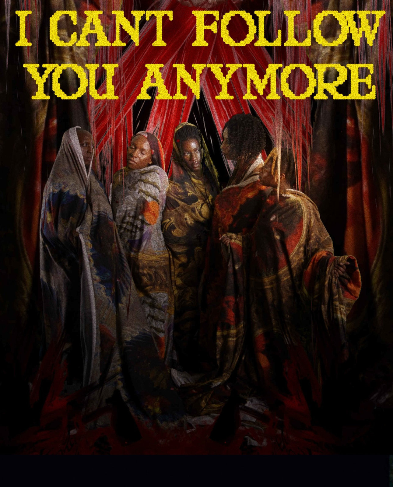 I CAN'T FOLLOW YOU ANYMORE (2023), copertina del gioco, dal sito dell'artista</td>
</tr></table>

### THE REBIRTHING ROOM (2024)
**Corso:** `AW`
**Temi:** `video-mapping-e-proiezione`
**Descrizione:** prima personale istituzionale, a conclusione di un anno di residenza da Studio Voltaire, Londra (31 gennaio – 28 aprile 2024). Il visore VR è «hackerato» e trasformato in un controller manovrato dal pubblico: la visione individuale del casco diventa un grande ambiente in proiezione mappata, che richiede di collaborare per muoversi nello spazio.[^2] Il testo d'ingresso, in forma di «Terms & Conditions», definisce la sala uno spazio «pro Black, pro Trans» per chi il paese non ha protetto.[^2] Le fotografie sul sito mostrano tronchi d'albero rivestiti di stoffe stampate, con piccoli altari e crocifissi, e schermate del gioco con scritte come «DONT LET YOURSELF DOWN AGAIN» e «I NEED TO CHANGE».[^22]
**Lettura critica:** Hannah Hutchings-Georgiou, su *Art Monthly*, descrive una foresta notturna in cui chi gioca affronta, con un controller a forma di testa avvolta in stoffa, mostri chiamati ansia, bassa autostima, paura del fallimento, dipendenze, insicurezza e intolleranza, quasi sempre perdendo. Il punto, secondo la recensione, è che la rinascita comincia dal riconoscimento delle proprie fragilità e non dalla vittoria su di esse. L'ex sala di missione del 1890 che ospita Studio Voltaire rende il richiamo religioso esplicito: chi è trans può attraversare una propria rinascita, ma non ha bisogno di essere salvato né convertito.[^17]
**Sul sito:** [THE REBIRTHING ROOM](https://www.daniellebrathwaiteshirley.com/copy-of-the-soul-station)

<table><tr>
<td width="250" valign="top">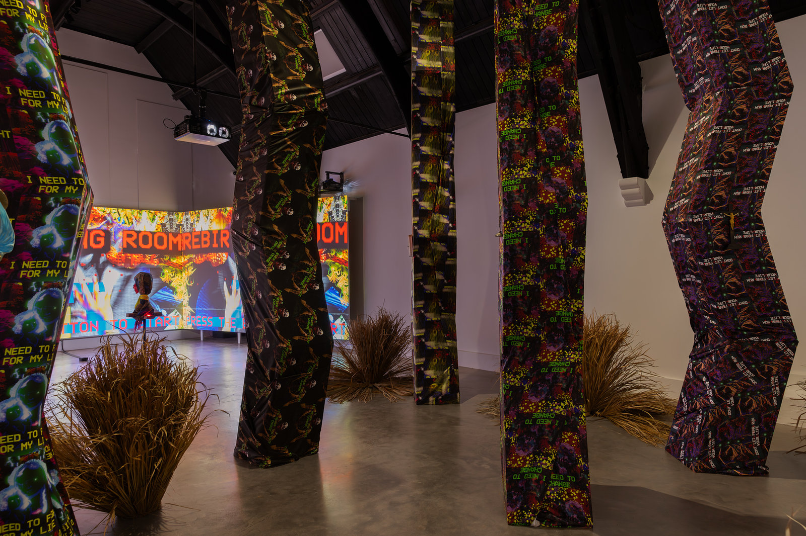 THE REBIRTHING ROOM (2024), Studio Voltaire, Londra, dal sito dell'artista</td>
<td width="250" valign="top">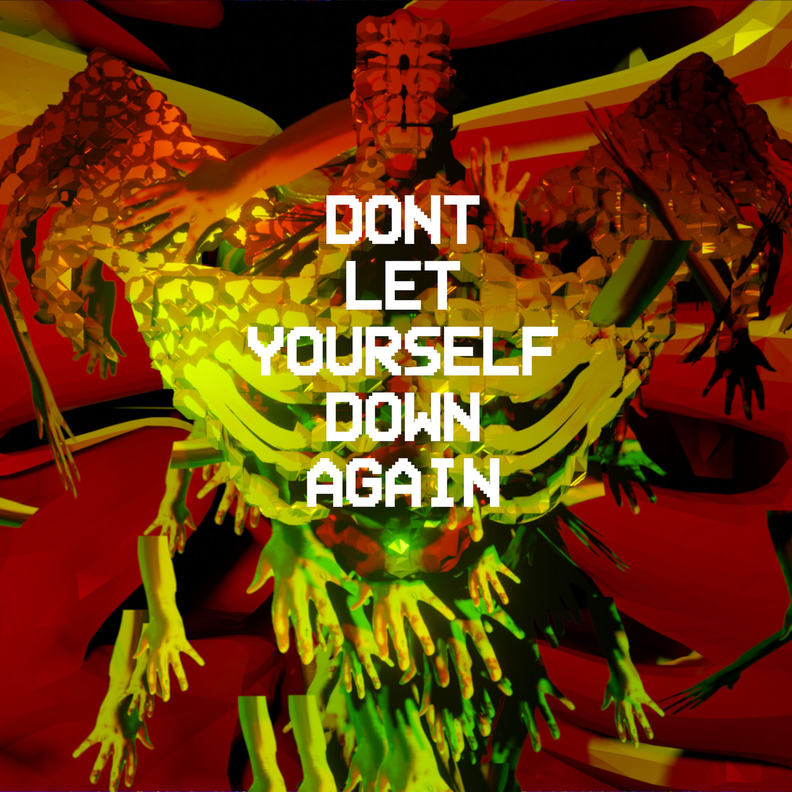 THE REBIRTHING ROOM (2024), schermata del gioco, dal sito dell'artista</td>
</tr></table>

### THE SOUL STATION (2024)
**Descrizione:** prima personale in Germania, in due capitoli, alla Halle am Berghain di Berlino con LAS Art Foundation, con i giochi *YOU CAN'T HIDE ANYTHING* (2024) e *ARE YOU SOULLESS, TOO?* (2024, dal 12 settembre al 13 ottobre).[^6] *YOU CAN'T HIDE ANYTHING* è un gioco di gruppo: una persona guida, le altre guardano e possono intervenire solo a voce. L'artista dice di averlo costruito sulla democrazia: un capo, e intorno chi vorrebbe un cambiamento e si sente impotente.[^6] Il testo d'ingresso promette uno spazio che mostra a chi entra la propria anima, «pro Black, pro Trans, pro Fury, pro Nerd»; il sito collegato invita a «pulire l'anima».[^22] Le fotografie mostrano schermi verticali nella sala e una scritta «MORALITY TEST COMPLETE».[^22]
**Sul sito:** [THE SOUL STATION](https://www.daniellebrathwaiteshirley.com/copy-of-whenourworldsmeet)
**Gioco:** [yoursoulisdirty.com](https://www.yoursoulisdirty.com/)

<table><tr>
<td width="250" valign="top">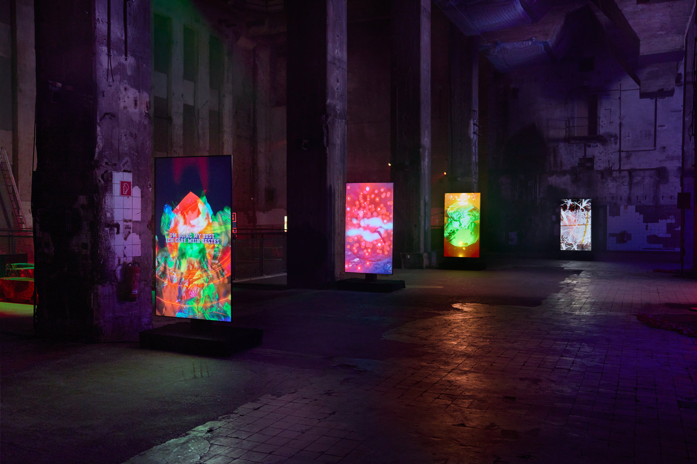 THE SOUL STATION (2024), Halle am Berghain, Berlino, dal sito dell'artista</td>
<td width="250" valign="top">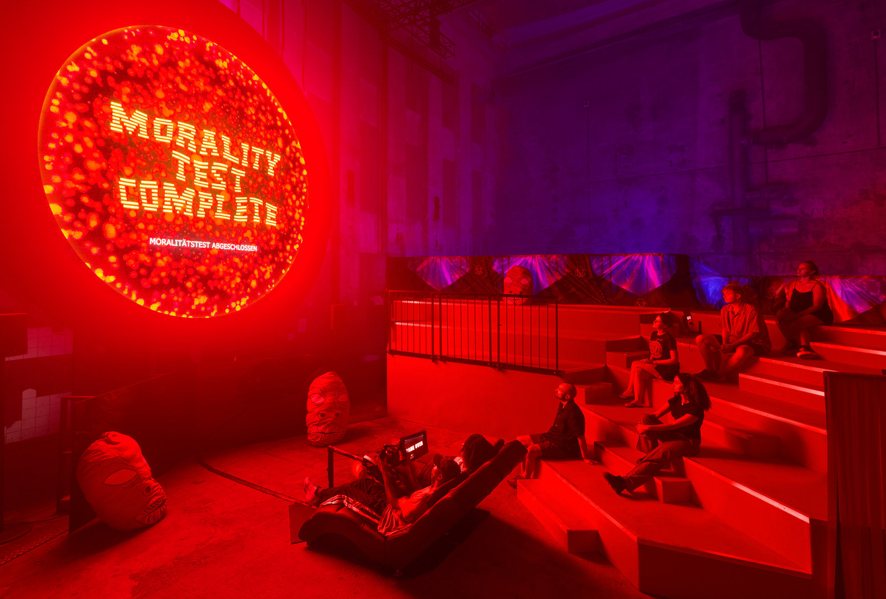 THE SOUL STATION (2024), «MORALITY TEST COMPLETE», dal sito dell'artista</td>
</tr></table>

### THE DELUSION (2025)
**Corso:** `AW`
**Temi:** `propaganda-e-media`
**Descrizione:** personale alla Serpentine North, Londra (30 settembre 2025 – 18 gennaio 2026), commissionata e prodotta da Serpentine Arts Technologies: una serie di giochi multigiocatore su polarizzazione, censura e legame sociale, sviluppati in un anno con artisti, ricercatori, tecnici e membri della comunità nera trans e queer dell'artista.[^1][^18] Il mondo è un futuro post-apocalittico dopo il «Day of Division», diviso in fazioni chiuse ciascuna con la propria verità, nell'era chiamata «Peace by Isolation»; il racconto viene dalla fanzine *Below the Blue Line*. Allestimento con Lydia Chan; tra i collaboratori Travis Alabanza, Tatenda Shamiso e Loraine James. Il progetto usa sprite 2D e 3D e il motore open source UPBGE (Uchronia Project Blender Game Engine).[^1][^18] In *The Unifier* i giocatori muovono insieme una sfera in un labirinto tenendo le mani sul tavolo; in *The Validators* si spara su uno schermo con pistole a forma di lampada, mentre compaiono istruzioni come alzare la mano se si teme la censura.[^19]
**Lettura critica:** la Serpentine collega il progetto a Hyde Park e allo Speakers' Corner, luogo storico del dibattito pubblico.[^1] L'artista descrive *The Validators* come uno sparatutto arcade trasformato in un gioco di riflessione, in tre livelli: censura, disumanizzazione, speranza.[^19] Il progetto prosegue nel gioco online *I DIDNT REALISE YOU THOUGHT LIKE THAT* (dal 21 maggio 2026), sviluppato con Beyond Code, ambientato nello stesso mondo, dove ogni commento negativo scritto in rete prende vita.[^20]
**Gioco:** [ididntrealiseyouthoughtlikethat.com](https://ididntrealiseyouthoughtlikethat.com/)

### Altri giochi giocabili online
Dalla pagina «Playable Games» del sito, oltre a quelli già citati:[^22]
- [blacktransair.com](http://blacktransair.com/) — *BLACKTRANSAIR*, della serie dei siti `.com`.[^10]
- [icanttakethisstepforyou.com](https://icanttakethisstepforyou.com/) — *Dæmon Map*, per la Biennale di Helsinki 2023: un pellegrinaggio verso una parte di sé nascosta, che chi gioca deve dichiarare per proseguire (testo in inglese e finlandese).[^27]
- [THE OCEAN REMEMBERED A BODY](https://www.daniellebrathwaiteshirley.com/copy-of-home) — pagina del sito.
- [THE VOICE OF A LOST GOD RETURNS](https://vitalcapacities.com/exhibitions/danielle-braithwaite-shirley/), su Vital Capacities. **Sinossi:** nove video, caricati su YouTube tra il 19 e il 21 settembre 2022. Ognuno comincia con l'audiodescrizione di un disegno in bianco e nero da cui emergono figure scolpite in 3D, con occhi che si muovono e giavellotti rossi che partono dagli sguardi; poi una voce racconta un frammento di storia. Il cielo si spezza, nel cielo compare la «schermata blu della morte», la gente guarda in alto, i lavoratori ricevono l'ordine di restare a casa, e la voce di un dio perduto ritorna; due personaggi, June e Sep, attraversano la folla che riempie una foresta. Un video chiede a chi ascolta se ha mai partecipato a una caccia alle streghe, se ha mai goduto nel vedere qualcuno bruciare. **Gameplay:** la pagina mostra nove immagini; cliccandone una si apre il video, con una musica di sottofondo. Non ci sono scelte.[^44]

### Altre opere sul sito
- *STOP F\*CKING TOUCHING/LOOKING/STARING/PHONING/_____ ME* (2018), mostra con Travis Alabanza alla Mimosa House, Londra, settembre 2018, con il video *Films Of You* proiettato su tessuto di paillettes dorate.[^22]
- *THE BLACK SEA*, installazione VR (foto Finn Browning).[^22]
- Sculture e disegni (2017-2019): *Watching Head* (2018), scultura di capelli, bottiglia di Lucozade, camere d'aria, ginocchiere, elastici, fondotinta e plastica; *I DONT HAVE A DEAD NAME* (2019), serigrafia e spray su carta, 84 × 118 cm; *Blood Test* (2019), tubetti d'inchiostro vuoti, cuffia da doccia, mascherina, mollette e acrilico; disegni a inchiostro e collage digitali.[^22]
- Collaborazioni: design visivo per *Before I Step Outside (You Love Me)* di Travis Alabanza e sound design per *I Tried To F\*ck Up the System But None Of My Friends Texted Back* dello stesso Alabanza, alla Wellcome Collection.[^22]

## Approfondimenti

### Parole dell'artista
- Sui giochi della propria adolescenza: in *Dragon's Dogma* l'artista creava una versione femminile di sé, e in *Pokémon* provava nomi nuovi; i giochi erano un luogo in cui sperimentare un'identità senza conseguenze, prima di poterlo fare nel mondo.[^3][^10]
- Sulla visibilità in rete: è facile trovare rappresentazioni visive delle persone nere trans, ma la cura nei loro confronti spesso si ferma all'aspetto; servono spazi costruiti per sostenerne l'esistenza, e persone nere trans nelle squadre che progettano le interfacce.[^10]
- Sul futuro: nessuna utopia, ma futuri alternativi in cui l'attenzione cade dove oggi non cade, come in *Resurrection Lands*.[^6]
- Sulla storia del videogioco: l'artista studia giochi vecchi e oscuri come altri studiano un Rembrandt, per esempio *Frontier: Elite II*.[^19][^6]
- Sul pubblico: l'arte di oggi è tutta nel dare, con una transazione troppo facile; l'opera dovrebbe essere difficile, a volte dolorosa, uno scambio in cui anche chi guarda dà qualcosa.[^24]

### Tecnologie dei giochi
Ricavate dal codice delle pagine (2026-11-24) e dalle fonti indicate.[^32]
- **Film interattivi a bivi**, con clip video preregistrate collegate da scelte: *WE ARE HERE BECAUSE OF THOSE THAT ARE NOT* (49 clip, lettore Plyr, tasti 1-2-3), *RESURRECTION LANDS* (video in streaming con video.js, scelta di squadra e di luogo), *Pirating Blackness* (applicazione Svelte che legge una mappa di nodi video).
- **Avventure testuali e pagine-gioco**: *I CANT REMEMBER A TIME I DIDNT NEED YOU* (Twine 2.3.5, formato Harlowe 3.1.0, 285 passaggi; lo stesso gioco si apre da blacktransair.com), *Dæmon Map* (mappa Leaflet con cinque film), *THE VOICE OF A LOST GOD RETURNS* (nove video), il sito di *THE SOUL STATION* (sei «puzzle»), *I DIDNT REALISE YOU THOUGHT LIKE THAT* (applicazione web con video, audio e domande).
- **Motori in tempo reale**: Unity per *SHE KEEPS ME DAMN ALIVE*;[^14] Godot per *I CAN'T FOLLOW YOU ANYMORE*, con lo sviluppatore Florian Brueckner e i volti di performer ripresi a Studio Voltaire;[^33] UPBGE per *THE DELUSION*.[^18]

### Letture critiche e concetti
- *MUBI Notebook* (rubrica «Cutscenes», 2024) segue il passaggio dai film ai giochi: nei film tutti ricevono lo stesso accesso alle storie, nei giochi l'accesso passa per l'identità dichiarata e per le scelte, e il fallimento è parte dell'esperienza, con un rimando a Bernard Suits.[^24]
- Meritxell Rosell (*Clot Magazine*, 2022) accosta il lavoro alla ricerca di micha cárdenas, artista e teorica che individua somiglianze tra l'esperienza trans e quella delle realtà multiple dei giochi; per Rosell Brathwaite-Shirley porta al centro non solo gli artisti ma qualunque visitatore.[^10]
- Hannah Hutchings-Georgiou (*Art Monthly*, 2024) legge *THE REBIRTHING ROOM* come un archivio vivo e incarnato, prosecuzione dell'etica della cura collettiva di *blacktransarchive.com*.[^17]
- Vítor Blanco-Fernández, «Gaming identity in contemporary queer art: the works of Danielle Brathwaite-Shirley and Lu Yang», *Hipertext.net* n. 29 (2024), pp. 75-87, confronta l'uso del gioco nelle opere di Brathwaite-Shirley e di Lu Yang. Articolo segnalato da Wikipedia, non letto.[^21]

## Interviste e talk
- [Tamar Clarke-Brown, intervista per Queer Direct, Annka Kultys Gallery (2020)](https://www.annkakultys.com/?p=24449)
- [Shama Khanna (Flatness), intervista, *Feminist Review* n. 129 (2021)](https://research.gold.ac.uk/id/eprint/30768)
- [Meritxell Rosell, su *SHE KEEPS ME DAMN ALIVE*, *Clot Magazine* (2022)](https://clotmag.com/?p=27827)
- [Gazelle Mba, «Interview: Danielle Brathwaite-Shirley», *Fact* (2023, online 2024)](https://factmag.com/2024/01/19/interview-danielle-brathwaite-shirley)
- [«Cutscenes | The Medium Is You», con un'intervista, *MUBI Notebook* (2024)](https://mubi.com/en/notebook/posts/cutscenes-the-medium-is-you-danielle-brathwaite-shirley-s-interactive-digital-archives)
- [Tom Barker, intervista su *THE SOUL STATION*, *Highsnobiety* (2024)](https://www.highsnobiety.com/p/danielle-brathwaite-shirley-interview)
- [P. Eldridge, «The Question Is The Work», CIRCA (2025)](https://circa.art/the-question-is-the-work/)
- **Video:** [«I call it an emotional machine», su *THE DELUSION*, con Tamar Clarke-Brown e Ruth Waters (Serpentine, 2025)](https://www.serpentinegalleries.org/watch/i-call-it-an-emotional-machine-danielle-brathwaite-shirley-on-the-delusion/)
- **Video:** [canale Vimeo dell'artista, 16 video pubblici (2017-2019)](https://vimeo.com/daniellebs)
- **Video:** [*In the Studio with Danielle Brathwaite-Shirley*, Factory International (2023), 10'23"](https://www.youtube.com/watch?v=CYLBOmdhg2o): registrazione di voci e ritratti per *I CAN'T FOLLOW YOU ANYMORE*, metodo di lavoro
- **Video:** [*Desktop Tour*, arebyte (2021), 20'18"](https://www.youtube.com/watch?v=6UXPlE4UvN0): *SHE KEEPS ME DAMN ALIVE* in Unity, motion capture, motori e giochi di riferimento
- **Video:** [*SHE KEEPS ME DAMN ALIVE*, trailer della mostra, arebyte (2021), 52"](https://vimeo.com/639598105)
- **Video:** [conversazione con Bo Ruberg, arebyte (2022), 59'](https://www.youtube.com/watch?v=d2YnJQkTb0g) · [con Gabrielle de la Puente, arebyte (2022), 75'](https://www.youtube.com/watch?v=ItdjN1z15x4) · [con Cade Diehm, arebyte (2022), 50'](https://www.youtube.com/watch?v=GpuPL1gELTg)
- **Video:** [*a·21: Removing passive observers*, Oyoun (2021), 46'](https://www.youtube.com/watch?v=4Cas-skChew)
- **Video:** [conversazione con Kim Ninkuru, InterAccess (2021), 93'](https://www.youtube.com/watch?v=YN6YoebYXJw)
- **Video:** [*WE CAN'T DO THIS ALONE*, Serpentine (2022), 6'46"](https://www.youtube.com/watch?v=gji_VPKKa9A)
- **Video:** [*Q&A with The Bandidos*, FACT (2023), 9'27"](https://www.youtube.com/watch?v=nCsgsU7d6q8)
- **Video:** [conversazione per Factory International (2024), 26'](https://www.youtube.com/watch?v=k1GkYeKfcKY)
- **Video:** [*Community Center Mechanisms*, Trust (2025), 16'](https://www.youtube.com/watch?v=9jD51ck0Xvs): i laboratori di *THE DELUSION*
- **Video:** [*Enough is Enough*, Penny Stamps Speaker Series, University of Michigan (2026), 61'](https://www.youtube.com/watch?v=MyIWU9nH0pw): lezione-performance con il pubblico
- **Video:** [*Your Voice, Your Choice*, keynote, Immersive Arts UK (2026), 40'](https://www.youtube.com/watch?v=6iEdO2AF1vg)
- **Giocate registrate:** [*WE ARE HERE BECAUSE OF THOSE THAT ARE NOT*, tutti i percorsi, CreepiCatfish (2025), 1:34:37](https://www.youtube.com/watch?v=muO0Icju-dE) · [*Black Trans Archive*, wii_gay (2020), 27'](https://www.youtube.com/watch?v=Zv1uGuYEDwc) · [«ENTERING THE RESURRECTION LANDS», canale dell'artista, 12'](https://www.youtube.com/watch?v=0UT5kAiuK0A) · [*I CANT REMEMBER A TIME I DIDNT NEED YOU*, Queen Faith (2020), 6'](https://www.youtube.com/watch?v=soFbZ4YHflQ) · [*Resurface: THE WORLD HAS CHANGED: YOU WILL BE JUDGED*, performance interattiva online, AND Festival (2021), 45'](https://www.youtube.com/watch?v=VlC-X1llo9A)
- **Video:** [*David Blandy on SHE KEEPS ME DAMN ALIVE*, arebyte (2021), 8'40"](https://www.youtube.com/watch?v=ZjUB8uXS7bA), con inserti di gioco · [*Inside an immersive video-game exhibition*, *Wallpaper\** (2025), 2'58"](https://www.youtube.com/watch?v=TiKKeP-VZhQ), su *THE DELUSION*
- [The White Pube, lettura del testo su *SHE KEEPS ME DAMN ALIVE*, podcast (2024), 28'](https://www.youtube.com/watch?v=ogGddyN3Q_0): resoconto in prima persona di una partita

## Fonti
- [Sito dell'artista](https://www.daniellebrathwaiteshirley.com/) e pagina [Playable Games](https://www.daniellebrathwaiteshirley.com/playable-games)
- [Canale Vimeo dell'artista](https://vimeo.com/daniellebs)
- [blacktransarchive.com](https://blacktransarchive.com/)
- [Serpentine, *THE DELUSION*](https://www.serpentinegalleries.org/whats-on/danielle-brathwaite-shirley-the-delusion/)
- [Studio Voltaire, *THE REBIRTHING ROOM*](https://studiovoltaire.org/whats-on/danielle-brathwaite-shirley-the-rebirthing-room/)
- [FACT, *When Our Worlds Meet*](https://fact.co.uk/artwork/when-our-worlds-meet-2022)
- [Factory International, *I CAN'T FOLLOW YOU ANYMORE*](https://factoryinternational.org/whats-on/i-cant-follow-you-anymore/)
- *WORLDBUILDING: Gaming and Art in the Digital Age*, booklet della mostra, Julia Stoschek Collection, Düsseldorf, 2022 (testo di Tamar Clarke-Brown)

## Crediti delle immagini
*THE MAN-MONSTER* (1836), litografia pubblicata da H. R. Robinson: [Wikimedia Commons](https://commons.wikimedia.org/wiki/File:Mary_Jones_Lithogram.jpg), pubblico dominio.

Tutte le altre immagini vengono dal sito dell'artista (daniellebrathwaiteshirley.com, consultato il 2026-11-24), salvo i fotogrammi dei film, che sono le anteprime dei video sul canale Vimeo dell'artista; diritti dell'artista e dei fotografi.
- *SHE KEEPS ME DAMN ALIVE*, arebyte Gallery: fotografie di Dan Weill, secondo i nomi dei file pubblicati sul sito per una parte della serie [verificare per le singole immagini].
- *RESURRECTION LANDS*, Les Urbaines, Losanna, 2019: fotografia di Guillaume Baeriswyl, secondo la didascalia del sito.
- *HAUNTING ALONGSIDE OUR SHADOWS*, QUAD, Derby: i nomi dei file sul sito citano FORMAT, FeatureShoot e Charlotte Jopling [verificare il fotografo].
- *WHEN OUR WORLDS MEET*, FACT: FACT accredita le vedute dell'installazione a Rob Battersby [verificare per questa immagine].
- *THE REBIRTHING ROOM*, Studio Voltaire: Studio Voltaire accredita le vedute dell'installazione a Sarah Rainer [verificare per questa immagine].
- *GET HOME SAFE*, *BEFORE THERE WERE NONE*, *THE SOUL STATION*, *WE ARE HERE BECAUSE OF THOSE THAT ARE NOT*, *Digging for Black Trans Life*, *I CAN'T FOLLOW YOU ANYMORE*: fotografo non indicato sul sito.

[^1]: Serpentine Galleries, «Danielle Brathwaite-Shirley: THE DELUSION», pagina della mostra con biografia dell'artista. [link](https://www.serpentinegalleries.org/whats-on/danielle-brathwaite-shirley-the-delusion/)

[^2]: Studio Voltaire, «Danielle Brathwaite-Shirley, THE REBIRTHING ROOM», pagina della mostra con biografia dell'artista. [link](https://studiovoltaire.org/whats-on/danielle-brathwaite-shirley-the-rebirthing-room/)

[^3]: Tamar Clarke-Brown, «Danielle Brathwaite-Shirley: interview», Queer Direct, Annka Kultys Gallery, 29 marzo 2020. [link](https://www.annkakultys.com/?p=24449)

[^4]: P. Eldridge, «Danielle Brathwaite-Shirley: The Question Is The Work», CIRCA, 4 luglio 2025. [link](https://circa.art/the-question-is-the-work/)

[^5]: «The artist using video gaming to tackle the erasure of Black Trans stories», blog della Science Gallery London, 31 marzo 2020. [link](https://london.sciencegallery.com/blog/gaming-black-trans-stories)

[^6]: Tom Barker, «Want to Confront Racism and Transphobia? Try Danielle Brathwaite-Shirley's Video Games», *Highsnobiety*, 26 luglio 2024. [link](https://www.highsnobiety.com/p/danielle-brathwaite-shirley-interview)

[^7]: Gazelle Mba, «Interview: Danielle Brathwaite-Shirley», *Fact*, numero primavera-estate 2023, online il 19 gennaio 2024. L'intervista data *Digging for Black Trans Life* al 2009, evidente refuso per il 2019. [link](https://factmag.com/2024/01/19/interview-danielle-brathwaite-shirley)

[^8]: Serpentine Galleries, comunicato stampa di *I DIDNT REALISE YOU THOUGHT LIKE THAT*, 2026, che usa la formula «the audience as medium», presente anche nella pagina di *THE DELUSION*. [link](https://www.serpentinegalleries.org/about/press/danielle-brathwaite-shirley-ididntrealiseyouthoughtlikethat/)

[^9]: Buffalo AKG Art Museum (già Albright-Knox), pagina dell'artista e di *WE ARE HERE BECAUSE OF THOSE THAT ARE NOT* in *Difference Machines: Technology and Identity in Contemporary Art* (16 ottobre 2021 – 16 gennaio 2022). [link](https://buffaloakg.org/node/38714)

[^10]: Meritxell Rosell, testo su *SHE KEEPS ME DAMN ALIVE* con dichiarazioni dell'artista, *Clot Magazine*, 11 febbraio 2022. [link](https://clotmag.com/?p=27827)

[^11]: Jynann Ong, «Danielle Brathwaite-Shirley is an animation and sound artist archiving their existence as a Black trans person», *It's Nice That*, 24 settembre 2018. [link](https://www.itsnicethat.com/articles/daniel-brathwaite-shirley-artist-practice-digital-240918)

[^12]: Science Gallery London, blog citato alla nota 5, che presenta il gioco nella mostra *GENDERS*.

[^13]: Elenco delle scene nel codice della pagina di blacktransarchive.com, consultata il 2026-11-24. [link](https://blacktransarchive.com/)

[^14]: Tamar Clarke-Brown, testo su Danielle Brathwaite-Shirley in *WORLDBUILDING: Gaming and Art in the Digital Age*, booklet della mostra, Julia Stoschek Collection, Düsseldorf, 2022.

[^15]: «Danielle Brathwaite-Shirley Presents "GET HOME SAFE"», *Hypebeast*, 31 maggio 2022. [link](https://hypebeast.com/2022/5/danielle-brathwaite-shirley-get-home-safe-david-kordansky-gallery)

[^16]: Spike Island, «Danielle Brathwaite-Shirley», Digital Commission, 2022. [link](https://www.spikeisland.org.uk/programme/digital-commission/danielle-brathwaite-shirley/)

[^17]: Hannah Hutchings-Georgiou, «Danielle Brathwaite-Shirley: THE REBIRTHING ROOM», *Art Monthly* n. 474, marzo 2024. [link](https://www.artmonthly.co.uk/magazine/site/article/danielle-brathwaite-shirley-the-rebirthing-room-by-hannah-hutchings-georgiou)

[^18]: Serpentine Galleries, comunicato stampa di *THE DELUSION*, 2025. [link](https://www.serpentinegalleries.org/about/press/danielle-brathwaite-shirley-the-delusion/)

[^19]: Gareth Harris, «Lots to play for: Serpentine exhibition explores censorship and connection through video games», *The Art Newspaper*, 29 settembre 2025. L'articolo data *Frontier: Elite II* al 1989; il gioco è del 1993 [verificare]. [link](https://www.theartnewspaper.com/2025/09/29/serpentine-exhibition-explores-censorship-connection-video-games)

[^20]: Serpentine Galleries, comunicato stampa di *I DIDNT REALISE YOU THOUGHT LIKE THAT*, 2026; il gioco è su ididntrealiseyouthoughtlikethat.com. [link](https://www.serpentinegalleries.org/about/press/danielle-brathwaite-shirley-ididntrealiseyouthoughtlikethat/)

[^21]: «Danielle Brathwaite-Shirley», *Wikipedia* (inglese), consultata il 2026-11-24. [link](https://en.wikipedia.org/wiki/Danielle_Brathwaite-Shirley)

[^22]: Danielle Brathwaite-Shirley, sito dell'artista: biografia, pagine dei progetti con testi e didascalie delle gallerie, pagina «Playable Games», consultato il 2026-11-24. [link](https://www.daniellebrathwaiteshirley.com/)

[^23]: Canale Vimeo dell'artista: titoli, durate, date di caricamento e descrizioni dei video, consultato il 2026-11-24. [link](https://vimeo.com/daniellebs)

[^24]: «Cutscenes | The Medium Is You: Danielle Brathwaite-Shirley's Interactive Digital Archives», *MUBI Notebook*, 6 febbraio 2024, con un'intervista all'artista; la citazione sulla tecnologia viene dall'intervista di *Feminist Review* (2021) riportata nell'articolo. Autore indicato nei dati della pagina: Matt Turner [verificare]. [link](https://mubi.com/en/notebook/posts/cutscenes-the-medium-is-you-danielle-brathwaite-shirley-s-interactive-digital-archives)

[^25]: Ariel Collier, «on Danielle Brathwaite-Shirley's TRANS-PORT ME and When Our Worlds Meet», Studio Voltaire, risorse; titolo e tesi letti solo nei risultati di ricerca. [link](https://studiovoltaire.org/resources/ariel-collier-on-danielle-brathwaite-shirleys-trans-port/)

[^26]: Comunicato di *SHE KEEPS ME DAMN ALIVE*, arebyte Gallery, ripreso da newexhibitions.com. [link](https://www.newexhibitions.com/e/58306)

[^27]: Testo dei giochi letto nel codice delle pagine, consultate il 2026-11-24: *I CANT REMEMBER A TIME I DIDNT NEED YOU* su neocities.org e *Dæmon Map* su icanttakethisstepforyou.com.

[^28]: FACT Liverpool, «When Our Worlds Meet (2022)», pagina dell'opera. [link](https://fact.co.uk/artwork/when-our-worlds-meet-2022)

[^29]: CIRCA, «Danielle Brathwaite-Shirley», CIRCA x Dazed Class of 2022, risposta dell'artista. [link](https://circa.art/?p=2013)

[^30]: Factory International, «I CAN'T FOLLOW YOU ANYMORE», pagina del gioco. [link](https://factoryinternational.org/whats-on/i-cant-follow-you-anymore/)

[^31]: *THE MAN-MONSTER*, litografia, H. R. Robinson, New York, 1836, testo della didascalia stampata; scheda di Wikimedia Commons. [link](https://commons.wikimedia.org/wiki/File:Mary_Jones_Lithogram.jpg)

[^32]: Codice delle pagine dei giochi, letto il 2026-11-24: blacktransarchive.com, resurrectionland.com, blacktranssea.com, la pagina neocities del gioco Twine, icanttakethisstepforyou.com, vitalcapacities.com, yoursoulisdirty.com, ididntrealiseyouthoughtlikethat.com.

[^33]: Crediti di *I CAN'T FOLLOW YOU ANYMORE*, blacktransrevolution.com. [link](https://www.blacktransrevolution.com/credits.html)

[^34]: *In the Studio with Danielle Brathwaite-Shirley*, Factory International, 27 novembre 2023, 10'23"; sottotitoli automatici, minuti 02:28-04:37, 05:27-06:22, 06:57-07:55, 08:48-09:44. [link](https://www.youtube.com/watch?v=CYLBOmdhg2o)

[^35]: *Danielle Brathwaite Shirley - Desktop Tour*, arebyte, 2021, 20'18"; sottotitoli automatici, minuti 04:08-07:34 (*SHE KEEPS ME DAMN ALIVE*), 10:12 (poligoni), 12:02-13:45 (motori e primi programmi 3D), 14:38-15:31 (*blacktransarchive.com*). [YouTube](https://www.youtube.com/watch?v=6UXPlE4UvN0) · [arebyte](https://aos.arebyte.com/contents/danielle-brathwaite-shirley-desktop-tour/)

[^36]: *Danielle Brathwaite-Shirley in conversation with Dr. Bo Ruberg*, arebyte, 18 febbraio 2022; sottotitoli automatici, minuti 16:18-18:28. [link](https://www.youtube.com/watch?v=d2YnJQkTb0g)

[^37]: *Danielle Brathwaite-Shirley in conversation with Gabrielle de la Puente*, arebyte, 10 febbraio 2022; sottotitoli automatici, minuti 45:27-47:40. [link](https://www.youtube.com/watch?v=ItdjN1z15x4)

[^38]: *a·21: Removing passive observers*, Oyoun, Berlino, 19 marzo 2021; sottotitoli automatici, minuti 29:03-31:33. [link](https://www.youtube.com/watch?v=4Cas-skChew)

[^39]: *Community Center Mechanisms with Danielle Brathwaite-Shirley*, Trust, 2025; sottotitoli automatici, minuti 05:55-06:59. [link](https://www.youtube.com/watch?v=9jD51ck0Xvs)

[^40]: FACT Liverpool, «Bandidos blog», marzo 2023, con la serie di video; *Q&A with The Bandidos | Artist Interview*, 22 marzo 2023. [link](https://fact.co.uk/news/2023/03/bandidos-blog)

[^41]: arebyte, pagina di *SHE KEEPS ME DAMN ALIVE* con il libretto della mostra (testi di Chloe Filani, Tamar Clarke-Brown, Rebecca Edwards) e il programma degli eventi. [link](https://www.arebyte.com/danielle-brathwaiteshirley-copy)

[^42]: «Danielle Brathwaite-Shirley's Videogame Arcade Celebrates Black Trans Life», *ArtReview*, 2022. [link](https://artreview.com/danielle-brathwaite-shirley-vanguard-videogame-arcade-black-trans/)

[^43]: «Danielle Brathwaite-Shirley», *CURA.*, rubrica digitale. [link](https://curamagazine.com/digital/danielle-brathwaite-shirley/)

[^44]: Giochi letti e ascoltati il 2026-11-24: testi e strutture nel codice delle pagine (blacktransarchive.com, resurrectionland.com, blacktranssea.com, vitalcapacities.com) e nei file del gioco Godot di blacktransrevolution.com; scritte a schermo lette sui fotogrammi delle clip; parlato trascritto automaticamente con Whisper (modello small), da ricontrollare per le citazioni. Per *WE ARE HERE BECAUSE OF THOSE THAT ARE NOT* e *RESURRECTION LANDS* anche le giocate registrate su YouTube citate in «Interviste e talk».
