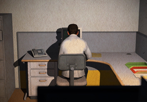

# Davey Wreden

**Tag tecnica/formato:** `videogioco-simulazione`
**Tag tema:** `game-culture` `temporalita-non-lineare`
**Tag corso:** `AW`

## Biografia
Game designer e sviluppatore statunitense. Laureato nel 2011 alla University of Southern California in critical studies.

## Poetica e ricerca
Wreden realizza videogiochi narrativi che smontano dall'interno le convenzioni del game design tradizionale — agency del giocatore, obiettivi, meccaniche — trasformandole in strumento di riflessione critica sul medium stesso. I suoi lavori più noti abbandonano la struttura ludica canonica (missioni, ricompense) per costruire esperienze quasi interamente testuali/narrative, dove il vero "gioco" è interpretativo.

## Opere principali
### The Stanley Parable (2011, mod di *Half-Life 2*; 2013 versione standalone con William Pugh)
**Descrizione:** il giocatore controlla Stanley, un impiegato che segue (o disobbedisce) le istruzioni di un narratore onnisciente; ogni scelta genera diramazioni narrative multiple.
**Lettura critica:** esplora l'agency del giocatore mettendo in scena il conflitto tra libertà apparente e struttura autoriale — sovverte le convenzioni narrative del videogioco dall'interno.

**Approfondimento:** [everythingunlimitedltd.com](https://everythingunlimitedltd.com/)

### The Beginner's Guide
**Descrizione:** gioco narrativo di circa un'ora e mezza, senza meccaniche, obiettivi o goal tradizionali; racconta — tramite un commento in prima persona di Wreden stesso — la storia di un amico sviluppatore alle prese con qualcosa che non riesce a comprendere.
**Lettura critica:** riflette sul rapporto tra autore, opera e interprete, e sui limiti etici della lettura critica applicata alla vita di un'altra persona.

**Approfondimento:** [everythingunlimitedltd.com](https://everythingunlimitedltd.com/) · [thebeginnersgui.de](http://www.thebeginnersgui.de/)

## Interviste e talk
- **Video:** [The Beginner's Guide — talk](https://www.youtube.com/watch?v=bKMAJ8vOMDg)

## Fonti
- [everythingunlimitedltd.com](https://everythingunlimitedltd.com/)
- [The Stanley Parable — gameplay completo](https://www.youtube.com/watch?v=-pHsFDiRqOM)
- [The Beginner's Guide — gameplay](https://www.youtube.com/watch?v=bswgQg-F3QE)
- Portfolio/sito ufficiale personale: il sito dello studio (everythingunlimitedltd.com) è la fonte primaria disponibile.

## Crediti delle immagini
Immagine e link di approfondimento per entrambe le opere, inclusi sotto la relativa descrizione in "Opere principali", scaricate dal sito ufficiale [everythingunlimitedltd.com](https://everythingunlimitedltd.com/).
