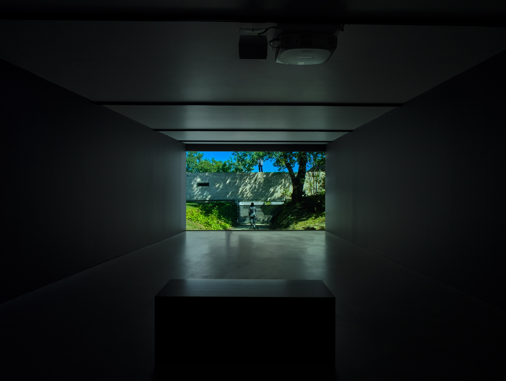
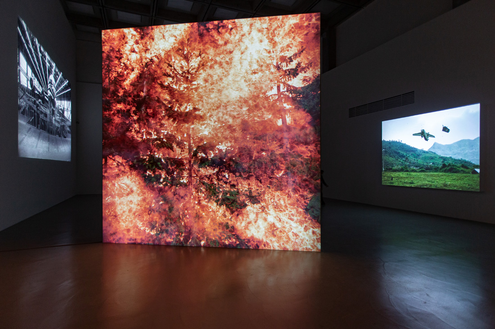
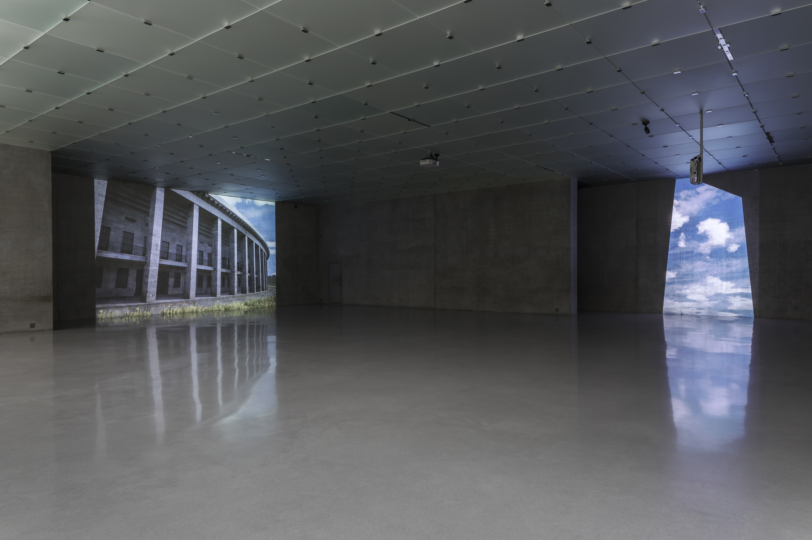
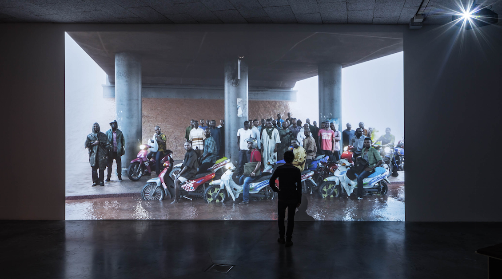
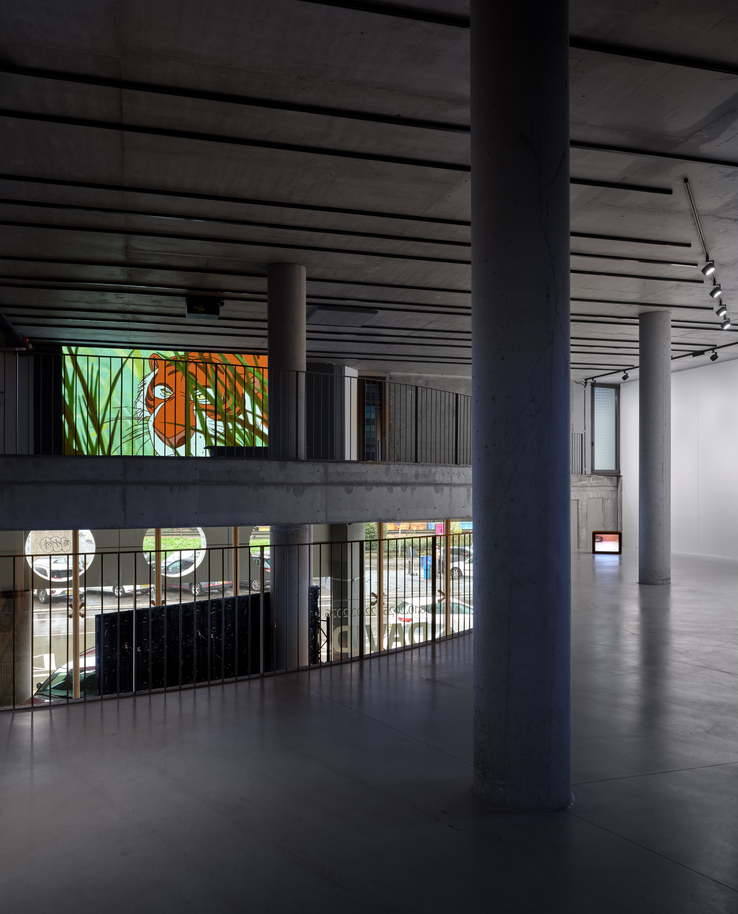
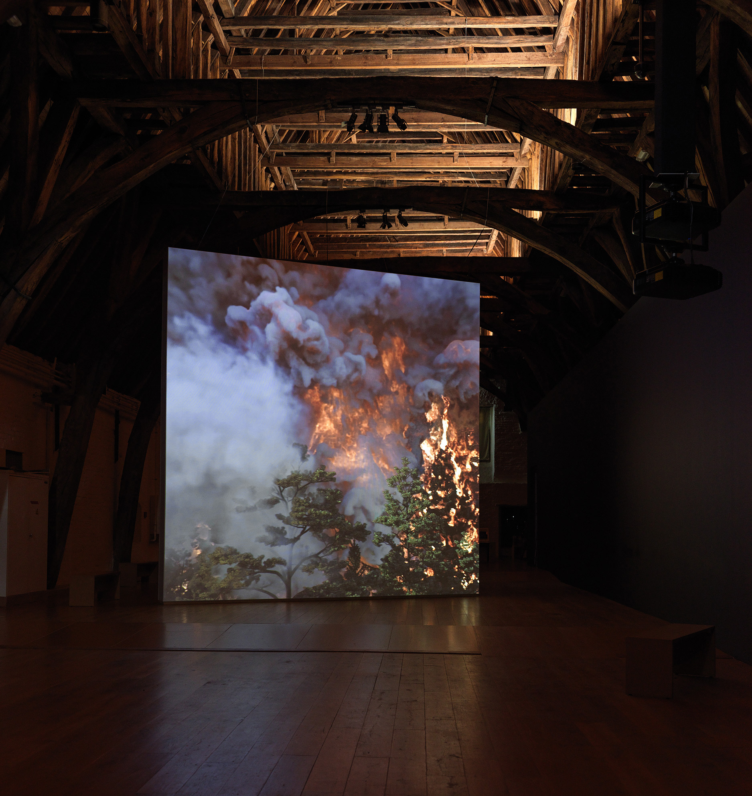
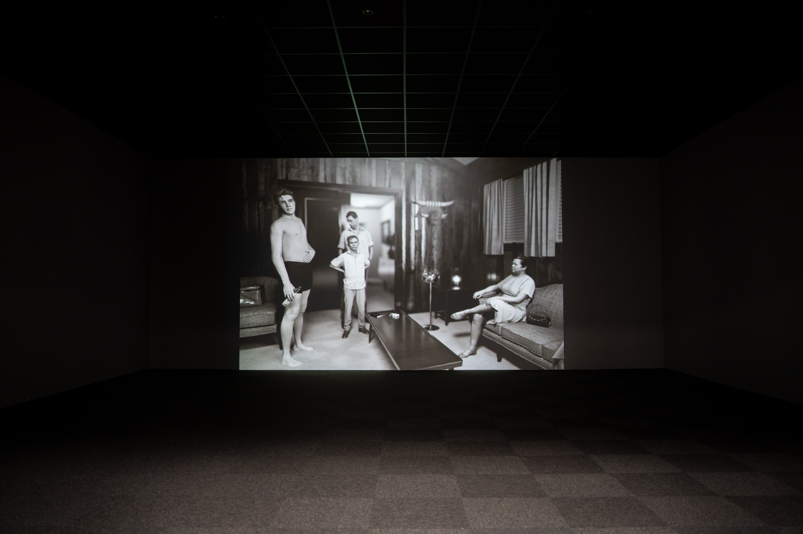
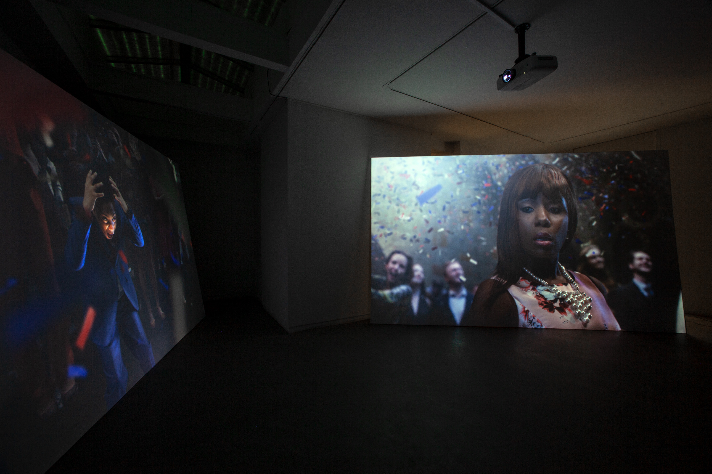
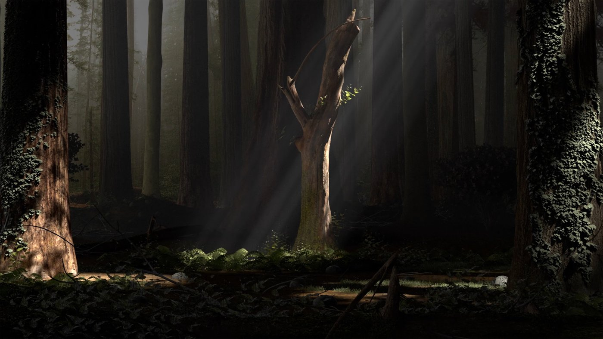

# David Claerbout

**Tag tecnica/formato:** `video` `fotografia`
**Tag tema:** `storia-computer-grafica` `temporalita-non-lineare`
**Tag corso:** `TAD-DCV` `TAD-AVM`
**Stato:** opere riviste il 2026-11-01 sulle pagine dell'artista · da documentare: Ruurlo, Borculoscheweg, 1910 (1997), Nocturnal Landscapes (1999), The Close, Aircraft (F.A.L.)

## Biografia
Artista belga, nato nel 1969 a Kortrijk; vive e lavora tra Anversa e Berlino. Si forma come pittore al Nationaal Hoger Instituut voor Schone Kunsten di Anversa e alla Rijksakademie di Amsterdam, tra il 1992 e il 1996 ([EAI](https://www.eai.org/artists/david-claerbout/biography)), e si è progressivamente interessato al tempo attraverso indagini sulla natura della fotografia, l'immagine fissa e quella in movimento, passando alla fotografia, al video e alle arti digitali. Realizza installazioni di grande formato che pongono domande su tempo, memoria e verità. Tra le mostre personali recenti in musei: Musée de l'Orangerie, Parigi (2025), Centraal Museum, Utrecht (2024), Milwaukee Art Museum (2022), Garage Museum of Contemporary Art, Mosca (2021); tra le precedenti, SFMOMA, San Francisco (2011). È rappresentato, tra gli altri, da Sean Kelly, Esther Schipper e Galerie Micheline Szwajcer ([EAI](https://www.eai.org/artists/david-claerbout/biography); [SMAK](https://smak.be/en/artists/david-claerbout); [Esther Schipper](https://www.estherschipper.com/artists/53-david-claerbout/biography/)).

## Poetica e ricerca
Il lavoro di Claerbout interroga l'autenticità sensoriale delle immagini e la fiducia — sempre più incrinata — tra realtà e rappresentazione. Centrale è il concetto di **indicizzalità** (Charles Sanders Peirce): il segno fotografico come connessione fisica diretta con il proprio referente, oggi eroso dall'immagine digitale e dallo scanning 3D. La sua pratica è spesso descritta come "sculpting in duration": non racconta storie lineari, ma dà forma al tempo stesso — alla differenza percepita tra il minuto 1 e il minuto 10 — sottraendo l'immagine alla logica della gratificazione istantanea.

## Opere principali

### Bordeaux Piece (2004)
**Corso:** `TAD-AVM`
**Temi:** `tempo-lungo-e-durata`
**Descrizione:** video a canale singolo di 13 ore e 43 minuti. Una breve finzione in sette inquadrature, con dialoghi scritti dall'artista sulla storia del *Disprezzo* di Godard, è girata ogni dieci minuti dalle 5.30 alle 22, per un mese tra luglio e agosto: la sceneggiatura viene così recitata 70 volte, sempre con la luce dello stesso momento del giorno ([davidclaerbout.com](https://davidclaerbout.com/Bordeaux-Piece-2004)). Il luogo è la casa di Bordeaux progettata da Rem Koolhaas nel 1996; con Josse De Pauw nella parte del padre ([Wikipedia](https://en.wikipedia.org/wiki/David_Claerbout)).
**Lettura critica:** la narrazione collassa progressivamente, lasciando spazio al movimento della luce solare sul paesaggio e sull'architettura: è la luce naturale, non la trama, a dare forma alla durata.

**Approfondimento:** [davidclaerbout.com — Bordeaux Piece](https://davidclaerbout.com/Bordeaux-Piece-2004)

### Vietnam, 1967, near Duc Pho (reconstruction after Hiromichi Mine) (2001)
**Corso:** `TAD-AVM`
**Temi:** `tempo-lungo-e-durata` `guerra-e-militare`
**Descrizione:** video a canale singolo, a colori e muto, in loop di circa 3 minuti. Parte da una fotografia di Hiromichi Mine: un aereo Caribou bimotore, abbattuto da fuoco amico mentre tentava di atterrare, resta sospeso nell'immagine, mentre il paesaggio di Ha Phan, ripreso nel novembre 2000 a fine monsone, 33 anni dopo, cambia con la luce e le nuvole. Sul sito dell'artista il nome compare come «Hiromishi» ([davidclaerbout.com](https://davidclaerbout.com/Vietnam-1967-near-Duc-Pho-reconstruction-after-Hiromishi-Mine-2001); [Wikipedia](https://en.wikipedia.org/wiki/David_Claerbout)).
**Lettura critica:** mette in tensione il "là e allora" della fotografia (Barthes) e il "qui e ora" permanente del film, interrogando lo statuto ontologico dell'immagine tra i due medium.

**Approfondimento:** [davidclaerbout.com — Vietnam, 1967, near Duc Pho](https://davidclaerbout.com/Vietnam-1967-near-Duc-Pho-reconstruction-after-Hiromishi-Mine-2001)

### Olympia (the real-time disintegration into ruins of the Berlin Olympic stadium over the course of a thousand years) (dal 2016)
**Corso:** `TAD-AVM`
**Temi:** `tempo-lungo-e-durata` `architettura-e-citta`
**Descrizione:** proiezione a due canali in tempo reale, a colori e muta. Una replica dello stadio olimpico di Berlino, costruita con software da videogioco, è lasciata alle intemperie e alla vegetazione per mille anni, senza intervento umano. Il programma gira dal 15 marzo 2016 e un archivio di fotogrammi ne documenta i cambiamenti ([davidclaerbout.com](https://davidclaerbout.com/Olympia-The-real-time-disintegration-into-ruins-of-the-Berlin-Olympic)).
**Lettura critica:** richiamandosi alla *Ruinenwert*, il «valore di rovina», oppone la durata biologica di una vita all'illusione di assistere a un millennio.
**Video:** [pagina progetto, davidclaerbout.com](https://davidclaerbout.com/Olympia-The-real-time-disintegration-into-ruins-of-the-Berlin-Olympic)

### Oil workers (from the Shell company of Nigeria) returning home from work, caught in torrential rain (2013)
**Corso:** `TAD-AVM`
**Temi:** `tempo-lungo-e-durata`
**Descrizione:** video a canale singolo, muto, di animazione HD e di durata «infinita». Ricostruisce con tecniche 3D un piccolo JPEG trovato online, che dà anche il titolo: un gruppo di uomini al riparo dalla pioggia monsonica. Con un semplice movimento di camera, gli uomini sembrano bloccati nell'attesa e l'immagine scivola verso il ritratto ufficiale ([davidclaerbout.com](https://davidclaerbout.com/Oil-workers-from-the-Shell-company-of-Nigeria-returning-home-from)).
**Lettura critica:** riflette sull'attesa come tempo improduttivo e su un'Africa di solito raccontata come arida. Nella conversazione con la curatrice Sara Dolfi Agostini l'artista dice di aver lavorato «con l'acqua, ma il risultato era petrolio», e accosta l'operaio «zombie» della modernità, svuotato di tutto tranne il proprio gesto, al lavoratore migrante, presente ma reso invisibile.
**Video:** [David Claerbout in conversazione con Sara Dolfi Agostini su Oil Workers (YouTube)](https://www.youtube.com/watch?v=3nQVjL6k6ZU)

**Approfondimento:** [davidclaerbout.com — Oil Workers](https://davidclaerbout.com/Oil-workers-from-the-Shell-company-of-Nigeria-returning-home-from)

### The Pure Necessity (2016)
**Corso:** `TAD-AVM`
**Temi:** `tempo-lungo-e-durata`
**Descrizione:** animazione 2D a canale singolo, 50 minuti. Claerbout riprende *Il libro della giungla* (1967) senza raccontarlo: toglie l'antropomorfismo agli animali ed elimina il protagonista, il cucciolo d'uomo. Un gruppo di artisti ha ridisegnato a mano ogni fotogramma per tre anni ([davidclaerbout.com](https://davidclaerbout.com/The-pure-necessity-2016)).
**Lettura critica:** senza storia gli animali si muovono nella giungla come se il racconto andasse avanti da solo; l'opera riflette anche sul passaggio dalla visione collettiva in sala a quella solitaria sugli schermi personali.
**Video:** [estratto/documentazione (Vimeo)](https://vimeo.com/502677017)

**Approfondimento:** [davidclaerbout.com — The Pure Necessity](https://davidclaerbout.com/The-pure-necessity-2016)

### Wildfire (meditation on fire) (2019-2020)
**Corso:** `TAD-AVM`
**Temi:** `tempo-lungo-e-durata`
**Descrizione:** video a canale singolo con animazione 3D, 24 minuti, realizzato con Musea Brugge. Lunghe inquadrature di un incendio silenzioso: non c'è una camera, l'immagine è interamente calcolata ([davidclaerbout.com](https://davidclaerbout.com/Wildfire-meditation-on-fire-2019-2020)).
**Lettura critica:** un'illusione calcolata che fa vivere un'esperienza altrimenti impossibile, a un ritmo lento come un respiro.
**Video:** [documentazione alla Galeria Pedro Cera, Lisbona, 2021 (Vimeo)](https://vimeo.com/480728352)

**Approfondimento:** [davidclaerbout.com — Wildfire](https://davidclaerbout.com/Wildfire-meditation-on-fire-2019-2020)

### KING (after Alfred Wertheimer's 1956 picture of a young man named Elvis Presley) (2015-2016)
**Corso:** `TAD-AVM`
**Temi:** `tempo-lungo-e-durata`
**Descrizione:** animazione HD a canale singolo, in bianco e nero e muta, 10 minuti. Ricostruisce con una lente soltanto virtuale una fotografia di Alfred Wertheimer del 1956, che coglie il ventunenne Elvis Presley nel passaggio alla celebrità ([davidclaerbout.com](https://davidclaerbout.com/KING-after-Alfred-Wertheimer-s-1956-picture-of-a-young-man-named-1)).
**Lettura critica:** oppone la fiducia nella macchina fotografica degli anni Cinquanta al controllo di oggi: Elvis si lasciava fotografare, l'immagine ricostruita decide tutto. Prosegue la linea di *Vietnam, 1967*, che parte da un'unica fotografia storica.
**Video:** [pagina progetto, davidclaerbout.com](https://davidclaerbout.com/KING-after-Alfred-Wertheimer-s-1956-picture-of-a-young-man-named-1)

### The confetti piece (2015-2018)
**Corso:** `TAD-AVM`
**Temi:** `tempo-lungo-e-durata`
**Descrizione:** doppia proiezione video con animazione 3D, muta, 18'25". Un momento di quella che sembra un'elezione locale americana: migliaia di coriandoli cadono davanti a un edificio neoclassico, tra gli applausi; il dettaglio centrale è l'urlo spaventato di un bambino ([davidclaerbout.com](https://davidclaerbout.com/the-confetti-piece-2015-2018)).
**Lettura critica:** il sito dell'artista la presenta come un'indagine sulla tattilità digitale, tra leggerezza e peso.
**Video:** [pagina progetto, davidclaerbout.com](https://davidclaerbout.com/the-confetti-piece-2015-2018)

### Shadow Piece (2005)
**Corso:** `TAD-AVM`
**Temi:** `tempo-lungo-e-durata`
**Descrizione:** installazione video in bianco e nero di circa 30 minuti: alcuni passanti cercano di aprire una serie di porte a vetri per entrare nell'atrio di un edificio.

**Approfondimento:** [Wikipedia — David Claerbout](https://en.wikipedia.org/wiki/David_Claerbout)

### Sections of a Happy Moment (2007)
**Corso:** `TAD-AVM`
**Temi:** `tempo-lungo-e-durata`
**Descrizione:** video in bianco e nero a canale singolo, con audio stereo, di circa 26 minuti: presenta un momento della vita di una famiglia cinese nel cortile di una tenuta anonima. Ne esiste una versione ampliata, *The Algiers' Sections of a Happy Moment* (realizzata tra il 2008 e il 2011, 37 minuti secondo la Pinault Collection).

**Approfondimento:** [Pinault Collection — The Algiers' Sections of a Happy Moment](https://lesoeuvres.pinaultcollection.com/en/node/2291)

### Travel (1996-2013)
**Corso:** `TAD-AVM` `TAD-DCV`
**Temi:** `tempo-lungo-e-durata` `paesaggio-e-territorio`
**Descrizione:** opera del 1996 completata nel corso degli anni (le fonti danno 1996-2013 oppure 1996-2014), di circa 12 minuti, con una colonna sonora di musica terapeutica sintetizzata composta dal francese Eric Breton.

**Approfondimento:** [Hirshhorn — David Claerbout, Travel](https://hirshhorn.si.edu/explore/david-claerbout-travel)

### The Silence of the Lens (saggio, e-flux Journal #73, 2016)
**Corso:** `TAD-DCV` `TAD-AVM`
**Temi:** `patrimonio-e-scansione` `prospettiva-e-camera`
**Descrizione:** testo teorico dell'artista sul passaggio dalla fotografia analogica (lens-based) allo scanning e all'immagine 3D.
**Lettura critica:** oppone la "logica dell'incontro" della fotografia (autenticazione reciproca tra obiettivo e mondo) alla "logica dell'evitamento" dello scanning, orientato alla sicurezza e all'individuazione di minacce — una critica alla "radicale conservatività" del 3D fotorealistico.

## Approfondimenti
Materiale teorico e critico per la didattica, ricavato dalla scheda di riferimento originale (REF su Drive: trascrizioni di interviste e talk, estratti del saggio). Le parole dell'artista vengono da trascrizioni di video: vanno verificate sul video prima di citarle per esteso.

### Indicizzalità e fiducia nell'immagine
- **Indicizzalità (Peirce).** Charles S. Peirce chiama «indice» il segno che rinvia al proprio oggetto per una connessione reale (come l'impronta o la fotografia), distinguendolo dal segno iconico (per somiglianza) e da quello simbolico (per convenzione). È il fondamento della fiducia nell'immagine fotografica, che Claerbout vede incrinarsi con l'immagine digitale ([Exploring Indexicality in Photography](https://aestheticsofphotography.com/exploring-indexicality-in-photography/)).
- **Barthes: punctum e studium.** Riferimento segnato nel REF come pista di lettura, da collegare alla fotografia come «là e allora» (vedi *Vietnam, 1967*).
- **Rottura epocale («Dark Optics», e-flux, 2019).** Claerbout paragona il momento attuale agli anni Trenta dell'Ottocento: con la fotografia, per la prima volta, un evento esterno veniva registrato per via chimica e la camera diventava una copia meccanica del funzionamento dell'occhio, con uno shock per chi produceva immagini. Oggi, dice, la transizione non dovrebbe farsi notare: con la scomparsa della lente torna in primo piano la *rappresentazione*. La lente funzionava per «autenticazione reciproca» tra dispositivo e mondo, e su quel sistema di fiducia, durato circa 160 anni, si sono fondate prove, politica e informazione; la «materia digitale» incrina già certezze sensoriali che davamo per scontate ([lecture all'e-flux, YouTube](https://www.youtube.com/watch?v=udVGSu5A2lw)). Dice di averlo capito con *Oil Workers*: lavorato con l'acqua, ma il risultato era petrolio.

### «Scolpire nella durata» (sculpting in duration)
Dalla conversazione con Sara Dolfi Agostini su *Oil Workers* ([YouTube](https://www.youtube.com/watch?v=3nQVjL6k6ZU)):
- **La tecnologia come espressione del sistema nervoso.** Ciò che gli umani costruiscono è, per Claerbout, l'espressione di ciò che pensavano fosse il proprio sistema nervoso in quel momento storico.
- **Tempo dell'orologio contro durata.** L'orologio è un'invenzione moderna necessaria (senza non si sincronizzerebbe un mondo globale) ma tiene sotto controllo la percezione, impedendo di sentire il tempo in modi diversi. A lui interessa la capacità trasformativa della durata. Sull'*eterocronia* come molteplicità di tempi dichiara di non essere del tutto d'accordo: per lui indica tempi ben definiti, non l'estendersi della durata.
- **Spettatore «morto» e spettatore che si sente processare.** Davanti a un'animazione la vita sta nell'animazione e lo spettatore invecchia passivo; scolpendo la durata il passaggio unilaterale del tempo cambia e ci si sente elaborare: conta «la differenza tra il minuto 1 e il minuto 10». Descrive il proprio lavoro come una coreografia minimalista dei più piccoli cambiamenti in chi guarda.
- **Contro la gratificazione istantanea.** «Il tempo è denaro»: è facile cliccare altrove quando un'animazione non piace, e questo rende le immagini «zuccherine», fatte per la ricompensa immediata. Lo paragona alla reazione dei pittori all'arrivo industriale della fotografia.
- **Il virtuale «non arriva mai».** Per descrivere l'immagine digitale usa la metafora di un aereo che decolla, mentre il capitano annuncia che l'aeroporto di partenza e quello di destinazione non esistono più: si resta a mezz'aria, abbastanza lontani dall'originale analogico.

### Opere: letture e dichiarazioni dal REF
- ***Bordeaux Piece* (2004).** L'artista spiega di non aver tentato di reinterpretare la finzione cinematografica: lo «sfondo» strutturato dalla luce passa lentamente in primo piano e cancella la storia, al contrario di quanto accade nel cinema («è la luce che organizza tutto»). La storia può interessare la prima volta, forse la seconda, poi diventa una tela deludente, un motivo che dà ritmo: il vero tema è dare forma alla durata con la luce naturale. L'attore Josse De Pauw ha collaborato alla sceneggiatura. *(Nel REF la dichiarazione è senza fonte indicata: da ricollegare a un'intervista.)*
- ***Vietnam, 1967, near Duc Pho* (2001).** Non è fotografia classica ma video, medium temporale che «accade» sempre: ciò che si vede non è il momento drammatico dello schianto ma movimenti molto lenti (solarizzazione, nuvole) mentre l'aereo smembrato resta sospeso. L'immagine mette in questione lo statuto ontologico dell'immagine e produce una riflessione reciproca tra fotografia e film. Secondo Barthes (*Rhétorique de l'image*) la fotografia è «là e allora», il film un presente permanente «qui e ora»; anche ridotti a dati, continuiamo a percepire secondo tradizioni pittoriche distinte. Claerbout parla di tensione tra sguardo *focalizzato* (la tragedia dell'aereo) e sguardo *panoramico* (che dà profondità di senso) e spera che lo spettatore resti abbastanza a lungo perché il panoramico prenda il sopravvento. *(Il commento sul REF è un testo critico senza fonte indicata, probabilmente da un catalogo: da rintracciare.)*
- ***Oil Workers* (2013).** Figure «zombie» svuotate e ridotte al gesto superficiale: il lavoratore moderno e il lavoratore migrante, presenti nello spazio ma invisibili nel contenuto (vedi la descrizione dell'opera).

### «The Silence of the Lens» (e-flux Journal #73, 2016): passi chiave
Fonte: [e-flux](https://www.e-flux.com/journal/73/60460/the-silence-of-the-lens/). Sintesi dai passi segnati nel REF, tutti ritrovati nel saggio il 2026-11-01.
- **Il conservatorismo radicale del 3D.** Claerbout si dichiara sbalordito: tante scienze convergono in un bastione di conservatorismo pittorico «realistico». Il nuovo modo di fare immagini richiede padronanza di pittura, cinema e scultura, «e una laurea in informatica»; nel suo studio, dove poche persone fanno «tutto», la quantità di decisioni salta all'occhio.
- **Ogni dettaglio è premeditato.** Un prato richiede scelte: stagione, area geografica, erba selvatica o tagliata e, se tagliata, da chi. Nella fotografia con lente un'immagine nasce senza decidere queste cose, grazie a una tradizione di **autenticazione reciproca** tra chi sta dietro la camera e ciò che sta davanti all'obiettivo. Nel 3D ogni immagine diventa un accumulo di decisioni e responsabilità, appoggiato a codici di memoria e moralità, potenzialmente «barocca».
- **Giocare a Dio, osservare a memoria.** Non siamo più in un mondo di contingenza, creato dalla collaborazione tra lente e mondo, ma creatori di tutto fino all'ultimo dettaglio. La fabbricazione totale implica «osservare a memoria»: nostalgia e senso di perdita di una percezione ingenua e spontanea. Analogia con Freud: la fotografia con lente è il paziente guarito, che assorbe serenamente la luce; il 3D pittorico è una persona diventata cieca che ripercorre compulsivamente il passato.
- **Scansione contro incontro.** La scansione registra solo ciò che potremmo colpire o che potrebbe colpirci al buio: riduce il mondo a una «collezione di ostacoli». È logica dell'*evitare*, mentre la fotografia segue la logica dell'*incontrare*; è orientata alla sicurezza (si scansiona per cercare minacce). A differenza della fotografia, una scansione definisce uno spazio personale attorno a «me»: lo scanner è l'individuo spaventato che ha sensori intorno a sé.
- **Cultura dell'immagine e «schizofrenia generalizzata».** Claerbout riprende Baudrillard (fine dell'interiorità e dell'intimità, sovraesposizione e trasparenza del mondo). L'episodio dell'amica con l'iPad: punto di vista, meteo, stagione e ora sono indicati dall'indirizzo IP, e gli algoritmi possono «indovinare» il momento ideale per fotografare un'alba; nella foto «non c'era nulla di lei, oltre alla coincidenza della tecnologia con sé stessa». Il delirio non è la foto ma il credere di averne prodotto lo sguardo: l'ideologia proietta sul sé confini che non esistono.

### Letture critiche (aggiunte il 2026-11-01)
- **Salvare le immagini (Blythe).** Claerbout racconta a Finn Blythe di aver avuto difficoltà con l'immagine in movimento e di essere stato attratto dalla fissità delle fotografie nascoste nei libri, a cui voleva dare una seconda vita. Da lì vengono i primi lavori, come *Ruurlo, Borculoscheweg, 1910* (1997) e *Retrospection* (2000). In *Wildfire* il meccanismo si rovescia: tutto si muove, tranne le fiamme ([Ocula, 2025](https://ocula.com/magazine/spotlights/dark-optics-david-claerbout-unstable-images/)).
- **Mondi senza umani (Oscar).** Sara Oscar legge *Olympia* e *The pure necessity* (entrambi 2016) nel quadro dell'Antropocene e chiede che cosa serva per rappresentare il mondo senza di noi, in dialogo con Claire Colebrook e Joanna Zylinska ([*Journal of Visual Art Practice*](https://uts.academia.edu/SOscar); letto solo l'abstract).
- **Durata di *Bordeaux Piece*.** Il sito dell'artista dà 13 ore e 43 minuti e 70 ripetizioni: vale questo dato. Wikipedia arrotonda a 14 ore, un testo della galleria Nichido parla di 64 film da circa 12 minuti ([NCA](https://www.nca-g.com/exhibition/2006/david_claerbout_david_claerbout/en/)), forse una versione diversa.

### Da leggere
Non letti in questa revisione:
- *The Silence of the Lens* (Hannibal Books, 2022), con la conversazione con Jonathan Pouthier
- [Sara Oscar](https://uts.academia.edu/SOscar), testo completo: letto solo l'abstract
- La fonte delle dichiarazioni su *Bordeaux Piece* e del commento su *Vietnam, 1967* riportati dal REF

### Spunti per la didattica
- Confronto tra *The Silence of the Lens* e l'uso di scansioni 3D e fotogrammetria (M3D): chi decide cosa entra nel modello, e con quale responsabilità.
- *Bordeaux Piece* e *Olympia* come due modi di «scolpire la durata»: tempo registrato (luce naturale) e tempo calcolato (simulazione in tempo reale).
- Esercizio di visione prolungata: che cosa cambia tra il minuto 1 e il minuto 10 davanti a un'immagine quasi ferma.

## Interviste e talk
- **Video:** [David Claerbout Interview: Virtual Image Making (Louisiana Channel)](https://www.youtube.com/watch?v=WKuoFD-LjeA)
- **Video:** [«On Dark Optics», lecture all'e-flux, New York, 11 marzo 2019 (YouTube)](https://www.youtube.com/watch?v=udVGSu5A2lw)
- Conversazione con Sara Dolfi Agostini su *Oil Workers*: vedi il video sotto l'opera.
- Mastertalk «Dark Optics», EYE Filmmuseum, Amsterdam, 24 novembre 2018 (elencato nella [pagina dell'artista su Sean Kelly](https://skny.com/artists/david-claerbout))
- Intervista sul film *Die reine Notwendigkeit* (*The Pure Necessity*), Städel Museum, Francoforte, 2016 (stessa pagina)
- [Hamburger Bahnhof — «In Conversation: David Claerbout» (6 aprile 2024)](https://www.smb.museum/en/online-offers/detail/in-conversation-david-claerbout/)
- [Museum of Non-Visible Art — intervista di Brainard Carey](https://museumofnonvisibleart.com/interviews/david-claerbout/)
- *The Silence of the Lens* (Hannibal Books, 2022) include una conversazione con Jonathan Pouthier, curatore del Centre Pompidou, su *The Close*, *Aircraft (F.A.L.)*, *Wildfire*, *The Confetti Piece* e *The Pure Necessity*.

## Fonti
- [davidclaerbout.com](https://davidclaerbout.com/)
- [The Silence of the Lens (e-flux)](https://www.e-flux.com/journal/73/60460/the-silence-of-the-lens/)
- [Electronic Arts Intermix — biografia](https://www.eai.org/artists/david-claerbout/biography)
- [Wikipedia — David Claerbout](https://en.wikipedia.org/wiki/David_Claerbout)

## Crediti delle immagini
Immagine per ciascuna delle otto opere visive, inclusa sotto la relativa descrizione in "Opere principali", scaricate dal sito ufficiale [davidclaerbout.com](https://davidclaerbout.com/) (*The Silence of the Lens* è un saggio testuale, non ha immagine). Controllate a vista il 2026-11-01: sono vedute di sala, con i luoghi indicati dalla scheda originale; il sito non riporta didascalie, quindi le sedi non sono state riscontrate.
- [The Silence of the Lens (e-flux)](https://www.e-flux.com/journal/73/60460/the-silence-of-the-lens/)
- *Travel*: immagine dalla pagina [hirshhorn.si.edu](https://hirshhorn.si.edu/explore/david-claerbout-travel); diritti dei rispettivi titolari, uso didattico.
