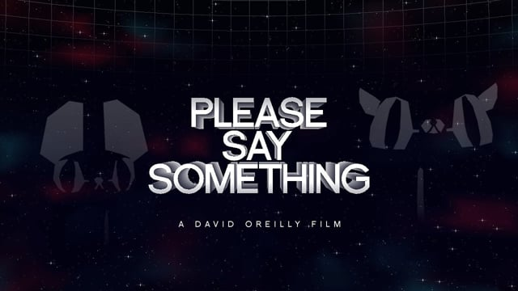
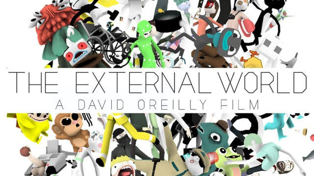
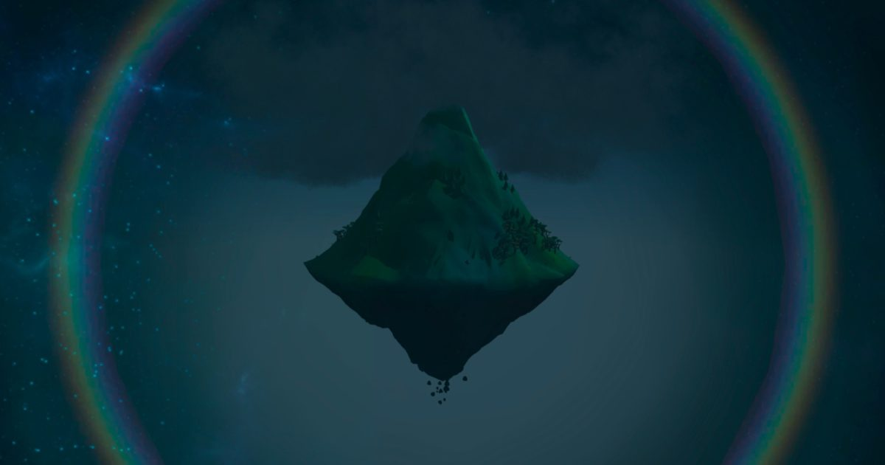
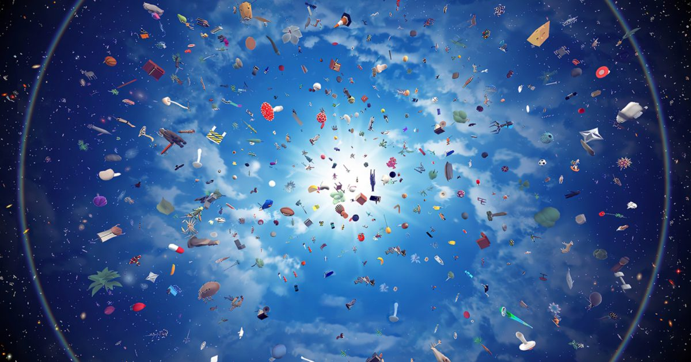
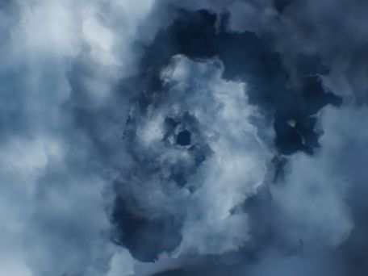

# David O'Reilly

**Tag tecnica/formato:** `modellazione-3d` `videogioco-simulazione` `procedurale-generativo`
**Tag tema:** `storia-computer-grafica` `mondi-virtuali-simulazione`
**Tag corso:** `TAD-DCV` `AW` `M3D`
**Stato:** non confermato: l'ingresso di Everything nella collezione permanente del MoMA (da verificare su moma.org) · da verificare il progetto EACHOTHER (2026)

## Biografia
Nato il 21 giugno 1985 a Kilkenny, Irlanda. Autodidatta, senza formazione accademica in animazione computerizzata: inizia a lavorare da adolescente allo studio Cartoon Saloon di Kilkenny. Si trasferisce a Londra, dove entra nel collettivo di design e regia Shynola (lavorandovi di notte mentre di giorno è impiegato allo Studio AKA), contribuendo a un video musicale di Beck ("E-Pro") e a segmenti animati per *Guida galattica per autostoppisti* di Garth Jennings (2005). Nel 2007 si trasferisce a Berlino per lavorare in autonomia. Nel 2009 vince l'Orso d'Oro alla Berlinale con *Please Say Something*, il lavoro che gli dà risonanza internazionale. Anima e dirige, nel film *Lei* di Spike Jonze (2013), le sequenze del videogioco olografico con il personaggio "Alien Child" — progetto spesso citato come ciò che lo spinge verso lo sviluppo di veri videogiochi. Dal 2014 realizza *Mountain* ed *Everything* (2017), entrambi pubblicati da Double Fine Productions. Vive e lavora a Los Angeles.

## Poetica e ricerca
Il tratto distintivo di O'Reilly è un'estetica 3D deliberatamente "low-poly" e non rifinita — ombreggiature piatte, assenza di fonti di luce realistiche, nessuna texture map elaborata — posizionata consapevolmente contro lo standard fotorealistico ad alta definizione imposto da Pixar, DreamWorks e Hollywood in generale. Ha articolato questa posizione nel proprio saggio *Basic Animation Aesthetics*, largamente diffuso online: "C'è un flusso continuo di animazione, sia commerciale sia indipendente, che appare sempre uguale, e non credo debba essere necessariamente così." A proposito di *Please Say Something* scrive: "la mia idea centrale nel costruire il mondo del film era dimostrare che qualcosa di totalmente artificiale e irreale potesse comunque comunicare emozione e reggere una verità cinematografica." Sostiene inoltre che "la chiave dell'estetica è la coerenza" — le regole visive di un mondo possono essere del tutto arbitrarie, purché internamente coerenti. In un'intervista all'*Irish Times* estende questo principio al proprio lavoro interattivo: "Tutta l'arte è una descrizione del mondo, o il mondo che descrive se stesso. Il 3D è un mezzo eccellente per farlo, e lo è ancora di più perché il medium interattivo dei videogiochi è ancora più vicino a questo: si basa su simulazioni, su sistemi vicini al modo in cui funziona la natura." Descrive *Everything* come un "documentario naturalistico giocabile", costruito attorno all'idea di Alan Watts secondo cui "ciò che è caos a un livello di ingrandimento è armonia a un livello di ingrandimento superiore".

## Opere principali
### Please Say Something (2009)
**Descrizione:** cortometraggio di 10 minuti, allegoria minimalista in 3D di una relazione travagliata tra un gatto e un topo "in un futuro remoto". Scritto, diretto e prodotto da O'Reilly, sound design e sintesi vocale di David Kamp, musica di Bram Meindersma. Vince l'Orso d'Oro per il miglior cortometraggio alla Berlinale 2009; la giuria lo definisce "un film che ci ha dato molta emozione, sensibilità e molto su cui riflettere".
**Lettura critica:** dimostrazione precoce e condensata della tesi della "basic animation aesthetics" — forme deliberatamente rozze e artificiali possono comunque portare un peso emotivo e narrativo autentico.
**Video:** [Please Say Something, film integrale (Vimeo)](https://player.vimeo.com/video/3388129)

### The External World (2010)
**Descrizione:** cortometraggio di 17 minuti scritto da Vernon Chatman e David O'Reilly, diretto da O'Reilly: una serie di vignette cupe e satiriche (tra cui "un ragazzo impara a suonare il piano") che intrecciano droga, sesso, violenza e riferimenti pop nello stesso linguaggio visivo low-poly. In anteprima alla 67ª Mostra del Cinema di Venezia, anteprima statunitense a Sundance 2011; vince oltre 40 premi festival, incluso l'IFTA (Irish Film & Television Award) per la miglior animazione.
**Lettura critica:** una maturazione dell'estetica "brutta"/artificiale verso la satira sociale e politica, oltre il minimalismo puramente emotivo del lavoro precedente.
**Video:** [The External World, film integrale (Vimeo)](https://vimeo.com/19723116)

### A Glitch Is a Glitch (Adventure Time, episodio, 2013)
**Descrizione:** singolo episodio della serie *Adventure Time* (stagione 5, episodio 15, andato in onda il 1° aprile 2013), interamente animato in CGI 3D nello stile proprio di O'Reilly, che lo scrive, storyboarda e dirige. Pendleton Ward, creatore della serie, lo contatta per la prima volta attorno al 2010; la collaborazione si realizza circa tre anni dopo, una volta che O'Reilly si è trasferito a Los Angeles.
**Lettura critica:** un caso raro di innesto diretto dell'estetica d'autore low-poly dentro una produzione televisiva mainstream per bambini, senza addolcirne il linguaggio visivo.

⚠️ Nessuna immagine trovata: Rhizome (fonte con screenshot documentato) e Adventure Time Wiki bloccano l'accesso automatizzato; da recuperare manualmente.

### Mountain (2014, videogioco/app, Double Fine Productions)
**Descrizione:** "simulatore di montagna" minimale: il giocatore risponde a un breve questionario visivo per generare una montagna fluttuante unica, poi si limita in gran parte a osservarla invecchiare, subire intemperie e pronunciare occasionalmente frasi filosofiche o banali. Pensato per restare in esecuzione in background.
**Lettura critica:** una riduzione all'osso del genere "gioco idle/simulazione", che estende l'interesse di O'Reilly per sistemi che funzionano con un'agentività minima da parte del giocatore.

**Approfondimento:** [doublefine.com/games/mountain](https://www.doublefine.com/games/mountain)

### Everything (2017, videogioco, Double Fine Productions)
**Descrizione:** simulazione assistita da procedure in cui il giocatore può abitare e passare tra oltre 3.000 "cose" giocabili diverse — batteri, animali, edifici, galassie — esplorando scala e interconnessione. Narrato per intero da registrazioni d'archivio di lezioni del filosofo Alan Watts (1965-1973). Il trailer di 11 minuti, costruito con filmati di gioco e la narrazione di Watts, vince il Jury Prize a Vienna Independent Shorts 2017, entra nella longlist degli Oscar per il miglior cortometraggio d'animazione — probabilmente il primo trailer di un videogioco a raggiungere lo status di qualificazione agli Oscar — e vince il Golden Nica al Prix Ars Electronica.
**Lettura critica:** l'opera che porta a compimento il progetto di O'Reilly di trattare il videogioco come sistema filosofico e non solo come intrattenimento — l'interconnessione tra scale radicalmente diverse (batterio/galassia) diventa argomento estetico oltre che ludico.
**Video:** [Everything, trailer di lancio PS4 (YouTube)](https://www.youtube.com/watch?v=bwqGSQzE0H0)

**Approfondimento:** [doublefine.com/games/everything](https://www.doublefine.com/games/everything)

### Eye of the Dream (2018-2023)
**Descrizione:** film/installazione a cupola 360° costruito sul motore di *Everything*, che esplora geometria frattale ed evoluzione "dal Big Bang all'epoca contemporanea". Mostrato al 21st Century Museum of Contemporary Art di Kanazawa e nella mostra "The New Infinity" dei Berliner Festspiele.
**Lettura critica:** estende il linguaggio sviluppato per *Everything* dal formato videoludico a quello dell'installazione immersiva a cupola, portando l'esperienza di scala cosmica oltre lo schermo del videogioco.

**Approfondimento:** [berlinerfestspiele.de — Eye of the Dream](https://www.berlinerfestspiele.de/en/programm/archiv/the-new-infinity/2018/david-oreilly-eye-of-the-dream)

## Interviste e talk
- [The Irish Times — intervista](https://www.irishtimes.com/culture/art-and-design/david-o-reilly-this-irish-game-maker-s-theory-about-everything-1.3096313)
- [Rhizome — intervista su "A Glitch Is a Glitch"](https://rhizome.org/editorial/2013/apr/25/datamoshing-land-ooo-conversation-david-oreilly/)

## Fonti
- [Vimeo — canale ufficiale dell'artista](https://vimeo.com/davidoreilly/videos)
- [Berlinale — Please Say Something, programma 2009](https://www.berlinale.de/en/2009/programme/20097362.html)
- [Double Fine Productions — Everything](https://www.doublefine.com/games/everything)
- [Double Fine Productions — Mountain](https://www.doublefine.com/games/mountain)
- [Ars Electronica — blog su Everything](https://ars.electronica.art/aeblog/en/2017/09/07/everything/)
- [PBS SoCal Artbound — profilo critico](https://www.pbssocal.org/shows/artbound/you-are-being-generated-the-work-of-animator-david-oreilly)
- [Basic Animation Aesthetics, saggio (PDF)](https://www.media-arts-uts.com/aes1/wp-content/uploads/2012/01/BasicAnimationAesthetics.pdf)
- [IDFA DocLab — Eye of the Dream](https://www.doclab.org/2018/eye-of-the-dream/)

## Crediti delle immagini
Immagine per cinque delle sei opere, incluse sotto la relativa descrizione in "Opere principali", da Vimeo, Double Fine e Berliner Festspiele — manca solo *A Glitch Is a Glitch*, le cui fonti con immagini (Rhizome, Adventure Time Wiki) bloccano l'accesso automatizzato.
- [Berlinale — Please Say Something, programma 2009](https://www.berlinale.de/en/2009/programme/20097362.html)
