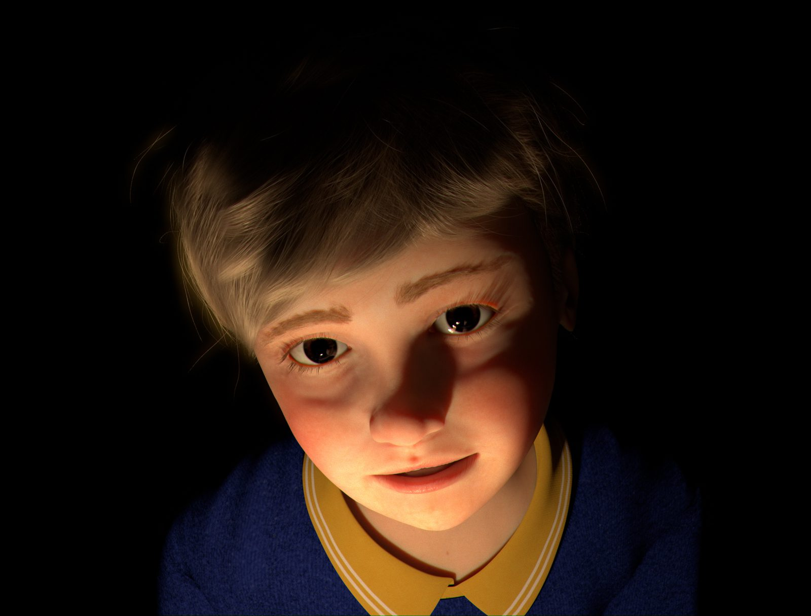
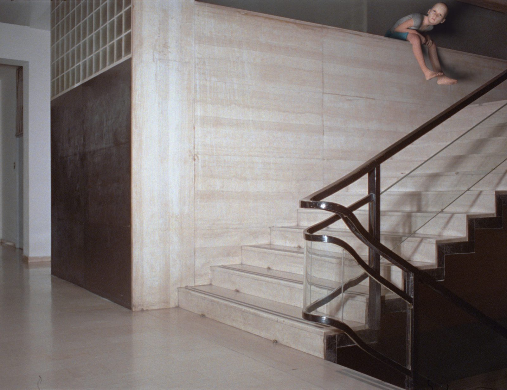
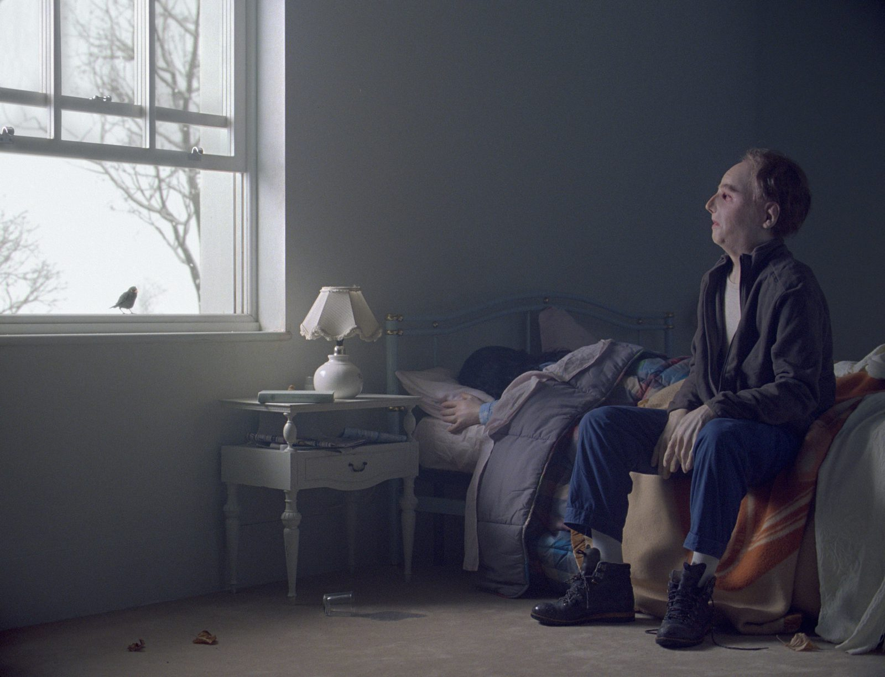
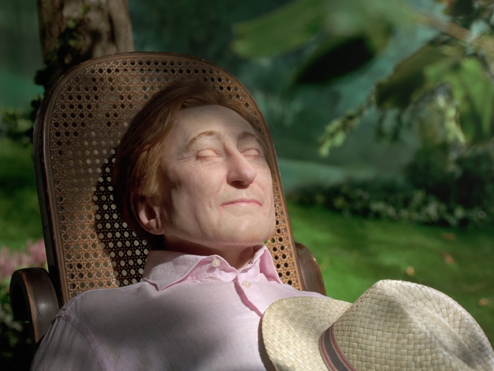

# Diego Marcon

**Tag tecnica/formato:** `modellazione-3d` `video` `ai-generativa`
**Tag tema:** `corpo-identita` `memoria-archivio` `temporalita-non-lineare`

## Biografia
Nato nel 1985 a Busto Arsizio, provincia di Varese. Frequenta la Scuola Civica di Cinema, Televisione e Nuovi Media di Milano (2006) e consegue un BA in Arti Visive e Teatro allo IUAV, Università Iuav di Venezia (2012). Vive e lavora a Milano. Riconoscimenti: Premio MAXXI Bvlgari 2018 (Roma), vinto per il video *Ludwig* — la giuria ne cita "l'unica combinazione tra linguaggio analogico e digitale"; l'opera entra nella collezione permanente del MAXXI. Premio Scultura della Fondazione Henraux (4ª edizione, 2018), per una versione scultorea in marmo della figura del bambino di *Ludwig* — "la materializzazione in marmo di un bambino creato prima tramite un modello 3D". *The Parents' Room* debutta alla Quinzaine des Réalisateurs (Quindicina dei Registi) del Festival di Cannes 2021. Nel 2022 partecipa alla 59ª Biennale di Venezia, "Il latte dei sogni", curata da Cecilia Alemani, con *The Parents' Room*. Nel 2023 la Fondazione Nicola Trussardi gli dedica "Dramoletti", la sua prima antologica istituzionale in Italia (Teatro Gerolamo, Milano, curata da Massimiliano Gioni). Rappresentato dalle gallerie Sadie Coles HQ (Londra), Galerie Buchholz (Berlino/Colonia/New York), ZERO... (Milano) ed Ermes-Ermes (Roma/Vienna).

⚠️ Correzione importante: non risulta alcuna partecipazione al Whitney Biennial — il traguardo internazionale del 2022 è la Biennale di Venezia ("Il latte dei sogni", a cura di Cecilia Alemani), non il Whitney Biennial di New York. Non confermata una formazione all'Accademia di Brera: la formazione documentata è alla Scuola Civica di Cinema di Milano e allo IUAV di Venezia.

## Poetica e ricerca
Myriam Ben Salah, direttrice esecutiva e capo curatrice della Renaissance Society di Chicago (in occasione della mostra "Krapfen", 2025), scrive che Marcon "smonta il fare cinematografico pur continuando a usarne gli strumenti più seducenti", trattando il film come "una macchina — di tempo, suono e immagine — che può ricablare dall'interno". La galleria Sadie Coles HQ descrive la sua pratica come radicata "nell'intrattenimento e nel cinema strutturale — evitando la narrazione tradizionale per esplorare la meccanica stessa del fare film... le opere attingono a vocabolari cinematografici da musical, melodramma, horror e comicità slapstick... impiega dispositivi tecnici come robotica, protesi e CGI". La Fondazione Trussardi inquadra il lavoro come costruzione di "misteriosi drammi da camera abitati da pupazzi, bambini e creature sospese tra stati umani e post-umani, fondendo melodramma ed effetti speciali". Lou Stoppard, su *Frieze*, ha scritto un saggio critico ("Diego Marcon's Films Conjure a Familiar, Grotesque World") sulla sua estetica perturbante; *ArtReview* gli ha dedicato il pezzo "Diego Marcon's Hollow People", specificamente sulle figure simili a bambole/pupazzi al centro del suo lavoro. Temi ricorrenti confermati da più fonti: la malinconia dell'infanzia, la morte e la tragedia rese in formato operistico/cantato, strutture in loop, la "zona liminale tra vita e morte", il dialogo con generi cinematografici popolari e classici (horror, slapstick, melodramma, musical) ricombinati con CGI ed effetti protesici/animatronici.

## Opere principali

### Ludwig (2018)
**Descrizione:** video di 4 minuti interamente realizzato in CGI — il primo video dell'artista realizzato interamente con questa tecnica. Un bambino biondo, solo nella stiva buia di una nave in tempesta, canta un'aria romantica/operistica (interpretata da un membro del coro Voci Bianche dell'Accademia Teatro alla Scala). Vince il Premio MAXXI Bvlgari 2018; una versione scultorea in marmo vince il Premio Scultura della Fondazione Henraux.
**Lettura critica:** l'opera che segna il passaggio definitivo dell'artista dal cinema analogico/pellicola alla CGI totale, pur mantenendo lo stesso registro operistico/melodrammatico dei lavori precedenti.

**Approfondimento:** [sadiecoles.com — Ludwig](https://www.sadiecoles.com/artworks/diego-marcon/ludwig)

### Monelle (2017, uscito nel 2018)
**Descrizione:** film in 35mm con animazione CGI, circa 14 minuti, in loop, composto da 30 inquadrature di meno di un secondo ciascuna, intervallate da buio. Girato dentro la Casa del Fascio di Como (1936, architetto Giuseppe Terragni). Lampi rivelano bambine e frammenti di violenza (corpi trascinati, spinti da balconi), con musica di tromba di Federico Chiari.
**Lettura critica:** letta come indagine sulla capacità dell'architettura fascista di trattenere l'"impronta" della violenza passata — l'edificio stesso diventa testimone e archivio di ciò che vi è accaduto.

**Approfondimento:** [sadiecoles.com — Monelle](https://www.sadiecoles.com/artworks/diego-marcon/monelle)

### La Miserabile (2018, installazione site-specific)
**Descrizione:** debutto della prima mostra personale istituzionale dell'artista, alla Triennale di Milano (20 luglio-26 agosto 2018, a cura di Edoardo Bonaspetti). Installazione in vinile/tubi al neon che raffigura una bambina malata al centro di una "veglia" di sedici enigmatiche figure adolescenti che la scrutano o si distraggono con azioni prive di senso.
**Lettura critica:** malinconia esistenziale dell'infanzia in una zona liminale tra vita e morte — un tema che ritornerà costantemente in tutta l'opera successiva dell'artista.

⚠️ Nessuna immagine trovata: non presente tra le opere con immagini dirette su Sadie Coles HQ; la Fondazione Nicola Trussardi documenta un'altra mostra (Teatro Gerolamo), non questa installazione del 2018 alla Triennale.

### The Parents' Room (2020-2021)
**Descrizione:** film in 35mm, circa 6 minuti, in loop, colonna sonora originale di Federico Chiari (registrata alla Trinity Laban School of Music, Londra). Un uomo siede sul bordo di un letto disfatto accanto a una donna; in un monologo operistico accompagnato da un coro, narra il proprio omicidio della moglie e dei figli e il proprio suicidio, mentre le vittime entrano in scena una a una. Gli attori indossano calchi protesici sintetici di se stessi (un effetto simile allo stop-motion ottenuto con attori dal vivo). Presentato in anteprima alla Quinzaine des Réalisateurs di Cannes (2021); mostra personale al Madre - Museo d'arte contemporanea Donnaregina, Napoli (settembre 2021, a cura di Eva Fabbris e Andrea Viliani), entra nella collezione permanente del Madre; mostrato alla 59ª Biennale di Venezia (2022).
**Lettura critica:** l'opera che porta a massima intensità la formula distintiva dell'artista — l'orrore più estremo (l'omicidio familiare) raccontato nel registro più formalmente controllato e musicalmente elegante (l'aria operistica).

**Approfondimento:** [sadiecoles.com — The Parents' Room](https://www.sadiecoles.com/artworks/diego-marcon/the-parents-room)

### La Gola (2024)
**Descrizione:** presentata alla Kunsthalle Wien (4 ottobre 2024-2 febbraio 2025), prima mostra personale austriaca dell'artista, co-prodotta con il Centre d'Art Contemporain di Ginevra e il Kunstverein di Amburgo. Strutturata come otto lettere tra due corrispondenti, Gianni e Rossana, interpretati da manichini/pupazzi statici e iperrealistici i cui soli occhi sono animati in CGI (che sbattono le palpebre, riflettono la luce, si riempiono di lacrime). Gianni descrive le portate di un banchetto sontuoso mentre Rossana racconta il declino della salute della madre — temi di piacere, dolore, cibo e morte. Colonna sonora originale di Federico Chiari, registrata su un organo storico della Cattedrale di Sant'Alessandro Martire, Bergamo.
**Lettura critica:** porta all'estremo la tecnica del corpo statico/protesico con solo gli occhi animati digitalmente — un dispositivo che rende letteralmente "immobili" i personaggi mentre le loro parole raccontano dolore e perdita in movimento.

**Approfondimento:** [sadiecoles.com — La Gola](https://www.sadiecoles.com/artworks/diego-marcon/la-gola)

## Immagini

Immagine e link di approfondimento per quattro delle cinque opere, incluse sotto la relativa descrizione in "Opere principali", scaricate da [sadiecoles.com](https://www.sadiecoles.com/artists/diego-marcon) — manca solo *La Miserabile* (2018).
- [La Biennale di Venezia — pagina artista, Il latte dei sogni (2022)](https://www.labiennale.org/en/art/2022/milk-dreams/diego-marcon)
- [Fondazione Nicola Trussardi — Dramoletti](https://www.fondazionenicolatrussardi.com/en/mostre/diego-marcon/)

## Fonti
- [Sadie Coles HQ — pagina artista](https://www.sadiecoles.com/artists/diego-marcon)
- [La Biennale di Venezia — pagina artista, Il latte dei sogni (2022)](https://www.labiennale.org/en/art/2022/milk-dreams/diego-marcon)
- [Fondazione Nicola Trussardi — Dramoletti](https://www.fondazionenicolatrussardi.com/en/mostre/diego-marcon/)
- [Madre - Museo d'arte contemporanea Donnaregina — The Parents' Room](https://www.madrenapoli.it/en/exhibition/diego-marcon-the-parents-room-eng/)
- [Kunsthalle Wien — La Gola](https://kunsthallewien.at/en/exhibition/diego-marcon-la-gola)
- [Artforum — vittoria del Premio MAXXI Bvlgari 2018](https://www.artforum.com/news/diego-marcon-wins-2018-maxxi-bulgari-prize-77354)
- [Frieze — Lou Stoppard, "Diego Marcon's Films Conjure a Familiar, Grotesque World"](https://www.frieze.com/article/diego-marcon-lou-stoppard-250)
- [ArtReview — "Diego Marcon's Hollow People"](https://artreview.com/diego-marcons-hollow-people/)
- [Mousse Magazine — su La Miserabile, Triennale di Milano](https://www.moussemagazine.it/magazine/diego-marcon-la-miserabile-la-triennale-di-milano-milan-2018/)
- [The Renaissance Society, Chicago — Krapfen (2025)](https://renaissancesociety.org/exhibitions/560/diego-marcon-krapfen/)

---

## Appunti da organizzare
- Non citato in un programma specifico dei corsi — inserito dalla lista generale "da scrivere da zero" per la particolare rilevanza come artista italiano che fonde CGI, protesi e cinema classico.
- ⚠️ Non verificato: un'opera intitolata "Rain" attribuita all'artista — nessuna fonte trovata, probabile confusione con un altro artista.
- Opere recenti da approfondire: *Dolle* (2023, video digitale di 29 minuti e 32 secondi da 35mm/CGI, mostrato simultaneamente da Sadie Coles HQ Londra e Galerie Buchholz Berlino); *FORZA CANI* (2025, mostra personale al Consortium Museum di Digione).
- Video ulteriori: canale Vimeo ufficiale dell'artista: [vimeo.com/diegomarcon](https://vimeo.com/diegomarcon/videos); pagina video della galleria Sadie Coles HQ: [sadiecoles.com/video](https://www.sadiecoles.com/video/artists/67/).
