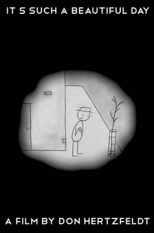

# Don Hertzfeldt

**Tag tecnica/formato:** `animazione-2d` `video`
**Tag tema:** `corpo-identita` `memoria-archivio` `fantascienza-speculativa`
**Stato:** scheda parziale, scritta a partire da fonti web (Wikipedia, siti di festival e gallerie); non ancora assegnata a un corso · immagini da verificare (diritti degli autori)

## Biografia
Nato il 1° agosto 1976, animatore, sceneggiatore e regista indipendente statunitense. Due volte candidato all'Oscar. Nove suoi cortometraggi sono stati in concorso al Sundance Film Festival (un record per il festival) ed è l'unico regista ad aver vinto due volte il Gran Premio della Giuria per il cortometraggio. Il suo ultimo film, *Paper Trail*, è stato presentato al Sundance 2026 e ha vinto il Premio speciale della giuria per la visione creativa.

## Poetica e ricerca
Lavora in modo indipendente e artigianale. La critica ha descritto la sua opera come tra le più influenti dell'animazione contemporanea e *GQ* (2020) l'ha definita «tragica e comica, filosofica e cruda, profondamente triste e fatalista, ma ostinatamente piena di speranza». Lo storico Stephen Cavalier osserva che attira un seguito fanatico tra studenti e ambienti alternativi, di solito associato alle band indie rock.

## Opere principali

### It's Such a Beautiful Day (2012)
**Descrizione:** Lungometraggio che riunisce la trilogia di cortometraggi animati sul personaggio di Bill, un uomo che cerca di rimettere insieme la propria psiche in frantumi. Considerato dalla critica tra i migliori film d'animazione di sempre.

### World of Tomorrow e World of Tomorrow Episode Two
**Descrizione:** Serie di cortometraggi in cui una bambina, Emily, viene portata in un viaggio nel suo lontano futuro e poi incontra un suo clone di riserva dal futuro ancora più lontano. Considerato dalla critica tra i migliori film d'animazione di sempre.

⚠️ Nessuna immagine trovata.

### Rejected e Paper Trail
**Descrizione:** *Rejected* è tra le sue opere più note; *Paper Trail* (2026) ha vinto il Premio speciale della giuria al Sundance e il Cristallo ad Annecy.

⚠️ Nessuna immagine trovata.

### Rejected (2000) e World of Tomorrow (2015): candidature
**Corso:** `TAD-DCV` `TAD-AVM`
**Temi:** `tempo-lungo-e-durata` `corpo-post-umano`
**Descrizione:** *Rejected* (2000) è stato candidato all'Oscar per il cortometraggio d'animazione, nella cerimonia del 2001. *World of Tomorrow* (2015) ha ottenuto una seconda candidatura e riprende le figure stilizzate tipiche di Hertzfeldt nella sua prima prova di animazione digitale ([Sundance](https://www.sundance.org/blogs/oscars-preview-hertzfeldts-stick-figures-return-in-world-of-tomorrow-3/); [Austin Chronicle](https://www.austinchronicle.com/screens/don-hertzfeldt-snags-oscar-nomination-12095660/)).
**Lettura critica:** la figura stilizzata mostra quanto poco basti a un corpo per recitare: è una buona prova per la lezione sul corpo performante.

## Fonti
- [Wikipedia — Don Hertzfeldt](https://en.wikipedia.org/wiki/Don_Hertzfeldt)
- [Wikipedia — It's Such a Beautiful Day](https://en.wikipedia.org/wiki/It's_Such_a_Beautiful_Day_(film))
- [Sundance — Oscars Preview: World of Tomorrow](https://www.sundance.org/blogs/oscars-preview-hertzfeldts-stick-figures-return-in-world-of-tomorrow-3/)
- [Austin Chronicle — candidatura all'Oscar](https://www.austinchronicle.com/screens/don-hertzfeldt-snags-oscar-nomination-12095660/)
- Davide Giurlando (a cura di), *Fantasmagoria. Un secolo (e oltre) di cinema d'animazione*, Marsilio, 2017 (citato tra gli ospiti del festival Georama, saggio di Maria Roberta Novielli, PDF 78)

## Crediti delle immagini
Immagini da verificare: provengono da pagine di festival, gallerie, siti degli artisti e piattaforme, e restano di proprietà degli autori.
- It's Such a Beautiful Day (1): [en.wikipedia.org](https://en.wikipedia.org/wiki/File%3AIt%27s_Such_A_Beautiful_Day_Poster.jpg) · Fair use
