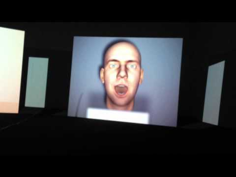
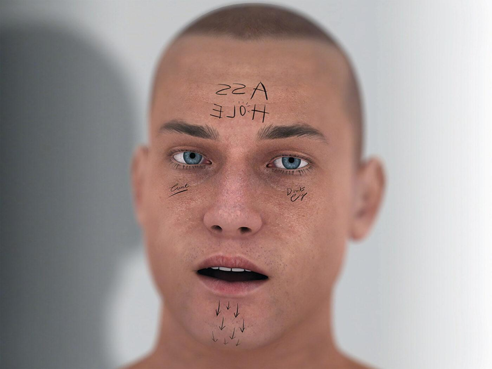
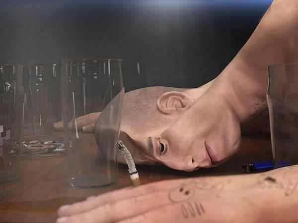
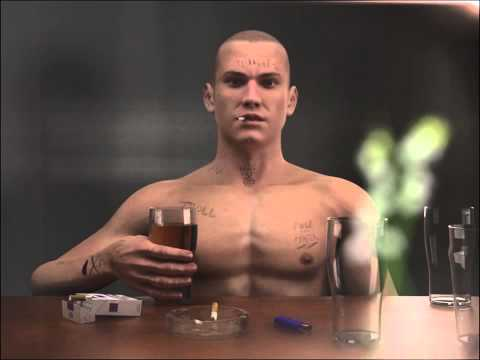
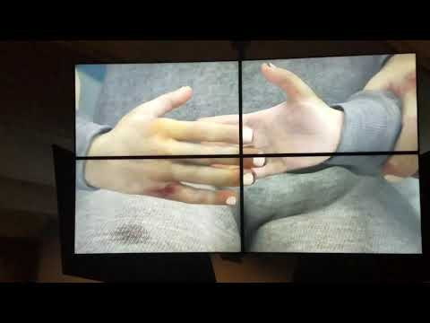
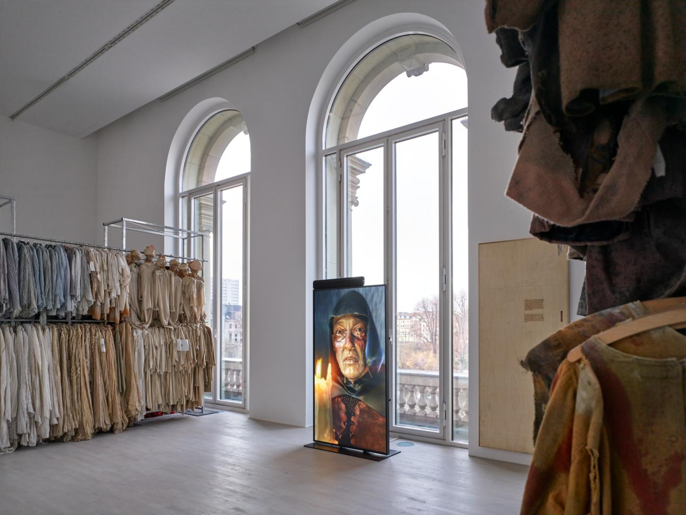
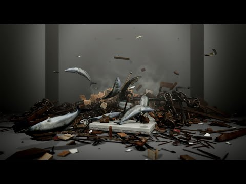
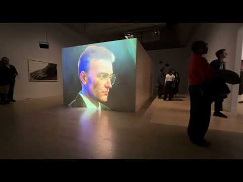

# Ed Atkins

**Tag tecnica/formato:** `modellazione-3d` `motion-capture` `video`
**Tag tema:** `corpo-identita` `storia-computer-grafica`
**Tag corso:** `TAD-DCV` `TAD-AVM` `M3D`

## Biografia
Artista britannico, nato nel 1982, cresciuto a Stonesfield, un paese vicino a Oxford (madre insegnante d'arte, padre grafico). BA al Central Saint Martins; MA in Fine Art allo Slade School of Fine Art, University College London (2009). Ha insegnato come Fine Art Lecturer al Goldsmiths College di Londra (2012-2014) — **non vi si è laureato**, come indicato erroneamente in una versione precedente di questa scheda. Vive a Copenaghen; insegna anche alla Hochschule für bildende Künste di Amburgo. Retrospettiva alla Tate Britain (recensita dal Guardian nell'aprile 2025).

## Poetica e ricerca
Atkins lavora con avatar CGI ad altissima definizione — "surrogati" digitali — come stand-in di sé stesso, mappando il proprio volto sul modello tramite motion capture. Il suo lavoro esplora il divario tra la perfezione apparente dell'immagine digitale e la fragilità, la finitezza e la malinconia dell'esperienza umana: gli avatar cadono nella "valle perturbante", con pelle simile a cera e movimenti goffi, portati al massimo dettaglio tecnico solo per rivelarne il fallimento nel catturare la vita vera. Il processo creativo parte quasi sempre dalla scrittura — testo come "sceneggiatura" che dà una parvenza di interiorità a figure altrimenti vuote — e da un sound design viscerale (respiri, deglutizioni, singhiozzi) che contrasta con l'immagine, re-iniettando fisicità in ciò che la CGI ha svuotato. Ha pubblicato anche un libro di testi, *A Primer for Cadavers*.

## Opere principali
### Us Dead Talk Love (2012)
**Corso:** `TAD-AVM` `M3D`
**Temi:** `avatar-e-corpo-virtuale` `desiderio-e-intimita`
**Descrizione:** video a due canali con avatar digitale, esplora intimità e incarnazione digitale.
**Lettura critica:** primo lavoro maturo sul corpo digitale come "guscio vuoto" che performa emozioni senza poterle davvero provare.
**Video:** [versione integrale su YouTube (37'24")](https://www.youtube.com/watch?v=yVMN0Y6rM-0)

### Even Pricks (2013)
**Temi:** `realismo-sintetico`
**Descrizione:** video-collage di 7'32" in CGI: carrellate su modelli di After Effects, titoli che esplodono come in un trailer di videogioco, simulazioni di vetro, neve, fiamme e acqua. Il motivo centrale è un braccio con il pollice alzato, il segno del «mi piace», che si sgonfia e si rigonfia in modo fallico. Compaiono uno scimpanzé che parla e un letto il cui materasso si frantuma.
**Lettura critica:** simulazioni troppo perfette impediscono l'immersione. La catena di associazioni va dall'approvazione al fallimento, e l'immagine lucida e disumana diventa uno specchio per amore, speranza e depressione.

### Warm, Warm, Warm Spring Mouths (2013)
**Corso:** `M3D` `TAD-AVM`
**Temi:** `avatar-e-corpo-virtuale` `realismo-sintetico`
**Descrizione:** un protagonista maschile disincarnato, realizzato in CGI e motion capture, legge "The Morning Roundup" (poesia di Gilbert Sorrentino) mentre l'ambiente intorno a lui cambia continuamente.
**Lettura critica:** un'opera insieme perturbantemente realistica e riconoscibilmente artificiale — il testo poetico letto ad alta voce diventa la "pelle" psicologica di un corpo altrimenti vuoto.
**Video:** [Parte 1](https://www.youtube.com/watch?v=Xt5sAIyIej0) · [Parte 2](https://www.youtube.com/watch?v=vFfNTmKoBSU)

### Ribbons (2014)
**Corso:** `M3D`
**Temi:** `realismo-sintetico` `avatar-e-corpo-virtuale`
**Descrizione:** un avatar digitale canta ballate malinconiche in un ambiente da bar iperreale.
**Lettura critica:** la performance del sentimento (canto, ubriachezza, confessione) rivela la sua stessa artificialità.

**Approfondimento:** [stedelijk.nl — Ribbons](https://www.stedelijk.nl/en/collection/96446-ed-atkins-ribbons)
**Video:** [Ed Atkins — Ribbons, 2014 (YouTube, caricamento non ufficiale)](https://www.youtube.com/watch?v=3EkqVWXBVOQ)

### Safe Conduct (2016)
**Corso:** `TAD-AVM` `M3D`
**Temi:** `avatar-e-corpo-virtuale`
**Descrizione:** installazione video, rilettura surreale dei rituali di sicurezza aeroportuale, interpretata da un avatar motion-captured.
**Lettura critica:** ansia e sorveglianza istituzionale filtrate attraverso il corpo digitale.
**Video:** [ED ATKINS - SAFE CONDUCT - HIRSHHORN 2017](https://www.youtube.com/watch?v=eUgU0dziZG4)

### Old Food (2017-2018)
**Corso:** `TAD-AVM`
**Temi:** `tempo-lungo-e-durata`
**Descrizione:** installazione che combina quattro monumentali attaccapanni carichi di costumi d'opera presi in prestito dal Deutsche Oper di Berlino (quasi 280 metri lineari, esposti esattamente come archiviati, per secolo e tema) con elementi video: i personaggi verbosi dei lavori precedenti sono ora resi muti, capaci solo di gemere e ansimare, intrappolati in un ciclo senza fine di sentimentalismo. L'installazione è accompagnata da un pezzo per pianoforte del compositore svizzero Jürg Frey, otto accordi lenti e sospesi in loop.
**Lettura critica:** i costumi vuoti — gusci di identità storiche mai indossate in scena durante la mostra — dialogano con i corpi digitali vuoti dei video: entrambi sono superfici che promettono un'interiorità che non arriva mai.

### Refuse.exe (2019)
**Corso:** `TAD-AVM` `TAD-DCV` `M3D`
**Temi:** `glitch-e-errore`
**Descrizione:** film digitale in cui oggetti collassano, si glitchano e si ricompongono.
**Lettura critica:** l'instabilità della materia virtuale come metafora della fragilità stessa del reale.
**Video:** [Ed Atkins, Refuse.exe (2019)](https://www.youtube.com/watch?v=FY0ilvPGl7k)

### The Worm (2021)
**Corso:** `TAD-AVM`
**Temi:** `avatar-e-corpo-virtuale`
**Descrizione:** film basato su una conversazione registrata con la madre dell'artista.
**Lettura critica:** distanza e connessione emotiva mediate dalla tecnologia digitale.

**Approfondimento:** [moma.org — The Worm](https://www.moma.org/collection/works/447112)

### Pianowork 2 (2023)
**Corso:** `M3D` `TAD-AVM`
**Temi:** `avatar-e-corpo-virtuale` `performance-audiovisiva`
**Descrizione:** avatar motion-captured che esegue un brano al pianoforte.
**Lettura critica:** l'emozione della performance musicale sopravvive anche quando il corpo che la produce è dichiaratamente assente.

⚠️ Nessuna immagine trovata: le fonti individuate (Mimic Productions, Gladstone Gallery, Instagram/Facebook) non espongono immagini dirette scaricabili automaticamente.

## Approfondimenti
Materiale per la didattica. Le prime due sezioni, aggiunte il 2026-11-01, sono state lette sulle fonti. Il resto viene dal documento di riferimento originale (REF su Drive), in gran parte compilato da AI: i link riportano parametri di tracciamento da chatbot e le frasi attribuite all'artista non hanno una fonte primaria indicata. Vanno quindi controllate prima di citarle in classe.

### Parole dell'artista
Dalla conversazione via email con Mitch Speed ([Art Basel](https://www.artbasel.com/news/ed-atkins-avatars-animations-experimental-writing)):
- **Vasi vuoti.** Gli avatar sono per lui sostituti di sé, modelli comprati su TurboSquid perché più articolati, pensati per il maggior numero di utenti: li personalizza e li indossa come maschere. Dice di aver preso a detestare l'idea di animarli con personaggi, moventi e storie.
- **I video come corpi morti.** Ha parlato dei video come corpi completi, come una sensualità resa digitale, e come corpi morti, pesanti e maleodoranti in senso figurato; da qui il tumore del testo *A Tumour* (2010).
- **Una richiesta di empatia.** Vuole che chi guarda provi qualcosa, probabilmente ciò che prova lui: lo chiama una richiesta di empatia.
- **Le fonti.** Burroughs, Sade, Lautréamont, Leiris, Hilda Hilst, Sorrentino, Barthelme e soprattutto Beckett.

### Letture critiche
- **Maschere mortuarie (Caldas).** Sulla mostra alla Tate Britain, Julieta Caldas legge gli avatar come maschere mortuarie, registrazioni di movimento umano chiuse in un presente che si ripete. L'opera interrompe di continuo la propria illusione; lo stesso Atkins scrive di volere che tutto ciò che fa si inceppi come un attore che ride in scena (*corpse*). Caldas critica però i testi di sala, che indicano già come reagire ([New Left Review, Sidecar, 2025](https://newleftreview.org/sidecar/posts/death-masks)).
- **La svolta confessionale (Kurtz).** Michael Kurtz vede un passaggio dall'alienazione digitale a un modo confessionale, centrato su famiglia e amore, e lo lega allo «stile dell'immediatezza» di Anna Kornbluh. Trova i lavori più recenti solipsistici; salva *The Worm*, dove la figura digitale fredda e la telefonata calda mantengono una distanza ([e-flux, 2025](https://www.e-flux.com/criticism/666807/ed-atkins)).
- **Da leggere.** [Hal Foster su *The Worm*, Artforum](https://www.artforum.com/features/hal-foster-on-ed-atkinss-the-worm-2021-250660/): non è stato possibile aprirlo da qui.

### Parole attribuite all'artista *(origine AI, da verificare)*
- Il volto: «Mappo il movimento del mio volto su quello del modello CGI: è il mio volto che si contorce, recitando dietro questa maschera immateriale.»
- L'artificio: vuole un'arte «ferocemente artificiale, ma che ti dice di controllare il neo sulla spalla».
- I temi: morte, cedimento del corpo, rimpianto, perdita e malinconia come motivi ricorrenti.
- Tate Britain, sulla sua pratica: usa le proprie esperienze, sentimenti e corpo come modelli per intimità, amore e perdita ([Tate Britain](https://www.tate.org.uk/whats-on/tate-britain/ed-atkins)).

### Dall'intervista «Something is Missing» *(sintesi AI del REF, da riascoltare)*
Fonte da riascoltare: [Ed Atkins Interview: Something is Missing](https://www.youtube.com/watch?v=H1iwLbwxKys).
- **Scrittura come sorgente.** Il processo parte quasi sempre dalla scrittura, un modo di «pensare attraverso il linguaggio»; in passato il ritmo della scrittura determinava la struttura dei video.
- **Avatar «evidentemente falsi e senza vita».** Proprio l'artificialità palese gli permette di usarli; un volto reale sarebbe «troppo specifico», l'avatar consente temi universali.
- **Rivelare l'artificio.** Vuole video che «parlino molto del modo in cui sono stati fatti», perché ci sia qualcosa di commovente nel mostrare la struttura dell'opera.
- **Malinconia e perdita.** Titolo e temi: insufficienza, fallimento, il passaggio tra esperienza corporea e senso «intangibile e sentimentale» di perdita.

### Per la didattica
- *A Primer for Cadavers* (Fitzcarraldo Editions, 2016), raccolta di testi dell'artista: comprende *A Tumour* e usa la maschera mortuaria come motivo. Il REF lo indica come chiave per leggere l'avatar come «cadavere».
- Discussione da Kurtz e Caldas: la sincerità degli ultimi lavori è un passo avanti o un modo di evitare la critica?
- Video segnati nel REF: [Safe Conduct (Hirshhorn, 2017)](https://www.youtube.com/watch?v=eUgU0dziZG4); [Us Dead Talk Love](https://www.youtube.com/watch?v=yVMN0Y6rM-0); [Ed Atkins: Get Life / Love's Work](https://www.youtube.com/watch?v=Kty-OFt0hX4).
- Confronto con Cheng e Claerbout sul rapporto tra superficie perfetta e vuoto: l'avatar come corpo che fallisce nel catturare la vita.

## Interviste e talk
- [Fantastic Man — intervista](https://www.fantasticman.com/articles/ed-atkins/)
- **Video:** [Ed Atkins in conversation with Tom McCarthy (AA School of Architecture, YouTube)](https://www.youtube.com/watch?v=Lt4TfzN-f2s) — nelle tracce di lezione: «talk con estratto da Safe Conduct»
- **Video:** [Blind Faith, Artist Lecture by Ed Atkins (Haus der Kunst, YouTube)](https://www.youtube.com/watch?v=k8tb3KiEg5o) — nelle tracce di lezione: talk con estratti video
- **Video:** [V. Ed Atkins — «Digital PTSD Part II. The Practice of Art and Its Impact on Digital Trauma» (Castello di Rivoli, YouTube)](https://www.youtube.com/watch?v=ms-1XQoI6a4)

## Fonti
- [Tate Britain — profilo artista](https://www.tate.org.uk/whats-on/tate-britain/ed-atkins)
- [Wikipedia — Ed Atkins](https://en.wikipedia.org/wiki/Ed_Atkins)
- [Gladstone Gallery — biografia](https://www.gladstonegallery.com/cn/artist/ed-atkins/biography)
- [The Guardian — recensione Tate Britain, 2025](https://www.theguardian.com/artanddesign/2025/apr/06/ed-atkins-tate-britain-review)
- [e-flux — Michael Kurtz sulla mostra alla Tate Britain (2025)](https://www.e-flux.com/criticism/666807/ed-atkins)
- [New Left Review, Sidecar — Julieta Caldas, «Death Masks» (2025)](https://newleftreview.org/sidecar/posts/death-masks)
- [Art Basel — conversazione con Mitch Speed](https://www.artbasel.com/news/ed-atkins-avatars-animations-experimental-writing)
- [Dazed Digital — 58 Ed Atkins](https://www.dazeddigital.com/projects/article/22541/1/58-ed-atkins)
- [SSENSE — I Am Not an Authority on Who I Am](https://www.ssense.com/en-us/editorial/art/i-am-not-an-authority-on-who-i-am)
- [Kunstsammlung Düsseldorf — Old Food](https://www.kunstsammlung.de/en/exhibitions-archive/ed-atkins-ye-olde-food-en)
- [e-flux — annuncio Old Food](https://www.e-flux.com/announcements/244172/ed-atkinsye-olde-food)
- Portfolio/sito ufficiale personale: **non individuato** — da cercare (l'artista è rappresentato da gallerie come Cabinet Gallery e dépendance).
- [Cabinet Gallery — Ed Atkins](https://www.cabinet.uk.com/ed-atkins)
- *WORLDBUILDING: Gaming and Art in the Digital Age*, booklet della mostra, Julia Stoschek Collection, Düsseldorf, 2022 (testo di Marion Eisele)

## Crediti delle immagini
Immagine per otto delle nove opere, incluse sotto la relativa descrizione in "Opere principali" — fotogrammi Vimeo/YouTube per i lavori senza immagine diretta disponibile, più fonti dirette (MoMA, Stedelijk) dove trovate.
- [Tate Britain — profilo artista](https://www.tate.org.uk/whats-on/tate-britain/ed-atkins)
- [Wikipedia — Ed Atkins](https://en.wikipedia.org/wiki/Ed_Atkins)
- [Gladstone Gallery — biografia](https://www.gladstonegallery.com/artist/ed-atkins)
