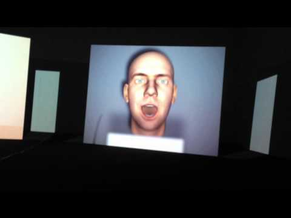
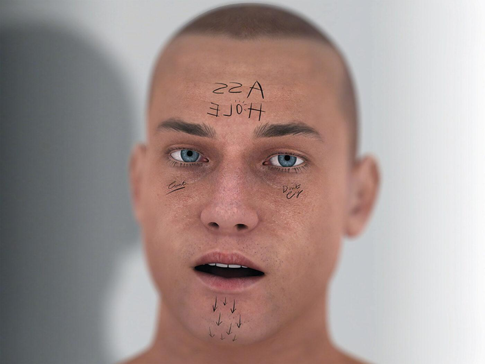
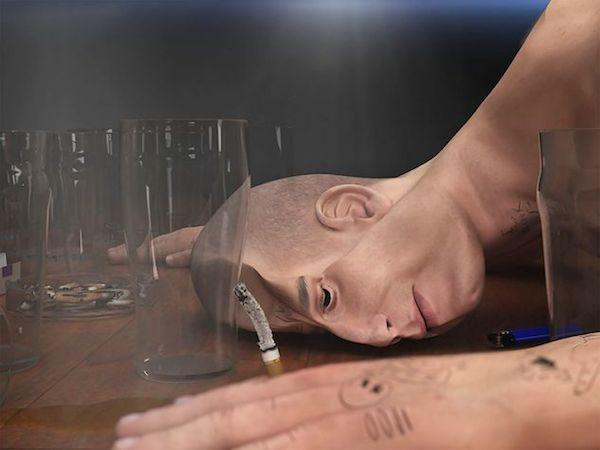
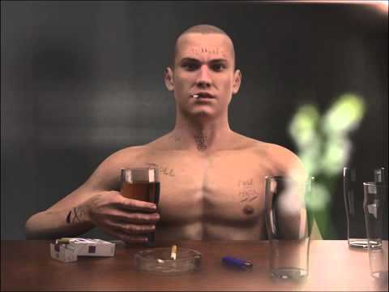
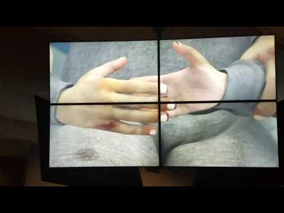
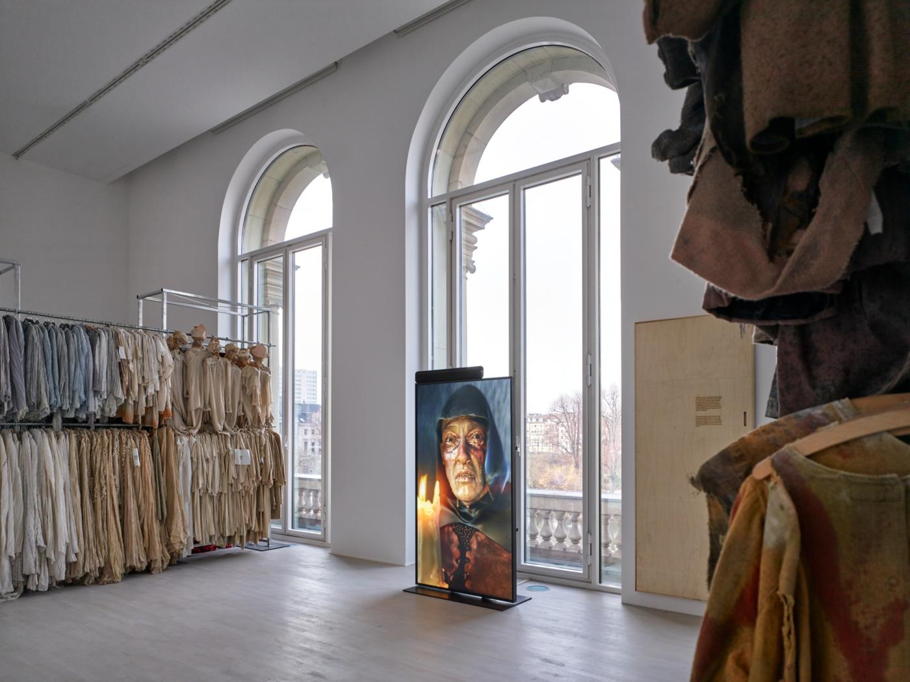
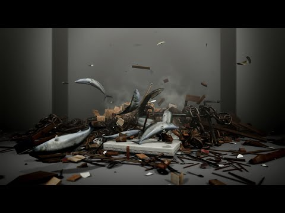
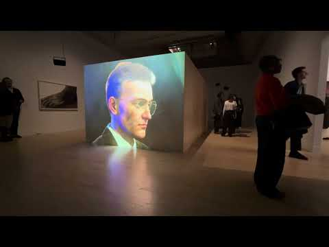

# Ed Atkins

**Tag tecnica/formato:** `modellazione-3d` `motion-capture` `video`
**Tag tema:** `corpo-identita` `storia-computer-grafica`
**Tag corso:** `TAD-DCV` `TAD-AVM` `M3D`
**Stato:** scheda avanzata · l'attribuzione delle due immagini di *Warm, Warm, Warm Spring Mouths* è probabile ma non certa · da aggiungere: *Cut* e *Death Mask II: The Scent* (2010), *Performance Capture* (2015), i disegni *Children*, i ricami, *Sorcerer* (2022)

## Biografia
Artista britannico, nato a Oxford nel 1982 e cresciuto a Stonesfield, un paese vicino.[^1][^2] Studia alla Central Saint Martins (BA) e alla Slade School of Fine Art di Londra, dove conclude il master nel 2009, l'anno in cui muore il padre, Philip Atkins.[^2][^3] Alla fine degli studi lavora nel gruppo che cerca gli spezzoni di film per *The Clock* (2010) di Christian Marclay.[^2] Ha insegnato a Goldsmiths e alla Hochschule für bildende Künste di Amburgo e ha una cattedra alla Kunstakademie di Düsseldorf; vive a Copenaghen.[^3][^2] Dalla mostra Art Now alla Tate Britain nel 2011 espone tra l'altro alla Chisenhale Gallery, alla Biennale di Venezia, allo Stedelijk, al Palais de Tokyo, alla Serpentine e al New Museum; la Tate Britain gli dedica la più ampia antologica, *Ed Atkins* (2 aprile - 25 agosto 2025), curata da Polly Staple e Nathan Ladd con Hannah Marsh.[^3]

## Poetica e ricerca
Atkins realizza dal 2010 video e animazioni in computer grafica in cui usa come modello i propri desideri, le proprie esperienze e il proprio corpo.[^3] Gli avatar sono modelli comprati e poi personalizzati, animati con il motion capture del suo volto e del suo corpo: nell'intervista del catalogo Tate ricostruisce la sequenza, dalla testa dimostrativa del software Faceshift in *Us Dead Talk Love* (2012) a un modello TurboSquid chiamato Dave, a un altro modello senza nome, a un personaggio dell'archivio dello studio berlinese Mimic in *The worm* (2021), fino al proprio doppio digitale in *Pianowork 2* (2023). A ogni lavoro sale di qualità, perché l'esperimento consiste nel verificare che la computer grafica fallisca a ogni livello: se la tecnologia si vede, ha già fallito, e l'opera sta tra il realismo dell'immagine e la realtà che copre male. Per questo, dice, il lavoro non parla di tecnologia ma mette i sentimenti davanti alle tecnologie per vedere come falliscono.[^3] Il suono dà peso a immagini che non ne hanno, e la musica è scelta tra i brani più sfruttati da pubblicità e colonne sonore, come immagini di repertorio.[^3] Il punto di partenza è quasi sempre la scrittura; Atkins ha pubblicato anche raccolte di testi, tra cui *A Primer for Cadavers*.[^2][^4] Poco prima della pandemia il lavoro passa dall'eccesso virtuosistico a una riduzione deliberata, centrata sulla voce e sulla famiglia, con il riferimento a *Arts of Impoverishment* (1993) di Leo Bersani e Ulysse Dutoit e la collaborazione con lo scrittore Steven Zultanski.[^3]

## Opere principali
### Us Dead Talk Love (2012)
**Corso:** `TAD-AVM` `M3D`
**Temi:** `avatar-e-corpo-virtuale` `desiderio-e-intimita`
**Descrizione:** video a due canali di 37 minuti, presentato alla Chisenhale Gallery di Londra. Una testa digitale, ricavata dal modello dimostrativo del software Faceshift, parla di aver trovato un ciglio sotto il prepuzio, confessione da cui parte una meditazione sull'autenticità, sulla rappresentazione di sé e sulla possibilità dell'amore.[^2][^3]
**Video:** [versione integrale su YouTube (37'24")](https://www.youtube.com/watch?v=yVMN0Y6rM-0)

### Even Pricks (2013)
**Temi:** `realismo-sintetico`
**Descrizione:** video-collage di 7'32" in computer grafica: carrellate su modelli di After Effects, titoli che esplodono come in un trailer di videogioco, simulazioni di vetro, neve, fiamme e acqua. Il motivo centrale è un braccio con il pollice alzato, il segno del «mi piace», che si sgonfia e si rigonfia in modo fallico; compaiono uno scimpanzé che parla e un letto il cui materasso si frantuma. [verificare: descrizione e durata non riscontrate su una fonte] Jamie Stevens lo cita come esempio di un'opera che resta allo stadio di pensiero non formato, fatta di colpi di tosse, sospiri e frammenti.[^3]

### Warm, Warm, Warm Spring Mouths (2013)
**Corso:** `M3D` `TAD-AVM`
**Temi:** `avatar-e-corpo-virtuale` `realismo-sintetico`
**Descrizione:** un protagonista maschile disincarnato, realizzato in computer grafica e motion capture, legge «The Morning Roundup», poesia di Gilbert Sorrentino, mentre l'ambiente intorno a lui cambia continuamente. [verificare: titolo della poesia non riscontrato; Sorrentino è tra gli autori che Atkins indica come fonti][^4]
**Video:** [Parte 1](https://www.youtube.com/watch?v=Xt5sAIyIej0) · [Parte 2](https://www.youtube.com/watch?v=vFfNTmKoBSU)

### Ribbons (2014)
**Corso:** `M3D`
**Temi:** `realismo-sintetico` `avatar-e-corpo-virtuale`
**Descrizione:** video HD a tre canali, presentato con installazioni di testi e immagini alla Serpentine Sackler Gallery di Londra (11 giugno - 25 agosto 2014) e poi acquisito dallo Stedelijk Museum di Amsterdam. Il protagonista è Dave, l'avatar ricavato dal modello TurboSquid, una figura che beve, fuma e si commuove; la colonna sonora mescola *Erbarme dich* di Bach e *I Think It's Going to Rain Today* di Randy Newman a imprecazioni e ai rumori amplificati di bicchieri posati e sigarette arrotolate. La galleria la presentava come in parte musical, in parte horror e in parte melodramma.[^5][^3]

**Approfondimento:** [stedelijk.nl — Ribbons](https://www.stedelijk.nl/en/collection/96446-ed-atkins-ribbons)

**Video:** [Ed Atkins — Ribbons, 2014 (YouTube, caricamento non ufficiale)](https://www.youtube.com/watch?v=3EkqVWXBVOQ)

### Safe Conduct (2016)
**Corso:** `TAD-AVM` `M3D`
**Temi:** `avatar-e-corpo-virtuale`
**Descrizione:** videoinstallazione a tre canali con suono 5.1. Un personaggio in computer grafica attraversa il controllo di sicurezza di un aeroporto e deposita nella vaschetta del nastro trasportatore parti del proprio corpo: il video mette in scena la spersonalizzazione di un ambiente in cui passività e aggressione si intrecciano.[^6] L'opera è nella collezione dell'Hirshhorn Museum di Washington, dove è stata esposta nel 2017. [verificare: comunicato del museo non aperto]
**Video:** [ED ATKINS - SAFE CONDUCT - HIRSHHORN 2017](https://www.youtube.com/watch?v=eUgU0dziZG4)

### Hisser (2015)
**Temi:** `avatar-e-corpo-virtuale` `motion-capture`
**Descrizione:** video a tre canali di 21'51".[^3] Nella lettura del curatore Nathan Ladd, la mimica di Atkins, passata attraverso il motion capture, dà all'uomo in computer grafica il suo corpo; l'artista dice che il tono dei personaggi è uscito da solo, come effetto del recitare per le macchine di *capture*.[^3]

### Old Food (2017-2018)
**Corso:** `TAD-AVM`
**Temi:** `tempo-lungo-e-durata`
**Descrizione:** otto video di 16 minuti ciascuno, presentati con quattro grandi attaccapanni carichi di costumi d'opera della Deutsche Oper di Berlino (*Masses*, 2018).[^3][^1] I personaggi verbosi dei lavori precedenti sono ora muti: gemono, ansimano e ululano in un ciclo di sentimentalismo senza fine, in un mondo pseudo-storico di paesaggi idilliaci e capanne di legno. L'installazione è accompagnata da un brano per pianoforte del compositore svizzero Jürg Frey, otto accordi lenti in loop.[^1] Con il peso, l'odore e l'assorbimento acustico, i costumi fanno da contrappeso all'alta definizione dei video e ricordano i corpi che li hanno indossati.[^1][^3] Alla Kunstsammlung Nordrhein-Westfalen di Düsseldorf la mostra si intitolava *Ye Olde Food* (12 febbraio - 16 giugno 2019).[^1]

### Refuse.exe (2019)
**Corso:** `TAD-AVM` `TAD-DCV` `M3D`
**Temi:** `glitch-e-errore`
**Descrizione:** video a due canali e software su misura, 15 minuti in loop. È l'unica opera di Atkins generata in tempo reale: Unreal Engine modificato e simulazione fisica producono a ogni passaggio un cumulo diverso di oggetti che cadono. Deriva da una lista scritta da Antonin Artaud durante l'internamento a Rodez. Atkins la descrive come un videogioco che gioca da solo, o una demo dimenticata in una fiera impossibile; nasceva come copione teatrale, con oggetti che cadono davvero su un palco, poi la forma del motore è parsa più giusta.[^3]
**Video:** [Ed Atkins, Refuse.exe (2019)](https://www.youtube.com/watch?v=FY0ilvPGl7k)

### The worm (2021)
**Corso:** `TAD-AVM`
**Temi:** `avatar-e-corpo-virtuale`
**Descrizione:** video con suono, compensato e metallo, 12'39".[^3] Atkins, come avatar, ascolta in un set da intervista televisiva una telefonata con la madre, che si sente ma non si vede. Il set riprende l'ultima intervista di Dennis Potter, lo scrittore inglese che nel 1994, malato terminale, parlò in televisione della propria morte. La registrazione è avvenuta durante il lockdown, con Atkins in un albergo di Berlino e la madre in Inghilterra; la telefonata tratta di come l'infelicità si trasmetta tra generazioni. Presentato nella mostra *Get Life/Love's Work* al New Museum di New York (2021); il titolo rimanda a *Love's Work* di Gillian Rose (1995).[^3]

**Approfondimento:** [moma.org — The Worm](https://www.moma.org/collection/works/447112)

### Pianowork 2 (2023)
**Corso:** `M3D` `TAD-AVM`
**Temi:** `avatar-e-corpo-virtuale` `performance-audiovisiva`
**Descrizione:** video di 15'40" in cui il doppio digitale di Atkins, realizzato con lo studio Mimic, esegue un brano di Jürg Frey. Il pezzo chiede al corpo una precisione quasi meccanica che non può dare, con 468 ripetizioni della stessa quarta, pause enormi e dinamiche minime, e il fallimento è ciò che Atkins cerca.[^3] Per la lavorazione: tuta Xsens e guanti, un iPhone davanti al volto per la camera TrueDepth, scansione di testa e mani; suono di Magnus Kaslov con microfoni a nastro, a contatto e accelerometri.[^3]

### Nurses Come and Go, But None for Me (2024)
**Temi:** `desiderio-e-intimita`
**Descrizione:** lungometraggio girato dal vero, scritto con Steven Zultanski.[^3] Parte da *Sick Notes*, il diario che il padre tenne per circa sei mesi, dalla diagnosi di cancro alla morte: nel film un uomo lo legge a un pubblico invitato in casa, e una coppia mima l'«Ambulance Game», il gioco in cui la figlia di Atkins fa la malata. Lo stesso diario è anche un ricamo, completo ma in ordine alfabetico, e quindi illeggibile, che fa da pannello acustico nella sala.[^3]

## Approfondimenti

### Parole dell'artista
Dall'intervista con Polly Staple nel catalogo della Tate Britain (2025):[^3]
- **Il montaggio.** Comincia a montare alla fine del master, attratto dalla possibilità di lavorare su una singola transizione e di annullarla senza traccia; usa filmati di repertorio, tanto meglio se generici, perché il soggetto sparisca e resti la struttura del sentimento. La teoria dei media è stata anche una protezione, una tuta fatta di discorso che ripara la parte più tenera.
- **I mezzi.** Rifiuta il ruolo di commentatore sociale; realtà virtuale e aumentata non lo attraggono, perché cerca forme tanto familiari da far presumere al pubblico di conoscerne il funzionamento, poco prima che diventino obsolete. Con Robert Bresson: senza suono la computer grafica è senza peso.
- **L'intelligenza artificiale.** Non gli interessano le previsioni ma il fatto che sia ovunque e che tutti presumano di sapere a che cosa serve, così che l'uso sbagliato si noti. Preferisce i modelli più vecchi, che scrivevano cose assurde, e la usa come una lista, prolungando elenchi chiusi da secoli e ricamandoli sul lino.

Dalla conversazione via email con Mitch Speed per Art Basel:[^4]
- **Vasi vuoti.** Gli avatar sono sostituti di sé, modelli comprati su TurboSquid perché più articolati e pensati per il maggior numero di utenti: li personalizza e li indossa come maschere. Dice di aver preso a detestare l'idea di animarli con personaggi, moventi e storie.
- **I video come corpi morti.** Ha parlato dei video come corpi completi e come corpi morti, pesanti e maleodoranti in senso figurato; da qui il tumore del testo *A Tumour* (2010).
- **Le fonti.** Burroughs, Sade, Lautréamont, Leiris, Hilda Hilst, Sorrentino, Barthelme e soprattutto Beckett.

### Letture critiche e concetti
- **Hal Foster, «Media Corpsing»** (catalogo Tate, 2025, versione rivista di un articolo su *Artforum*, ottobre 2021). Lo storico dell'arte individua la «scommessa» di Atkins: se la tecnologia può derealizzare il mondo, in essa il reale si può anche ritrovare. Il *corpsing*, il momento in cui un attore rompe il personaggio, si estende a un disco che salta o a un video che si blocca. Come la Pictures Generation aveva assunto il repertorio dello spettacolo, Atkins assume quello della computer grafica per usarlo male; da Harun Farocki, Hito Steyerl e Trevor Paglen lo separa la direzione, perché quelli mostrano l'umano che si consegna alla tecnologia e Atkins cerca di piegarla di nuovo verso l'umano. Foster avanza tre riserve: il rischio di escludere la realtà sociale restando nel personale, la tensione tra la poetica dell'impoverimento di Bersani e quella della riparazione, il dubbio che i media possano arricchire la vita affettiva quando le piattaforme sfruttano gli affetti.[^3]
- **Ben Lerner, «Regarding the Pain of Avatars»** (catalogo Tate). Il romanziere osserva che oggi l'artificiale si riconosce da un eccesso di realtà, perché i difetti della pelle sono troppo perfetti; da *Pianowork 2* risale al problema filosofico del dolore altrui, alla domanda se un avatar possa soffrire e, con *Il culto delle immagini* di Hans Belting, al doppio digitale come reliquia imparentata con la maschera funeraria. Ogni opera è per lui un CAPTCHA che si può non superare.[^3]
- **Kathryn Scanlan, Jamie Stevens, Nathan Ladd** (catalogo Tate). Scanlan legge i disegni *Children* e *Nurses* attraverso lo slapstick e il gioco nel senso dello psicoanalista Donald Winnicott; Stevens, curatore e psicoterapeuta, descrive l'opera come uno strumento di analisi condiviso con chi guarda, con un'espressione di Otto Isakower; Ladd, con Merleau-Ponty e Jean-Luc Nancy, parla di intercorporeità: guardando un corpo, anche digitale, il corpo di chi guarda ne ripete in piccolo i gesti.[^3]
- **Maschere mortuarie (Caldas).** Sulla mostra alla Tate Britain, Julieta Caldas legge gli avatar come maschere mortuarie, registrazioni di movimento umano chiuse in un presente che si ripete; l'opera interrompe di continuo la propria illusione. Caldas critica però i testi di sala, che indicano già come reagire.[^7]
- **La svolta confessionale (Kurtz).** Michael Kurtz vede un passaggio dall'alienazione digitale a un modo confessionale, centrato su famiglia e amore, e lo lega allo «stile dell'immediatezza» di Anna Kornbluh. Trova i lavori più recenti solipsistici; salva *The worm*, dove la figura digitale fredda e la telefonata calda mantengono una distanza.[^8]

## Interviste e talk
- [Fantastic Man — intervista](https://www.fantasticman.com/articles/ed-atkins/)
- [Studio International — intervista di Anna McNay su *Ribbons* (2014)](https://www.studiointernational.com/ed-atkins-ribbons-serpentine-sackler-london/)
- **Video:** [Ed Atkins in conversation with Tom McCarthy (AA School of Architecture, YouTube)](https://www.youtube.com/watch?v=Lt4TfzN-f2s)
- **Video:** [Blind Faith, Artist Lecture by Ed Atkins (Haus der Kunst, YouTube)](https://www.youtube.com/watch?v=k8tb3KiEg5o)
- **Video:** [Ed Atkins Interview: Something is Missing (YouTube)](https://www.youtube.com/watch?v=H1iwLbwxKys)
- **Video:** [V. Ed Atkins — «Digital PTSD Part II. The Practice of Art and Its Impact on Digital Trauma» (Castello di Rivoli, YouTube)](https://www.youtube.com/watch?v=ms-1XQoI6a4)

## Fonti
- *Ed Atkins*, catalogo della mostra, a cura di Nathan Ladd e Polly Staple, Tate Publishing, 2025
- [Tate Britain — profilo artista](https://www.tate.org.uk/whats-on/tate-britain/ed-atkins)
- [Wikipedia — Ed Atkins](https://en.wikipedia.org/wiki/Ed_Atkins)
- [Gladstone Gallery — biografia](https://www.gladstonegallery.com/cn/artist/ed-atkins/biography)
- [The Guardian — recensione Tate Britain, 2025](https://www.theguardian.com/artanddesign/2025/apr/06/ed-atkins-tate-britain-review)
- [e-flux — Michael Kurtz sulla mostra alla Tate Britain (2025)](https://www.e-flux.com/criticism/666807/ed-atkins)
- [New Left Review, Sidecar — Julieta Caldas, «Death Masks» (2025)](https://newleftreview.org/sidecar/posts/death-masks)
- [Art Basel — conversazione con Mitch Speed](https://www.artbasel.com/news/ed-atkins-avatars-animations-experimental-writing)
- [Dazed Digital — 58 Ed Atkins](https://www.dazeddigital.com/projects/article/22541/1/58-ed-atkins)
- [SSENSE — I Am Not an Authority on Who I Am](https://www.ssense.com/en-us/editorial/art/i-am-not-an-authority-on-who-i-am)
- [Kunstsammlung Düsseldorf — Old Food](https://www.kunstsammlung.de/en/exhibitions-archive/ed-atkins-ye-olde-food-en)
- [e-flux — annuncio Old Food](https://www.e-flux.com/announcements/244172/ed-atkinsye-olde-food)
- [Cabinet Gallery — Ed Atkins](https://www.cabinet.uk.com/ed-atkins)
- *WORLDBUILDING: Gaming and Art in the Digital Age*, booklet della mostra, Julia Stoschek Collection, Düsseldorf, 2022 (testo di Marion Eisele)

## Crediti delle immagini
Immagine per otto delle nove opere, incluse sotto la relativa descrizione in "Opere principali" — fotogrammi Vimeo/YouTube per i lavori senza immagine diretta disponibile, più fonti dirette (MoMA, Stedelijk) dove trovate.
- [Tate Britain — profilo artista](https://www.tate.org.uk/whats-on/tate-britain/ed-atkins)
- [Wikipedia — Ed Atkins](https://en.wikipedia.org/wiki/Ed_Atkins)
- [Gladstone Gallery — biografia](https://www.gladstonegallery.com/artist/ed-atkins)

[^1]: Kunstsammlung Nordrhein-Westfalen, «Ed Atkins — Ye Olde Food», archivio delle mostre. [link](https://www.kunstsammlung.de/en/exhibitions-archive/ed-atkins-ye-olde-food-en)

[^2]: «Ed Atkins», *Wikipedia* (inglese), consultata il 2026-11-08. Le notizie su Stonesfield e sui genitori non hanno una fonte nella voce. [link](https://en.wikipedia.org/wiki/Ed_Atkins)

[^3]: Nathan Ladd e Polly Staple (a cura di), *Ed Atkins*, catalogo della mostra, Tate Britain, 2025: prefazione di Alex Farquharson (pp. 8-9), introduzione dei curatori (pp. 11-14), intervista di Polly Staple (pp. 17-42), saggi di Hal Foster (pp. 73-80), Ben Lerner (pp. 95-101), Kathryn Scanlan (pp. 117-121), Jamie Stevens (pp. 161-168), Nathan Ladd (pp. 181-186), elenco delle opere (pp. 202-203).

[^4]: Mitch Speed, conversazione con Ed Atkins, *Art Basel*. [link](https://www.artbasel.com/news/ed-atkins-avatars-animations-experimental-writing)

[^5]: Anna McNay, «Ed Atkins: interview», *Studio International*, 18 agosto 2014. [link](https://www.studiointernational.com/ed-atkins-ribbons-serpentine-sackler-london/)

[^6]: Google Arts & Culture, «Safe Conduct — Ed Atkins», scheda dell'opera. [link](https://artsandculture.google.com/asset/safe-conduct/SwFsvzdUNA_Zrg)

[^7]: Julieta Caldas, «Death Masks», *New Left Review*, Sidecar, 2025. [link](https://newleftreview.org/sidecar/posts/death-masks)

[^8]: Michael Kurtz, «Ed Atkins», *e-flux Criticism*, 2025. [link](https://www.e-flux.com/criticism/666807/ed-atkins)
