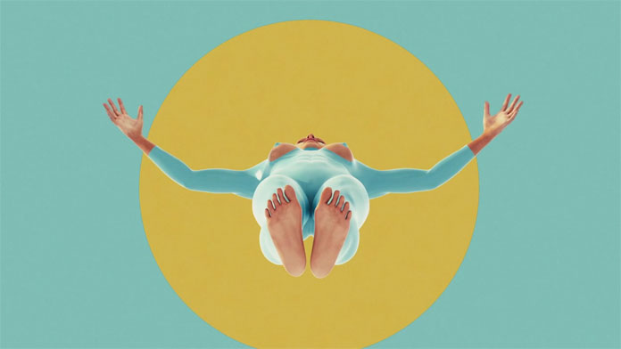
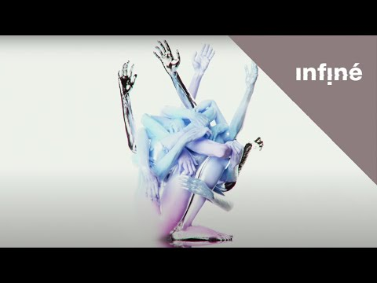

# El Popo Sangre (Paulin Rogues)

**Tag tecnica/formato:** `modellazione-3d` `video` `animazione-2d`
**Tag tema:** `corpo-identita` `fantascienza-speculativa`

⚠️ **Avviso di contenuto:** la produzione di questo artista è descritta in modo indipendente e convergente dalla stampa specializzata (Vice, tra gli altri) come contenente **immaginario sessualmente esplicito**, spesso reso con umorismo nero, distorsione surreale del corpo umano e registri vicini al body horror. Questa scheda tratta il lavoro dell'artista in termini puramente descrittivi e critici, senza riprodurre né descrivere in modo grafico i contenuti espliciti, e non include link diretti a materiale NSFW (ad esempio l'archivio Tumblr dell'artista). Coerente con il precedente già adottato nel database per altri artisti con opere dal contenuto esplicito (es. Petra Cortright, *VVEBCAM*).

## Biografia
El Popo Sangre è lo pseudonimo pubblico e dichiarato di **Paulin Rogues**, artista CGI, regista, art director e motion designer francese con base a Parigi. L'identificazione fra i due nomi è confermata in modo indipendente da più fonti (profilo Vimeo professionale, scheda IMDb come regista, profilo LinkedIn, articoli di stampa che usano i due nomi in modo intercambiabile) e non costituisce una rivelazione non autorizzata: è l'identità con cui l'artista stesso si presenta pubblicamente nel proprio lavoro professionale. Rogues è descritto come "uno dei tre" della studio creativo parigino **Unicorn Paris**, dove lavora come art director. Ha firmato, tra l'altro, il video musicale per "Keep On" dei Portugal. The Man (accreditato come regista su IMDb).

## Poetica e ricerca
Il lavoro di El Popo Sangre applica ai tropi consueti della new media art — avatar ed ambienti virtuali iper-colorati — una dimensione narrativa esplicita, costruendo mondi virtuali descritti dalla critica come "affascinanti, misteriosi e spesso comici". Stilisticamente, la sua pratica fonde **fantascienza (in particolare cyberpunk)**, **assurdismo letterario** e quello che la critica definisce lo "sciamanesimo psichedelico-sessuale" di Alejandro Jodorowsky. Le influenze dichiarate dall'artista includono il cinema di Jodorowsky, Godard, Kubrick e il cinema psichedelico, insieme a autori assurdisti come Boris Vian, Eugène Ionesco e Samuel Beckett. In un'intervista a *Vice*, l'artista respinge esplicitamente l'etichetta di "trasgressivo": la sua ricerca è definita piuttosto una questione di "onestà nel creare immagini che rappresentano ciò che sente" — una dichiarazione che riporta il registro sessuale/esplicito del suo lavoro entro una cornice di espressione personale piuttosto che di provocazione fine a se stessa. *Frisson*, coprendo il video musicale per "Tacoma" dei Bottler, inquadra invece l'uso di saturazione cromatica estrema e immagini lampeggianti come "una critica alla cultura digitale" — posizionando l'artista anche come satirista della cultura degli schermi, non solo come creatore di spettacolo visivo.

## Opere principali

### POSTICHE (scritta nel 2007, realizzata nel 2015)
**Descrizione:** definita dallo stesso materiale promozionale come "una commedia spaziale in tre atti" incentrata su temi assurdi e surreali. L'opera (o una sua scena, "Act 1, Scene 2") è stata presentata come edizione NFT 1/1 all'interno della collettiva inaugurale di Superchief Gallery NFT, "Season 1 Starter Pack" (circa 300 artisti partecipanti).
**Lettura critica:** rappresenta l'ingresso dell'artista nel circuito delle edizioni digitali/NFT, otto anni dopo la stesura originale del progetto — un caso di lunga gestazione fra concezione e realizzazione.

⚠️ Nessuna immagine: la piattaforma NFT che ospita l'opera non è stata consultata per questa scheda per il rischio di contenuto esplicito non filtrato — scegliere con cautela se recuperata in futuro.

### Fantasy (2016)
**Descrizione:** cortometraggio animato sperimentale, scritto e diretto nel 2016, presentato secondo la stampa specializzata nell'ambito dell'evento internazionale "Forest For the Trees" a Portland, Oregon.
**Lettura critica:** coperto da *WeAndTheColor* come esempio della cifra visiva distintiva dell'artista nel formato del cortometraggio.
**Video:** [Fantasy (Vimeo)](https://vimeo.com/180222262) — ⚠️ link non verificato per contenuto: raccomandata visione preventiva da parte di un adulto prima di un uso didattico.

**Approfondimento:** [WeAndTheColor — Fantasy](https://weandthecolor.com/fantasy-experimental-animation-el-popo-sangre/77619) (fonte curata, immagine scelta come meno esplicita disponibile)

### Through the Looking Glass, mostra (Superchief Gallery, New York, ca. 2016-2017)
**Descrizione:** mostra presso lo spazio newyorkese di Superchief Gallery, definita dalla stampa come l'occasione in cui l'artista viene "scovato" dall'ambiente della new media art newyorkese dopo un periodo di relativa oscurità nel campo dell'arte 3D.
**Lettura critica:** segna il passaggio dell'artista da pratica indipendente/underground a circuito espositivo riconosciuto della new media art statunitense.

⚠️ Nessuna immagine: nessuna fonte con documentazione fotografica della mostra individuata senza passare da Vice (NSFW segnalato dalla testata stessa) — da recuperare con cautela in futuro.

### Tacoma, video musicale per Bottler (2022)
**Descrizione:** video musicale diretto per il singolo "Tacoma" del duo brooklinese Bottler, pubblicato il 6 aprile 2022.
**Lettura critica:** *Frisson* inquadra l'opera come "un commento critico sull'umanità e sulla cultura digitale", condotto tramite saturazione cromatica estrema e immagini lampeggianti — un esempio del registro più esplicitamente satirico, meno legato al contenuto sessuale, della produzione dell'artista.

**Approfondimento:** [YouTube — Bottler, Tacoma (Official Music Video)](https://www.youtube.com/watch?v=TatdM5tObws)

## Immagini

⚠️ Artista con avviso di contenuto esplicito (vedi nota metodologica generale del database). Immagine trovata solo per le 2 opere (*Fantasy*, *Tacoma*) documentate da fonti curate non esplicite (WeAndTheColor, YouTube ufficiale); per *POSTICHE* e *Through the Looking Glass* non sono state consultate le fonti disponibili (piattaforma NFT, Vice) per il rischio di contenuto non filtrato — scegliere con cautela se recuperate in futuro, restando nel registro meno esplicito disponibile.
- [Vice — "The Surreal CGI Sex-Worlds of El Popo Sangre" ⚠️ contenuto NSFW segnalato dalla testata stessa](https://www.vice.com/en/article/cgi-artist-el-popo-sangre/)
- [Various Artists — "Paulin Rogues / El Popo Sangre" (1 marzo 2017)](https://variousartists.io/2017-03-01/paulin-rogues-el-popo-sangre/)

## Fonti
- [Vice — "The Surreal CGI Sex-Worlds of El Popo Sangre" ⚠️ contenuto NSFW segnalato dalla testata stessa](https://www.vice.com/en/article/cgi-artist-el-popo-sangre/)
- [Various Artists — "Paulin Rogues / El Popo Sangre" (1 marzo 2017)](https://variousartists.io/2017-03-01/paulin-rogues-el-popo-sangre/)
- [WeAndTheColor — "Fantasy – Experimental Animation by El Popo Sangre"](https://weandthecolor.com/fantasy-experimental-animation-el-popo-sangre/77619)
- [Frisson Media — "Bottler and El Popo Sangre offer a critical commentary of humanity and digital culture in Tacoma" (5 maggio 2022)](https://www.frisson.media/2022/05/05/tacoma-bottler-el-popo-sangre/)
- [Visual Atelier 8 — "Paulin Rogues Visualizes Digital Contortions Of The Human Body"](https://visualatelier8.com/paulin-rogues-visualizes-digital-contortions/)
- [Vimeo — profilo professionale (Paulin Rogues, regista/art director)](https://vimeo.com/paulinrogues)
- [IMDb — scheda regista](https://www.imdb.com/name/nm10448075/)
- [Unicorn Paris — sito dello studio](https://unicorn-paris.com/)
- [OpenSea — "POSTICHE – Act 1, Scene 2", edizione NFT](https://opensea.io/assets/0x495f947276749ce646f68ac8c248420045cb7b5e/109357140932249174184232105731133177415490681567806678064024980322402940485633)

---

## Appunti da organizzare
- Non citato in un programma specifico dei corsi — inserito dalla lista generale "da scrivere da zero".
- ⚠️ Da verificare direttamente prima di qualunque pubblicazione: data e firma esatta dell'articolo Vice (l'URL suggerisce la sezione "Creators Project" di Vice, attiva circa 2013-2017, non recente come talvolta indicato in fonti secondarie); anno esatto della mostra collettiva Superchief "Season 1 Starter Pack"; dettagli/data precisi della mostra "Through the Looking Glass"; l'affermazione — riportata da una sola fonte, non confermata altrove — di una presenza dell'artista ad Ars Electronica (da considerare non verificata, eventualmente da omettere).
- ⚠️ Non verificato in modo indipendente il collegamento fra l'evento "Forest For the Trees" citato per *Fantasy* (2016) e l'omonimo progetto di street art/murales di Portland, Oregon, documentato da altre fonti — potrebbe trattarsi di eventi diversi con lo stesso nome.
- Nota importante sul metodo: per rispetto del contenuto sensibile dell'opera dell'artista, questa scheda evita deliberatamente di linkare l'archivio Tumblr personale ("elpoposangreuniverse"), che secondo le fonti consultate contiene materiale esplicito; chiunque intenda approfondire dovrebbe visionare preventivamente qualunque link aggiuntivo prima di un uso in aula.
