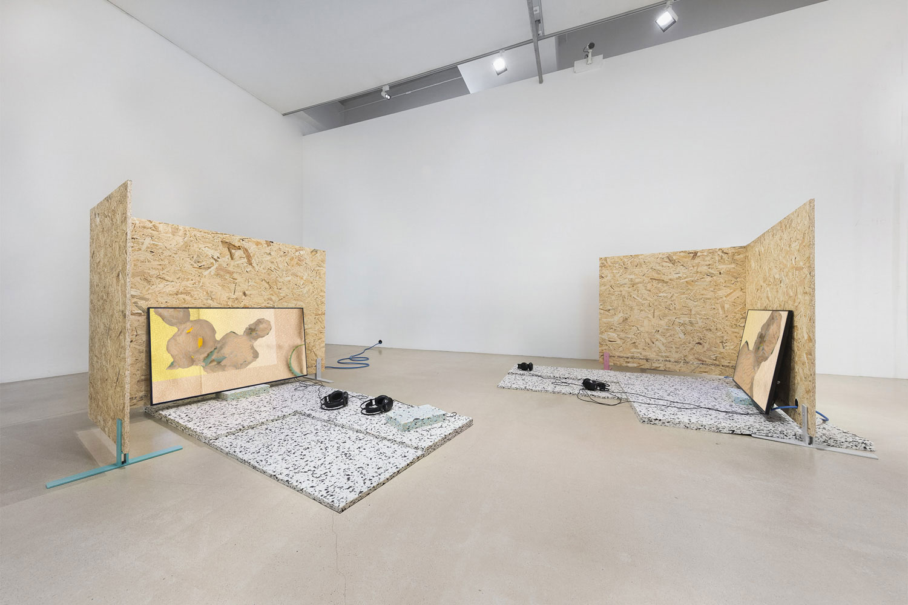
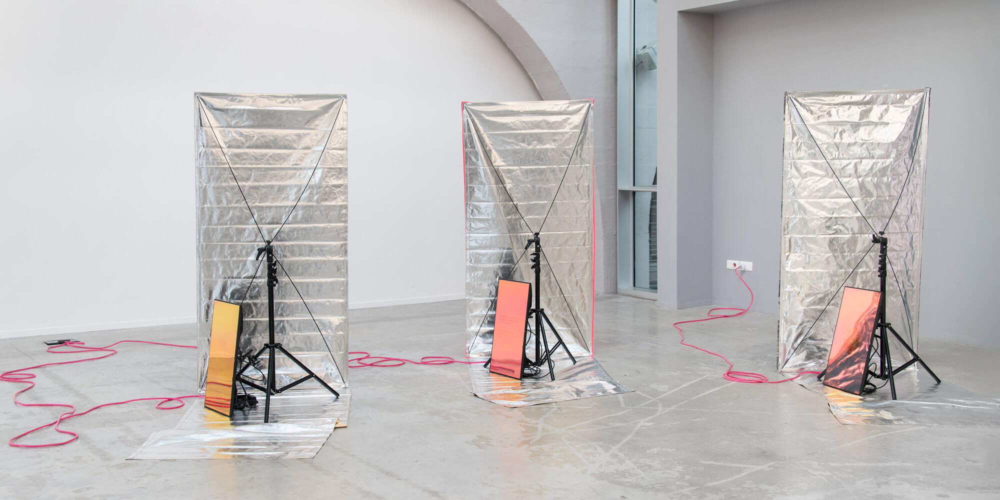

# Elisa Giardina Papa

**Tag tecnica/formato:** `video` `installazione` `ai-generativa`
**Tag tema:** `intelligenza-artificiale-critica` `capitalismo-lavoro` `genere-queerness`

## Biografia
Nata nel 1979 in Sicilia, vive e lavora tra Sant'Ignazio (provincia di Trapani, Sicilia) e New York. Consegue un MFA alla Rhode Island School of Design (RISD) e un dottorato in Film, Media e Gender Studies alla University of California, Berkeley. È Assistant Professor of Modern Culture and Media alla Brown University. È inoltre membro fondatore del collettivo artistico Radha May. Ha esposto e ha ricevuto commissioni da istituzioni di primo piano: MoMA di New York (rassegna "Modern Mondays", 2013), Whitney Museum of American Art (Sunrise/Sunset Commission, 2017), 59ª Biennale di Venezia ("Il latte dei sogni", a cura di Cecilia Alemani, 2022, presentata all'Arsenale e a Forte Marghera), Martin-Gropius-Bau di Berlino (mostra "Künstliche Intelligenz", 2023) e ICA di Londra (2023). Il lavoro "Cleaning Emotional Data" (2020) è stato commissionato da Aksioma - Institute of Contemporary Art (Lubiana) e Kunsthalle Mulhouse, ed è stato selezionato per lo S+T+ARTS Prize di Ars Electronica, sostenuto dal programma Horizon 2020 dell'Unione Europea.

## Poetica e ricerca
La pratica di Giardina Papa, definita dalla stessa artista come "research-based", indaga le forme di sapere e desiderio smarrite, dimenticate o rese "illeggibili" dalle richieste egemoniche di ordine — con particolare attenzione a come genere, sessualità e lavoro vengono performati e riorganizzati dall'economia digitale del ventunesimo secolo. Lavora attraverso progetti basati sull'intelligenza artificiale, installazioni video su larga scala, film sperimentali, scrittura e, in anni recenti, sculture in ceramica e vetro. Un nucleo centrale della sua ricerca è il lavoro digitale invisibile che sostiene i sistemi di intelligenza artificiale — i cosiddetti "microworker" che etichettano, categorizzano e validano dataset per addestrare algoritmi di riconoscimento delle emozioni — letto come nuova forma di lavoro precario, spesso femminilizzato e delocalizzato nel Sud globale. Una parte della sua produzione più recente si rivolge invece alla memoria orale e al mito popolare siciliano, mettendo in relazione le "donne di fora" della tradizione contadina con le vittime dei processi per stregoneria dell'Inquisizione — un asse che lega la sua ricerca sul controllo algoritmico dei corpi contemporanei a una più lunga storia di sorveglianza e criminalizzazione dei corpi femminili "devianti".

## Opere principali

### Technologies of Care (2016)
**Descrizione:** installazione video che raccoglie le interviste a sette freelance che offrono online supporto emotivo su richiesta — tra cui un'artista ASMR, un coach di appuntamenti online, un'interprete di video fetish e autrice di fiabe, una "fan a noleggio" per i social media, una nail designer e un'operatrice di customer service — basate in Brasile, Grecia, Filippine, Venezuela e Stati Uniti, collegate a clienti in tutto il mondo tramite piattaforme terze. Il video combina rendering 3D e narrazioni in voce off.
**Lettura critica:** indaga il rapporto tra lavoro, genere e le sfide etiche del lavoro online invisibile, portando in primo piano le vite umane dietro il "lavoro emotivo" digitale.

**Approfondimento:** [Galerie Tanja Wagner — Technologies of Care](https://tanjawagner.com/works/elisa-giardina-papa-technologies-of-care-2016/)

### Cleaning Emotional Data (2020)
**Descrizione:** installazione video a tre canali. Nell'inverno 2019, mentre viveva a Palermo e conduceva una ricerca sui sistemi di affective computing, l'artista ha lavorato da remoto per diverse aziende nordamericane di "human-in-the-loop" che forniscono dataset "puliti" per addestrare algoritmi di riconoscimento delle emozioni. Tra i compiti svolti: la tassonomizzazione delle emozioni, l'annotazione di espressioni facciali e la registrazione della propria immagine per animare personaggi tridimensionali.
**Lettura critica:** l'opera mette in luce lo spettro limitato di emozioni che gli algoritmi sono programmati a riconoscere come "rilevanti", e la struttura di sfruttamento del lavoro invisibile ("ghost work") che rende possibile l'infrastruttura dell'IA affettiva. Selezionata per lo S+T+ARTS Prize di Ars Electronica.

**Approfondimento:** [Ars Electronica — Cleaning Emotional Data](https://ars.electronica.art/starts-prize/en/cleaning-emotional-data/)

### 'U Scantu: A Disorderly Tale (2021)
**Descrizione:** installazione video e ceramica di circa 12 minuti, presentata alla 59ª Biennale di Venezia (2022, Arsenale e Forte Marghera). Reinterpreta il mito siciliano delle "donne di fora" — figure descritte nella tradizione orale come femminili ma anche maschili, umane ma in parte animali, benevole ma vendicative — immaginandole come giovani "tuner" che percorrono in bicicletta l'architettura postmoderna abbandonata di Gibellina Nuova. Il video intreccia testi e motivi visivi tratti da una raccolta ottocentesca di fiabe siciliane, ricordi d'infanzia frammentari dell'artista legati ai racconti della nonna, e i processi per stregoneria del XVI-XVII secolo che criminalizzarono le donne ritenute "donne di fora".
**Lettura critica:** collega la sorveglianza e la criminalizzazione storica dei corpi femminili "devianti" a una riflessione più ampia sulla memoria orale come forma di sapere resistente al controllo.

**Approfondimento:** [Galerie Tanja Wagner — 'U Scantu](https://tanjawagner.com/works/elisa-giardina-papa-u-scantu-a-disorderly-tale-2022-2/)

## Immagini

Immagine e link di approfondimento per ciascuna delle tre opere, inclusi sotto la relativa descrizione in "Opere principali", da Galerie Tanja Wagner e Ars Electronica.
- [Sito ufficiale dell'artista](https://www.elisagiardinapapa.org/)
- [La Biennale di Venezia — pagina artista, Il latte dei sogni (2022)](https://www.labiennale.org/en/art/2022/milk-dreams/elisa-giardina-papa)
- [Whitney Museum of American Art — pagina artista](https://whitney.org/artists/18438)

## Fonti
- [Sito ufficiale dell'artista](https://www.elisagiardinapapa.org/)
- [Whitney Museum of American Art — pagina artista](https://whitney.org/artists/18438)
- [Whitney Museum — Labor of Sleep](https://whitney.org/exhibitions/labor-of-sleep)
- [La Biennale di Venezia — pagina artista, Il latte dei sogni (2022)](https://www.labiennale.org/en/art/2022/milk-dreams/elisa-giardina-papa)
- [Universes in Universe — Elisa Giardina Papa, Venice Biennale 2022](https://universes.art/en/venice-biennale/2022/the-milk-of-dreams-tour-5/elisa-giardina-papa)
- [Ars Electronica — S+T+ARTS Prize, Cleaning Emotional Data](https://ars.electronica.art/starts-prize/en/cleaning-emotional-data/)
- [Aksioma — The Cleaning of Emotional Data](https://aksioma.org/cleaning.emotional.data)
- [Berlin Art Link — intervista, Technologies of Care](https://www.berlinartlink.com/2020/02/11/technologies-of-care-an-interview-with-elisa-giardina-papa/)
- [Rhizome — The Download: Technologies of Care](https://rhizome.org/editorial/2016/oct/04/the-download-technologies-of-care/)
- [Berliner Festspiele / Martin-Gropius-Bau — testi mostra "Künstliche Intelligenz" (2023)](https://www.berlinerfestspiele.de/en/gropius-bau/programm/2023/ausstellungen/kuenstliche-intelligenz/ausstellungstexte)
- [Brown University — pagina docente](https://italianstudies.brown.edu/people/elisa-giardina-papa)

---

## Appunti da organizzare
- Scheda scritta il 19 agosto 2026, ricerca sulla scena italiana (angolo gallerie/critica/accademia, non festival). Nota sul metodo: WebFetch bloccato in sandbox — contenuti da snippet WebSearch, da riverificare prima di uso didattico.
- Da approfondire: il collettivo Radha May (di cui è membro fondatore) e il rapporto tra questa pratica collettiva e il lavoro individuale a firma Giardina Papa.
- Da verificare con fonte primaria diretta: dettagli precisi della mostra ICA Londra 2023 ("She Flickered In and Out of History") — trovato solo il link alla pagina ICA, non ancora letto per il blocco WebFetch.
- 🔗 Presente anche nel repo gemello `research-database` ([scheda](https://github.com/danMa-hub/research-database/blob/main/contenuti/elisa-giardina-papa.md)), con taglio complementare: qui il focus è sulla pratica IA/net-art critica in generale (*Technologies of Care*, *Labor of Sleep*, *Cleaning Emotional Data*), là specificamente sulla dimensione di lavoro sessuale/erotico digitale toccata da quella stessa serie.
