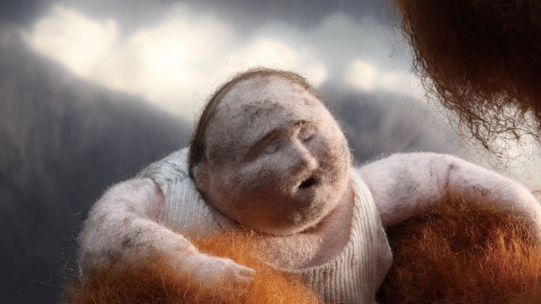
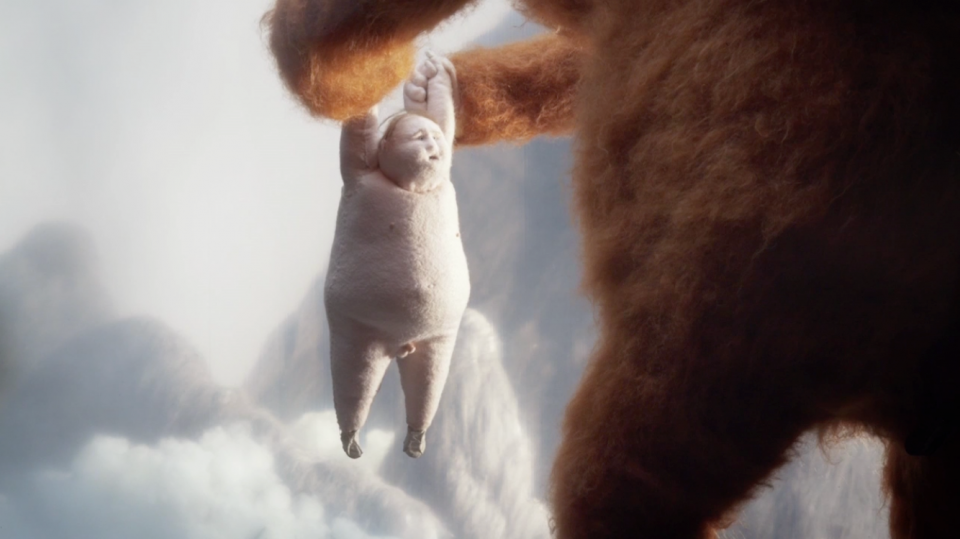
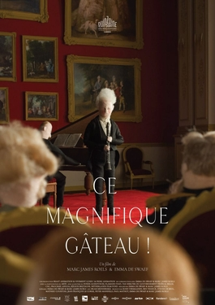
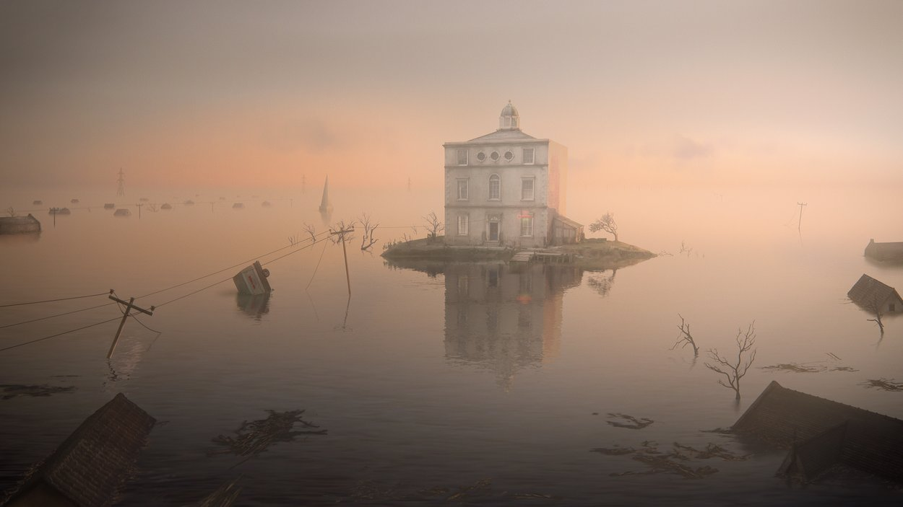
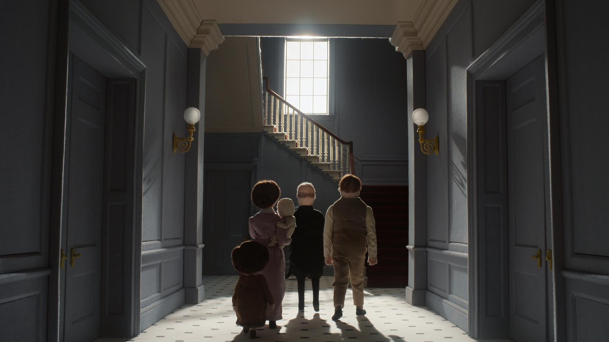
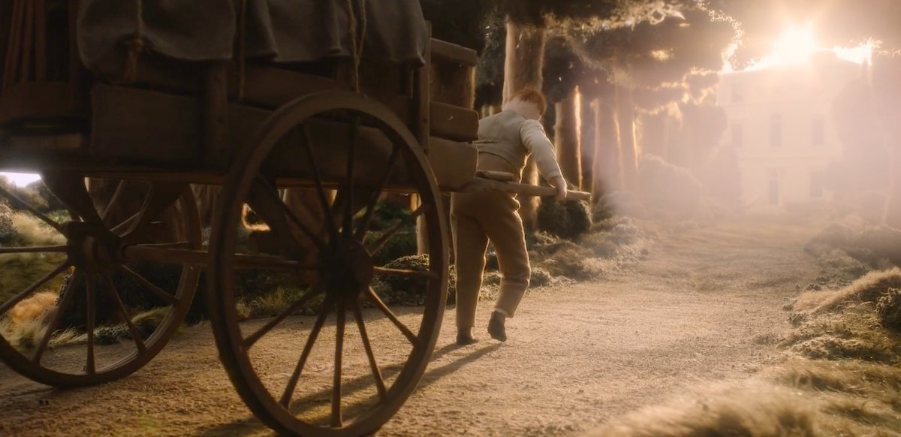

# Emma De Swaef e Marc James Roels

**Tag tecnica/formato:** `stop-motion` `video`
**Tag tema:** `colonialismo-decolonialita` `corpo-identita`
**Stato:** scheda parziale, scritta a partire da fonti web (Wikipedia, siti di festival e gallerie); non ancora assegnata a un corso · immagini controllate (diritti degli autori)

## Biografia
Duo di registi belga con sede ad Anversa. Roels ha un percorso nel cinema dal vivo (*Mompelaar*, 2007; *A Gentle Creature*, 2010); De Swaef è specializzata in stop motion e nella progettazione di bambole in tessuto.

## Poetica e ricerca
Lavorano in stop motion con lana e feltro; il loro film più lungo affronta in modo diretto la storia del colonialismo belga in Africa.

## Opere principali

### Oh Willy… (2012)
**Descrizione:** Cortometraggio in stop motion di lana e feltro, il loro primo grande successo di festival (una fonte parla di circa 80 premi, tra cui il Cartoon d'Or per il miglior film d'animazione europeo; nomination ai César 2013 per il miglior film d'animazione).

### This Magnificent Cake! (2018)
**Descrizione:** Film in stop motion, coproduzione di Belgio, Francia e Paesi Bassi, incentrato sulla storia del colonialismo belga in Africa. Gran Premio all'Anim'est 2018 e Gran Premio nazionale a Clermont-Ferrand, in concorso con film dal vivo.

### The House (2022)
**Descrizione:** Primo episodio (ambientato nel primo Ottocento) dell'antologia in stop motion in tre parti prodotta da Nexus Studios per Netflix e scritta da Enda Walsh; gli altri episodi sono di Niki Lindroth von Bahr e Paloma Baeza.

## Fonti
- [Wikipedia — This Magnificent Cake!](https://en.wikipedia.org/wiki/This_Magnificent_Cake!)
- [Cartoon Brew — This Magnificent Cake! vince a Clermont-Ferrand](https://www.cartoonbrew.com/awards/competing-against-dozens-of-live-action-films-this-magnificent-cake-wins-clermont-ferrand-grand-prize-170033.html)
- [Netflix — The House](https://about.netflix.com/news/netflix-orders-the-house-from-directors-niki-lindroth-von-bahr-emma-de-swaef-marc-james-roels-and-paloma-baeza)

## Crediti delle immagini
Immagini controllate il 2026-11-01: provengono dalle pagine indicate (festival, gallerie, siti degli artisti, piattaforme) e restano di proprietà degli autori.
- Oh Willy… (1): [www.bunka.go.jp](https://www.bunka.go.jp/j-mediaarts-festival/en/award/single/oh-willy/index.html) · Immagine promozionale / fotogramma ufficiale, diritti degli autori; uso didattico
- Oh Willy… (2): [www.stashmedia.tv](https://www.stashmedia.tv/warm-wooly-marc-emma-release-oh-willy/) · Immagine promozionale / fotogramma ufficiale, diritti degli autori; uso didattico
- This Magnificent Cake! (1): [en.wikipedia.org](https://en.wikipedia.org/wiki/File%3ACe_magnifique_g%C3%A0teau.jpg) · Locandina, diritti degli autori; uso didattico
- The House (1): [eyeondesign.aiga.org](https://eyeondesign.aiga.org/behind-the-scenes-of-the-house-netflixs-new-ode-to-stop-motion-animation/) · Immagine promozionale / fotogramma ufficiale, diritti degli autori; uso didattico
- The House (2): [slashfilm.com](https://slashfilm.com/663068/the-house-first-look-a-stop-motion-dark-comedy-anthology-series-makes-a-home-at-netflix) · Immagine promozionale / fotogramma ufficiale, diritti degli autori; uso didattico
- The House (3): [www.dragonframe.com](https://www.dragonframe.com/blog/netflixs-the-house-by-nexus-studios/) · Immagine promozionale / fotogramma ufficiale, diritti degli autori; uso didattico
