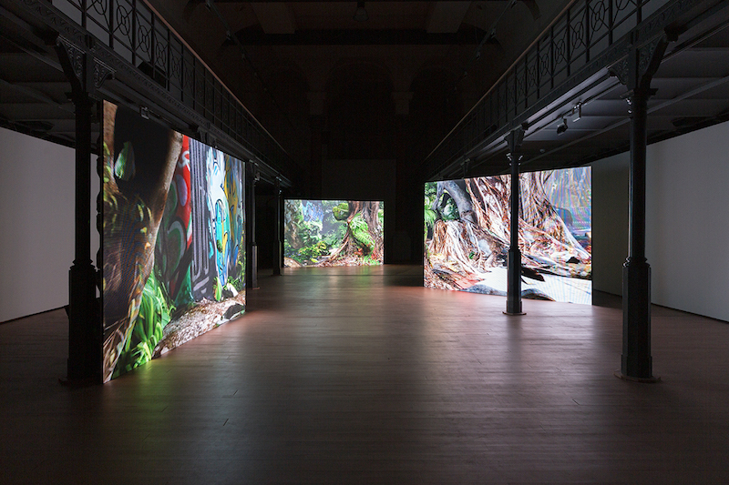
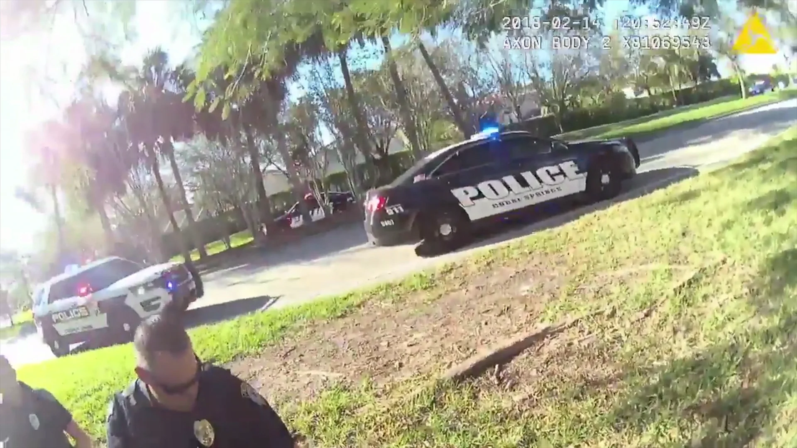
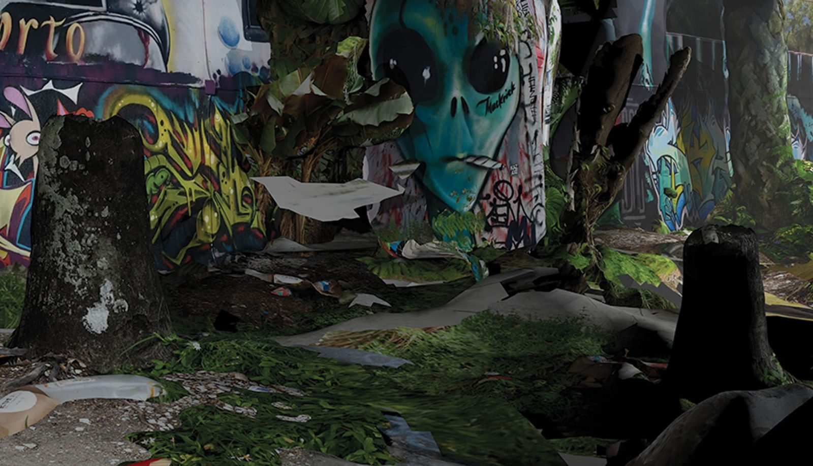

# Emmanuel Van der Auwera

**Tag tecnica/formato:** `video` `installazione`
**Tag tema:** `mondi-virtuali-simulazione` `sorveglianza-controllo`
**Stato:** scheda parziale, scritta a partire da fonti web (Wikipedia, siti di festival e gallerie); non ancora assegnata a un corso · immagini controllate (diritti degli autori)

## Biografia
Artista belga nato nel 1982, vive a Bruxelles. Lavora con video, scultura, stampa e teatro. È stato residente al WIELS (2012) e laureato HISK (2015).

## Poetica e ricerca
Il suo lavoro si muove spesso nella tensione tra arte e tecnologia, tra realtà e simulazione e nella banalizzazione della violenza.

## Opere principali

### The Sky Is on Fire (2019)
**Descrizione:** Installazione video a tre canali su pareti LED, HD a colori con suono, 15 minuti e 21 secondi, edizione di 5 più 2 prove d'artista. Una lenta panoramica attraversa un ambiente che sembra una periferia americana idilliaca e che si rivela gradualmente distopico. Mostra personale al Botanique di Bruxelles nel 2019; una versione è stata presentata nella mostra *Seeing is Revealing* all'HEK di Basilea.
**Lettura critica:** Una recensione sul giornale *La Libre* la legge come interrogazione sul valore archeologico delle immagini prodotte dalla cultura digitale.

### Altre opere
**Descrizione:** Serie *VideoSculptures* (*White Noise*, 2018), *Wake Me Up at 4:20 AM* (2019, avatar, identità e YouTuber), serie *Memento* (2018, lastre di alluminio offset con immagini di folla da giornali), *White Cloud* (2024, documentario di 19 minuti sulle miniere in Mongolia Interna).

⚠️ Nessuna immagine trovata.

## Fonti
- [Harlan Levey Projects — The Sky Is on Fire](https://hl-projects.com/artworks/831-emmanuel-van-der-auwera-the-sky-is-on-fire-2019)
- [La Libre — Les décombres d'un désastre](https://www.lalibre.be/culture/arts/2019/10/02/les-decombres-dun-desastre-3IPGFJENCZDEPAEN77FXG2IIKI/)
- [HEK Basel — Seeing is Revealing](https://hl-projects.com/viewing-room/20-seeing-is-revealing-emmanuel-van-der-auwera-hek-basel/)

## Crediti delle immagini
Immagini controllate il 2026-11-01: provengono dalle pagine indicate (festival, gallerie, siti degli artisti, piattaforme) e restano di proprietà degli autori.
- The Sky Is on Fire (1): [www.artforum.com](https://www.artforum.com/picks/emmanuel-van-der-auwera-80828) · Immagine promozionale / fotogramma ufficiale, diritti degli autori; uso didattico
- Teaser del dittico *The Death of K-9 Cigo* e *The Sky Is on Fire*: [vimeo.com](https://vimeo.com/349657828) · Immagine promozionale / fotogramma ufficiale, diritti degli autori; uso didattico
- The Sky Is on Fire (3): [www.argosarts.org](https://www.argosarts.org/event/argos-at-the-66th-international-short-film-festival-oberhausen) · Immagine promozionale / fotogramma ufficiale, diritti degli autori; uso didattico
