# Eva & Franco Mattes

**Tag tecnica/formato:** `videogioco-simulazione` `performance-dal-vivo` `net-art-sito-web` `video`
**Tag tema:** `game-culture` `economia-attenzione` `sorveglianza-controllo` `performance-nei-mondi-virtuali`
**Tag corso:** `TAD-DCV` `AW`
**Stato:** da verificare prima di citarli in classe: come si sono conosciuti (fonti divergenti), l'esito dell'azione legale di Nike su Nike Ground, il ruolo di Franco Mattes al MIT ACT, la fonte della definizione «Bonnie e Clyde dell'arte contemporanea» · opere recenti (2023-24: P2P, But I Love Human, Sleep Mode, Copycat, Roomba Cat) da verificare

## Biografia
Eva e Franco Mattes sono nati entrambi nel 1976 a Brescia. Lavorano insieme dalla metà degli anni Novanta, inizialmente sotto lo pseudonimo collettivo **0100101110101101.ORG** (un nome in codice binario), con cui hanno firmato i primi interventi di net art e le prime "bufale" mediatiche; il sito ufficiale del duo è tuttora ospitato sul dominio storico 0100101110101101.org, anche se oggi firmano il lavoro semplicemente come "Eva & Franco Mattes". Vivono e lavorano tra New York (Brooklyn) e l'Italia (Brescia). Non risulta una formazione artistica accademica documentata: si descrivono come autodidatti, avvicinatisi ai computer da adolescenti e a internet come via di fuga dalla provincia. Nel 2001 sono tra gli artisti più giovani mai inclusi nella Biennale di Venezia (tramite l'espediente del "Darko Maver", vedi sotto). Hanno ricevuto sostegno da Whitney Museum e Walker Art Center e il New York Prize 2006 dell'Italian Academy della Columbia University. Franco Mattes ha inoltre un'affiliazione documentata con il programma Art, Culture and Technology (ACT) del MIT (ruolo e date precisi da verificare). La loro pratica ha generato ripetute conseguenze legali reali — dal contenzioso con la Santa Sede per *Vaticano.org* (1998) alle azioni legali minacciate da Nike per *Nike Ground* (2003) — che hanno contribuito a una reputazione, ricorrente nella stampa di settore, da "Bonnie e Clyde dell'arte contemporanea" (formulazione esatta e fonte originale da verificare).

## Poetica e ricerca
Il lavoro di Eva e Franco Mattes si colloca sistematicamente al confine tra vero e falso, sintetico e naturale, diretto e mediato: mette in scena interventi e performance su scala di massa rivolti a un pubblico ignaro della loro natura artistica, spesso fino a generare conseguenze reali — panico, denunce, azioni legali — prima che l'intervento venga rivelato come opera. La Onassis Foundation descrive il loro lavoro come una dissezione costante della "condizione contemporanea in rete", condotta "con un taglio umoristico e cupo" sulle questioni etiche e politiche della vita online. Buona parte della produzione più recente (*BEFNOED*, *Dark Content*, *Riccardo Uncut*) sposta l'attenzione dalla provocazione mediatica alla condizione materiale del lavoro digitale invisibile — i moderatori di contenuti, i lavoratori del crowdsourcing, i "ghost worker" della gig economy — con letture curatoriali (Frankfurter Kunstverein, mostra *Fake Views*, 2023) che parlano esplicitamente di una critica al "sadismo capitalista della gig economy" e alla complicità dello spettatore nell'economia dell'attenzione. Julia Bryan-Wilson, in una recensione su *Artforum* (maggio 2007) dedicata a *13 Most Beautiful Avatars*, osserva come il lavoro riprenda esplicitamente i *13 Most Beautiful Boys/Women* di Andy Warhol (1964) ma ne risulti "svuotato delle imperfezioni che rendevano ipnotici gli screen test di Warhol" — interrogandosi sul perché gli avatar scelti dai Mattes assomiglino così tanto a esseri umani convenzionali invece di sfruttare la libertà formale del mondo virtuale. Il critico e curatore italiano Domenico Quaranta ha dedicato al duo la prima monografia critica (*Eva and Franco Mattes: 0100101110101101.org*, con testi di Maurizio Cattelan, RoseLee Goldberg, Bruce Sterling e Wu Ming, 2009), un indicatore della loro centralità nel canone della net art. In un'intervista al *The Art Newspaper* (2020) gli artisti sintetizzano la propria posizione così: "la tecnologia non crea i problemi sociali che così spesso critichiamo" — a chiarire che il bersaglio della loro ricerca non è la tecnologia in sé, ma i comportamenti umani che essa rende visibili o amplifica.

## Opere principali
### Darko Maver (1998-99)
**Corso:** `TAD-DCV`
**Temi:** `copia-e-autenticita` `propaganda-e-media`
**Descrizione:** un elaborato falso d'artista: i Mattes inventano un fittizio artista serbo/jugoslavo, Darko Maver, autore — secondo la loro narrazione — di sculture iperrealistiche di corpi torturati realizzate durante la guerra in Jugoslavia. Le "opere" sono in realtà fotografie reali di atrocità recuperate da siti come rotten.com, spacciate come documentazione fotografica del lavoro di Maver, di cui viene inoltre annunciata la morte in un carcere del Kosovo. La bufala viene diffusa attraverso mailing list, siti e riviste del mondo dell'arte fino a includere (postuma) l'opera-fantasma di Maver nella 48ª Biennale di Venezia (2001), prima di essere smascherata.
**Lettura critica:** un esperimento diretto sui meccanismi di autenticazione del sistema dell'arte e dei media — mostra quanto poco venga verificata l'origine di un'immagine "scioccante" quando è accompagnata da una narrazione plausibile, e quanto la macchina curatoriale/critica sia disposta a legittimare un autore mai verificato di persona.

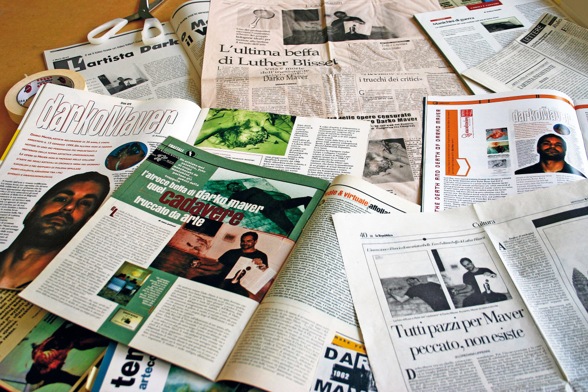

**Approfondimento:** [0100101110101101.org — Darko Maver](https://0100101110101101.org/darko-maver/)

### Life Sharing (2000-2003)
**Corso:** `TAD-DCV`
**Temi:** `infrastruttura-e-rete`
**Descrizione:** per tre anni gli artisti trasmettono in diretta sul web l'intero contenuto del proprio computer personale — file, email, estratti conto bancari, software installato — da un server nella loro camera da letto, in un progetto commissionato dal Walker Art Center.
**Lettura critica:** anticipa di anni le logiche di esposizione volontaria del sé e di estrazione dei dati personali che diventeranno la norma con i social media, proponendo una "condivisione di vita" (life sharing) che eccede il semplice file sharing allora al centro del dibattito su Napster e il P2P.

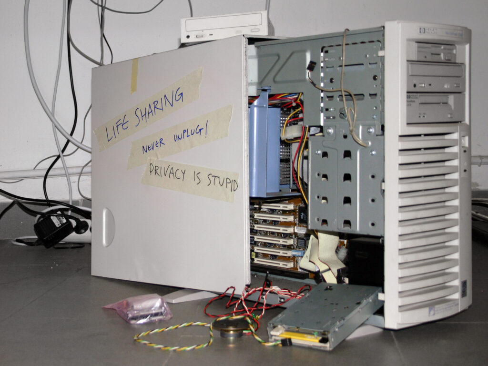

**Approfondimento:** [Rhizome — Net Art Anthology, Life Sharing](https://anthology.rhizome.org/life-sharing)

### Nike Ground (2003)
**Corso:** `TAD-DCV`
**Temi:** `propaganda-e-media`
**Descrizione:** intervento di guerrilla marketing su scala urbana: un finto ufficio informazioni ("Nike Infobox") viene allestito su Karlsplatz a Vienna, insieme a un sito web (nikeground.com) e a migliaia di volantini, per annunciare che la piazza sarebbe stata ribattezzata "Nikeplatz" e sormontata da un monumentale Swoosh. L'intervento dura un mese e provoca reazioni reali da cittadini, media e amministrazione comunale, oltre a un'azione legale minacciata da Nike, che nega ogni coinvolgimento.
**Lettura critica:** trasforma l'intera città in un palcoscenico per una performance di massa rivolta a un pubblico ignaro, mettendo a nudo la naturalezza con cui il marketing aziendale si appropria dello spazio pubblico — al punto che l'intervento fittizio risulta indistinguibile da una reale operazione di branding.

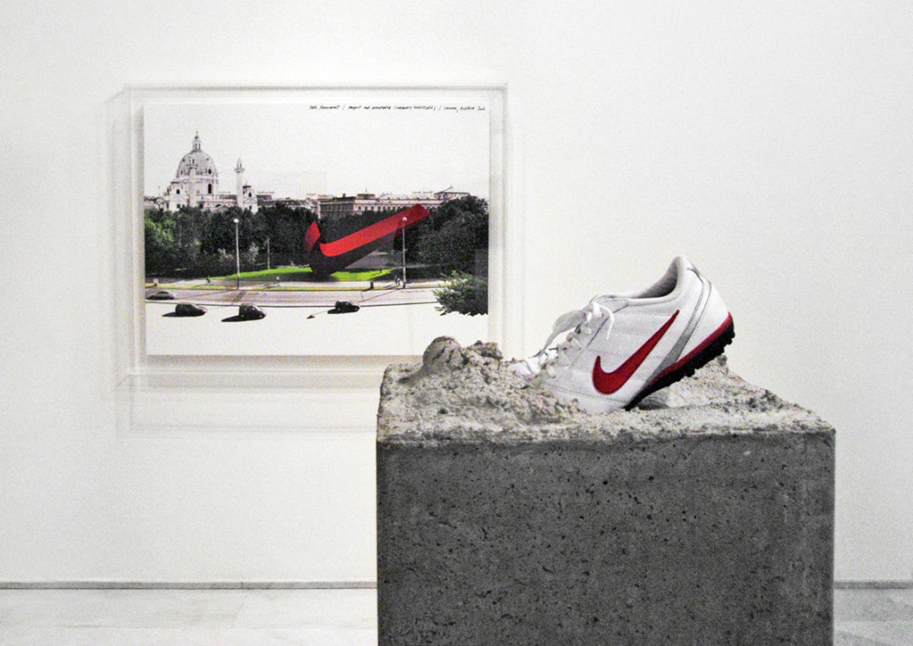

**Approfondimento:** [0100101110101101.org — Nike Ground](https://0100101110101101.org/nike-ground/)

### 13 Most Beautiful Avatars (2006) e Synthetic Performances / Reenactments (2007)
**Corso:** `AW`
**Temi:** `avatar-e-corpo-virtuale` `performance-nei-mondi-virtuali`
**Descrizione:** *13 Most Beautiful Avatars* è una serie di ritratti di tredici avatar di Second Life, scelti per la loro resa visiva, realizzati tramite sessioni fotografiche consensuali all'interno del mondo virtuale, in esplicito riferimento ai *13 Most Beautiful Boys* e *13 Most Beautiful Women* di Andy Warhol (1964). L'anno seguente, nell'ambito del festival newyorkese PERFORMA 07, gli artisti rimettono in scena — sempre tramite i propri avatar — alcune opere canoniche della performance art storica: *Shoot* di Chris Burden, *Seedbed* di Vito Acconci, *Tapp und Tastkino* di VALIE EXPORT e una versione di *Imponderabilia* di Marina Abramović.
**Lettura critica:** Julia Bryan-Wilson (Artforum, 2007) nota come la serie di avatar risulti paradossalmente priva delle imperfezioni che rendevano potenti gli originali warholiani. Le *Synthetic Performances* interrogano invece lo statuto della rievocazione (reenactment) quando il corpo storico dell'artista viene sostituito da un avatar sintetico: la reazione della critica e degli stessi artisti reinterpretati è stata divisa — Marina Abramović avrebbe commentato con ammirazione ("avrei voluto pensarci io"), mentre VALIE EXPORT si sarebbe opposta alla rievocazione della propria opera.

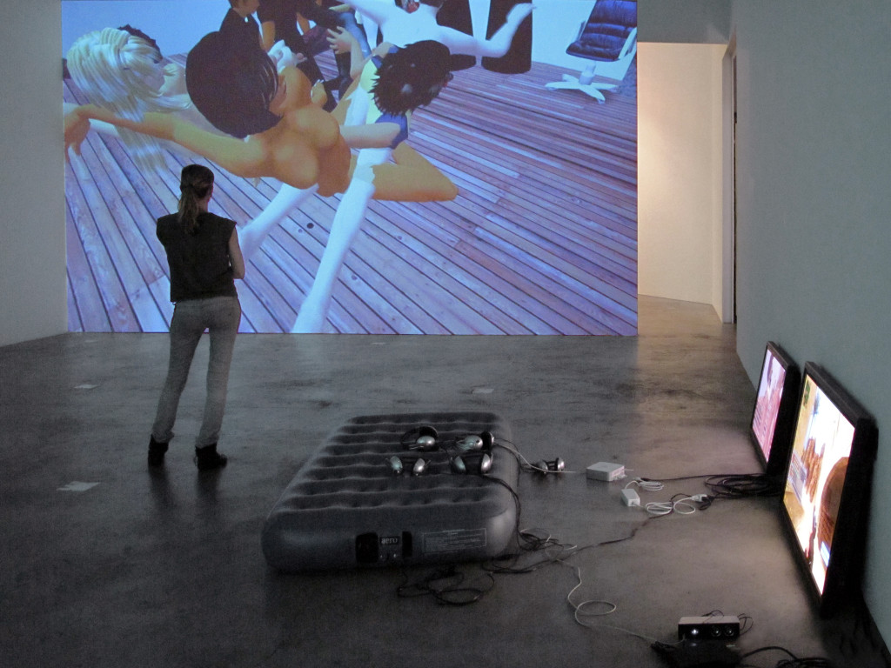

**Approfondimento:** [0100101110101101.org — Synthetic Performances](https://0100101110101101.org/synthetic-performances/)

### No Fun (2010)
**Corso:** `TAD-DCV`
**Temi:** `performance-audiovisiva` `infrastruttura-e-rete`
**Descrizione:** performance video su Chatroulette: il corpo di Franco Mattes viene mostrato appeso e immobile al soffitto, come impiccato, trasmesso in diretta a partner-webcam sconosciuti collegati casualmente sulla piattaforma, raggiungendo potenzialmente centinaia di migliaia di utenti nell'arco della performance. Un piccolo riquadro sullo schermo mostra in tempo reale la reazione dello spettatore connesso, a dimostrazione che la trasmissione è dal vivo e non preregistrata. La documentazione finale è un video di montaggio di circa 15 minuti delle reazioni raccolte — che vanno dall'indifferenza allo scherno, fino a chi fotografa il "cadavere"; secondo le fonti solo uno spettatore su migliaia avrebbe contattato le autorità. L'opera viene in seguito rimossa da YouTube per "contenuto scioccante e disgustoso".
**Lettura critica:** un esperimento diretto, non simulato, sulla desensibilizzazione dello sguardo online — la vera "opera" non è il corpo appeso ma l'archivio di reazioni indifferenti o divertite di un pubblico convinto di assistere a un suicidio reale.
**Video:** [documentazione integrale, Vimeo](https://vimeo.com/11467722)

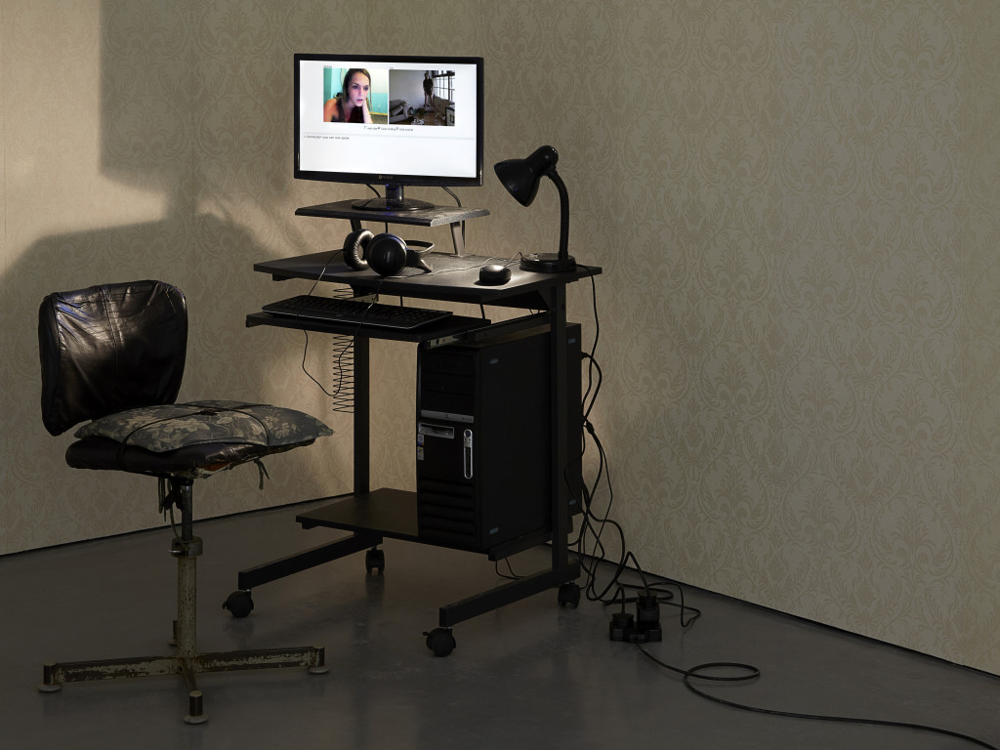

**Approfondimento:** [0100101110101101.org — No Fun](https://0100101110101101.org/no-fun/)

### Emily's Video (2012)
**Corso:** `TAD-DCV`
**Temi:** `propaganda-e-media`
**Descrizione:** film di 15 minuti che raccoglie le reazioni di un gruppo di newyorkesi, reclutati tramite un annuncio online, ciascuno visitato a casa da una donna di nome "Emily" e invitato a guardare, tramite webcam, un video estremamente disturbante — secondo la narrazione dell'opera reperito sul dark web — la cui esistenza reale non viene mai mostrata: il filmato originale sarebbe stato distrutto, e restano soltanto le reazioni indirette come unica "prova" della sua esistenza. Nell'allestimento, il video viene proiettato su un monitor verticale installato in modo che lo spettatore ne veda prima il retro, di fatto uno specchio in cui si riflette mentre si avvicina.
**Lettura critica:** riflette sulla cultura del "reaction video" tipica di YouTube, mettendo in scena — letteralmente, con lo specchio — la posizione dello spettatore stesso come soggetto in osservazione, non solo osservatore.

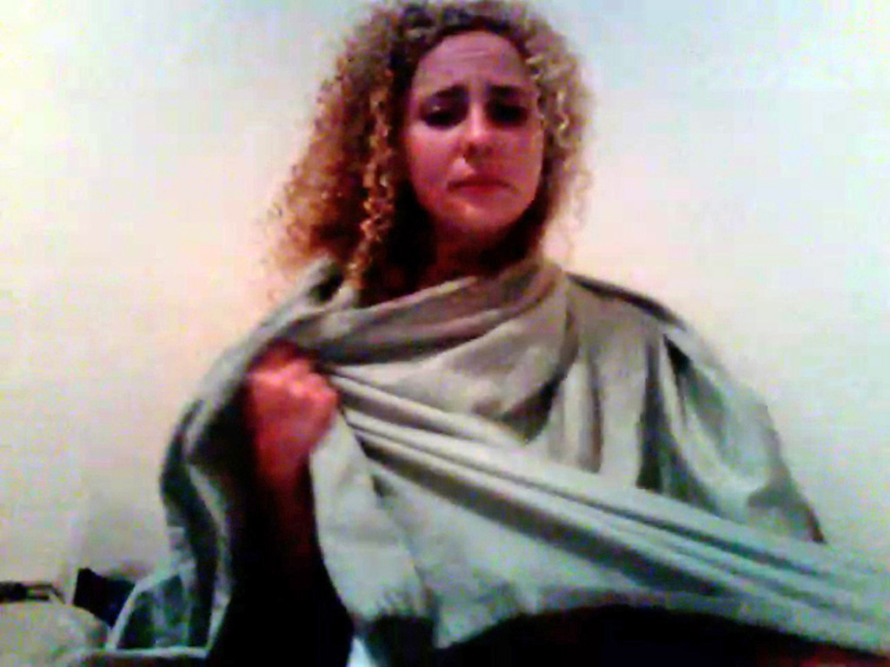

**Approfondimento:** [0100101110101101.org — Emily's Video](https://0100101110101101.org/emilys-video/)

### Dark Content (2015)
**Corso:** `TAD-DCV`
**Temi:** `lavoro-digitale-e-piattaforme`
**Descrizione:** serie video basata su interviste — condotte fingendosi una società di software in cerca di personale, poiché i veri content moderator sono vincolati da accordi di riservatezza — a oltre cento moderatori di contenuti reali. I loro racconti anonimizzati sul materiale disturbante (pornografia, violenza, contenuti razzisti, autolesionismo) che erano incaricati di rimuovere vengono ridoppiati da avatar generati al computer. Gli episodi sono stati distribuiti esclusivamente sul dark web.
**Lettura critica:** rende visibile il lavoro invisibile della moderazione dei contenuti — l'infrastruttura umana, precaria e traumatizzata, che rende "pulita" l'esperienza quotidiana del web per tutti gli altri utenti.

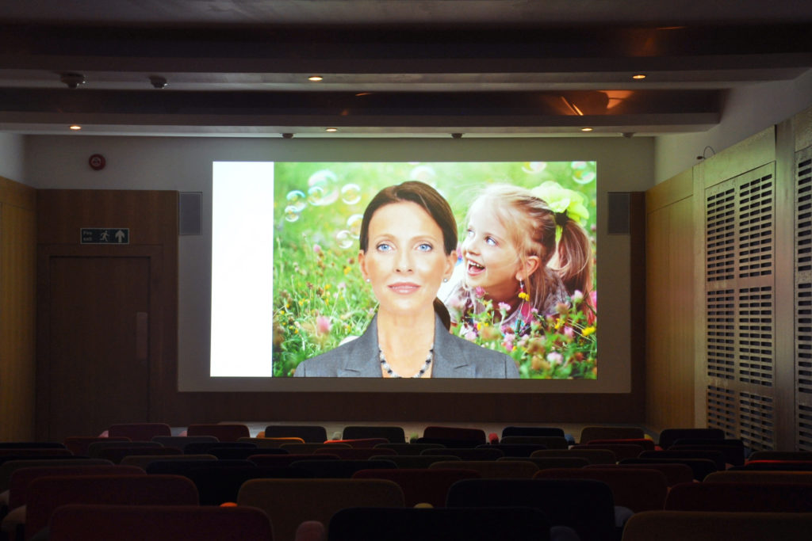

**Approfondimento:** [0100101110101101.org — Dark Content](https://0100101110101101.org/dark-content/)

### Riccardo Uncut (2018)
**Corso:** `TAD-DCV`
**Temi:** `copia-e-autenticita`
**Descrizione:** gli artisti offrono pubblicamente 1.000 dollari a chiunque venda loro il proprio smartphone con l'intero archivio fotografico e video; acquistano così l'archivio di circa 3.000 immagini (2004-2017) di un uomo di nome Riccardo e lo espongono integralmente, in ordine cronologico, come slideshow — viaggi, sesso, famiglia, lavoro, vita quotidiana. L'opera è entrata nella collezione del Whitney Museum of American Art.
**Lettura critica:** interroga cosa sopravvive come "memoria digitale" quando un intero archivio privato e non editato viene reso pubblico senza selezione né narrazione — l'autenticità grezza dell'archivio sostituisce qualunque costruzione autoriale.

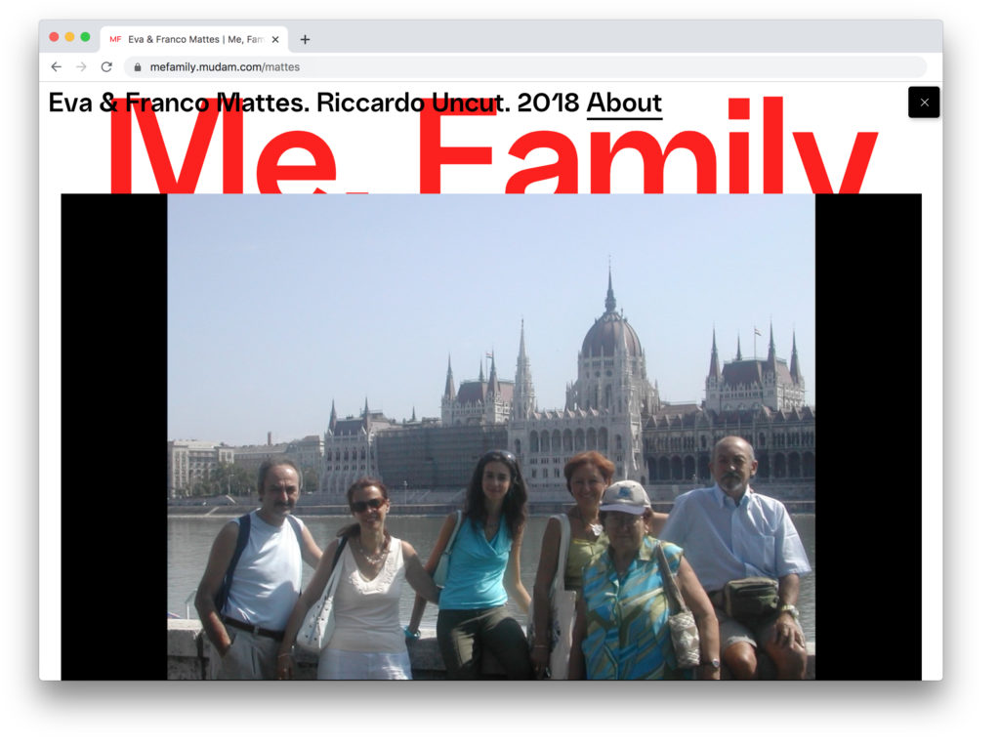

**Approfondimento:** [Whitney Museum — Riccardo Uncut](https://whitney.org/exhibitions/riccardo-uncut)

### The Bots (2020)
**Descrizione:** serie di installazioni video, nata da un anno di ricerche con il giornalista Adrian Chen sui moderatori di contenuti di internet. Le testimonianze dei moderatori, raccolte in sei parti, sono presentate come finti tutorial di trucco; ogni video è mostrato sul retro di una scrivania da ufficio dello stesso modello usato nel centro di moderazione di Facebook a Berlino. Esistono versioni per diversi «mercati» (per esempio italiano, greco, britannico). Per realizzarla gli artisti hanno avuto accesso ai cataloghi riservati di linee guida con cui i moderatori valutano i contenuti.
**Lettura critica:** rende visibile il lavoro invisibile della moderazione dei contenuti, travestendolo da genere di intrattenimento delle piattaforme: il tutorial di bellezza.

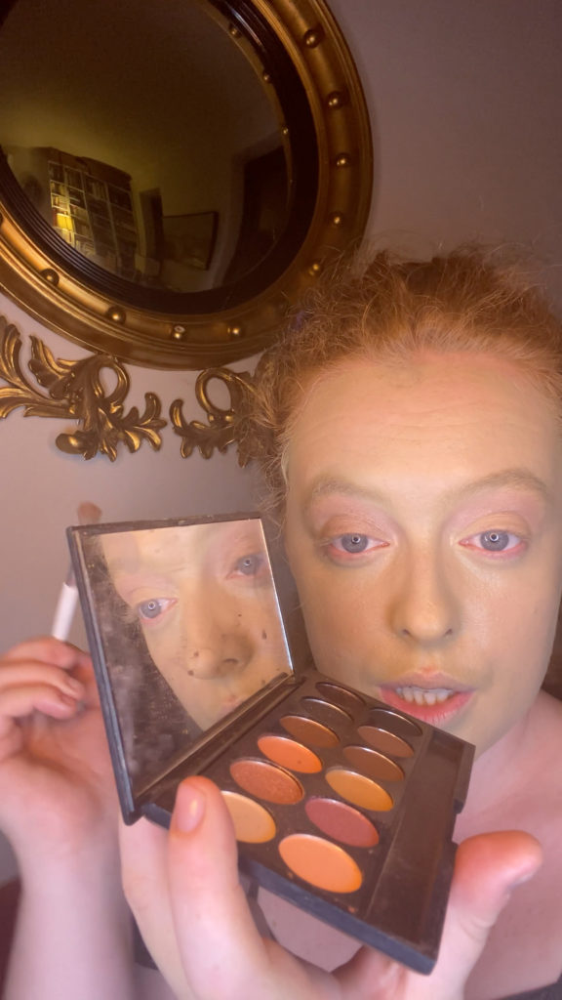

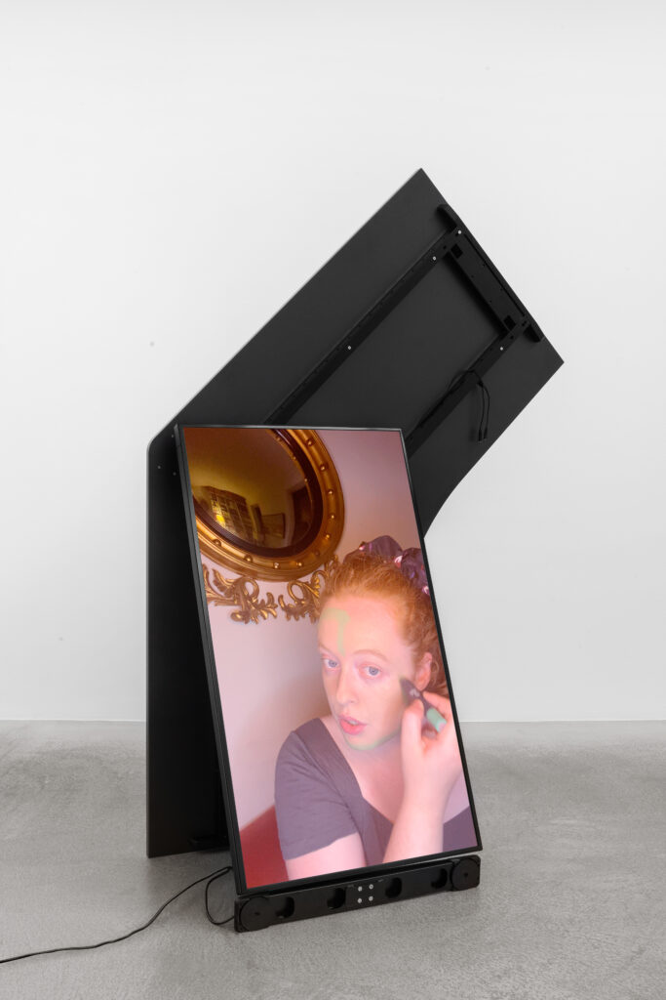

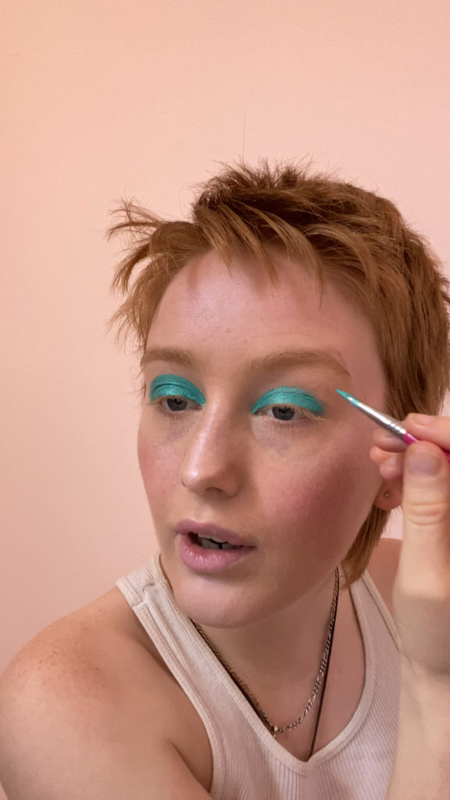

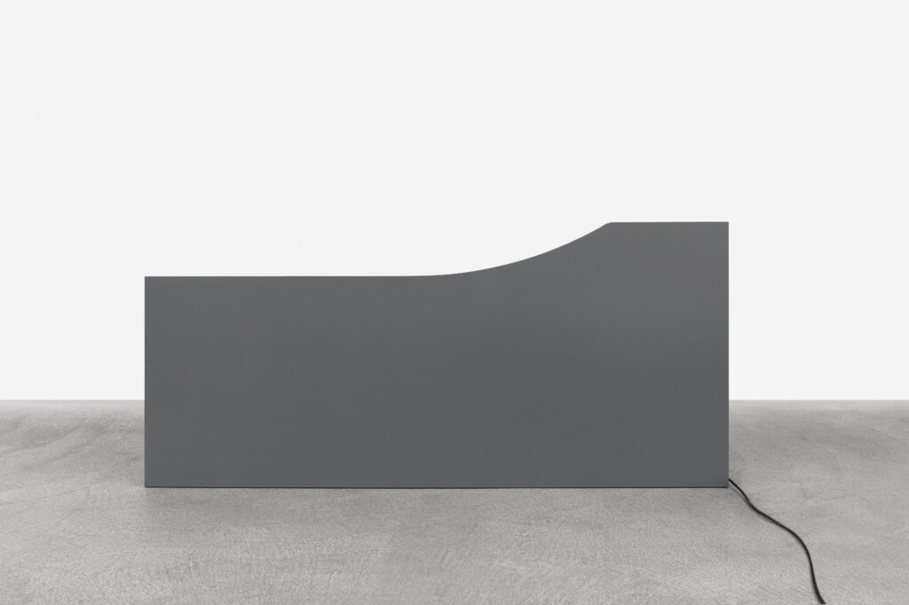

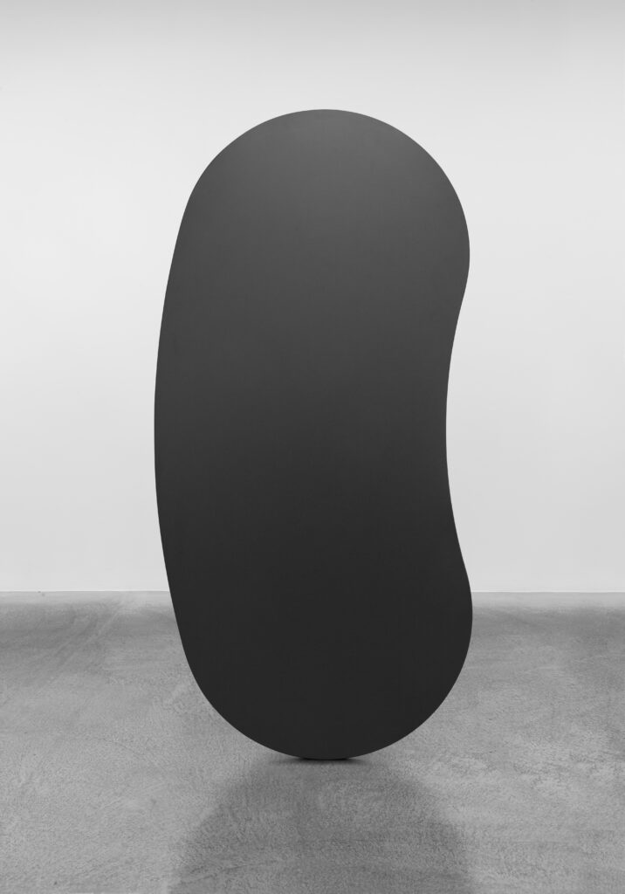

### Up Next (2023)
**Descrizione:** video-presentazione sulla storia di Sahar Tabar, ragazza iraniana diventata famosa su Instagram come «Angelina Jolie zombie» attraverso trucco e Photoshop. Presentato in prima mondiale al Frankfurter Kunstverein nella mostra *Fake Views* (14 luglio - 10 settembre 2023), poi nella personale *508 Loop Detected* (Brescia, 2024).
**Lettura critica:** riflette sull'identità costruita per i social e sulla viralità come economia dell'attenzione.

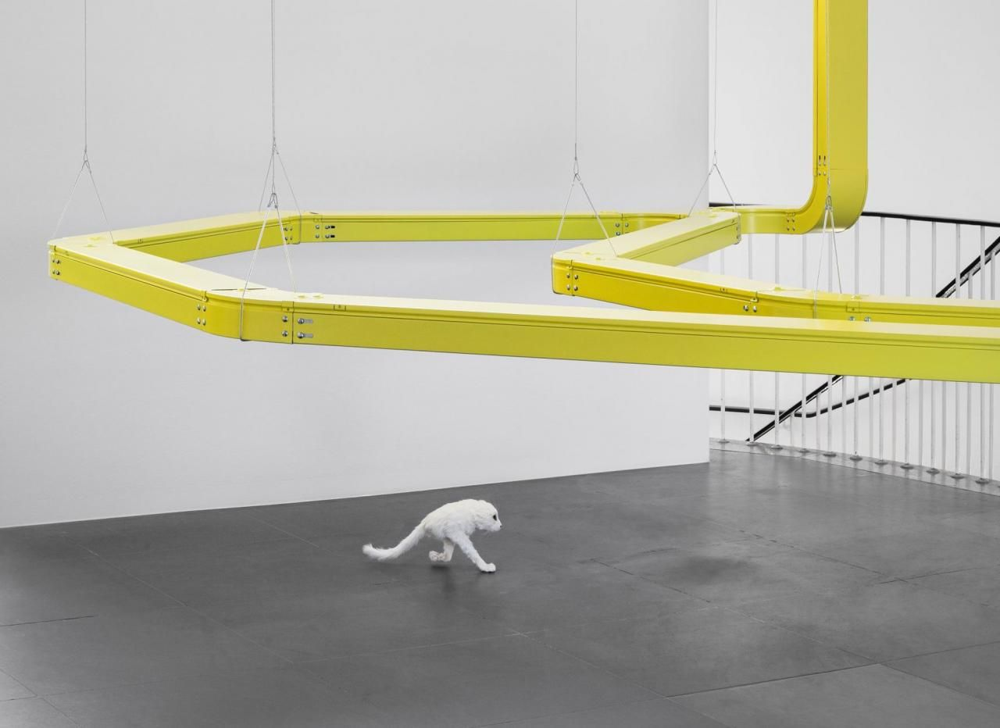

## Interviste e talk
- [The Art Newspaper — intervista (2020)](https://www.theartnewspaper.com/2020/05/05/eva-and-franco-mattes-technology-does-not-create-the-social-problems-we-so-often-criticise)

## Fonti
- [Onassis Foundation — The Bots](https://www.onassis.org/art/works/the-bots)
- [0100101110101101.org — The Bots](https://0100101110101101.org/the-bots/)
- [Spike Art Magazine — Eva & Franco Mattes at Frankfurter Kunstverein (2023)](https://spikeartmagazine.com/articles/review-eva-franco-mattes-frankfurter-kunstverein-2023)
- [Artribune — Eva & Franco Mattes, 508 Loop Detected](https://www.artribune.com/mostre-evento-arte/eva-franco-mattes-508-loop-detected/)
- [0100101110101101.org — sito ufficiale](https://0100101110101101.org/about/) — ⚠️ non raggiungibile direttamente durante la ricerca per restrizioni di rete; da verificare in prima persona
- [Postmasters Gallery — bio ufficiale (PDF)](http://www.postmastersart.com/BIOS/01001011.org_bio.pdf)
- [Whitney Museum — pagina artista](https://whitney.org/artists/19027)
- [Whitney Museum — Freedom (2010), collezione](https://whitney.org/collection/works/59843)
- [Whitney Museum — Riccardo Uncut, mostra](https://whitney.org/exhibitions/riccardo-uncut)
- [Artforum — Julia Bryan-Wilson su 13 Most Beautiful Avatars (maggio 2007)](https://www.artforum.com/print/reviews/200705/eva-and-franco-mattes-42433)
- [Artforum — Tina Rivers Ryan su No Fun e la net art ai tempi del Covid](https://www.artforum.com/columns/tina-rivers-ryan-on-net-art-in-the-age-of-covid-19-247075/)
- [Rhizome — A Second Life for Some Old Performance Art (2008)](https://rhizome.org/editorial/2008/apr/04/a-second-life-for-some-old-performance-art/)
- [Rhizome Net Art Anthology — Life Sharing](https://anthology.rhizome.org/life-sharing)
- [springerin — Becoming Nike? The Fake Behind the Swoosh](https://www.springerin.at/en/2003/4/becoming-nike-the-fake-behind-the-swoosh/)
- [Hack Story — Vaticano.org](https://hackstory.net/Vaticano.org.html)
- [Landmarks, UT Austin — Emily's Video](https://landmarks.utexas.edu/video-art/emilys-video)
- [Hyperallergic — Dark Content, storie dei moderatori sul dark web](https://hyperallergic.com/the-stories-of-content-moderators-hosted-on-the-darknet/)
- [Frankfurter Kunstverein — Fake Views, testo di mostra (2023)](https://www.fkv.de/en/exhibition/eva-franco-mattes/)
- [Art Basel — How we became artists: Eva & Franco Mattes](https://www.artbasel.com/stories/how-we-became-artists-eva-franco-mattes?lang=en)
- [Onassis Foundation — profilo artisti](https://www.onassis.org/people/eva-franco-mattes)

## Crediti delle immagini
Immagine e link di approfondimento per ciascuna delle otto opere, inclusi sotto la relativa descrizione in "Opere principali", scaricate dal sito ufficiale [0100101110101101.org](https://0100101110101101.org/).
- [Postmasters Gallery — bio ufficiale (PDF)](http://www.postmastersart.com/BIOS/01001011.org_bio.pdf)
- [Whitney Museum — pagina artista](https://whitney.org/artists/19027)
- The Bots (Italian Market) (1): [0100101110101101.org](https://0100101110101101.org/the-bots/) · Immagine promozionale / fotogramma ufficiale, diritti degli autori; uso didattico
- The Bots (Italian Market) (2): [0100101110101101.org](https://0100101110101101.org/the-bots/) · Immagine promozionale / fotogramma ufficiale, diritti degli autori; uso didattico
- The Bots (Italian Market) (3): [0100101110101101.org](https://0100101110101101.org/the-bots/) · Immagine promozionale / fotogramma ufficiale, diritti degli autori; uso didattico
- The Bots (Greek Market) (1): [0100101110101101.org](https://0100101110101101.org/the-bots/) · Immagine promozionale / fotogramma ufficiale, diritti degli autori; uso didattico
- The Bots (Greek Market) (2): [0100101110101101.org](https://0100101110101101.org/the-bots/) · Immagine promozionale / fotogramma ufficiale, diritti degli autori; uso didattico
- The Bots (Greek Market) (3): [0100101110101101.org](https://0100101110101101.org/the-bots/) · Immagine promozionale / fotogramma ufficiale, diritti degli autori; uso didattico
- Up Next (1): [spikeartmagazine.com](https://spikeartmagazine.com/articles/review-eva-franco-mattes-frankfurter-kunstverein-2023) · Immagine promozionale / fotogramma ufficiale, diritti degli autori; uso didattico
