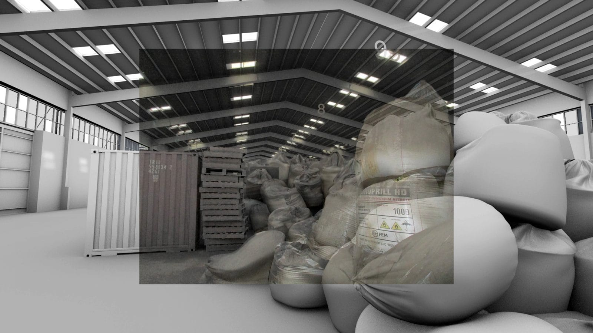
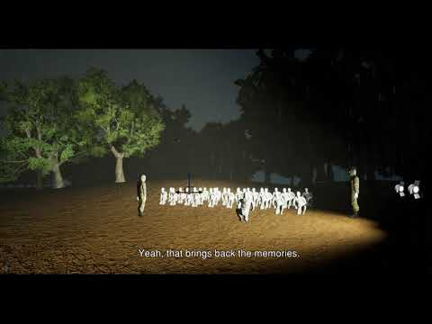
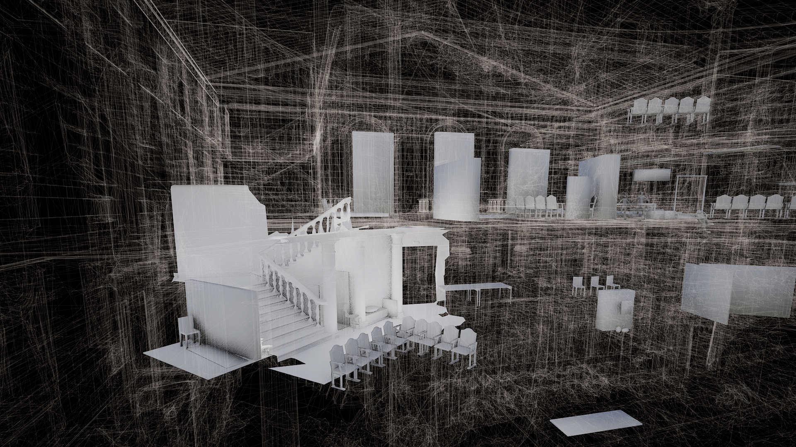

# Forensic Architecture

**Tag tecnica/formato:** `data-visualization` `video` `installazione`
**Tag tema:** `sorveglianza-controllo` `memoria-archivio`
**Tag corso:** `M3D`
**Stato:** scheda avanzata · da aggiungere: *The Bombing of Rafah* (2015), *Saydnaya* (2016), *77sqm_9:26min* (2017), *A Cartography of Genocide* (2024)

## Biografia
Gruppo di ricerca multidisciplinare con sede al Goldsmiths, University of London, fondato nel 2010 dall'architetto Eyal Weizman come progetto del Centre for Research Architecture dell'università.[^1] Ne fanno parte architetti, studiosi, artisti, registi, sviluppatori di software, giornalisti investigativi, archeologi, avvocati e scienziati, che indagano violazioni dei diritti umani da parte di stati e aziende, con e per le comunità colpite e insieme a procuratori internazionali e organizzazioni per i diritti umani.[^1] La prima indagine riguarda l'uccisione di Bassem Abu Rahma a Bil'in, presentata alla Corte suprema israeliana; dal 2011 il gruppo riceve finanziamenti dello European Research Council, e un gruppo interno, Forensic Oceanography, indaga le morti dei migranti nel Mediterraneo.[^1] Nel 2018 è tra i quattro candidati al Turner Prize; nel 2024 riceve il Right Livelihood Award e nel 2026 il Golden Nica di Ars Electronica per *A Cartography of Genocide*, la mappa della campagna militare israeliana a Gaza.[^1]

## Poetica e ricerca
Il gruppo è nato dalla convergenza di più fenomeni: l'urbanizzazione della guerra, la crisi di fiducia nelle prove sui crimini di stato, la diffusione di immagini open source girate con i telefoni, il bisogno della società civile di produrre prove proprie da usare in tribunale, in politica e nell'attivismo.[^1] Forensic Architecture descrive il lavoro forense come un percorso tra tre luoghi: il campo, il laboratorio e il foro. Poiché non ha i privilegi della scienza forense di stato (accesso ai luoghi, risorse, potere di stabilire le regole della prova), pratica una «contro-indagine forense» che rivolge lo sguardo forense contro lo stato, e porta i risultati in più «fori»: tribunali e parlamenti, ma anche musei, gallerie, tribunali popolari e media.[^1] Il termine *counter-forensics* viene dal fotografo e teorico Allan Sekula, che lo usava per l'adozione di tecniche forensi da parte dei cittadini contro le affermazioni dello stato; la parola *forensics* deriva dal latino *forensis*, «che riguarda il foro».[^2] Weizman descrive il metodo come un'«archeologia del passato recentissimo».[^2]

## Opere principali
### The Beirut Port Explosion (2020)
**Descrizione:** indagine sull'esplosione del porto di Beirut del 4 agosto 2020, che uccise più di duecento persone e ne ferì oltre 6.500, condotta su invito della testata egiziana *Mada Masr* e pubblicata il 17 novembre 2020. Il gruppo ha geolocalizzato le immagini e i video girati dai testimoni, calcolando il cono visivo di ogni ripresa dentro un modello 3D della città, e ha sincronizzato i video senza metadati usando la forma delle colonne di fumo, che cambia a ogni istante. Ne risultano quattro colonne di fumo distinte, uscite in quattordici minuti da parti diverse del magazzino 12. Con fotografie del gennaio 2020 e un video del dicembre 2019 è stato ricostruito l'interno del magazzino e la posizione dei 2.750 sacchi di nitrato d'ammonio. Secondo l'esperto di esplosivi delle Nazioni Unite Gareth Collett, la disposizione delle merci era quella di una bomba improvvisata grande quanto un magazzino; il confronto con le norme britanniche e australiane mostra che le regole di stoccaggio non erano state rispettate. Il modello, i video geolocalizzati e le fonti sono stati resi pubblici. L'indagine fa parte di un progetto più ampio, con *The Welders* e *Destruction of Destruction*.[^3]

**Approfondimento:** [forensic-architecture.org — The Beirut Port Explosion](https://forensic-architecture.org/investigation/beirut-port-explosion)

### Pushbacks Across the Evros/Meriç River: Situated Testimony (2020)
**Descrizione:** indagine sui respingimenti di migranti e rifugiati lungo il fiume Evros/Meriç, l'unico confine terrestre tra Grecia e Turchia, pubblicata il 19 ottobre 2020 con HumanRights360. I testimoni raccontano di essere stati fermati, picchiati e rimandati in Turchia di notte da uomini mascherati, senza accesso all'asilo e dopo il sequestro di telefoni e documenti; le autorità greche ed europee negano. Poiché la zona cuscinetto militarizzata impedisce l'accesso, il gruppo usa la «testimonianza situata», tecnica di intervista sviluppata da Forensic Architecture: con un ricercatore, il testimone ricostruisce in un modello 3D la scena del trauma, gli edifici in cui è stato detenuto, i veicoli, le uniformi, il paesaggio del fiume. Per i veicoli e le scene è stato usato Unreal Engine, con una libreria di oggetti di mezzi, uniformi, armi e vegetazione. Ne emergono una pratica sistematica di violenza e una seconda violenza esercitata attraverso il fiume e la sua geografia. Nel novembre 2020 HumanRights360 e Global Legal Action Network hanno presentato un ricorso contro la Grecia al Comitato dei diritti umani delle Nazioni Unite.[^4]

**Approfondimento:** [forensic-architecture.org — Situated Testimony](https://forensic-architecture.org/investigation/evros-situated-testimony)

### A City Within a Building: The Mariupol Drama Theatre (2023)
**Descrizione:** progetto di Forensis e del Center for Spatial Technologies (CST), collettivo di ricerca architettonica tra Kyiv e Berlino, sostenuto da Forensic Architecture e pubblicato il 16 marzo 2023. Il teatro di Mariupol, rifugio di migliaia di civili durante l'assedio, con la scritta «BAMBINI» tracciata a terra per gli aerei, fu colpito da un missile russo il 16 marzo 2022. Dopo l'attacco ai civili viene l'attacco alle prove: le autorità di occupazione invitano blogger a sostenere la tesi di un falso attentato ucraino e alla fine del 2022 demoliscono le rovine dietro impalcature schermate. Il gruppo ha raccolto migliaia di foto, video e post e più di cento ore di interviste, con la testimonianza situata, la fotogrammetria e i modelli digitali: un archivio vivo dell'evento e della «città dentro un edificio» che il teatro era diventato.[^5]

**Approfondimento:** [BAK — A City Within a Building](https://bakonline.org/en/making+public/program/a+city+within+a+building/) · [forensic-architecture.org](https://forensic-architecture.org/investigation/a-city-within-a-building-the-mariupol-drama-theatre)

## Approfondimenti

### Letture critiche e concetti
- **Naomi Pearce, *e-flux Criticism* (2018).** Sulla mostra *Counter Investigations* all'ICA di Londra (7 marzo - 6 maggio 2018), Pearce osserva che le opere dialogano sempre con un'assenza, di edifici distrutti o di responsabilità, e che la quantità di informazioni è soverchiante. La densità delle visualizzazioni, come il grande diagramma *The Forking Paths of Ayotzinapa* (2017) sulla scomparsa di 43 studenti in Messico, può sembrare un difetto di comunicazione, ma secondo Pearce indica qualcosa di più profondo: l'illusione di una comunicazione «chiara» quando si parla di prove forensi. Con l'architetta Laura Kurgan, per cui interpretare le immagini satellitari è un'arte oltre che una scienza, le opposizioni tra soggettivo e oggettivo, arte e scienza, si confondono nel linguaggio comune dell'estetica. Pearce critica però la mostra per l'affidarsi quasi solo alla vista: la galleria permetterebbe di lavorare con suono, odore e tatto, e le installazioni non ne approfittano.[^2]
- **La galleria come foro.** Pearce ricorda che il gruppo presenta spesso le indagini in contesti artistici, da *Forensis* alla Haus der Kulturen der Welt di Berlino (2014) a documenta 14 (2017); all'ICA il piano inferiore ospita seminari, e la sala diventa una piazza. Esporre i metodi con cui i casi vengono costruiti li rende anche vulnerabili alla critica.[^2]

## Interviste e talk
- [frieze — «I'd rather lose prizes and win cases», intervista a Eyal Weizman (2018)](https://frieze.com/article/id-rather-lose-prizes-and-win-cases-interview-eyal-weizman-turner-prize-nominated-forensic)

## Fonti
- [forensic-architecture.org](https://forensic-architecture.org/)
- [Wikipedia — Forensic Architecture](https://en.wikipedia.org/wiki/Forensic_Architecture)
- [The Beirut Port Explosion](https://forensic-architecture.org/investigation/beirut-port-explosion)
- [Pushbacks — Evros/Meriç](https://forensic-architecture.org/investigation/evros-situated-testimony)
- [A City Within a Building](https://theater.spatialtech.info/)
- [e-flux — Naomi Pearce, «Counter Investigations: Forensic Architecture» (2018)](https://www.e-flux.com/criticism/241395/counter-investigations-forensic-architecture)

## Crediti delle immagini
Immagine e link di approfondimento per ciascuna delle tre opere, inclusi sotto la relativa descrizione in "Opere principali". Il sito ufficiale [forensic-architecture.org](https://forensic-architecture.org/) carica le immagini via JavaScript, quindi le immagini sono state recuperate da fonti terze (Hyperallergic, YouTube, BAK).

[^1]: «Forensic Architecture», *Wikipedia* (inglese), consultata il 2026-11-08. [link](https://en.wikipedia.org/wiki/Forensic_Architecture)

[^2]: Naomi Pearce, «Counter Investigations: Forensic Architecture», *e-flux Criticism*, 20 aprile 2018. [link](https://www.e-flux.com/criticism/241395/counter-investigations-forensic-architecture)

[^3]: Forensic Architecture, «The Beirut Port Explosion», 17 novembre 2020. [link](https://forensic-architecture.org/investigation/beirut-port-explosion)

[^4]: Forensic Architecture, «Pushbacks Across the Evros/Meriç River: Situated Testimony», 19 ottobre 2020. [link](https://forensic-architecture.org/investigation/evros-situated-testimony)

[^5]: Forensic Architecture, «A City Within a Building: The Mariupol Drama Theatre», 16 marzo 2023. [link](https://forensic-architecture.org/investigation/a-city-within-a-building-the-mariupol-drama-theatre)
