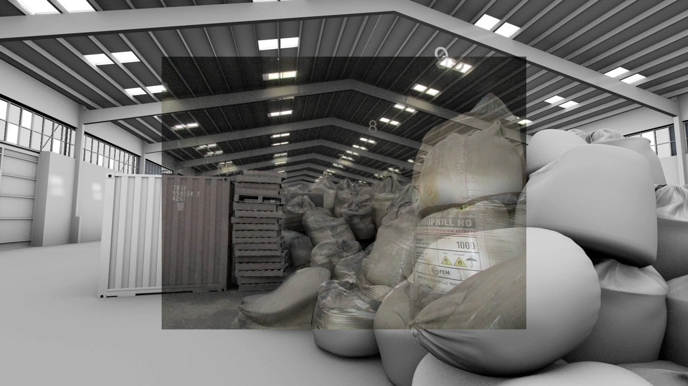
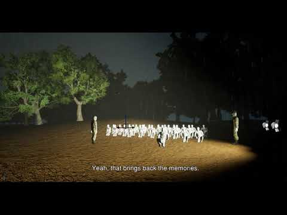
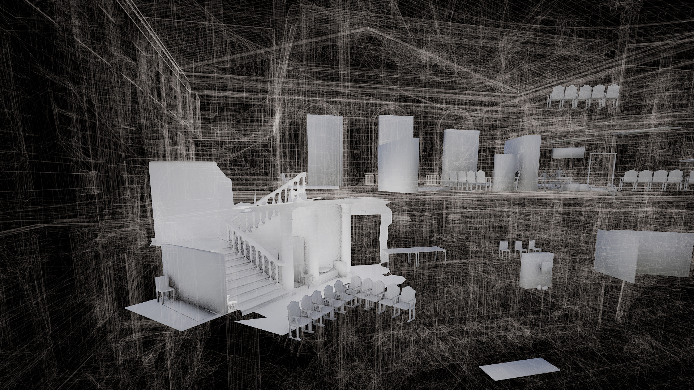

# Forensic Architecture

**Tag tecnica/formato:** `data-visualization` `video` `installazione`
**Tag tema:** `sorveglianza-controllo` `memoria-archivio`

## Biografia
Agenzia di ricerca con sede al Goldsmiths, University of London.

## Poetica e ricerca
Forensic Architecture conduce indagini spaziali su violazioni dei diritti umani e violenza di stato/corporate, usando ricostruzioni architettoniche 3D, open source investigation e analisi forense dei media. Il gruppo tratta l'architettura e l'immagine tecnica non come rappresentazione neutra ma come prova: ricostruisce eventi (esplosioni, respingimenti, attacchi) incrociando testimonianze, immagini satellitari, materiale open source e modellazione 3D, per restituire una verità verificabile — spesso in contesti dove le narrazioni ufficiali sono contestate o insabbiate.

## Opere principali

### The Beirut Port Explosion
**Descrizione:** indagine multi-capitolo sull'esplosione del porto di Beirut (2020), articolata in *Destruction of Destruction* e *The Welders*, che ricostruisce la dinamica dell'evento e le responsabilità.
**Lettura critica:** mostra come la ricostruzione forense digitale possa restituire una cronologia verificabile laddove le versioni ufficiali sono insufficienti o reticenti.

**Approfondimento:** [forensic-architecture.org — The Beirut Port Explosion](https://forensic-architecture.org/investigation/beirut-port-explosion)

### Pushbacks Across the Evros/Meriç River: Situated Testimony
**Descrizione:** indagine sui respingimenti di migranti al confine greco-turco lungo il fiume Evros/Meriç.
**Lettura critica:** la "testimonianza situata" combina racconto diretto e ricostruzione spaziale per rendere visibile una violenza di stato normalmente invisibile o negata.

**Approfondimento:** [forensic-architecture.org — Situated Testimony](https://forensic-architecture.org/investigation/evros-situated-testimony)

### A City Within a Building: The Mariupol Drama Theatre
**Descrizione:** progetto con Forensis e il Center for Spatial Technologies: archivio ed interviste ai sopravvissuti all'attacco russo al teatro di Mariupol, che prima della distruzione era anche un rifugio e luogo di auto-organizzazione comunitaria.
**Lettura critica:** l'edificio distrutto diventa archivio di una "città dentro un edificio" — solidarietà e resistenza documentate attraverso ricostruzione spaziale.

**Approfondimento:** [BAK — A City Within a Building](https://bakonline.org/en/making+public/program/a+city+within+a+building/) · [forensic-architecture.org](https://forensic-architecture.org/investigation/a-city-within-a-building-the-mariupol-drama-theatre)

## Immagini

Immagine e link di approfondimento per ciascuna delle tre opere, inclusi sotto la relativa descrizione in "Opere principali" — il sito ufficiale [forensic-architecture.org](https://forensic-architecture.org/) è una SPA React senza immagini leggibili via markup, quindi le immagini sono state recuperate da fonti terze (Hyperallergic, YouTube, BAK).

## Fonti
- [forensic-architecture.org](https://forensic-architecture.org/)
- [The Beirut Port Explosion](https://forensic-architecture.org/investigation/beirut-port-explosion)
- [Pushbacks — Evros/Meriç](https://forensic-architecture.org/investigation/evros-situated-testimony)
- [A City Within a Building](https://theater.spatialtech.info/)

---

## Appunti da organizzare
- Fonte: scheda REF originale su Drive, fonte unica, contenuto integralmente ripreso nella parte organizzata.
- Nessun link YouTube/Vimeo dedicato trovato nella scheda REF: i video di ricostruzione di ogni indagine sono incorporati direttamente nelle rispettive pagine forensic-architecture.org/investigation/... già in Fonti — da aprire direttamente per la visione/download.
- Sotto-indagini aggiuntive del caso Beirut segnalate nella scheda REF ma non ancora scorporate in Opere principali: *Destruction of Destruction* e *The Welders* (entrambe pagine dedicate su forensic-architecture.org).
