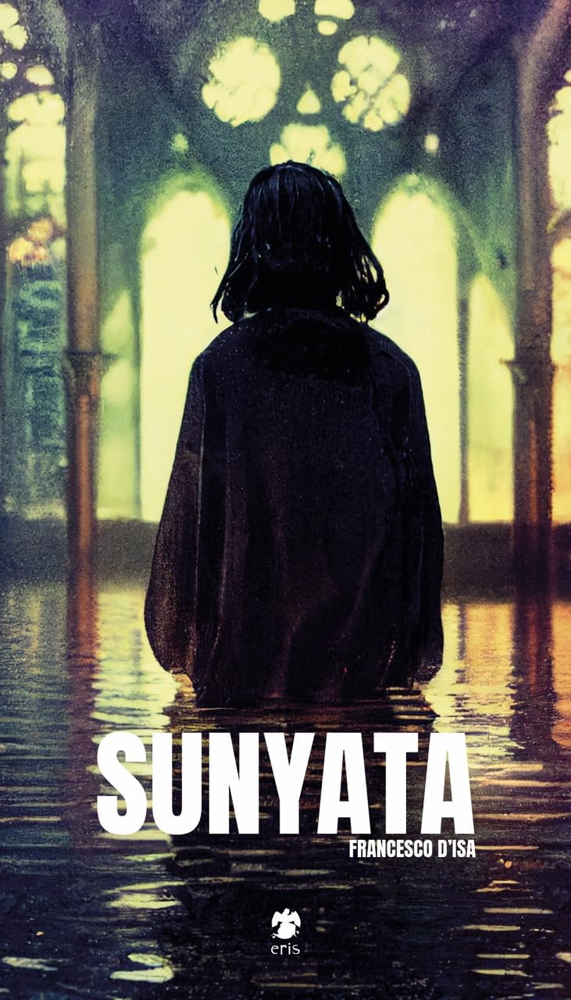

# Francesco D'Isa

**Tag tecnica/formato:** `ai-generativa` `video`
**Tag tema:** `intelligenza-artificiale-critica`

## Biografia
Nato a Firenze il 22 settembre 1980. Artista, scrittore, filosofo e curatore italiano; docente di Pittura presso l'Accademia di Belle Arti LABA (Libera Accademia di Belle Arti). È direttore editoriale della rivista culturale online "L'Indiscreto", da lui co-fondata, e ha co-fondato in precedenza la rivista d'arte e letteratura "Mostro", dove pubblica i suoi primi lavori. È autore di diversi libri, tra cui i romanzi "I." (Nottetempo, 2011) e "Anna - storia di un palindromo" (effequ, 2014), il saggio filosofico "L'assurda evidenza" (Tlon, 2022) e il saggio "La rivoluzione algoritmica delle immagini" (Luca Sossella Editore, 2024), dedicato specificamente al rapporto tra intelligenza artificiale generativa e produzione di immagini. Nel 2023 pubblica con Eris Edizioni "Sunyata", tra i primi fumetti pubblicati in Italia realizzato interamente con strumenti di intelligenza artificiale generativa (Midjourney v3/v4 e Stable Diffusion XL), accompagnato da un acceso dibattito critico sulla legittimità autoriale del lavoro. Nel 2026 tiene la personale "Latent Rooms" a Rifugio Digitale, spazio fiorentino dedicato all'arte digitale (a cura di Serena Tabacchi, direzione artistica di Laura Andreini, con il sostegno di FinecoBank e in collaborazione con Forma Edizioni).

## Poetica e ricerca
D'Isa affronta l'intelligenza artificiale generativa da una posizione insolita nel panorama italiano: quella del filosofo praticante che usa gli strumenti generativi non come scorciatoia produttiva ma come dispositivo di interrogazione filosofica su creatività, autorialità e percezione estetica. Nel saggio "La rivoluzione algoritmica delle immagini" sostiene che l'irruzione dell'AI generativa non mette in discussione l'arte in sé, ma costringe a rileggere concetti come creatività, autorialità e percezione estetica: le macchine, scrive, non vanno pensate né come autrici né come nemiche, ma come specchi in cui non sempre ci piace vedere ciò che riflettono. Una parte della sua pratica lavora deliberatamente sull'errore computazionale: nel progetto "Error#0" sfida i software di generazione testo-immagine con prompt costruiti apposta per produrre errori di sistema e risposte impreviste, usando il malfunzionamento del modello come strumento espressivo. Il suo lavoro si muove costantemente tra scrittura filosofica, critica e produzione visiva, senza separare nettamente il piano teorico da quello dell'opera.

## Opere principali
### Sunyata (2023, Eris Edizioni)
**Descrizione:** graphic novel realizzato interamente con strumenti di AI generativa (Midjourney v3/v4, Stable Diffusion XL) per la parte grafica, con testi dell'autore. La storia segue una ragazza alla ricerca di un'altra ragazza che potrebbe essere lei stessa, insieme a una chimera mutaforma, in una dimensione onirica dove identità, simboli culturali e sensazioni si fondono in un percorso sull'"io" e sul vuoto esistenziale (da cui il titolo, dal sanscrito "vacuità").
**Lettura critica:** pubblicato in un momento di forte polemica pubblica sull'uso dell'AI generativa in editoria, il libro è stato letto sia come opera pionieristica sia come provocazione sui limiti dell'autorialità — la fonte Fumettologica ne documenta la ricezione controversa.

**Approfondimento:** [erisedizioni.org — Sunyata](https://www.erisedizioni.org/prodotto/sunyata/)

### Error#0 (progetto in corso)
**Descrizione:** serie di immagini generate spingendo deliberatamente i modelli text-to-image verso l'errore di sistema, tramite prompt costruiti per provocare risposte anomale o fallimentari del software.
**Lettura critica:** capovolge la logica dominante dell'uso "produttivo" dell'AI generativa, facendo del glitch e del malfunzionamento — non dell'immagine "riuscita" — il centro della ricerca estetica.

⚠️ Nessuna immagine trovata: progetto in corso, poco documentato con immagini pubbliche.

### Latent Rooms (2026, personale, Rifugio Digitale, Firenze)
**Descrizione:** mostra personale che raccoglie brevi video generati attraverso diversi modelli di AI generativa, montati e assemblati dall'artista come forma di poesia visiva nata da un processo dialogico con l'intelligenza artificiale.
**Lettura critica:** l'esposizione presso Rifugio Digitale — spazio fiorentino specificamente dedicato all'arte digitale — consolida la posizione di D'Isa come una delle voci italiane più strutturate, sul piano sia teorico sia pratico, nel dibattito su AI e produzione visiva.

**Approfondimento:** [Artribune — mostra Rifugio Digitale (2026)](https://www.artribune.com/arte-contemporanea-2/2026/04/mostra-firenze-disa/)

## Interviste e talk
- [Poetarum Silva — intervista, "La rivoluzione algoritmica delle immagini"](https://poetarumsilva.com/2024/04/26/la-rivoluzione-algoritmica-delle-immagini-arte-e-intelligenza-artificiale-intervista-a-francesco-disa-a-cura-di-giulia-bocchio/)

## Fonti
- [Sito ufficiale dell'artista](https://francescodisa.netlify.app/)
- [Wikipedia (EN) — Francesco D'Isa](https://en.wikipedia.org/wiki/Francesco_D%27Isa)
- [LABA — pagina docente, "Francesco d'Isa, docente di Pittura"](https://laba.edu/francesco-disa-docente-di-pittura)
- [Eris Edizioni — pagina autore](https://www.erisedizioni.org/autori/francesco-disa/)
- [Eris Edizioni — pagina Sunyata](https://www.erisedizioni.org/prodotto/sunyata/)
- [Fumettologica — "Le polemiche per il fumetto realizzato con l'IA e la risposta dell'autore"](https://fumettologica.it/2023/10/sunyata-francesco-disa-eris-fumetto/)
- [Artribune — "La mostra di Francesco D'Isa a Rifugio Digitale a Firenze" (2026)](https://www.artribune.com/arte-contemporanea-2/2026/04/mostra-firenze-disa/)
- [Artribune — "Apre a Firenze Rifugio Digitale, museo dell'arte digitale" (2022)](https://www.artribune.com/arti-visive/arte-contemporanea/2022/04/firenze-rifugio-digitale-museo-arte-digitale/)
- [Artuu Magazine — "Francesco D'Isa, quando gli errori dell'AI diventano opere d'arte"](https://www.artuu.it/francesco-disa-quando-gli-errori-dellai-diventano-opere-darte/)

## Crediti delle immagini
Immagine e link di approfondimento per due delle tre opere, incluse sotto la relativa descrizione in "Opere principali".
- [Sito ufficiale dell'artista](https://francescodisa.netlify.app/)
