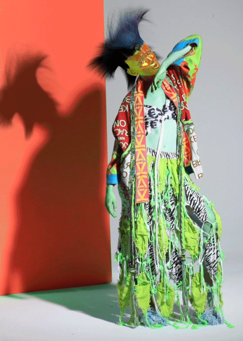
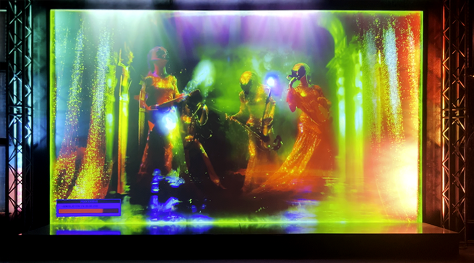

# Geoffrey Lillemon

**Tag tecnica/formato:** `modellazione-3d` `video` `net-art-sito-web`
**Tag tema:** `corpo-identita` `economia-attenzione`
**Tag corso:** `TAD-DCV` `TAD-AVM`

## Biografia
Nato nel 1981 a Fort Worth, Texas (USA), Geoffrey Lillemon è un artista/regista con base ad Amsterdam da oltre vent'anni, dove è diventato una figura di culto della scena digitale locale. Co-fonda lo studio **Champagne Valentine** insieme ad Anita Fontaine, tra le realtà pionieristiche del cosiddetto Net Art Movement, attive nell'interazione fra mondo digitale e fisico fin dai primi anni 2000. È **direttore creativo del Department of New Realities** di Wieden+Kennedy Amsterdam, ruolo in cui applica la propria pratica CGI/VFX al lavoro pubblicitario e di brand. Rappresentato come regista dalla casa di produzione amsterdamese **100%** (già HALAL). Le sue opere digitali sono distribuite anche tramite le piattaforme di edizioni digitali **Sedition** e **Foundation** (NFT). Collabora regolarmente con artisti musicali di primo piano — Beyoncé, Coldplay, Lady Gaga, Miley Cyrus (visual per il tour Bangerz, 2014, con Diane Martel), Nicki Minaj, Snoop Dogg, Travis Scott — e con marchi come adidas, Chanel, Converse, Diesel, Rick Owens, Iris Van Herpen, Gucci, Versace, Dazed Beauty. Opere acquisite dallo Stedelijk Museum e mostrate da Boijmans Van Beuningen (Rotterdam); ha inoltre presentato lavori/performance al Museo Tamayo di Città del Messico e al Centre Pompidou di Parigi.

⚠️ Alcune affermazioni ricorrenti nelle fonti secondarie — il titolo di "Invité d'Honneur" al Centre Pompidou, la rivendicazione di un "primo brevetto" per Wieden+Kennedy, riconoscimenti Adweek/Creative Review 2018 — sono ripetute in più bio ma non sono state verificate su fonte primaria diretta nel corso di questa ricerca: da trattare con cautela. Non è stata trovata alcuna connessione diretta e documentata con lo studio britannico Universal Everything, nonostante il nome venga talvolta accostato al suo in articoli generici sui pionieri della computer grafica: il collegamento va considerato non confermato.

## Poetica e ricerca
Lillemon porta uno stile di pittura e disegno "classico romantico" dentro la tecnologia, per reinterpretare la pratica artistica: il suo lavoro si concentra costantemente sull'interazione fra mondo digitale e fisico, spesso tramite animazioni interattive che rispondono al tocco, alle onde cerebrali o al battito cardiaco dello spettatore. *It's Nice That*, coprendo il suo lavoro per la collezione Donna SS13 di Bernhard Willhelm, descrive il trattamento visivo di Lillemon — "banshee cromate che si agitano su set sgargianti" — come capace di portare l'intera collezione "decisamente nel territorio del surreale"; lo stesso magazine lo definisce "una figura di culto ad Amsterdam" e "pioniere e provocatore" nel campo dell'arte digitale, della produzione 3D e della CGI. Il suo contributo si estende dallo sviluppo di visual estremi da zero alla creazione di deepfake, fino alla produzione di campagne di brand immersive: Lillemon ridefinisce così il ruolo del regista, sfumando il confine fra arte pura e lavoro commerciale. *Highsnobiety*, coprendo la sua produzione NFT, la descrive come una "reazione assurdista alla cultura dello scroll".

## Opere principali
### Bernhard Willhelm, look-book animato SS13 (2013, con Random Studio)
**Corso:** `TAD-DCV`
**Temi:** `economia-della-bellezza-e-pubblicita` `realismo-sintetico`
**Descrizione:** trattamento visivo CGI per la collezione Donna Primavera/Estate 2013 dello stilista Bernhard Willhelm, realizzato in collaborazione con lo studio Random Studio: figure cromate/banshee che si muovono in set dai colori sgargianti.
**Lettura critica:** secondo *It's Nice That*, l'opera porta l'intera collezione "nel territorio del surreale" — un caso paradigmatico dell'ibridazione fra CGI d'artista e immagine di moda commerciale che caratterizza tutta la produzione di Lillemon.
**Video:** [Twelv Magazine — "Digital Artist Geoffrey Lillemon Emotes Bernhard Willhelm S/S2013"](https://twelvny.com/fashion/digital-artist-geoffrey-lillemon-emotes-bernhard-willhelm-ss2013)

**Approfondimento:** [commercial.geoffreylillemon.com — Bernhard Willhelm SS13](https://commercial.geoffreylillemon.com/BERNHARD-WILLHELM-SS13)

### Simulation in Blue (2025, Nxt Museum, Amsterdam)
**Corso:** `TAD-AVM`
**Temi:** `vita-artificiale-e-simulazione`
**Descrizione:** installazione commissionata dal Nxt Museum di Amsterdam, curata da Bogomir Doringer.
**Lettura critica:** conferma il consolidamento della pratica dell'artista nel circuito museale dei nuovi media dopo oltre vent'anni di lavoro prevalentemente commerciale/musicale.

**Approfondimento:** [commercial.geoffreylillemon.com — Nxt Museum: Simulation in Blue](https://commercial.geoffreylillemon.com/NXT-MUSEUM-SIMULATION-IN-BLUE)

### Like to Death (con il collettivo Stööki)
**Corso:** `TAD-AVM`
**Temi:** `corpo-post-umano`
**Descrizione:** opera video/CGI realizzata in collaborazione con il collettivo Stööki.
**Lettura critica:** rappresenta la linea più sperimentale e meno commerciale della produzione dell'artista, in dialogo con altri collettivi della scena digitale internazionale.

⚠️ Nessuna immagine trovata.

### Space Cowboy, serie NFT (con Highsnobiety / SuperRare)
**Corso:** `TAD-DCV`
**Temi:** `finanza-blockchain-dao`
**Descrizione:** serie di opere digitali in edizione NFT, realizzata in collaborazione con Highsnobiety e distribuita sulla piattaforma SuperRare.
**Lettura critica:** *Highsnobiety* la presenta come una risposta "assurdista" alla cultura dello scroll infinito dei social media — un'estensione della sua pratica CGI/surreale nel formato dell'edizione digitale limitata.

⚠️ Nessuna immagine trovata.

## Interviste e talk
- _Nessuna ancora: da aggiungere._

## Fonti
- [commercial.geoffreylillemon.com — Biografia ufficiale](https://commercial.geoffreylillemon.com/BIOGRAPHY)
- [cargocollective.com/geoffreylillemon — portfolio](https://cargocollective.com/geoffreylillemon/Geoffrey-Lillemon)
- [It's Nice That — "You've not seen crazy until you've seen Geoffrey Lillemon's fashion shots"](https://www.itsnicethat.com/articles/geoffrey-lillemon)
- [It's Nice That — aggiornamenti sul lavoro dell'artista](https://www.itsnicethat.com/articles/geoffrey-lillemon-updates)
- [LBBOnline — "100% Signs Digital Artist Geoffrey Lillemon as Director"](https://lbbonline.com/news/100-signs-digital-artist-geoffrey-lillemon-as-director)
- [Highsnobiety — "Geoffrey Lillemon's Absurdist NFTs Are a Reaction To Scroll Culture"](https://www.highsnobiety.com/p/geoffrey-lillemon-nft/)
- [Sedition — pagina artista](https://seditionart.com/users/142886)
- [Automata.art — pagina artista](https://www.automata.art/artists/geoffrey-lillemon/)
- [Neue Luxury — profilo artista](https://www.neueluxury.com/feature/geoffrey-lillemon/)
- [SHOWstudio — pagina contributor](https://www.showstudio.com/contributors/geoffrey_lillemon)
- [Twelv Magazine — su Bernhard Willhelm SS13](https://twelvny.com/fashion/digital-artist-geoffrey-lillemon-emotes-bernhard-willhelm-ss2013)
- [YouTube — "Redefining Reality: Geoffrey Lillemon, Creative Director of W+K's Department of New Realities"](https://www.youtube.com/watch?v=AUuTjsbNvpk)

## Crediti delle immagini
Immagine e link di approfondimento per due delle quattro opere, incluse sotto la relativa descrizione in "Opere principali", scaricate dal sito ufficiale [commercial.geoffreylillemon.com](https://commercial.geoffreylillemon.com).
- [cargocollective.com/geoffreylillemon — portfolio](https://cargocollective.com/geoffreylillemon/Geoffrey-Lillemon)
- [It's Nice That — "You've not seen crazy until you've seen Geoffrey Lillemon's fashion shots"](https://www.itsnicethat.com/articles/geoffrey-lillemon)
