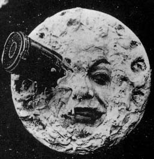

# Georges Méliès

**Tag tecnica/formato:** `video` `animazione-2d`
**Tag tema:** `fantascienza-speculativa`
**Stato:** scheda parziale, scritta a partire da fonti web (Wikipedia, siti di festival e gallerie); non ancora assegnata a un corso · immagini controllate (diritti degli autori)

## Biografia
Marie-Georges-Jean Méliès (Parigi, 8 dicembre 1861 - 21 gennaio 1938), regista, attore, prestigiatore e costruttore di giocattoli francese. Guida molti sviluppi tecnici e narrativi dei primi anni del cinema, soprattutto nel fantastico e nella fantascienza.

## Poetica e ricerca
Diventa celebre con i «trick film» e con l'uso innovativo degli effetti speciali: popolarizza giunzioni per sostituzione, doppie esposizioni, time-lapse, dissolvenze e colorazione a mano. È anche tra i primi registi a usare lo storyboard.

## Opere principali

### A Trip to the Moon (Le Voyage dans la Lune, 1902)
**Descrizione:** Film francese di fantascienza e avventura, scritto, diretto e prodotto da Méliès e ispirato al romanzo *Dalla Terra alla Luna* di Jules Verne. Opera tra le più importanti del cinema delle origini.

### The Impossible Voyage (Le Voyage à travers l'impossible, 1904)
**Descrizione:** Altra tra le sue opere più importanti.

⚠️ Nessuna immagine trovata.

## Fonti
- [Wikipedia — Georges Méliès](https://en.wikipedia.org/wiki/Georges_Méliès)
- [Wikipedia — A Trip to the Moon](https://en.wikipedia.org/wiki/A_Trip_to_the_Moon)

## Crediti delle immagini
Immagini controllate il 2026-11-01: provengono dalle pagine indicate (festival, gallerie, siti degli artisti, piattaforme) e restano di proprietà degli autori.
- Le Voyage dans la Lune (1): [en.wikipedia.org](https://en.wikipedia.org/wiki/File%3ALe_Voyage_dans_la_lune.jpg) · Public domain
