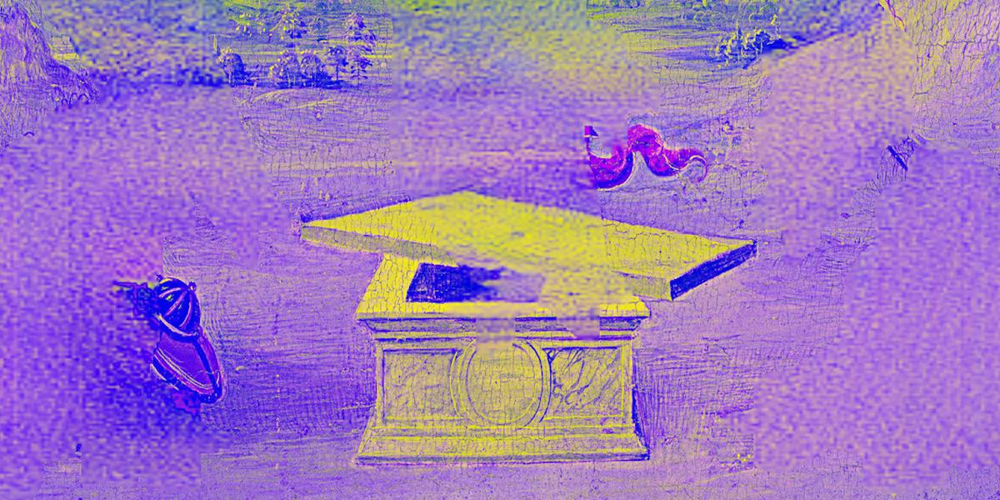
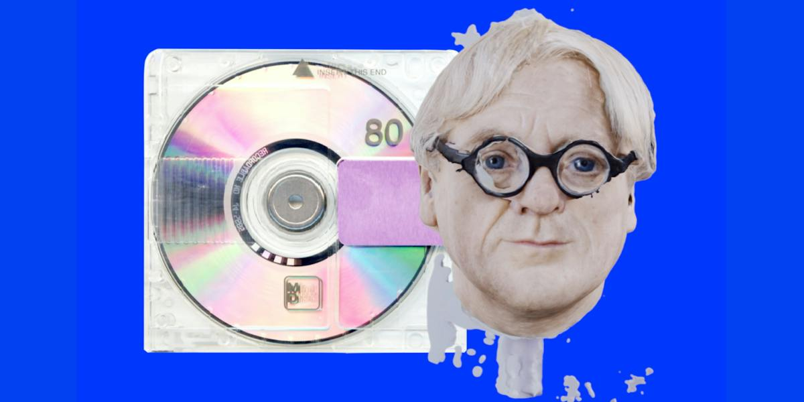

# Gilbert (dis.art)

**Tag tecnica/formato:** `video`
**Tag tema:** `economia-attenzione`
**Stato:** scheda parziale, scritta a partire da fonti web (Wikipedia, siti di festival e gallerie); l'identità dell'autore non è nota (non è provato che sia Gilbert di Gilbert & George) · non ancora assegnata a un corso · immagini controllate (diritti degli autori)

## Biografia
Autore, nei crediti di dis.art, di una serie di video sul graphic design. Le fonti lo definiscono storico amatoriale del graphic design e usano il pronome *they*. Ha scritto anche il testo autobiografico «They Built World: A Boyhood in Graphic Design» (newsletter *Other Worlds*, novembre 2024). Cognome e dati biografici non risultano.

## Poetica e ricerca
La serie è descritta da dis.art come una lettera d'amore al graphic design, nonostante il titolo, in tono saggistico e sardonico verso il capitalismo.

## Opere principali

### I Hated Graphic Design (serie, dis.art)
**Descrizione:** Serie di video. Contiene *Duchamp Pisses on Graphic Design* (Duchamp come artista che irrompe nelle rigide convenzioni del graphic design e ispira seguaci che diventano designer in formazione), *Neophiles versus Amnesiacs* (la facilità del graphic design oggi e la tensione tra nuovi designer dilettanti e predecessori modernisti), *What the Graphic Designers Wore* (contro i designer maschi europei canonici).

## Fonti
- [dis.art — I Hated Graphic Design](https://dis-art.proxy.library.upenn.edu/series/i-hated-graphic-design)
- [dis.art — Duchamp pisses on graphic design](https://dis-art.proxy.library.upenn.edu/duchamp-pisses-on-graphic-design)
- [dis.art — Neophiles versus Amnesiacs](https://dis-art.proxy.library.nyu.edu/neophiles-versus-amnesiacs)
- [Other Worlds — They Built World](https://buttondown.com/otherworlds/archive/ow-19-they-built-world-a-boyhood-in-graphic/)

## Crediti delle immagini
Immagini controllate il 2026-11-01: provengono dalle pagine indicate (festival, gallerie, siti degli artisti, piattaforme) e restano di proprietà degli autori.
- Duchamp Pisses on Graphic Design (1): [dis.art](https://dis.art/duchamp-pisses-on-graphic-design) · Immagine promozionale / fotogramma ufficiale, diritti degli autori; uso didattico
- Neophiles versus Amnesiacs (1): [dis.art](https://dis.art/neophiles-versus-amnesiacs) · Immagine promozionale / fotogramma ufficiale, diritti degli autori; uso didattico
