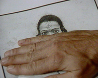
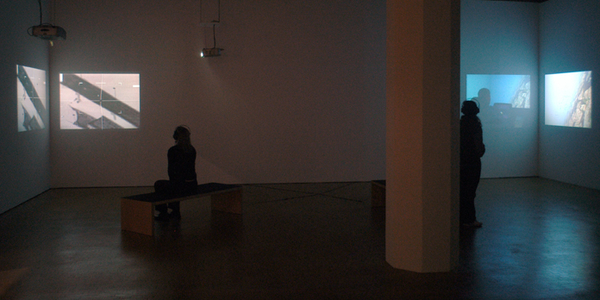
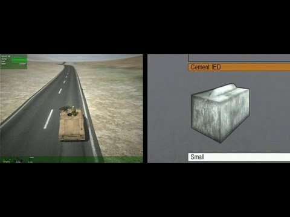
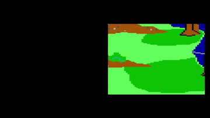
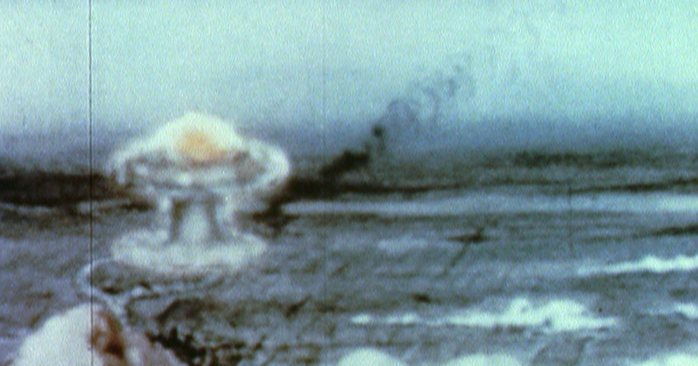
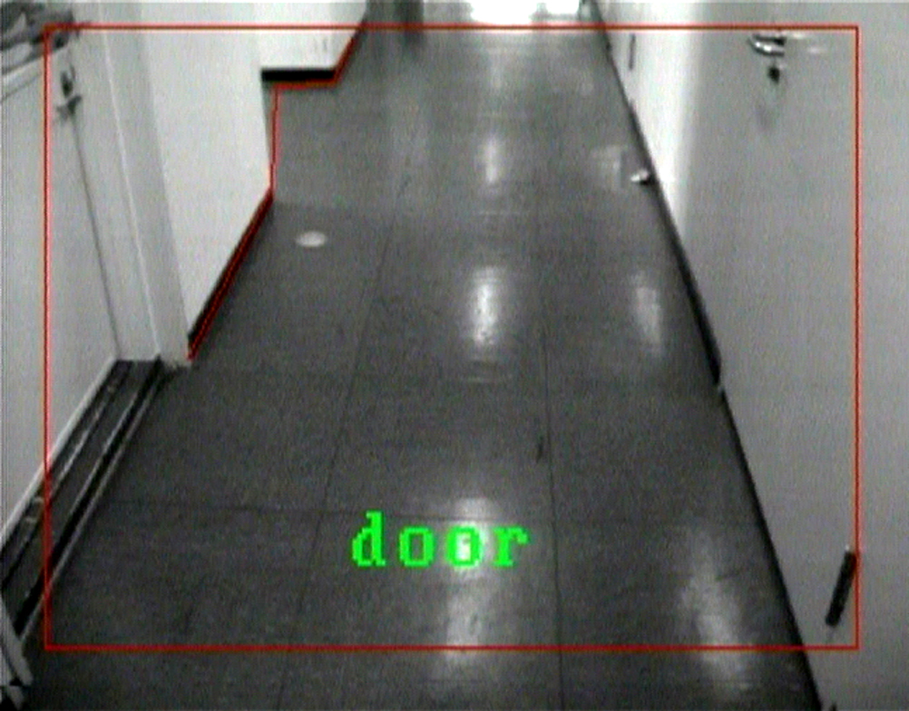

# Harun Farocki

**Tag tecnica/formato:** `video` `data-visualization`
**Tag tema:** `sorveglianza-controllo` `storia-computer-grafica` `game-culture`
**Tag corso:** `M3D`
**Stato:** sintesi: l'opera di Farocki è molto più vasta di quella qui raccolta · la parte sulle immagini operative si basa su due saggi (Parikka, Paglen)

## Biografia
Regista, artista e scrittore tedesco (1944-2014). Ha realizzato oltre 90 film, per lo più brevi documentari sperimentali; la mostra «Images of War (at a Distance)» al MoMA (2011) è stata la prima grande personale in un museo statunitense ([Wikipedia](https://wikipedia.com/wiki/Harun_Farocki)). Figura centrale del cinema saggistico e dell'arte dei media critica sulle immagini tecniche, la guerra e il lavoro.

## Poetica e ricerca
Farocki ha coniato e sviluppato il concetto di **"immagine operativa"** (*operational image*): immagini non prodotte per essere guardate da un occhio umano, ma per essere calcolate, misurate, usate per navigare, colpire un bersaglio, tracciare un oggetto — immagini che passano "dai modi di vedere ai modi di calcolare" (Jussi Parikka). La sua ricerca lega la storia delle immagini tecniche a quella della produzione industriale, della violenza, del lavoro e dei dati, rifiutando di trattarle come mera cultura visiva. Il suo lavoro attraversa decenni indagando come le tecnologie della visione — dai sistemi di puntamento militare ai motori grafici dei videogiochi — costruiscano un modo specifico di vedere (e agire su) il mondo.

## Opere principali

### Immagini del mondo e iscrizione della guerra / Bilder der Welt und Inschrift des Krieges (1989)
**Descrizione:** film-saggio che mette in relazione fotografie aeree, sistemi di puntamento e altre forme di modellazione e simulazione.
**Lettura critica:** indaga come leggere paesaggi e immagini aeree nel loro senso materiale e operativo, non solo rappresentativo.

**Approfondimento:** [harunfarocki.de — Images of the World and the Inscription of War](http://www.harunfarocki.de/films/1980s/1988/images-of-the-world-and-the-inscription-of-war.html)

### Eye/Machine I-III (2001-2003)
**Descrizione:** trilogia di video-installazioni su sistemi d'arma autonomi e visione artificiale in ambito industriale e militare.
**Lettura critica:** è qui che Farocki introduce il concetto di immagine operativa, osservando il passaggio dalla rappresentazione alla primazia dell'operazione — l'immagine come parte di un ciclo di calcolo e azione, non di contemplazione.

**Approfondimento:** [harunfarocki.de — Eye/Machine](http://www.harunfarocki.de/installations/2000s/2000/eye-machine.html)

### Serious Games 1-4 (2009-2010)
**Descrizione:** serie sull'uso di simulazioni videoludiche nell'addestramento militare e nella terapia dei veterani (tra cui *Watson is Down*, *Three Dead*, *Immersion*).
**Lettura critica:** mostra come lo stesso dispositivo tecnico (il motore di simulazione) prepari alla guerra e curi il suo trauma, cortocircuitando addestramento e cura.
**Video:** [Serious Games 1: Watson is Down (video)](https://www.youtube.com/watch?v=P1fa8jZ01rE) · [Serious Games 2: Three Dead (video)](https://www.youtube.com/watch?v=KH5MmRX1Cns) · [Serious Games 3: Immersion (video)](https://www.youtube.com/watch?v=XrXAd6p4EaM)

### Parallel I-IV (2012-2014)
**Descrizione:** serie in due canali sincronizzati che confronta la storia estetica della computer grafica nei videogiochi — dalle linee astratte dei primi giochi anni '80 (*Mystery House* 1980, *Pitfall* 1982, *King's Quest* 1984) al fotorealismo — con le regole e i limiti dei mondi di gioco e dei loro protagonisti ("homunculi" senza genitori né maestri, con un set limitato di interazioni).
**Lettura critica:** ricostruisce un'evoluzione ideale dell'estetica dei videogiochi come specchio deformante ma ricco di informazioni su libertà d'azione, regole e artificio — "le animazioni al computer dispongono di un terzo tipo di vento", diverso da quello reale e da quello filmico.
**Video:** [Parallel I-IV, versione integrale (Internet Archive)](https://archive.org/details/parallel-i-iv-2014)

### Inextinguishable Fire (1969)
**Descrizione:** film saggistico breve, realizzato nella Germania Ovest poco dopo l'espulsione di Farocki dall'accademia di cinema di Berlino per il suo impegno contro la guerra in Vietnam; esamina l'uso del napalm in Vietnam e il suo legame con la tecnologia e la guerra.
**Lettura critica:** è la prima formulazione di un tema che attraversa tutta la sua opera, il legame fra produzione tecnologica e violenza.

**Approfondimento:** [Goethe-Institut — retrospettiva Harun Farocki, note di programma](https://www.goethe.de/resources/files/pdf329/harun-farocki-retrospective_schedule-and-programm-notes.pdf)

### Videograms of a Revolution (1992, con Andrei Ujică)
**Descrizione:** montaggio di video amatoriali e di materiale della televisione di stato rumena del dicembre 1989, che documenta la caduta del regime di Ceaușescu.
**Lettura critica:** è spesso citato come primo esempio del ruolo della televisione nella costruzione stessa di una rivoluzione.

**Approfondimento:** [Artlist — Harun Farocki](https://artlist.cz/en/umelci/harun-farocki/)

### Workers Leaving the Factory (1995)
**Descrizione:** montaggio di 36 minuti che parte dal film dei fratelli Lumière del 1895 e raccoglie le variazioni della stessa scena (l'uscita degli operai dalla fabbrica) in un secolo di cinema. Farocki lo ha poi ripreso in un'installazione a più schermi, *Workers Leaving the Factory in Eleven Decades*.
**Lettura critica:** la storia del cinema letta attraverso un solo motivo, il lavoro industriale.

**Approfondimento:** [Goethe-Institut — retrospettiva Harun Farocki](https://www.goethe.de/resources/files/pdf329/harun-farocki-retrospective_schedule-and-programm-notes.pdf)

### Counter-Music (2004)
**Descrizione:** ambientato a Lille, città del nord della Francia segnata dalla deindustrializzazione, si chiede come oggi si debba filmare una città; richiama le sinfonie urbane degli anni Venti, come quella di Vertov.

**Approfondimento:** [Haus der Kunst — Harun Farocki, Counter-Music](https://hausderkunst.de/en/eintauchen/harun-farocki-counter-music)

### Altre opere (elenco da approfondire)
**Descrizione:** dal catalogo del Video Data Bank: *How to Live in the FRG* (1990), *The Appearance* (1996), *Still Life* (1997), *The Interview* (1997), *The Creators of Shopping Worlds* (2001). Titoli e anni sono quelli del catalogo, le descrizioni vanno ancora scritte.

**Approfondimento:** [Video Data Bank — Harun Farocki](https://vdb.org/node/9912)

### War at a Distance (Erkennen und Verfolgen, 2003)
**Descrizione:** saggio documentario di circa 58 minuti, con voce narrante di Margarita Broich, prodotto da Harun Farocki Filmproduktion con ZDF/3sat. Parte dalla guerra del Golfo del 1991, quando le immagini trasmesse e quelle generate al computer diventano difficili da distinguere, e mostra l'immagine come anello di una catena di produzione e distruzione. Con materiali d'archivio e originali, lega strategia militare e produzione industriale e mostra come la tecnologia bellica passi nell'uso quotidiano.
**Lettura critica:** uno dei film chiave sulle «immagini operative»: le immagini non servono più a mostrare ma a guidare un'azione.

## Approfondimenti
Materiale teorico per la didattica, ricavato dalla scheda di riferimento originale (REF su Drive) e dai saggi che cita.

### Immagini operative: la genealogia
- **Dal visivo all'invisuale.** Secondo Jussi Parikka le immagini operative incrinano la nozione stessa di immagine: non sono necessariamente rappresentative né pittoriche, passano dal primato della percezione umana alla misura, all'analisi di pattern, alla navigazione. Hanno una forza epistemica e intervengono nel mondo, direttamente o indirettamente: sono «dai modi di vedere ai modi di calcolare» ([Parikka, «Operational Images: From the Visual to the Invisual»](https://manifold.umn.edu/read/operational-images/section/91d3d20c-0c66-4cc7-9e1d-ba5d1f144574)).
- **Una storia alternativa delle tecnologie visive.** Parikka fa risalire l'imaging operativo al telerilevamento ottocentesco: lo spettrometro di Joseph von Fraunhofer (anni 1810) è per lui un caso centrale, perché ciò che registra non è una «immagine» in senso tradizionale. Già nel suo primo secolo la fotografia era uno strumento di misura che analizzava il mondo, compreso quello extraterrestre (astronomia); l'incontro fra media e scienze ha poi guidato il passaggio al «digitale», all'analisi di dati e all'infrastruttura planetaria.
- **Il termine in Farocki.** Appare nei primi anni Duemila nella trilogia *Eye/Machine I–III* (2001–03), su armi autonome, visione artificiale industriale e passaggio dalle rappresentazioni al primato delle operazioni. Il REF lega le immagini di Farocki a una storia di chimica, violenza, lavoro, sfruttamento e dati, non solo di cultura visiva; precedente di terreno in *Bilder der Welt und Inschrift des Krieges* (1989).
- **Paglen.** Il REF segna il saggio [Trevor Paglen, «Operational Images» (e-flux journal #59)](https://www.e-flux.com/journal/59/61130/operational-images/), che parte dalla visione di *Eye/Machine III*: frecce animate che mostrano come un robot «vede» il paesaggio, la traiettoria di un missile da crociera, riquadri verdi che tracciano oggetti in movimento.

### Guerra simulata: Theweleit
Dal REF, citazione di Klaus Theweleit (usata da Farocki in *Erkennen und Verfolgen / War at a Distance*, 2003, dal minuto 25:59): le immagini computerizzate della guerra cancellano la differenza tra eventi simulati e reali e tra tempo storico e tempo simulato; diventa impossibile decidere se qualcosa accade, che cosa accade, e se accade mentre lo vediamo. Le persone morte in Iraq sotto le bombe con telecamera erano già trattate dalla macchina come persone simulate. Ne consegue l'abolizione dell'«immagine autentica» (con il suo cartellino di tempo e luogo) e degli occhi come organo che testimonia la storia. *(Numero di nota 19 nel REF: titolo e pagina del testo di Theweleit da rintracciare nel saggio di Parikka.)*

### Spunti per la didattica
- Confronto con Paglen e Steyerl (immagini operative) e con Claerbout sulla fiducia nell'immagine (*The Silence of the Lens*: scansione come logica dell'evitare).
- *Parallel I–IV*: storia degli stili della grafica computerizzata, dalle sole linee orizzontali e verticali agli anni Ottanta al fotorealismo; i mondi di gioco come dischi sospesi, con quinte e fondali come in teatro (vedi la descrizione dell'opera).

## Interviste e talk
- «Nine Minutes in the Yard: A Conversation with Harun Farocki», di Rembert Hüser, in Thomas Elsaesser (a cura di), *Harun Farocki: Working on the Sight-Lines* (2004) — testo a stampa
- [MACBA — Harun Farocki. To think in images](https://www.macba.cat/en/node/21709): scheda dell'evento, con la lecture «Subtext and subimage» tenuta da Farocki con Roger M. Buergel (non è una registrazione)
- [Video Data Bank — Harun Farocki](https://vdb.org/node/9912): catalogo e distribuzione dei film

## Fonti
- [Harun Farocki — War at a Distance](https://www.harunfarocki.de/films/2000s/2003/war-at-a-distance.html)
- [IFFR — Erkennen und Verfolgen](https://iffr.com/en/2004/films/erkennen-und-verfolgen)
- [Jussi Parikka — "Operational Images: From the Visual to the Invisual"](https://manifold.umn.edu/read/operational-images/section/91d3d20c-0c66-4cc7-9e1d-ba5d1f144574)
- [Trevor Paglen — "Operational Images" (e-flux journal #59)](https://www.e-flux.com/journal/59/61130/operational-images/)
- [Eye/Machine I (video)](https://www.youtube.com/watch?v=r4sDXhHqndk)
- [Eye/Machine II (video)](https://www.youtube.com/watch?v=DR3UOzCjRio)
- [Eye/Machine III (video)](https://www.youtube.com/watch?v=eRisum_xq_A)
- [Serious Games 2: Three Dead (video)](https://www.youtube.com/watch?v=KH5MmRX1Cns)
- [Parallel I-IV, versione integrale (Internet Archive)](https://archive.org/details/parallel-i-iv-2014)
- [Whitechapel Gallery — Parallel I-IV](https://www.whitechapelgallery.org/exhibitions/harun-farocki/)
- Portfolio/sito ufficiale: **non individuato** nella fonte originale (l'opera è gestita dall'Harun Farocki Institut) — da cercare.

## Crediti delle immagini
Immagine per ciascuna delle quattro opere, inclusa sotto la relativa descrizione in "Opere principali", dal sito ufficiale [harunfarocki.de](http://www.harunfarocki.de), YouTube e Internet Archive.
- [Jussi Parikka — "Operational Images: From the Visual to the Invisual"](https://manifold.umn.edu/read/operational-images/section/91d3d20c-0c66-4cc7-9e1d-ba5d1f144574)
- [Trevor Paglen — "Operational Images" (e-flux journal #59)](https://www.e-flux.com/journal/59/61130/operational-images/)
- War at a Distance (Erkennen und Verfolgen) (1): [www.eyefilm.nl](https://www.eyefilm.nl/en/whats-on/farocki-fast-night/1468047) · Immagine promozionale / fotogramma ufficiale, diritti degli autori; uso didattico
- War at a Distance (Erkennen und Verfolgen) (2): [iffr.com](https://iffr.com/en/2004/films/erkennen-und-verfolgen) · Immagine promozionale / fotogramma ufficiale, diritti degli autori; uso didattico
