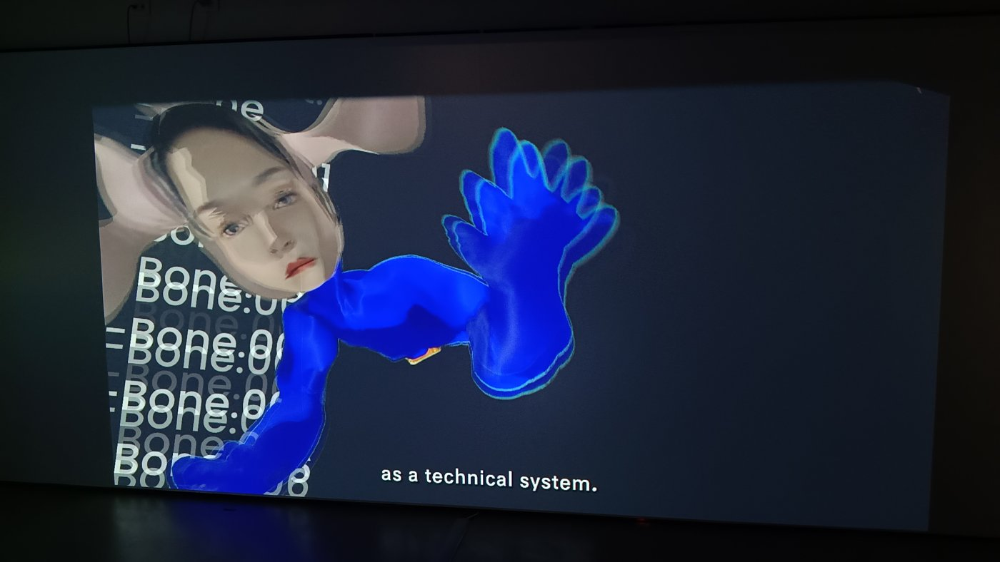

# Hsin Min Chan

**Tag tecnica/formato:** `video` `modellazione-3d` `vr-ar`
**Tag tema:** `corpo-identita` `genere-queerness`
**Stato:** scheda breve, ricavata da risultati di ricerca e dal materiale della mostra: da approfondire e verificare (biografia, opere, date) · nessun sito ufficiale verificato

## Biografia
Artista nata a Taiwan e con base nei Paesi Bassi. Lavora con l'immagine digitale e con la realtà estesa (selezionata nel 2025 per il Next XR Talent Program) e con la ceramica, esposta all'European Ceramic Work Centre. Il suo metodo è descritto come autoetnografico: parte dalla propria esperienza di identità, genere, sessualità e politica per mettere alla prova i limiti dell'autonomia individuale ([Playgrounds](https://weareplaygrounds.nl/artist/hsin-min-chan/); [EKWC](https://ekwc.nl/en/?p=63560)).

## Poetica e ricerca
La ricerca parte dal corpo e da come i sistemi di rappresentazione, fisici e digitali, lo standardizzano: nella ceramica ricombina parti del corpo in forme ibride, nel video e nella realtà virtuale mette in discussione le norme con cui i personaggi virtuali definiscono un corpo «efficace».

## Opere principali

### Smuggling Bodies: Digital Embodiment as a Method for Reimagining Body Politics
**Descrizione:** video che esplora la personificazione digitale (*digital embodiment*) come metodo per ripensare il corpo oltre i presupposti antropocentrici. Parte dal fatto che la maggior parte dei sistemi di personaggi virtuali definisce un corpo efficace attraverso norme standardizzate, e che ciò che se ne discosta è spesso trattato come errore: indaga come forme corporee alternative possano essere comprese nello spazio virtuale e immagina forme di esistenza molto diverse per futuri corpi digitali. Nel video compaiono scheletri e nomi di ossa (*Bone:00…*) di un rig, volti deformati e mani in blu. Presentato nella sezione *Metaverse Fashion Video Open Call* della mostra *2030: Collective Resonance — Human, AI, Rituals and Virtual Memory*, MEET, Milano (2026).

## Interviste e talk
- _Nessuna ancora: da aggiungere._

## Fonti
- [Playgrounds — Hsin Min Chan](https://weareplaygrounds.nl/artist/hsin-min-chan/)
- [EKWC — Hsin Min Chan](https://ekwc.nl/en/?p=63560)
- Opuscolo della mostra «2030: Collective Resonance», MEET, Milano, 2026 (testo ITA/ENG su *Smuggling Bodies*)

## Mostre viste
- *2030: Collective Resonance — Human, AI, Rituals and Virtual Memory*, MEET, Milano (2026) — visto da @danMa-hub

## Crediti delle immagini
- *Smuggling Bodies*: fotografia di Daniele Maffeis del video in mostra al MEET, Milano; diritti dell'artista.
