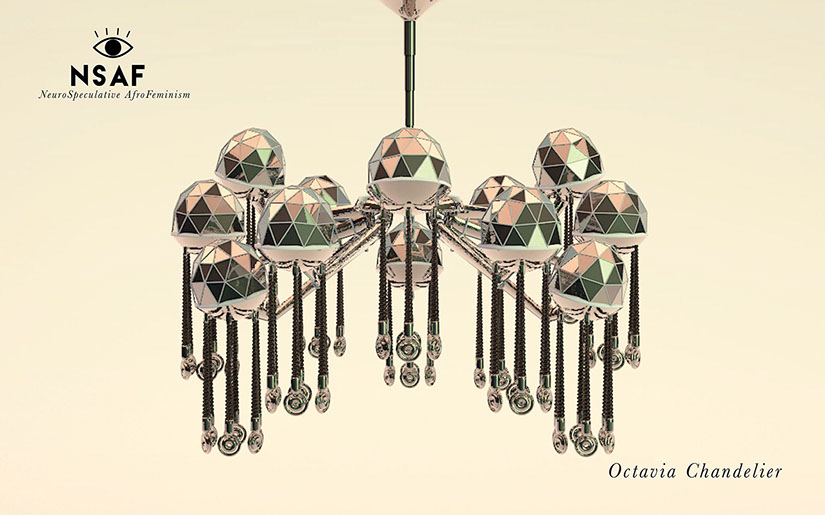
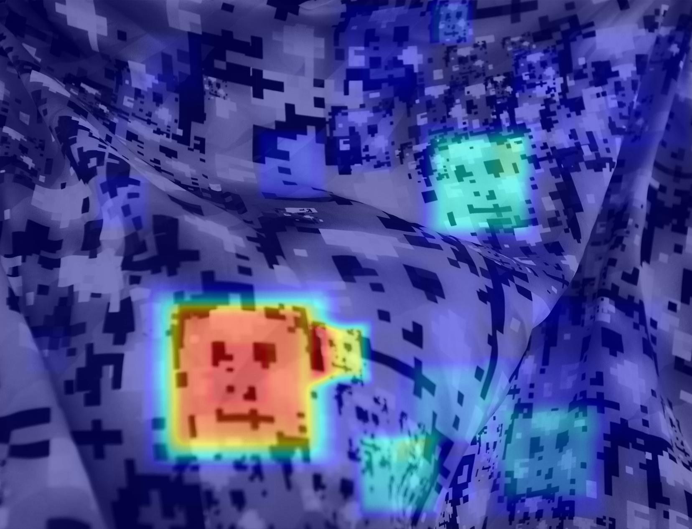
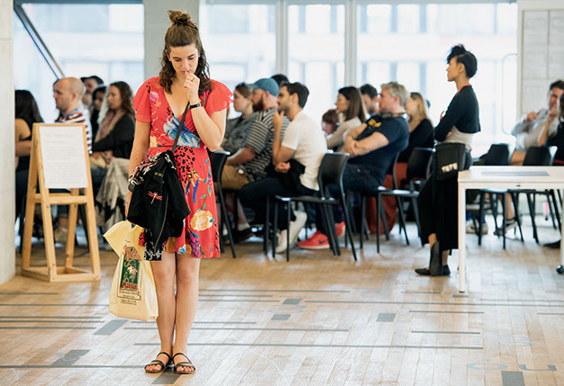
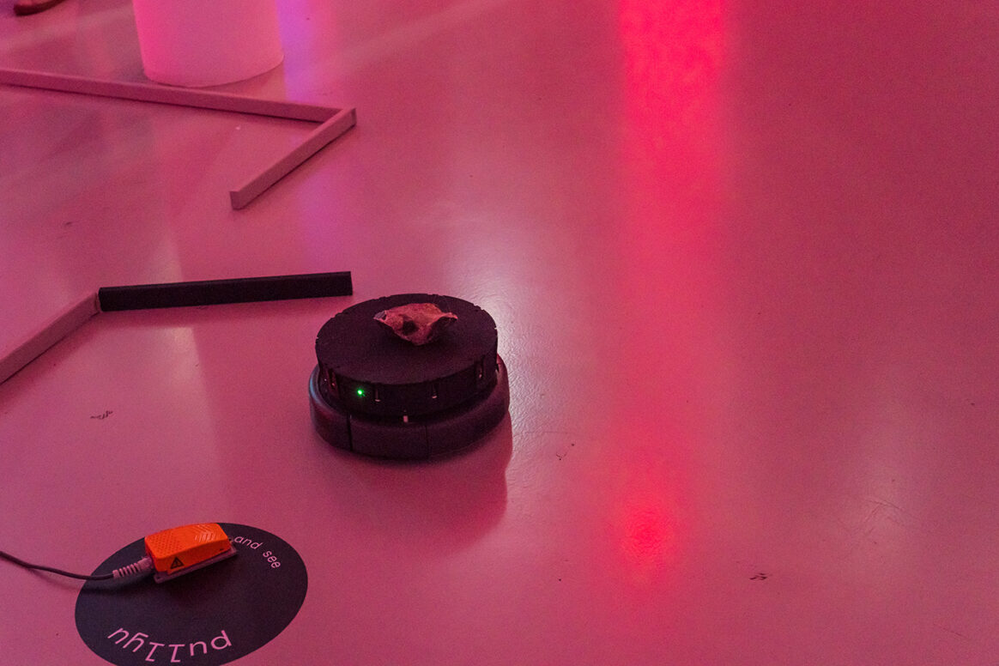

# Hyphen-Labs

**Tag tecnica/formato:** `vr-ar` `installazione` `data-visualization`
**Tag tema:** `sorveglianza-controllo` `corpo-identita` `colonialismo-decolonialita`

## Biografia
Hyphen-Labs è un collettivo internazionale fondato nel 2014 da **Carmen Aguilar y Wedge** (ingegnere strutturale e designer, messicano-americana) e **Ece Tankal** (architetta, turca), che ne condividono il ruolo di direzione creativa. **Ashley Baccus-Clark** (biologa molecolare/cellulare con base a Brooklyn, diventata "neuroscienziata speculativa", in precedenza a Warby Parker) è direttrice/responsabile della ricerca; **Nitzan Bartov** (tecnologa/designer) è collaboratrice fondamentale nei progetti di punta. Descritto come "un team internazionale di donne di colore che lavora all'intersezione tra tecnologia, arte, scienza e futuro", strutturato come collettivo distribuito e basato su progetti piuttosto che come studio con un organico fisso. Base a Londra, con collaborazioni distribuite internazionalmente. Riconoscimenti: United States Artists Fellow 2019 (categoria Media, borsa non vincolata di 50.000 dollari); artist(s)-in-residence Ida Ely Rubin al MIT Center for Art, Science & Technology (ospitati dal MIT Open Documentary Lab, in collaborazione con l'Imagination, Computation and Expression Lab, il Synthetic Neurobiology Group e il Center for Civic Media del MIT); artista principale del quarto anno di Tate Exchange (2019), Tate Modern, Londra, sul tema "Power".

## Poetica e ricerca
La pratica di Hyphen-Labs si colloca all'intersezione tra speculative/critical design, tecnologia indossabile, afrofuturismo e femminismo intersezionale, affrontando specificamente il bias algoritmico, la sorveglianza e la sottorappresentazione delle donne di colore nella tecnologia. *CLOT Magazine* (stampa di design/tecnologia) inquadra la loro pratica attorno a "design centrato sull'essere umano e politica progressista", osservando che "resiste alle tecnologie contemporanee basate sul consumo" ed "esplora le assurdità che emergono ai margini tra 'questo' e 'quello', sfidando le convenzioni e stimolando conversazioni, ponendo i bisogni planetari e le esperienze collettive al centro delle narrazioni in evoluzione". *Hyperallergic* ha intitolato il proprio articolo "An Afrofeminist Project Uses Technology to Empower Marginalized Communities"; *IndieWire*, nella copertura del Sundance, ha titolato "Afrofuturist Virtual Reality Installation Reimagines the Future for Women Of Color". *The Creative Independent* ha pubblicato un'ampia intervista sul loro metodo di lavoro collaborativo/collettivo e sulle pratiche di proprietà intellettuale condivisa. Sul proprio sito, il collettivo descrive il termine "Hyphen" (trattino) come simbolo della propria identità di "collettivo globale che usa le proprie ampie esperienze e prospettive culturali per realizzare un lavoro significativo", con una missione "radicata nella rappresentazione intersezionale".

## Opere principali
### NeuroSpeculative AfroFeminism, NSAF (2016/2017-in corso)
**Descrizione:** progetto transmediale in tre parti: (1) un'installazione fisica messa in scena come un futuristico salone di bellezza/"neurocosmetologia" che espone prodotti speculativi per donne di colore — tra cui UVBeam (crema solare trasparente formulata per pelli ricche di melanina), accessori con il pattern HyperFace (vedi sotto), e orecchini a battente dotati di telecamera/microfono nascosti per registrare incontri ostili; (2) un'esperienza VR che colloca il visitatore nel corpo/avatar di una giovane donna nera sottoposta a un trattamento di "neuroplasticità" dei capelli; (3) un filone di ricerca biometrica/fMRI in corso che studia se l'incarnazione VR di donne nere possa ridurre il bias implicito negli spettatori. Presentato in anteprima al Sundance Film Festival New Frontier (gennaio 2017); mostrato anche a SXSW, Tribeca Film Festival (menzione d'onore della giuria), Gray Area Festival, School of the Art Institute of Chicago, Stony Island Arts Bank & Rebuild Foundation, Versions Festival di New Inc; mostra personale al Plug In ICA (Winnipeg, gennaio-marzo 2020).
**Lettura critica:** un caso raro di opera che combina installazione speculativa, esperienza VR e vera e propria ricerca scientifica (fMRI) sul bias implicito — non solo rappresentazione critica ma verifica empirica del proprio impatto.

**Approfondimento:** [hyphen-labs.com — NSAF](https://hyphen-labs.com/NSAF)

### HyperFace (2017, collaborazione con l'artista Adam Harvey)
**Descrizione:** tessuto/sciarpa di camuffamento per la visione artificiale, sviluppato come parte dell'installazione NSAF. Realizzato con l'artista berlinese Adam Harvey (già presente in questo database), stampa circa 1.200 pattern di falsi volti pixelati su sciarpe di seta e altri tessuti, sfruttando gli algoritmi di rilevamento facciale (classificatori tipo Haar-cascade) sovraccaricandoli di falsi volti "ideali", così che il software non riesca a isolare il volto reale di chi lo indossa — "sovraccaricare un algoritmo con ciò che vuole", nelle parole di Harvey. Presentato in anteprima al Sundance 2017 come parte dell'esposizione di prodotti speculativi di NSAF.
**Lettura critica:** ampiamente discusso come oggetto indossabile e reale di contro-sorveglianza contro il bias del riconoscimento facciale — non solo un'opera concettuale ma un prodotto funzionante e commercializzato.

**Approfondimento:** [hyphen-labs.com — NSAF](https://hyphen-labs.com/NSAF)

### Higher Resolution (2019, Tate Exchange, Tate Modern, Londra)
**Descrizione:** Hyphen-Labs viene nominato artista principale del quarto anno di Tate Exchange (la piattaforma di arte partecipativa della Tate Modern), producendo un programma intitolato "Higher Resolution" sul tema annuale "Power" (17-29 settembre 2019). Il programma combina opere interattive, talk con esperti internazionali di tecnologia e workshop pratici su sorveglianza, privacy online e come l'IA plasmi cultura e relazioni — realizzato con contributi della Mozilla Fellow Caroline Sinders e della psichiatra/produttrice creativa Romy Gad el Rab.
**Lettura critica:** conferma il posizionamento del collettivo come mediatore tra pratica artistica e attivismo tecnologico concreto — non solo mostra ma programma educativo/di workshop.

**Approfondimento:** [hyphen-labs.com — Tate Exchange](https://hyphen-labs.com/Tate-Exchange)

### PushMi PullYu (2020, Schering Stiftung, Berlino)
**Descrizione:** mostra personale (11 settembre-22 novembre 2020) in cui robot a intelligenza di sciame (unità Roomba modificate, costruite con lo studio IT Kai Lab) si muovono autonomamente e interattivamente nello spazio della galleria, talvolta controllati dai visitatori, talvolta indipendenti, sotto luce colorata. Concepita in dialogo con il neuroscienziato John-Dylan Haynes (i cui esperimenti del 2008 e del 2015 sui tempi della decisione cosciente rispetto ai segnali cerebrali hanno informato direttamente l'opera), mette in scena interrogativi su libero arbitrio contro determinismo e comportamento individuale contro collettivo/di sciame. Programmazione della ricercatrice di comportamento di sciame Dr. Mary Katherine Heinrich.
**Lettura critica:** estende la pratica di critical design del collettivo alla robotica e all'installazione informata dalle neuroscienze — l'opera più recente documentata con dettaglio, e un allontanamento dal tema più specificamente razziale/di genere di NSAF verso una domanda filosofica più generale sulla coscienza e l'agentività.

**Approfondimento:** [hyphen-labs.com — PushMI PullYu](https://hyphen-labs.com/PushMI-PullYu)

## Interviste e talk
- [The Creative Independent — intervista sul metodo collaborativo](https://thecreativeindependent.com/people/interaction-studio-hyphen-labs-on-bringing-the-future-into-the-present-through-radical-collaboration/)

## Fonti
- [hyphen-labs.com — sito ufficiale](https://hyphen-labs.com/who-is-hyphen-labs)
- [MIT Center for Art, Science & Technology — pagina collettivo](https://arts.mit.edu/people/hyphen-labs/)
- [MIT Open Documentary Lab — pagina NSAF](https://opendoclab.mit.edu/presents/hyphen-labs-neurospeculative-afrofeminism/)
- [Tate — comunicato stampa Tate Exchange 2019](https://www.tate.org.uk/press/press-releases/tate-exchange-announces-lead-artist-its-fourth-year-focusing-on-power-hyphen)
- [Schering Stiftung — PushMi PullYu](https://scheringstiftung.de/en/projektraum/hyphen-labs-push-mi-pull-yu/)
- [United States Artists — pagina fellow 2019](https://www.unitedstatesartists.org/fellow/hyphen-labs/)
- [Hyperallergic — "An Afrofeminist Project Uses Technology to Empower Marginalized Communities"](https://hyperallergic.com/460424/hyphen-labs/)
- [IndieWire — copertura Sundance 2017](https://www.indiewire.com/features/general/virtual-reality-sundance-2017-afrofuturist-1201777661/)
- [Vice — su HyperFace](https://www.vice.com/en/article/countersurveillance-textiles-trick-computer-vision-software/)

## Crediti delle immagini
Immagine e link di approfondimento per ciascuna delle quattro opere, inclusi sotto la relativa descrizione in "Opere principali", scaricate dal sito ufficiale [hyphen-labs.com](https://hyphen-labs.com).
- [MIT Center for Art, Science & Technology — pagina collettivo](https://arts.mit.edu/people/hyphen-labs/)
- [MIT Open Documentary Lab — pagina NSAF](https://opendoclab.mit.edu/presents/hyphen-labs-neurospeculative-afrofeminism/)
