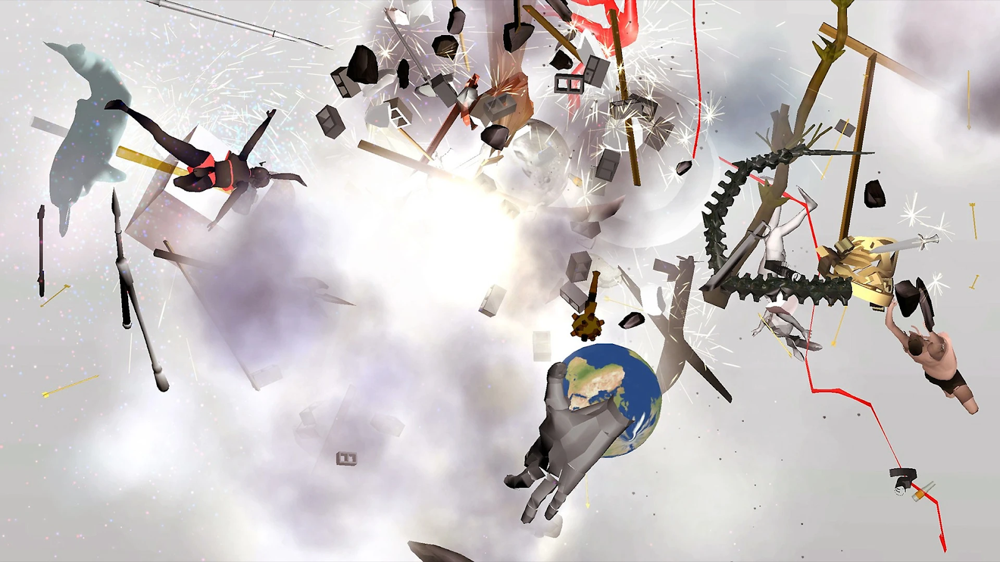
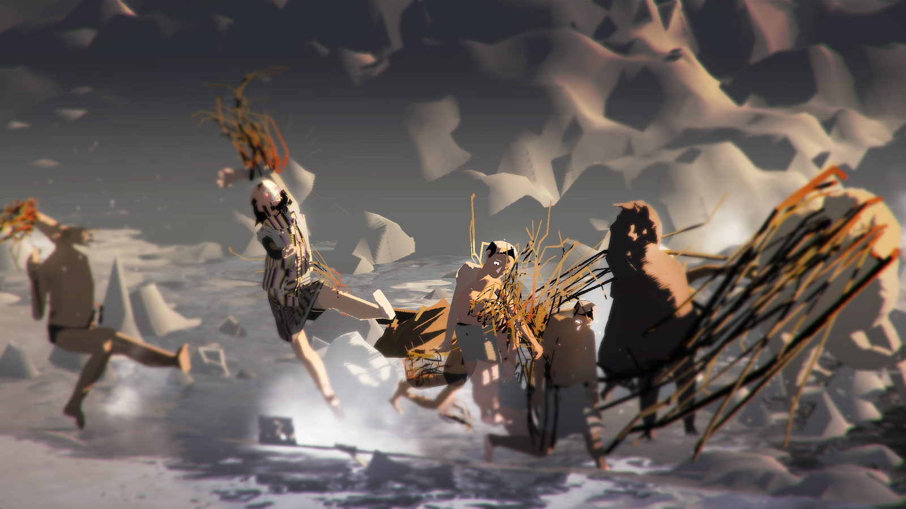
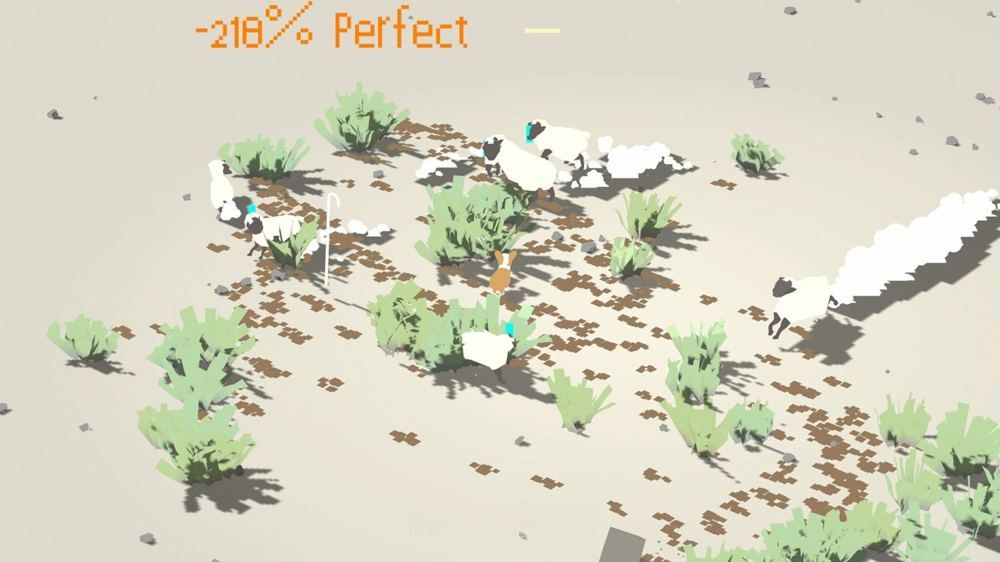
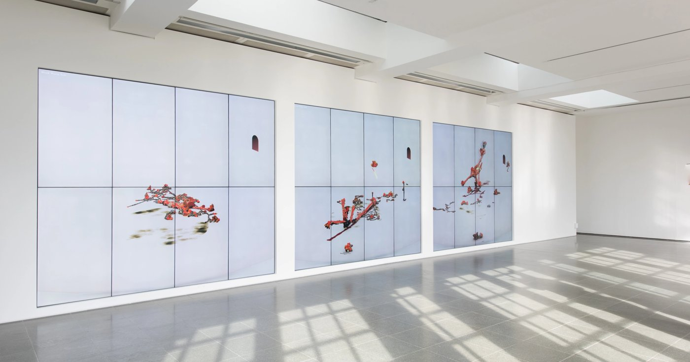
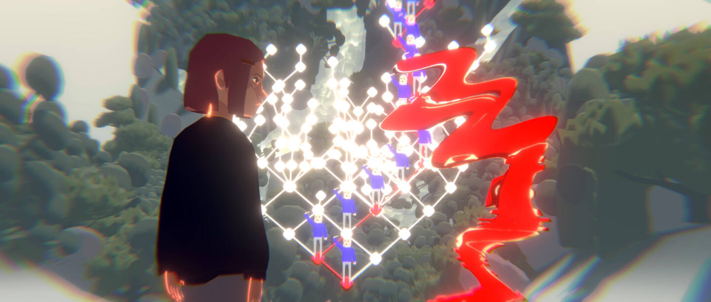

# Ian Cheng

**Tag tecnica/formato:** `game-engine-realtime` `ai-generativa` `procedurale-generativo`
**Tag tema:** `intelligenza-artificiale-critica` `temporalita-non-lineare`
**Tag corso:** `AW`
**Stato:** le tre immagini provengono dalla scheda originale e non hanno una fonte tracciata · da sostituire con immagini di provenienza verificata

## Biografia
Nato nel 1984 a Los Angeles, vive e lavora a New York ([Whitney Museum](https://whitney.org/artists/16784); [Wikipedia](https://en.wikipedia.org/wiki/Ian_Cheng)). Laurea (doppio corso in scienze cognitive e art practice) alla UC Berkeley (2006); ha lavorato a Industrial Light & Magic (la società di effetti visivi di George Lucas); MFA alla Columbia University (2009); dal 2010 al 2012 ha lavorato nello studio dell'artista **Pierre Huyghe** (già nella nostra lista "nuovi") ed è stato co-direttore di Badlands Unlimited, casa editrice indipendente di Paul Chan. Mostre personali a MoMA PS1 (New York), Serpentine Galleries (Londra), Carnegie Museum of Art (Pittsburgh); collettive al MoMA, Whitney Museum, Biennale di Venezia 2019, Hirshhorn Museum, Tate Modern, Louisiana Museum, Fondation Louis Vuitton.

## Poetica e ricerca
Cheng rifiuta i media statici a favore di **"simulazioni dal vivo"**: mondi digitali autonomi che girano in tempo reale su game engine, popolati da agenti IA il cui comportamento è emergente e non pre-sceneggiato. La sua pratica è più vicina al giardinaggio che alla narrazione: imposta condizioni iniziali e pulsioni degli agenti, poi cede il controllo, osservando cosa "diventa" il mondo.

Cheng chiama questa pratica **"Worlding"**, distinguendola dal tradizionale "World-Building" (letteratura fantasy/fantascienza, che progetta a tavolino un mondo coerente e finito): il Worlding è un processo che porta i mondi virtuali a vivere nella loro imprevedibilità continua, una metafora per una vita vissuta al servizio di una particolare vitalità, con la capacità di creare complessità e il coraggio di convivere con l'indeterminatezza che la complessità comporta ([Philippe Vandenbroeck, "Ian Cheng: An Emissaries Guide to Worlding", Medium, 2018](https://philippevandenbroeck.medium.com/ian-cheng-an-emissaries-guide-to-worlding-2018-5a97f95b41d6)). È anche il titolo del suo libro *Emissary's Guide to Worlding* (Sternberg Press, con contributi di Hans Ulrich Obrist e altri) e di una mostra alla Pilar Corrias ([pilarcorrias.com](https://www.pilarcorrias.com/exhibitions/302-ian-cheng-worlding/)). Il termine ha origine nella fenomenologia di Heidegger (il "worlding" come senso verbale del mondo) — è il critico Vandenbroeck, non Cheng stesso, a esplicitare questo aggancio filosofico nel saggio citato sopra.

## Opere principali

### BBRRAATTSS (2012)
**Temi:** `vita-artificiale-e-simulazione`
**Descrizione:** nato dall'esperienza di Cheng in una società di effetti visivi, porta Bugs Bunny ed Elmer Fudd dentro il software di animazione: gli scheletri si scontrano, gli arti si deformano, i personaggi sopravvivono alle esplosioni.
**Lettura critica:** uno dei primi lavori in cui Cheng spinge su difetti e imprevisti del software, prima di passare alle simulazioni in cui i personaggi vengono messi in moto e lasciati agire.

### Entropy Wrangler (2013)
**Descrizione:** simulazione dinamica presentata su Oculus Rift al Frieze Art Fair di Londra e in seguito a MoMA PS1: uno spazio virtuale caotico in cui il punto di vista del partecipante altera la dinamica di forme 3D senza peso, generando una narrazione propria dall'esperienza ([Rhizome](https://rhizome.org/editorial/2013/dec/23/prosthetic-knowledge-picks-oculus-rift/)).
**Lettura critica:** opera precoce che anticipa il metodo maturo di Cheng — non un mondo narrato ma un sistema fisico/percettivo che il pubblico attiva e destabilizza.

### Emissaries — trilogia: *Emissary in the Squat of Gods* (2015), *Emissary Forks at Perfection* (2016), *Emissary Sunsets the Self* (2017)
**Descrizione:** tre "simulazioni dal vivo" interconnesse, costruite su Unity, popolate da agenti IA il cui comportamento non è pre-sceneggiato ma emergente. In ognuna, un agente specifico — l'**Emissario** — riceve una missione fissa in un mondo caotico e indifferente a quella missione. *Squat of Gods*: paesaggio preistorico dominato da un vulcano, l'Emissario è un bambino. *Forks at Perfection*: un'IA a forma di Atollo gestisce un ecosistema artificiale, l'Emissario è un cane Shiba Inu. *Sunsets the Self*: l'Atollo-IA è ormai antico e morente, l'Emissario è un ibrido tra l'Emissario-bambino (ora entità antica) e una nuova IA.
**Lettura critica:** Cheng ha dichiarato di essersi ispirato direttamente a *Il crollo della mente bicamerale e l'origine della coscienza* (1976) di Julian Jaynes — la teoria secondo cui gli umani antichi non prendevano decisioni coscienti e riflesse, interpretando invece i propri pensieri come voci esterne ("comandi divini"): *"Non so se sia vero, ma di sicuro è strano, e ha catturato la mia immaginazione al punto da farmi realizzare queste opere chiamate Emissaries"* ([Ian Cheng: A Portal to Infinity, Louisiana Channel](https://channel.louisiana.dk/video/ian-cheng-portal-infinity)). La trilogia segue l'evoluzione cognitiva attraverso tre epoche lontane: nascita, frammentazione e dissoluzione della coscienza.

### Bad Corgi (2015)
**Descrizione:** app per iOS commissionata dalle Serpentine Galleries (la seconda commissione digitale del museo), online dal 24 settembre 2015: il giocatore guida un corgi pastore in un mondo simulato caotico, in una sorta di app di mindfulness «oscura» per contemplare il caos. Alcune fonti la datano al 2016.
**Lettura critica:** porta nel formato dell'app la pratica delle «simulazioni dal vivo» di Cheng: un mondo che non si ferma quando il gioco diventa interessante.

**Approfondimento:** [Serpentine Galleries — Ian Cheng, Bad Corgi](https://serpentinegalleries.org/whats-on/ian-cheng-bad-corgi); [Pilar Corrias — «Artificial Ecology»](https://oldsite.pilarcorrias.com/wp-content/uploads/2015/03/Artificial-Ecology-Ian-Cheng-on-the-St...f-Pokémon-Go-Art-for-Sale-Artspace-copy.pdf)

### BOB (Bag of Beliefs) (2018-2019)
**Descrizione:** un'entità di "vita artificiale" interattiva — un corpo serpentino/corallino che cambia forma su schermi in galleria. Il pubblico interagisce inviando "offerte" tramite un'app.
**Lettura critica:** l'innovazione tecnica di BOB è il **"congresso di demoni"** (*congress of demons*) che ne governa le decisioni — modellato sulla *Critica della Ragion Pura* di Kant, tramite il lavoro dello scienziato IA **Richard Evans** (DeepMind, autore dell'"Apperception Engine", un tentativo di usare la psicologia a priori kantiana come progetto architetturale per un sistema di machine learning) e sul lavoro psicoanalitico di Carl Jung, per cui la psiche è composta da sotto-personalità di diverse epoche evolutive del cervello ([ArtNews](https://www.artnews.com/art-news/artists/ian-cheng-gladstone-bob-artificial-intelligence-11825/); [Cultured Magazine](https://www.culturedmag.com/article/2019/05/07/ian-cheng/)). Ogni "demone" (un demone-mangiatore, un demone-fuga, un demone-esploratore, ecc.) compete ogni pochi secondi per il controllo del corpo di BOB, usando un motore inferenziale per identificare le possibilità d'azione nell'ambiente rilevanti alla propria pulsione. Il sistema è descritto come vicino all'**autopoiesi** cibernetica — un sistema auto-producentesi ([Moderna Museet](https://www.modernamuseet.se/en/news/bob-bag-of-beliefs-visas-i-foajen/)). Nel suo saggio d'artista **"Minimum Viable Sentience"** ([testo integrale su iancheng.com](https://iancheng.com/minimumviablesentience)), Cheng definisce la senzienza non attraverso il test di Turing ma attraverso la capacità di essere "turbati" (*upset*) — un sistema artificiale viene escluso dalla senzienza perché incapace di "contare i propri turbamenti" e crescere da essi, seguendo regole programmate anziché un'auto-regolazione nata dall'esperienza vissuta.

### Life After BOB: The Chalice Study (2021)
**Descrizione:** "anime dal vivo" di 50 minuti costruito in Unity, sulla vita di Chalice Wong, nel cui sistema nervoso il padre impianta illegalmente un'IA "genitore algoritmico" (BOB) che scrive costantemente la sua "sceneggiatura di vita" ottimale; esiste sia come film montato sia come interfaccia interattiva ("Worldwatching") che espone i dati interni dei personaggi ([Pilar Corrias](https://www.pilarcorrias.com/exhibitions/265-ian-cheng-life-after-bob-the-chalice-study/)).
**Lettura critica:** tragedia sul controllo genitoriale e sul "soluzionismo" della Silicon Valley — suggerisce che l'identità coincida proprio con ciò che l'ottimizzazione vorrebbe eliminare: trauma, caos, irrazionalità.

## Approfondimenti
Materiale teorico e critico per la didattica, ricavato dai due documenti di riferimento originali su Drive («Ian Cheng REF» e «Ian Cheng», in «new refs»). **Attenzione sull'origine:** il secondo documento è un testo lungo di analisi in italiano, con tutta evidenza prodotto da un'AI e senza fonti di prima mano. Le voci tratte da lì sono marcate *(origine AI, da verificare)*: servono come traccia per la lezione, non come lettura critica consolidata. Le voci con link vanno invece a fonti dirette.

### Parole dell'artista
- **Cartoni nell'era dei big data (Artforum).** Cheng descrive *Thousand Islands Thousand Laws* (2013–): una simulazione animata in cui un pistolero da videogioco, uno stormo di aironi e un'isola di piante si mescolano e mutano continuamente, non solo nella forma e nel comportamento ma nello **status** (protagonisti, comparse, oggetti di scena). La camera si muove come in un documentario naturalistico, incerta su cosa sia davvero interessante nell'inquadratura; impara a concentrarsi sulle piccole perturbazioni in cui le linee di influenza diventano visibili e lo status viene rimescolato: un «chi» diventa un «cosa», la figura diventa sfondo, il rumore informazione. «L'unica veduta stabile è quella del cambiamento stesso.» Il testo continua chiedendosi che cosa siano i cartoni nell'era dei big data: modelli artificiali per giocare con complessità che i nostri modelli mentali (riflessi, emozioni, abitudini, memoria, linguaggio) non riescono a cogliere da soli, capaci di «stirare e comprimere» catene causali e di riformulare il rapporto parte/tutto in uno zoom nauseante alla *Powers of Ten*. Premessa dichiarata del suo lavoro recente: fare cartoni per **mutare la coscienza**. *(Il REF riporta il testo del pezzo di Ian Cheng uscito su Artforum; titolo e data da recuperare: il REF non li indica.)*
- **Worlding contro world-building.** Distinzione ripresa anche nella scheda (Poetica e ricerca): il *world-building* progetta dall'alto un mondo finito e coerente, che il pubblico esplora o consuma; il *worlding* imposta condizioni iniziali e agenti con le loro pulsioni, poi cede il controllo e osserva l'emergenza. Fonte diretta: [Vandenbroeck, «An Emissaries Guide to Worlding» (Medium)](https://philippevandenbroeck.medium.com/ian-cheng-an-emissaries-guide-to-worlding-2018-5a97f95b41d6). La tabella «artista come architetto / artista come giardiniere» che si trova nel REF è una sintesi AI *(origine AI, da verificare)*.

### Emissaries (2015–2017): letture
- **Jaynes come dispositivo.** Cheng stesso lo dichiara (intervista [Louisiana Channel](https://www.youtube.com/watch?v=TO6Luilc4Bo)): la mente bicamerale di Julian Jaynes (1976), secondo cui gli umani antichi avrebbero vissuto le decisioni come voci divine, è per lui «strana» e immaginativa più che vera. L'Emissario è l'unico agente con una missione lineare in un mondo non narrativo: la tensione nasce dal conflitto tra un agente narrativo e un ecosistema indifferente. *(La lettura dell'Emissario come «lotta di un agente narrativo contro un mondo non-narrativo» è del REF AI: da verificare.)*
- **Le tre simulazioni come tappe della coscienza** *(origine AI, da verificare)*: *Squat of Gods* come mente bicamerale pura (vulcano come divinità, sciamano come interprete, bambino-Emissario ignorato o ucciso dagli altri agenti); *Forks at Perfection* come frammentazione (l'IA-Atollo manager di un ecosistema artificiale, l'Emissario-cane con un *umwelt* animale); *Sunsets the Self* come dissoluzione (l'Atollo antico che desidera dissolversi, un Emissario che deve testimoniare più che agire).
- **«Palestra neurologica».** Lo spettatore che cerca invano una trama è costretto a riconoscere pattern, accettare il caos e allenarsi a lasciare il controllo *(formula del REF AI; il termine «neurological gym» va controllato su una fonte diretta)*.

### BOB e «Minimum Viable Sentience»
Il saggio dell'artista è linkato nelle Fonti ([iancheng.com — Minimum Viable Sentience](https://iancheng.com/minimumviablesentience)); la sintesi che segue viene dal REF AI e **non è stata confrontata con il testo integrale** *(origine AI, da verificare)*:
- **Senzienza come capacità di essere «turbati».** Contro il test di Turing (imitazione antropocentrica), Cheng propone come criterio il *turbamento* (upset): lo scarto tra la credenza di un agente e la realtà. Un bambino o un cane lo provano e, per ricomporre la propria visione del mondo, aggiornano le credenze; un termostato o un personaggio da videogioco non lo fanno, e si può abusarne perché non «contano i propri turbamenti».
- **Architettura di BOB.** Un corpo serpentino con sensori (dolore, vista, metabolismo) e azioni predefinite; una mente in tre parti: *inference engine* (costruisce e unifica le credenze; ispirato a Kant via Richard Evans), *congress of demons* (circa dieci sub-personalità in competizione, ispirate a Jung) ed *emozione* come segnale di mancato progresso. Per i riferimenti a Evans e Jung c'è già fonte nella scheda ([ArtNews](https://www.artnews.com/art-news/artists/ian-cheng-gladstone-bob-artificial-intelligence-11825/)).
- **Esempio della mela e bias.** Un oggetto «nodoso» che si rivela velenoso crea una credenza da pochi esempi (nodoso + rotondo = velenoso) e quindi un pregiudizio, come in un bambino.
- **Parenting collettivo.** Con la BOB Shrine App il pubblico invia «offerte» con una didascalia, che crea un «angelo» in competizione con i demoni; se l'angelo sbaglia, quel «genitore» perde affidabilità.
- **Senzienza e coscienza.** La coscienza sarebbe un «meta-demone»: la ricerca volontaria di esperienze anomale per testare le proprie credenze. BOB, conclude Cheng, non è (ancora) senziente ma «conta i suoi turbamenti» e apprende da pochi esempi, a differenza del deep learning.
- **Scatola trasparente.** BOB viene letto come l'opposto delle IA commerciali «black box», perché il «sacco di credenze» è visualizzato su uno schermo secondario *(origine AI, da verificare)*.

### Life After BOB (2021): lettura
Dati verificati sulla sinossi ufficiale ([lifeafterbob.io](https://lifeafterbob.io/)): in *The Chalice Study*, il neuroingegnere Dr. Wong installa un'IA sperimentale (BOB) nel sistema nervoso della figlia Chalice, di dieci anni, per guidarla in un mondo instabile; BOB affronta sempre più conflitti al posto di lei, mentre Chalice si rifugia nell'evasione, e la domanda diventa che cosa resti da fare al suo «sé umano classico». Il REF aggiunge, *(origine AI, da verificare)*:
- le **due forme** dell'opera: il film di 50 minuti, montato da innumerevoli run della simulazione, e *Worldwatching*, l'interfaccia in cui si può mettere in pausa, uscire dalla camera narrativa e vedere i dati interni dei personaggi (pulsioni, obiettivi, «sceneggiatura»);
- la lettura come **tragedia della genitorialità**: l'amore del padre indistinguibile dal controllo deterministico, e una critica al «soluzionismo»: se tristezza e trauma sono «bug», eliminarli elimina anche il sé. Trama dettagliata (Z.E.U.S., *Life Script*, biforcazione in Chalice e Chali): da controllare sulle fonti ufficiali prima di raccontarla in classe.

### Per la didattica
- **Dalla trilogia a BOB a Life After BOB** come tre scale della stessa domanda: ecosistema (*Emissaries*), individuo (*BOB*), biografia e narrazione (*Life After BOB*). Lettura offerta dal REF AI; l'ordine e le date si verificano sulla scheda.
- Il game engine come strumento d'autore: che cosa significa lasciare agli agenti il controllo, e cosa resta del montaggio.
- Per un confronto con altri artisti della scheda: Claerbout (durata registrata contro durata calcolata) e Lek (mondi simulati come ambienti narrativi).
- Risorse video dal REF: [Louisiana Channel, «A Portal to Infinity»](https://www.youtube.com/watch?v=TO6Luilc4Bo); [«Life after BOB: The Chalice Study with Ian Cheng» (artist talk)](https://www.youtube.com/watch?v=JfhdgNazHRo); [«In Dialogue: The Guggenheim Collection — Ian Cheng»](https://www.youtube.com/watch?v=55huQdixX0g). Gallerie di riferimento: [Gladstone](https://www.gladstonegallery.com/artists/ian-cheng), [Pilar Corrias](https://www.pilarcorrias.com/artists/39-ian-cheng/).

## Interviste e talk
- **Video:** [Ian Cheng Interview: A Portal to Infinity (Louisiana Channel)](https://www.youtube.com/watch?v=TO6Luilc4Bo)
- **Video:** [Intervista sull'opera dell'artista (YouTube)](https://www.youtube.com/watch?v=kg1k8BmTqNg)
- [ArtNews — intervista su BOB](https://www.artnews.com/art-news/artists/ian-cheng-gladstone-bob-artificial-intelligence-11825/)
- [LUMA Arles — intervista a Ian Cheng, con un talk insieme a Uzodinma Iweala e Rachel Rose](https://luma.org/en/arles/artists-thinkers-a-z/ian-cheng)
- [Moderna Museet — talk con Ian Cheng e la produttrice Veronica So sull'architettura cognitiva di *BOB*](https://www.modernamuseet.se/stockholm/en/?p=106063)
- [Serpentine — Ian Cheng: BOB, Emissaries (video)](https://www.serpentinegalleries.org/watch/ian-cheng-bob-emissaries/)
- [The Brooklyn Rail — Ian Cheng con Osman Can Yerebakan (febbraio 2019)](https://brooklynrail.org/2019/02/art/IAN-CHENG-with-Osman-Can-Yerebakan)
- *Emissaries Guide to Worlding* ([Serpentine](https://shop.serpentinegalleries.org/products/coming-soon-ian-cheng-emissaries-guide-to-worlding)): il libro include un'intervista di Hans Ulrich Obrist a Cheng.
- **Video:** [Ian Cheng: Life After BOB Trailer (The Shed, YouTube)](https://www.youtube.com/watch?v=AMg4JQIGjns)

## Fonti
- [iancheng.com](https://iancheng.com/)
- [iancheng.com — "Minimum Viable Sentience" (saggio integrale)](https://iancheng.com/minimumviablesentience)
- [Wikipedia — Ian Cheng](https://en.wikipedia.org/wiki/Ian_Cheng)
- [Whitney Museum — profilo artista](https://whitney.org/artists/16784)
- [Pilar Corrias — biografia](https://www.pilarcorrias.com/artists/39-ian-cheng/biography/)
- [Life After BOB](https://lifeafterbob.io/)
- [Philippe Vandenbroeck — "Ian Cheng: An Emissaries Guide to Worlding" (Medium, 2018)](https://philippevandenbroeck.medium.com/ian-cheng-an-emissaries-guide-to-worlding-2018-5a97f95b41d6)
- [Cantor Arts Center, Stanford — *Emissary Sunsets the Self* (mostra)](https://museum.stanford.edu/exhibitions/ian-cheng-emissary-sunsets-self) — link dalle tracce, non aperto (il sito blocca le richieste automatiche) [verificare]
- *WORLDBUILDING: Gaming and Art in the Digital Age*, booklet della mostra, Julia Stoschek Collection, Düsseldorf, 2022 (testo di Travis Diehl)

## Crediti delle immagini
Le tre immagini sopra sono screenshot raccolti dall'artista/docente nella scheda originale (Google Drive); non è nota la fonte esatta (sito dell'artista o documentazione di mostra) — da verificare e, se possibile, sostituire con immagini di provenienza tracciabile (sito ufficiale, museo, galleria).
- *BOB*: immagine dalla pagina [www.pilarcorrias.com](https://www.pilarcorrias.com/exhibitions/173-ian-cheng-bob-bag-of-beliefs/); diritti dei rispettivi titolari, uso didattico.
- *Bad Corgi*: immagine dalla pagina [serpentinegalleries.org](https://serpentinegalleries.org/whats-on/ian-cheng-bad-corgi); diritti dei rispettivi titolari, uso didattico.
