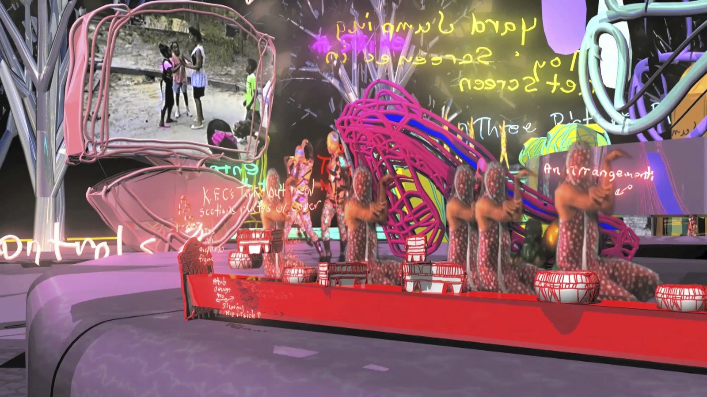
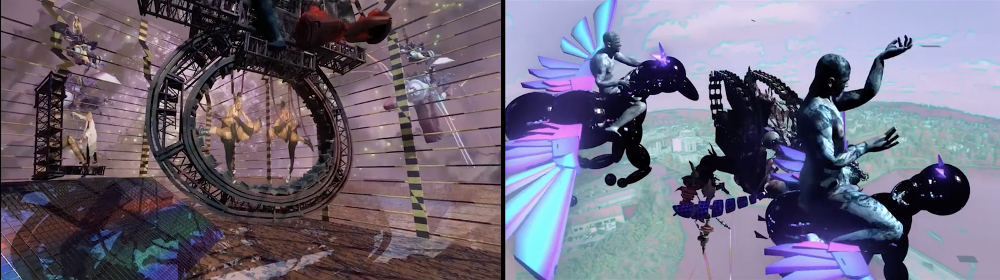
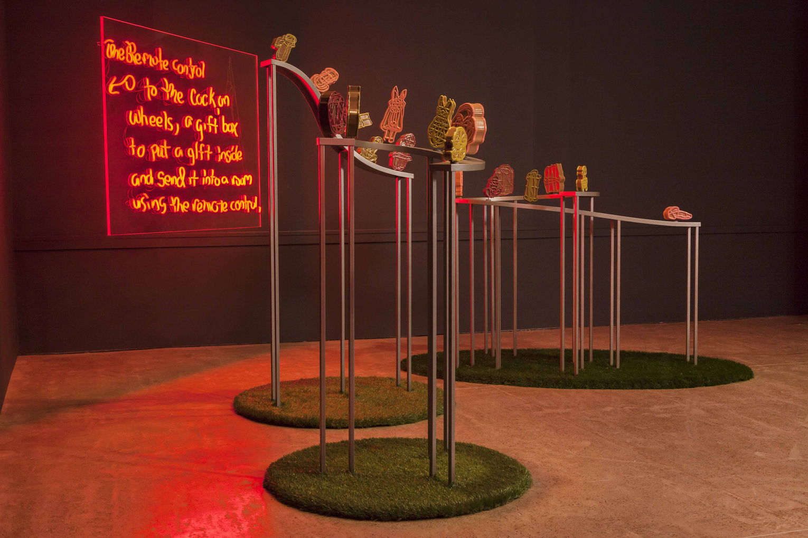
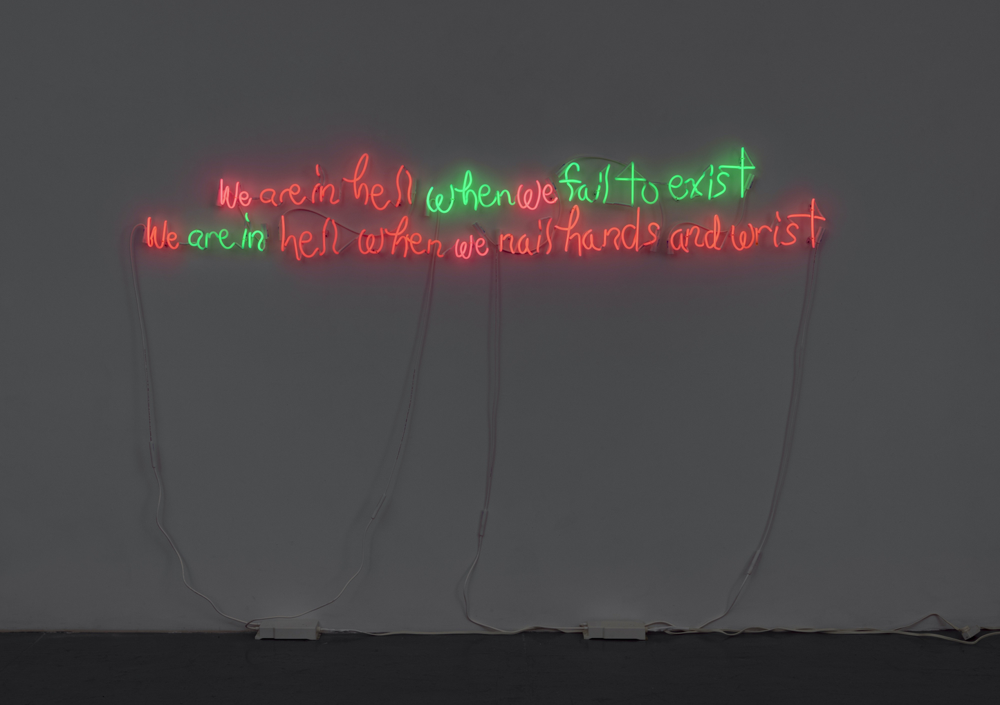
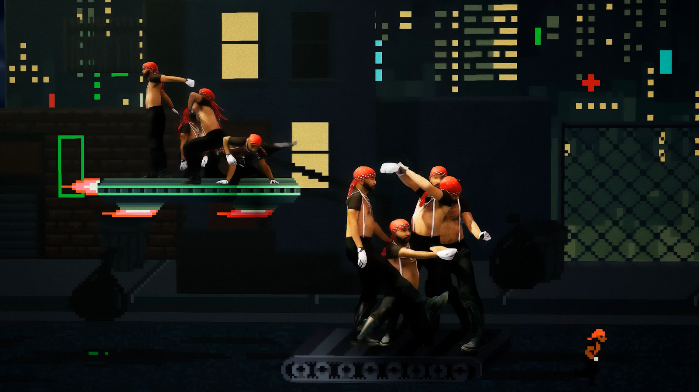

# Jacolby Satterwhite

**Tag tecnica/formato:** `modellazione-3d` `motion-capture` `performance-dal-vivo` `game-engine-realtime`
**Tag tema:** `corpo-identita` `genere-queerness` `memoria-archivio`
**Tag corso:** `AW`
**Stato:** da verificare: la data della morte di Patricia Satterwhite · non risulta nessuna partecipazione alla Biennale di Venezia 2022

## Biografia
Nato nel 1986 a Columbia, South Carolina, dove cresce. Consegue un BFA al Maryland Institute College of Art (MICA) di Baltimora e un MFA alla University of Pennsylvania di Philadelphia. Vive e lavora a Brooklyn, New York. La madre, Patricia Satterwhite, vive con la schizofrenia; nel corso di decenni realizza disegni e schemi di prodotti domestici immaginari (salviette umidificate, zollette di zucchero, spazzolini) e registra centinaia di canzoni a cappella su musicassette — con l'aggravarsi della malattia, i suoi disegni si spostano da rappresentazioni funzionali e realistiche verso gesti più astratti e poetici. Jacolby usa questi disegni come modelli per oggetti modellati in 3D nelle proprie animazioni, e (insieme al musicista Nick Weiss dei Teengirl Fantasy, nel duo "PAT") remixa le registrazioni vocali a cappella della madre in tracce dance elettroniche. Patricia Satterwhite muore nel 2016 (data esatta da verificare). Riconoscimenti: United States Artists Fellowship (2016); artista in residenza allo Studio Museum in Harlem (2020-21). Rappresentato dalla galleria Mitchell-Innes & Nash (New York) dal 2018, e da Morán Morán (Los Angeles).

## Poetica e ricerca
Il metodo centrale di Satterwhite è la performance in motion capture e green screen del proprio corpo (e di amici e collaboratori), spesso attingendo al vocabolario del vogueing e della cultura ballroom, alle arti marziali e alla tecnica del coreografo William Forsythe, trasposta in paesaggi 3D fantastici popolati da avatar — a volte descritti come forme "femme-bot nere". Ha definito lo Spectrum, storico club queer di Brooklyn oggi chiuso, centrale per la cultura ballroom/vogue newyorkese, "il Cedar Tavern della mia generazione" — un'affermazione diretta sulla cultura dei club queer come proprio milieu storico-artistico, in analogia con il celebre bar newyorkese ritrovo degli espressionisti astratti. La critica Eva Díaz, su *Artforum* (2013), osserva come Satterwhite, nel proprio ruolo di artista, riesca a "organizzare e rienergizzare i rituali di produzione di immagini terapeutiche" della madre, invitando il pubblico a un coinvolgimento con una pratica creativa nata come intimamente privata. Il critico Michael Bullock, su *frieze* (2019), descrive i film di Satterwhite come popolati da "paesaggi onirici celesti e a gravità zero" con "corpi intrecciati di attori porno, musicisti e ballerini, come un dipinto di Hieronymus Bosch reso in Final Fantasy", e accosta il suo progetto multimediale (film/scultura/album/merchandise) a un ibrido tra il *Cremaster Cycle* di Matthew Barney (1994-2002) e *Lemonade* di Beyoncé (2016). La galleria Mitchell-Innes & Nash descrive la sua pratica complessiva come concettuale, dedicata a "rituale, fantasia, libertà e costruzione di mondi attraverso installazione immersiva, realtà virtuale e media digitali", sintetizzando illustrazione, performance, pittura, scultura, fotografia e scrittura tramite l'animazione 3D.

## Opere principali
### Reifying Desire, serie (2011-2014, con Reifying Desire 7 – Dawn completata nel 2021-22)
**Descrizione:** ciclo video in più parti costruito da circa 230 versioni modellate in 3D del corpo dell'artista stesso e di oggetti tratti dagli schizzi di prodotti immaginari della madre, resi in uno spazio virtuale come "metanarrazioni collegate" che toccano storia personale, cultura pop, utopia e la "queerizzazione dell'ordinario". Il suo avatar digitale esegue movimenti tratti dal vogueing, dalle arti marziali e dalla coreografia di William Forsythe. Mostrata al Whitney Biennial 2014 come esempio di spazio digitale quale regno "utopico e non-politico" per esplorare memoria e desiderio. Diverse parti della serie sono nelle collezioni permanenti di MoMA e Whitney Museum; *Reifying Desire 7 – Dawn* (2021-22, video a due canali, videogioco e 53 disegni) è nella collezione del MOCA Los Angeles.
**Lettura critica:** la serie fondativa del metodo di Satterwhite — il corpo motion-captured dell'artista e i disegni "inutili" della madre diventano, insieme, il materiale grezzo di un intero universo narrativo personale.
**Video:** [Reifying Desire Three, film integrale (Vimeo)](https://vimeo.com/44403442)

⚠️ Nessuna immagine trovata con attribuzione certa (le immagini disponibili sulla pagina galleria non erano etichettate per opera specifica).

### Country Ball 1989-2012 (2012)
**Descrizione:** video a canale singolo di circa 13 minuti che combina filmati amatoriali reali di un vero barbecue familiare del 1989 in onore di Patricia Satterwhite e delle sue sorelle per la Festa della Mamma, con riprese in green screen della performance dell'artista, replicate in un paesaggio generato al computer ispirato al "Giardino delle delizie" di Hieronymus Bosch e alla cultura ballroom queer. Acquisita dal MoMA nel 2012.
**Lettura critica:** l'opera in cui il metodo di Satterwhite si rivela con più chiarezza — filmato di famiglia reale e mondo virtuale costruito si fondono in un unico piano narrativo, senza gerarchia tra i due registri.

**Approfondimento:** [Mitchell-Innes & Nash — pagina artista](https://www.miandn.com/artists/jacolby-satterwhite)

### Blessed Avenue (2018)
**Descrizione:** video HD a due canali con sonoro, 19:19 minuti (edizione "Jade"), costruito come video musicale per l'album concettuale *Blessed Avenue* dell'artista, che usa frammenti delle registrazioni su cassetta della madre scomparsa. Mostra personale presentata da Gavin Brown's enterprise, Harlem (2018), l'anno in cui Satterwhite entra nella scuderia di Mitchell-Innes & Nash.
**Lettura critica:** recensita da *frieze*, segna il momento in cui il progetto sonoro (l'album) e quello visivo diventano parti indissociabili della stessa opera, non un accompagnamento l'uno dell'altro.

### You're at Home / Room for Living (2019)
**Descrizione:** due mostre personali museali concomitanti — la prima, "Room for Living" al Fabric Workshop and Museum di Philadelphia, la sua prima personale museale in assoluto; la seconda, "You're at Home" a Pioneer Works, Brooklyn, dove debutta il video/installazione "Birds in Paradise" e coincide con l'uscita del suo primo album completo, *Love Will Find a Way Home* (come duo PAT con Nick Weiss), costruito su 155 registrazioni a cappella su cassetta della madre Patricia, mantenendone testi e melodie originali e riambientandole in produzione house elettronica, noise e club decostruito.
**Lettura critica:** *frieze* definisce le due mostre parallele una prova di come le sue animazioni si estendano "oltre lo schermo fino alla scultura, un album dance sperimentale e il merchandise".

### We Are in Hell When We Hurt Each Other (2020)
**Descrizione:** video HD a colori e animazione 3D con sonoro, 24:22 minuti. Avatar femme-bot neri (modellati sul corpo dell'artista in motion capture, vestito digitalmente) danzano vogue attraverso un'Arcadia boschiva; l'opera si chiude con un tributo commemorativo a Breonna Taylor. Mostrata da Mitchell-Innes & Nash, New York (2020) e in seguito al Blaffer Art Museum di Houston.
**Lettura critica:** inserita tra i momenti artistici più significativi del 2020 secondo la copertura del *New York Times* (da verificare direttamente) — l'opera più esplicitamente politica del suo percorso fino a quel momento, con un riferimento diretto e nominato alla violenza razziale contemporanea.
**Da *WORLDBUILDING* (2022):** il video è un concerto virtuale, con musica prodotta con Nick Weiss e la voce a cappella della madre, Patricia Satterwhite, che fa da guida al mondo. Il riferimento a Tiziano rovescia un'immagine storica del corpo nero: non più erotizzato, ma rituale e divino.
**Video:** [estratto (Vimeo)](https://vimeo.com/461561190) · [pagina mostra, Mitchell-Innes & Nash](https://www.miandn.com/exhibitions/jacolby-satterwhite)

**Approfondimento:** [Mitchell-Innes & Nash — We Are in Hell When We Hurt Each Other](https://www.miandn.com/exhibitions/jacolby-satterwhite)

### A Metta Prayer — The Great Hall Commission (2023-24, Metropolitan Museum of Art, New York)
**Descrizione:** commissione video immersiva a 6 canali per la Great Hall del Met (in mostra ottobre 2023-gennaio 2024), ispirata alla preghiera buddista metta ("gentilezza amorevole"). Fonde coreografia, video, animazione, illuminazione e musica in un mondo generato al computer che incorpora rese 3D di oltre 100 oggetti della collezione permanente del museo (tra cui figure in terracotta e una maschera Noh) insieme a sequenze dal vivo. In tournée al Museum of Fine Arts, Houston (maggio-ottobre 2024).
**Lettura critica:** la commissione più istituzionalmente prestigiosa della carriera dell'artista fino a quel momento — mette il suo metodo di "citazione digitale" al servizio diretto della collezione di uno dei più grandi musei enciclopedici al mondo, invece che della propria biografia personale.
**Video:** [intervista all'artista sulla commissione (Met Museum, YouTube)](https://www.youtube.com/watch?v=1OEsz3ByhMc)

**Approfondimento:** [metmuseum.org — A Metta Prayer](https://www.metmuseum.org/exhibitions/jacolby-satterwhite)

### 60ª Biennale di Venezia, "Foreigners Everywhere" (2024)
**Descrizione:** Satterwhite è tra i 331 artisti confermati nella mostra internazionale principale, a cura di Adriano Pedrosa (20 aprile-24 novembre 2024).
**Lettura critica:** ⚠️ non è stato possibile verificare quale opera specifica sia stata presentata né la sede esatta (Padiglione Centrale ai Giardini o Arsenale) — da confermare prima di descriverla in dettaglio in classe.

## Interviste e talk
- _Nessuna ancora: da aggiungere._

## Fonti
- [Mitchell-Innes & Nash — pagina artista](https://www.miandn.com/artists/jacolby-satterwhite)
- [MoMA — profilo artista](https://www.moma.org/artists/49586)
- [Whitney Museum — Biennial 2014, Jacolby Satterwhite](https://whitney.org/exhibitions/2014-biennial/jacolby-satterwhite)
- [The Metropolitan Museum of Art — A Metta Prayer](https://www.metmuseum.org/exhibitions/jacolby-satterwhite)
- [Fabric Workshop and Museum — Room for Living](https://fabricworkshopandmuseum.org/exhibition/jacolby-satterwhite-room-for-living/)
- [Pioneer Works — You're at Home](https://pioneerworks.org/exhibitions/jacolby-satterwhite-youre-at-home)
- [frieze — "Jacolby Satterwhite's Celestial, Zero-Gravity Dreamscapes"](https://www.frieze.com/article/jacolby-satterwhites-celestial-zero-gravity-dreamscapes)
- [Electronic Arts Intermix — biografia](https://www.eai.org/artists/jacolby-satterwhite/biography)
- [Miller Institute for Contemporary Art, Carnegie Mellon — "Spirits Roaming on the Earth"](https://miller-ica.cmu.edu/exhibitions/jacolby-satterwhite-spirits-roam-the-earth)
- [Document Journal — sull'eredità artistica della madre](https://www.documentjournal.com/2019/12/jacolby-satterwhites-unwavering-mission-to-honor-his-mothers-artistic-legacy/)
- *WORLDBUILDING: Gaming and Art in the Digital Age*, booklet della mostra, Julia Stoschek Collection, Düsseldorf, 2022 (testo di Sasha Bonét)

## Crediti delle immagini
Immagine per cinque delle sei opere/mostre, incluse sotto la relativa descrizione in "Opere principali", da Mitchell-Innes & Nash. *Reifying Desire* resta senza immagine con attribuzione certa.
- [MoMA — profilo artista](https://www.moma.org/artists/49586)
- [Whitney Museum — Biennial 2014, Jacolby Satterwhite](https://whitney.org/exhibitions/2014-biennial/jacolby-satterwhite)
