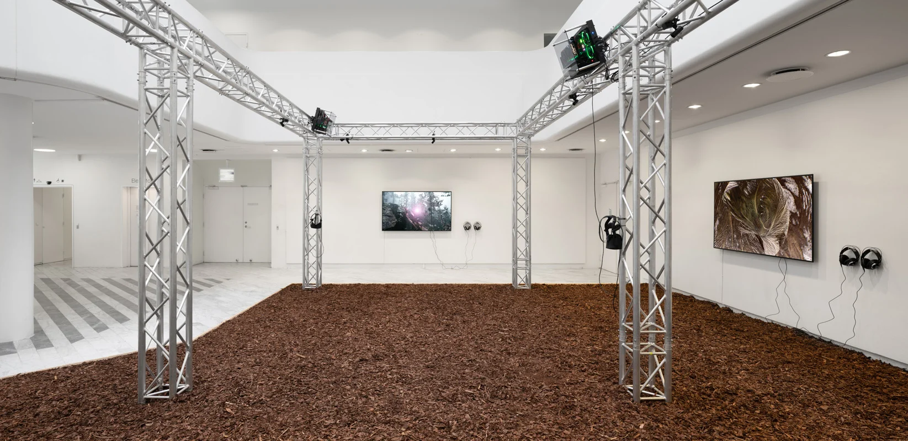
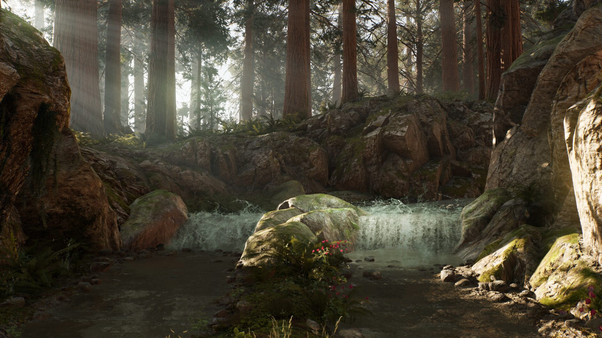
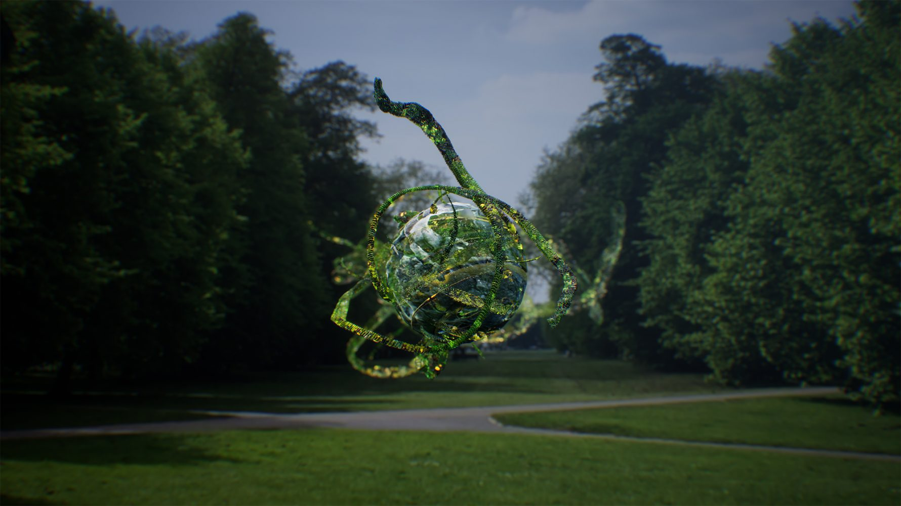
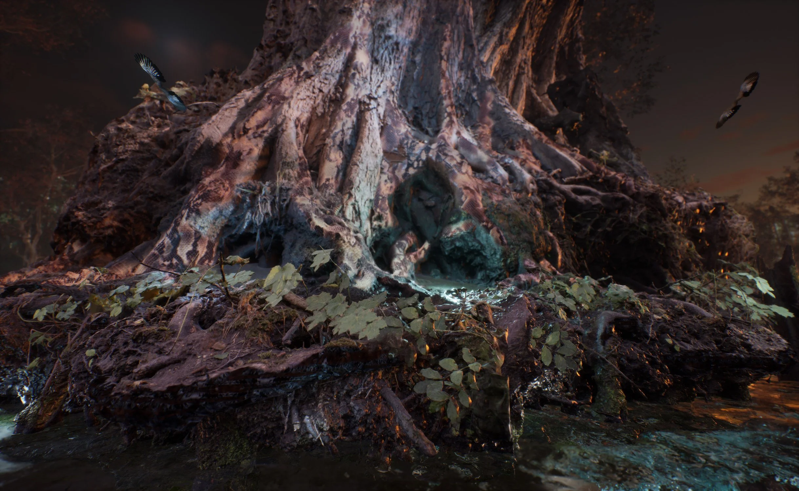
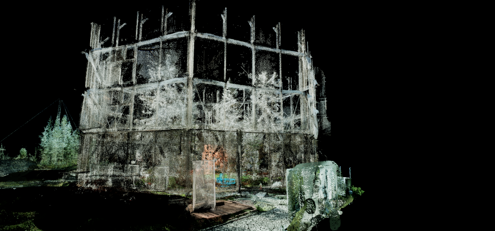

# Jakob Kudsk Steensen

**Tag tecnica/formato:** `modellazione-3d` `vr-ar` `game-engine-realtime`
**Tag tema:** `ecologia-ambiente` `mondi-virtuali-simulazione` `memoria-archivio`
**Tag corso:** `AW`
**Stato:** anno di nascita: alcune fonti riportano 1988, la più solida 1987

## Biografia
Nato nel 1987 a Køge, in Danimarca. Studia inizialmente pittura all'Università di Aarhus, poi si sposta verso l'arte e i nuovi media, con un anno di studi in antropologia; consegue un BA in Art and New Media ad Aarhus (2012), passa un anno alla Central Saint Martins di Londra per un MFA in Fine Art (2013), e torna a Copenhagen per completare un MA in Storia dell'Arte all'Università di Copenhagen (2014). Vive per circa sei anni a New York, poi si trasferisce a Berlino nel 2019, dove ha uno studio nel programma di residenza Callie's; oggi risulta con base tra Berlino e New York. Riconoscimenti: shortlist al Future Generation Art Prize 2019 (presentazione a Kyiv e alla Biennale di Venezia); finalista al Lumen Prize for Art and Technology (2017); premio per la miglior grafica VR al Cinequest Film & Creativity Festival (2019); Prix du Jury alle Rencontres d'Arles per *Re-Animated*; sostegno di Danish Arts Foundation, Augustinus Foundation e New Carlsberg Foundation. Non risulta rappresentato da una galleria commerciale primaria: la sua carriera si sviluppa soprattutto attraverso commissioni istituzionali (Serpentine, LAS Art Foundation, Fondation Beyeler, Fondation Louis Vuitton, PHI Foundation Montréal, Times Square Arts).

## Poetica e ricerca
Steensen costruisce quella che la critica definisce "natura digitale" — ecosistemi immersivi realizzati con motori di gioco (principalmente Unreal Engine), che fondono ricerca sul campo, dati biologici, registrazioni sonore spaziali e scansione 3D/fotogrammetria in paesaggi virtuali speculativi e spesso generativi, per affrontare ecologia, estinzione, tempo profondo e paesaggio simulato come memoria ecologica. L'artista definisce il proprio metodo "slow media" — usare la tecnologia digitale e un lavoro sul campo di lunga durata per richiamare l'attenzione sul mondo naturale e costruire nuove narrazioni di futuri ecologici. Per *Re-Animated* la ricerca comincia all'American Museum of Natural History di New York, che conserva esemplari ottocenteschi dell'ʻōʻō di Kauaʻi; per *Berl-Berl*, due settimane di fotogrammetria macro sul campo in canoa nella riserva della biosfera dello Spreewald (Brandeburgo), fino a 2.000 foto per singolo oggetto; per *Boreal Dreams*, ricerca condotta al Marcell Experimental Forest (Minnesota), dove gli scienziati simulano condizioni di riscaldamento globale su ecosistemi boreali. Hans Ulrich Obrist (direttore artistico della Serpentine) ha dialogato direttamente con lui per il numero 39 di *CURA* magazine, "Are We Eternal Beings?", dedicato a vita, morte, estinzione e immortalità — un ancoraggio critico importante per la sua ricerca su memoria ecologica e tempo profondo. Un saggio accademico sulla rivista curatoriale peer-reviewed *On-Curating* (numero 63) analizza *Berl-Berl* e *Boreal Dreams* attraverso la lente di "mondi virtuali ed ecologia digitale nel complesso espositivo di internet", discutendo come il suo lavoro fonda estetica del videogioco/simulazione e narrazione ecologica.

## Opere principali
### Re-Animated (2017-2019)
**Descrizione:** installazione multimediale VR/video che ricostruisce l'ʻōʻō di Kauaʻi, uccello hawaiano estinto, e il suo habitat, a partire da una ricerca iniziata all'American Museum of Natural History di New York. Il vero richiamo di accoppiamento dell'uccello — registrato dell'ultimo maschio vivente, circolato su YouTube prima dell'estinzione funzionale della specie, coincidente con l'anno di nascita dell'artista — è il detonatore emotivo e concettuale dell'opera: l'installazione permette di entrare in un'isola simulata di Kauaʻi dove flora e fauna crescono ed evolvono algoritmicamente, con una partitura generativa di Michael Riesman (direttore musicale del Philip Glass Ensemble). Formato: VR e due video 4K, fogliame scansionato in 3D, hardware personalizzato, luce LED. Vince il premio per la miglior grafica VR al Cinequest 2019 e il Prix du Jury alle Rencontres d'Arles; presentato come parte della shortlist del Future Generation Art Prize 2019 (Kyiv/Venezia).
**Lettura critica:** un lavoro che usa la tecnologia di simulazione non per costruire un futuro speculativo ma per riportare in vita, letteralmente in forma sonora e visiva, una specie già persa — la simulazione come atto di lutto e di memoria, non di fuga.

**Approfondimento:** [jakobsteensen.com — Re-Animated](http://www.jakobsteensen.com/re-animated)

### Catharsis (2018/2020)
**Descrizione:** installazione immersiva su grande scala che simula una foresta primaria indisturbata, costruita con texture 3D e audio spaziale raccolti sul campo in foreste nordamericane, sviluppata con il collaboratore principale Matt McCorkle. Presentata come un unico piano sequenza continuo che si muove dalle radici sotterranee fino alla chioma degli alberi. Commissionata originariamente dal PinchukArtCentre di Kyiv; mostrata alle Serpentine Galleries (Serpentine North) nel gennaio 2020 come parte di Connect, BTS — il progetto di arte pubblica globale promosso dalla band BTS.
**Lettura critica:** l'unico piano sequenza continuo, dalle radici alla chioma, mette in scena visivamente l'idea di un ecosistema come sistema unico e ininterrotto, non come somma di elementi separati.

**Approfondimento:** [Serpentine Galleries — Catharsis](https://www.serpentinegalleries.org/whats-on/jakob-kudsk-steensen-catharsis/)

### The Deep Listener (2019)
**Descrizione:** installazione AR site-specific e app, prima commissione di Serpentine Augmented Architecture, realizzata in collaborazione con Google Arts & Culture e l'architetto Sir David Adjaye. Guida i visitatori attraverso Kensington Gardens e Hyde Park (Londra) per vedere/ascoltare cinque specie del parco — platani londinesi, pipistrelli, parrocchetti dal collare, damigelle azzurre e canneti — affrontando estinzione, conservazione ed eredità ecologica sovrapposte all'infrastruttura reale del parco.
**Lettura critica:** sposta il lavoro di Steensen dallo schermo/visore all'aumento diretto di uno spazio pubblico reale — l'ecologia digitale qui non sostituisce ma si sovrappone all'ecologia fisica esistente.
**Video:** [The Deep Listener, documentazione (Vimeo)](https://vimeo.com/394495876)

**Approfondimento:** [Serpentine Galleries — The Deep Listener](https://www.serpentinegalleries.org/whats-on/jakob-kudsk-steensen-the-deep-listener/)

### Berl-Berl (2021)
**Descrizione:** grande installazione multischermo su due piani della Halle am Berghain di Berlino, commissionata da LAS Art Foundation. Simula le paludi preistoriche del Brandeburgo, unendo paesaggi "perduti" scansionati in 3D a riprese fresche dello Spreewald. Il titolo cita "Berl", antica parola slava per palude, proposta come radice etimologica di "Berlino" (una zona umida prosciugata nel Settecento). Paesaggio sonoro site-specific realizzato con il musicista Arca, il sound artist Matt McCorkle e il sound designer Lugh O'Neill.
**Lettura critica:** collega la storia geologica sommersa di una città (la palude sotto Berlino) alla sua identità contemporanea, usando il clubbing/Berghain — luogo di culto della cultura techno berlinese — come cassa di risonanza inattesa per una narrazione di deep time ecologico.
**Video:** [Berl-Berl, documentazione (YouTube)](https://www.youtube.com/watch?v=85I0bjm9lU0) · [Berl-Berl, video alternativo/making-of (YouTube, da 4:07)](https://www.youtube.com/watch?v=GivWvCUbH70&list=PLQjV1I6Kfcoc69Id2vi7iWmp5DpApU_5E&index=2&t=247s)

**Approfondimento:** [jakobsteensen.com — Berl-Berl](http://www.jakobsteensen.com/berlberl)

### Boreal Dreams (2025)
**Descrizione:** commissionata dalla Fondation Beyeler (Basilea/Riehen) come controparte contemporanea della mostra "Northern Lights" del museo, allestita nel giardino di sculture dell'edificio progettato da Renzo Piano. Simulazione dal vivo, suono spazializzato e componente interattiva online, che esplora come il cambiamento climatico influenzi il bioma boreale e, per estensione, il sogno e la coscienza; basata su ricerca condotta al Marcell Experimental Forest (Minnesota).
**Lettura critica:** l'opera più recente porta la ricerca ecologica di Steensen dalla documentazione di ecosistemi esistenti alla proiezione diretta dei loro possibili futuri sotto il cambiamento climatico.

**Approfondimento:** [jakobsteensen.com — Boreal Dreams](http://www.jakobsteensen.com/boreal-dreams)

## Interviste e talk
- [CURA magazine — conversazione con Hans Ulrich Obrist](https://curamagazine.com/digital/jakob-kudsk-steensen/)

## Fonti
- [jakobsteensen.com — sito ufficiale](http://www.jakobsteensen.com/about)
- [Serpentine Galleries — Catharsis](https://www.serpentinegalleries.org/whats-on/jakob-kudsk-steensen-catharsis/)
- [Serpentine Galleries — The Deep Listener](https://www.serpentinegalleries.org/whats-on/jakob-kudsk-steensen-the-deep-listener/)
- [LAS Art Foundation — Berl-Berl](https://www.las-art.foundation/programme/jakob-kudsk-steensen)
- [Kadist — Re-Animated](https://kadist.org/work/re-animated/)
- [Rhizome — profilo artista](https://rhizome.org/editorial/2018/dec/14/artist-profile-jakob-kudsk-steensen/)
- [On-Curating (n. 63) — saggio accademico su Berl-Berl e Boreal Dreams](https://www.on-curating.org/issues/issue-63/issue-63-reader/virtual-worlds-and-digital-ecology-in-the-exhibitionary-internet-complex-jakob-kudsk-steensen-s-berl-berl-and-boreal-dreams.html)
- [Fondation Louis Vuitton — Open Space #17, The Song Trapper](https://www.fondationlouisvuitton.fr/en/events/open-space-17-jakob-kudsk-steensen-the-song-trapper)
- [berlberl.world — esperienza online di *Berl-Berl*](https://berlberl.world/experience)

## Crediti delle immagini
Immagine e link di approfondimento per ciascuna delle cinque opere, inclusi sotto la relativa descrizione in "Opere principali", dal sito ufficiale [jakobsteensen.com](http://www.jakobsteensen.com) e da Serpentine Galleries.
