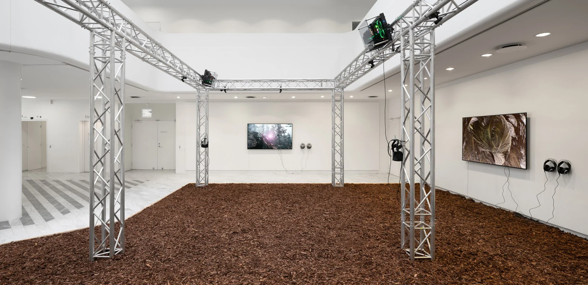
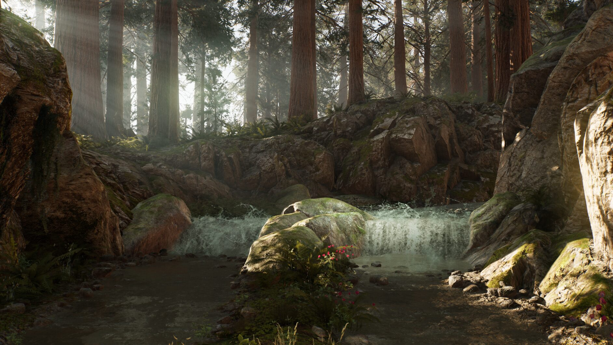
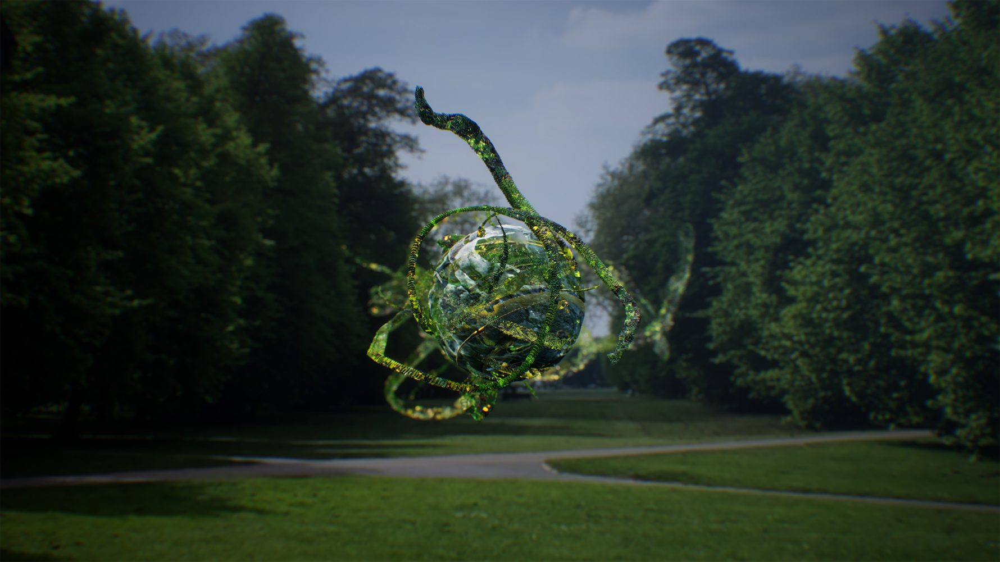
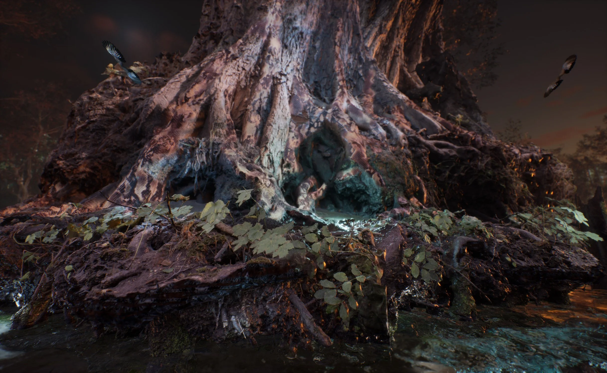
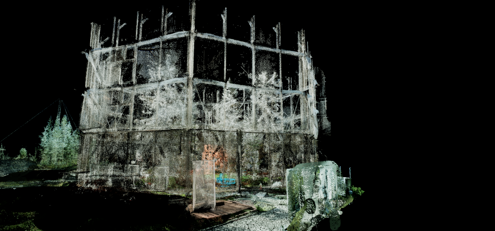

# Jakob Kudsk Steensen

**Tag tecnica/formato:** `modellazione-3d` `vr-ar` `game-engine-realtime`
**Tag tema:** `ecologia-ambiente` `mondi-virtuali-simulazione` `memoria-archivio`
**Tag corso:** `AW`
**Stato:** scheda avanzata · da aggiungere: *Liminal Lands* (LUMA Arles, 2021), *The Ephemeral Lake* (2024), *The Song Trapper* (Fondation Louis Vuitton, 2025-26), *Psychosphere* (2025)

## Biografia
Nato nel 1987 a Køge, in Danimarca.[^1] Si forma all'Università di Aarhus (BA in Art and New Media, 2009-2012), alla Central Saint Martins di Londra (MFA, PG-cert, 2012-2013) e all'Università di Copenaghen (MA Art, 2012-2014).[^2] Prima di dedicarsi all'arte ha lavorato per diversi anni nell'industria dei videogiochi.[^6] Nel 2020 la Serpentine lo presenta come artista con base a New York;[^4] il booklet della mostra *WORLDBUILDING* (2022) lo dice residente a Berlino,[^8] e nel 2025 Hauke Ohls indica Berlino come sua residenza precedente.[^11] Tra i riconoscimenti: Lumiere Award per la migliore installazione VR (2017), Webby Award People's Choice VR e Games for Change Award (2018), finalista del Future Generation Art Prize, Prix du Jury alle Rencontres d'Arles e premio per la grafica VR al Cinequest per *Re-Animated* (2019), menzione d'onore ad Ars Electronica (2021).[^2] Le sue opere sono nelle collezioni di Fondation Louis Vuitton, LUMA Foundation, KADIST, LAS Art Foundation, ARKEN, ARoS e SMK.[^3] La sua carriera procede soprattutto per commissioni di istituzioni: Serpentine, LAS Art Foundation, LUMA Arles, Fondation Beyeler, Fondation Louis Vuitton e, nel 2026-27, il Museum of Modern Art di New York con la mostra *Wetland*.[^2][^3]

## Poetica e ricerca
Steensen si definisce un artista che lavora con la narrazione ambientale attraverso la costruzione di mondi virtuali, i videogiochi, il suono spaziale e le grandi installazioni. I suoi soggetti sono fenomeni naturali trascurati: paesaggi vulcanici sottomarini, laghi temporanei del deserto, paludi dimenticate, canti di uccelli estinti conservati negli archivi di storia naturale. Al centro c'è il modo in cui il cambiamento climatico altera i corpi, la mente e la memoria collettiva.[^3] Il metodo parte da lunghi periodi di lavoro sul campo, spesso con biologi, compositori e filosofi: la filosofa ambientale Melanie Challenger, la musicista Arca, l'ornitologo Douglas H. Pratt, Michael Riesman, direttore musicale del Philip Glass Ensemble, il Cornell Lab of Ornithology e il Museum für Naturkunde di Berlino.[^3] Il materiale raccolto (scansioni 3D, fotogrammetria, registrazioni sonore) viene trasformato in mondi costruiti con Unreal Engine, il motore di videogiochi che è una costante del suo lavoro.[^1] La Serpentine riprende l'espressione con cui l'artista descrive la propria pratica, *slow media*: una tecnologia digitale usata per favorire l'attenzione verso il mondo naturale invece che la distrazione.[^4][^5]

Nella conversazione con Hans Ulrich Obrist su *CURA* (2022-23), Steensen indica tre aspetti del videogioco che gli interessano: la narrazione ambientale, che permette di costruire ricordi di luoghi unici e di aprire piccoli «portali» su regioni dimenticate; il gioco come orchestra, in cui scienziati e scrittori portano prospettive diverse; la possibilità di fondere tracce del mondo prese a scale temporali diverse, come in *Re-Animated*, dove il canto di un uccello vivo si unisce a quello registrato decenni prima.[^6]

## Opere principali
### Re-Animated (2018)
**Descrizione:** opera video e VR sull'ʻōʻō di Kauaʻi, uccello hawaiano la cui specie si estingue con la morte dell'ultimo esemplare nel 1987, l'anno di nascita dell'artista. Il canto di accoppiamento di quell'esemplare, registrato nel 1975 e digitalizzato in un laboratorio di ornitologia di New York, viene caricato su YouTube nel 2009 e ascoltato da allora più di mezzo milione di volte: *Re-Animated* nasce come risposta a quel richiamo rivolto a una compagna che non c'era più.[^7][^8] Per la ricerca l'American Museum of Natural History ha concesso all'artista l'accesso ai suoi archivi riservati, dove ha fotografato esemplari conservati raccolti alla fine dell'Ottocento; l'ornitologo Douglas H. Pratt è stato intervistato sui suoi ricordi dell'uccello, e parti delle interviste sono nell'audio dell'opera. Nel mondo virtuale, una ricostruzione distorta dell'habitat originario, flora e fauna scansionate in 3D sono programmate con algoritmi per colonizzare l'isola; la musica algoritmica è di Michael Riesman. Nella versione VR piante, muschi e insetti reagiscono alla musica generata in tempo reale e alla voce e al respiro di chi indossa il visore, raccolti da un microfono.[^7] Esistono un'edizione cinematografica 2D e tre video 4K (*Arrival*, *Mating Call*, *Bug Zapper*). Presentata in mostra personale al centro d'arte Tranen in Danimarca (2018-2019), poi alla mostra del Future Generation Art Prize al PinchukArtCentre di Kyiv e alla Biennale di Venezia (2019).[^7][^2]
**Lettura critica:** il curatore Toke Lykkeberg, nel testo per la mostra a Tranen poi ripreso nel booklet di *WORLDBUILDING*, presenta l'artista come un «giardiniere digitale» e legge l'opera come una meditazione sulla traiettoria tecno-scientifica: il controllo dell'uomo sulla natura ha avviato processi che non controlla più, e il paesaggio virtuale è insieme sogno e incubo, ecosistema e laboratorio biotecnologico per un uccello resuscitato in scala mostruosa.[^7] Nel booklet Lykkeberg intende l'animazione come ri-animazione, cioè come dare vita a materia morta, e legge Kauaʻi come un microcosmo dell'estinzione di massa, a partire dall'arrivo del capitano James Cook nel 1778, con le malattie e le specie invasive portate dai nuovi arrivati.[^8]

**Approfondimento:** [jakobsteensen.com — Re-Animated](http://www.jakobsteensen.com/re-animated)

### Catharsis (2018/2020)
**Descrizione:** simulazione di una foresta primaria, sviluppata indisturbata per centinaia di anni, costruita con texture 3D e suoni raccolti in diverse foreste nordamericane durante il lavoro sul campo con il collaboratore principale Matt McCorkle. L'opera è un unico piano sequenza continuo che sale dalle radici sommerse fino alla vista dalla chioma degli alberi. La prima versione è una commissione del PinchukArtCentre di Kyiv; la Serpentine l'ha presentata online dal 14 gennaio al 31 maggio 2020 nell'ambito di *Connect, BTS*, il progetto di arte pubblica in cinque città promosso dal gruppo sudcoreano BTS.[^4] Nella conversazione con Obrist l'artista precisa che il piano sequenza è solo apparente: ogni elemento della foresta (tempo atmosferico, vento, acqua, pioggia, sole) scorre a una velocità diversa.[^6]

**Approfondimento:** [Serpentine Galleries — Catharsis](https://www.serpentinegalleries.org/whats-on/jakob-kudsk-steensen-catharsis/)

### The Deep Listener (2019)
**Descrizione:** opera in realtà aumentata e audio spaziale, scaricabile come app, che guida attraverso Kensington Gardens e Hyde Park a Londra per vedere e ascoltare cinque specie del parco: platani londinesi, pipistrelli, parrocchetti, damigelle azzurre e canneti. È la prima commissione del programma Serpentine Augmented Architecture, in collaborazione con Google Arts & Culture e l'architetto David Adjaye, scelta tramite un bando internazionale lanciato nel febbraio 2019. Suoni e immagini vengono da materiale organico raccolto nel parco durante un periodo di ricerca e poi rielaborato digitalmente, con il sound designer Matt McCorkle. Al centro c'è il platano, ibrido di due specie di continenti diversi, che l'artista chiama una forma precoce di «bio-architettura»: la corteccia assorbe gli inquinanti e diventa un archivio di particelle che lega i corpi umani alle specie del parco.[^5][^4]

**Video:** [The Deep Listener, documentazione (Vimeo)](https://vimeo.com/394495876)

**Approfondimento:** [Serpentine Galleries — The Deep Listener](https://www.serpentinegalleries.org/whats-on/jakob-kudsk-steensen-the-deep-listener/)

### Berl-Berl (2021 - in corso)
**Descrizione:** simulazione dal vivo di una palude virtuale, commissionata da LAS Art Foundation, curata da Emma Enderby e presentata alla Halle am Berghain di Berlino dal 10 luglio al 26 settembre 2021.[^1][^9] Il titolo viene da *Berl*, antica parola slava per «palude», ritenuta l'origine del nome di Berlino, città sorta su una zona umida formata da una valle glaciale più di diecimila anni fa e prosciugata nel Settecento.[^1] L'artista ha passato mesi a fotografare le zone umide rimaste nel Brandeburgo con la macrofotogrammetria, centinaia di immagini per un singolo oggetto come una foglia o una zolla di fango; dal Museum für Naturkunde vengono esemplari dell'archivio e i richiami delle rane. Il paesaggio sonoro è di Matt McCorkle e della cantante Arca, la cui voce si fonde con i suoni degli anfibi. Nella narrazione entra il folklore sorabo: Triglav, divinità a tre teste che rappresenta cielo, terra e mondo sotterraneo, compare come un grande albero.[^1] Alla Halle am Berghain l'opera era distribuita su una serie di grandi schermi disposti su più livelli, con un'installazione sonora e in parte un pavimento nero riflettente.[^11] Esiste anche come mondo online, ed è stata poi presentata ad ARoS (Aarhus, 2022, *Berl-Berl: The Singing Swamp*), alla 15ª Biennale di Gwangju (2024), da The Window/Chanel a Londra, al Museum für Gestaltung di Zurigo e al MoMA di New York (2026-27).[^1][^2]

**Video:** [Berl-Berl, documentazione (YouTube)](https://www.youtube.com/watch?v=85I0bjm9lU0) · [Berl-Berl, video alternativo/making-of (YouTube, da 4:07)](https://www.youtube.com/watch?v=GivWvCUbH70&list=PLQjV1I6Kfcoc69Id2vi7iWmp5DpApU_5E&index=2&t=247s)

**Approfondimento:** [jakobsteensen.com — Berl-Berl](http://www.jakobsteensen.com/berlberl)

### Boreal Dreams (2025)
**Descrizione:** simulazione dal vivo con suono spazializzato ed esperienza interattiva online, commissionata dalla Fondation Beyeler come controparte contemporanea della mostra *Northern Lights* (26 gennaio - 25 maggio 2025), dedicata alla pittura di paesaggio scandinava e canadese tra il 1888 e il 1937.[^10] La ricerca si è svolta alla Marcell Experimental Forest, nel nord del Minnesota, dove gli scienziati simulano il riscaldamento climatico su porzioni di foresta boreale chiuse in strutture ottagonali di vetro; i collaboratori sono Matt McCorkle per il suono e lo studioso dei sogni Adam Haar Horowitz per i testi.[^10][^11] L'opera ha cinque capitoli, ciascuno a un diverso grado di riscaldamento: dalla foresta boreale a +0 °C all'esperimento di Marcell (+2,5 °C), alla cronobiologia (+4,5 °C), all'«architettura circadiana» (+6,5 °C), dove la luce blu degli schermi altera il sonno, fino a +9 °C, quando la foresta scomparsa si può visitare solo in sogno. Alla Beyeler l'opera era all'aperto, nel parco, su schermi LED a doppia faccia, con un paesaggio sonoro diffuso tra le chiome degli alberi; nel giugno 2025 è stata presentata al Tribeca Festival di New York.[^10]

**Approfondimento:** [jakobsteensen.com — Boreal Dreams](http://www.jakobsteensen.com/boreal-dreams)

## Approfondimenti

### Parole dell'artista
- Sull'intelligenza artificiale: i sistemi di apprendimento automatico applicano una logica prescritta; in *Liminal Lands* l'artista ha scansionato una grotta glaciale muovendo il proprio corpo con le fotocamere, inserendo così nel processo un ritmo fisico estraneo al sistema.[^6]
- Sui videogiochi: sono strumenti per «ridistribuire la sensibilità» verso l'ambiente, e la loro potenzialità è sottovalutata; tra i giochi commerciali cita *Death Stranding* come esempio di una sensibilità diversa. Scrivere resta per lui lo strumento virtuale più potente, e tra i riferimenti indica i romanzi di China Miéville, Jeff VanderMeer e N. K. Jemisin.[^6]
- Sull'estinzione: *Re-Animated* nasce in un'epoca di progetti di «de-estinzione» mossi dall'ansia per il declino della natura, ma per l'artista riguarda soprattutto l'accettazione delle vite che scompaiono.[^6]

### Letture critiche e concetti
- **Hauke Ohls, *On-Curating* n. 63.** Lo storico dell'arte dell'Università di Bonn confronta *Berl-Berl* e *Boreal Dreams* con *Scorched Earth* (2022) di Jonathan Crary, che descrive Internet come un «complesso» distruttivo per la comunità, l'ecologia e la creatività. Per Ohls le due opere mostrano il contrario: esistono solo grazie alle tecnologie della rete e permettono di percepire processi ecologici altrimenti inaccessibili, a livello molecolare o fuori dallo spettro dell'udito umano. Un tratto formale decisivo è l'inclusione, nell'immagine finale, delle fasi intermedie della fotogrammetria (nuvola di punti rada, nuvola densa, maglia poligonale, texture), che fa apparire la palude come una nube di punti colorati. Ohls riconosce il paradosso di opere ecologiche che consumano energia e infrastrutture, discusso almeno dalla critica a *Ice Watch* di Olafur Eliasson del 2014, e legge le temporalità intrecciate delle due opere con *A Thousand Years of Nonlinear History* (1997) di Manuel DeLanda e l'immersione con Felix Stalder. Il capitolo +6,5 °C di *Boreal Dreams*, con gli schermi che impediscono il sonno, richiama secondo Ohls la tesi di Crary in *24/7* sul sonno come ultima frontiera colonizzata dal capitalismo.[^11]
- **Toke Lykkeberg, testo per *Re-Animated* (Tranen, 2018) e booklet di *WORLDBUILDING* (Julia Stoschek Collection, 2022).** L'animazione come ri-animazione di materia morta; l'artista come «giardiniere digitale»; il paesaggio simulato come eco dei modelli con cui i climatologi prevedono gli scenari futuri.[^7][^8]

## Interviste e talk
- [CURA. 39, «Are We Eternal Beings?» — conversazione con Hans Ulrich Obrist (autunno-inverno 2022-23)](https://curamagazine.com/digital/jakob-kudsk-steensen/)

## Fonti
- [jakobsteensen.com — About](http://www.jakobsteensen.com/about) e CV (settembre 2026)
- [Serpentine Galleries — Catharsis](https://www.serpentinegalleries.org/whats-on/jakob-kudsk-steensen-catharsis/)
- [Serpentine Galleries — The Deep Listener](https://www.serpentinegalleries.org/whats-on/jakob-kudsk-steensen-the-deep-listener/)
- [LAS Art Foundation — Berl-Berl](https://www.las-art.foundation/programme/jakob-kudsk-steensen)
- [Hauke Ohls, On-Curating n. 63 — saggio su Berl-Berl e Boreal Dreams](https://www.on-curating.org/issues/issue-63/issue-63-reader/virtual-worlds-and-digital-ecology-in-the-exhibitionary-internet-complex-jakob-kudsk-steensen-s-berl-berl-and-boreal-dreams.html)
- [Fondation Louis Vuitton — Open Space #17, The Song Trapper](https://www.fondationlouisvuitton.fr/en/events/open-space-17-jakob-kudsk-steensen-the-song-trapper)
- [berlberl.world — esperienza online di *Berl-Berl*](https://berlberl.world/experience)
- [borealdreams.live — esperienza online di *Boreal Dreams*](https://borealdreams.live/)
- [Kadist — Re-Animated](https://kadist.org/work/re-animated/)
- [Rhizome — profilo artista (2018)](https://rhizome.org/editorial/2018/dec/14/artist-profile-jakob-kudsk-steensen/)
- *WORLDBUILDING: Gaming and Art in the Digital Age*, booklet della mostra, Julia Stoschek Collection, Düsseldorf, 2022 (testo di Toke Lykkeberg)

## Crediti delle immagini
Immagine e link di approfondimento per ciascuna delle cinque opere, inclusi sotto la relativa descrizione in "Opere principali", dal sito ufficiale [jakobsteensen.com](http://www.jakobsteensen.com) e da Serpentine Galleries.

[^1]: LAS Art Foundation, «Jakob Kudsk Steensen: Berl-Berl», pagina del progetto. [link](https://www.las-art.foundation/programme/jakob-kudsk-steensen)

[^2]: Jakob Kudsk Steensen, curriculum, settembre 2026, collegato dalla pagina «About» del sito dell'artista. [link](http://www.jakobsteensen.com/about)

[^3]: Jakob Kudsk Steensen, «About», sito dell'artista. [link](http://www.jakobsteensen.com/about)

[^4]: Serpentine Galleries, «Jakob Kudsk Steensen: Catharsis», 2020. [link](https://www.serpentinegalleries.org/whats-on/jakob-kudsk-steensen-catharsis/)

[^5]: Serpentine Galleries, «Jakob Kudsk Steensen: The Deep Listener». [link](https://www.serpentinegalleries.org/whats-on/jakob-kudsk-steensen-the-deep-listener/)

[^6]: Hans Ulrich Obrist, «Jakob Kudsk Steensen in conversation with Hans Ulrich Obrist», *CURA.* 39, autunno-inverno 2022-23. [link](https://curamagazine.com/digital/jakob-kudsk-steensen/)

[^7]: Jakob Kudsk Steensen, «Re-Animated», sito dell'artista, con il testo del curatore Toke Lykkeberg per la mostra a Tranen. [link](http://www.jakobsteensen.com/re-animated)

[^8]: Toke Lykkeberg, «Jakob Kudsk Steensen», in *WORLDBUILDING: Gaming and Art in the Digital Age*, booklet della mostra, Julia Stoschek Collection, Düsseldorf, 2022, p. 21.

[^9]: Jakob Kudsk Steensen, «Berl-Berl», sito dell'artista, con il testo della curatrice Emma Enderby. [link](http://www.jakobsteensen.com/berlberl)

[^10]: Jakob Kudsk Steensen, «Boreal Dreams», sito dell'artista. [link](http://www.jakobsteensen.com/boreal-dreams)

[^11]: Hauke Ohls, «Virtual Worlds and Digital Ecology in the Exhibitionary Internet Complex: Jakob Kudsk Steensen's Berl-Berl and Boreal Dreams», *On-Curating* n. 63. [link](https://www.on-curating.org/issues/issue-63/issue-63-reader/virtual-worlds-and-digital-ecology-in-the-exhibitionary-internet-complex-jakob-kudsk-steensen-s-berl-berl-and-boreal-dreams.html)
