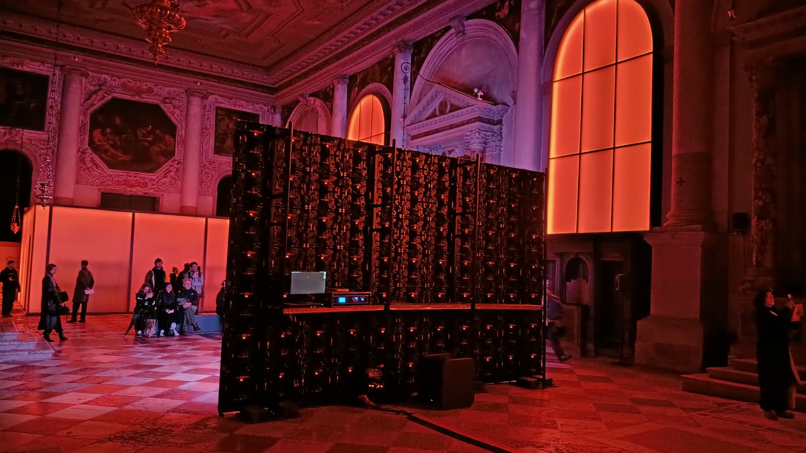

# Janis Rafa

**Tag tecnica/formato:** `video` `installazione`
**Tag tema:** `corpo-identita` `ecologia-ambiente`

## Biografia
Nata nel 1984 in Grecia (Janis Rafailidou), vive e lavora tra Atene e Amsterdam. PhD in Fine Art, University of Leeds (2012); residenza alla Rijksakademie (2013-14), dove il lavoro si sposta progressivamente dal video puro al film. Fellowship ARTWORKS/Fondazione Niarchos (2020). Mostra personale all'Eye Filmmuseum di Amsterdam (2023). Nel 2026 presente alla mostra collettiva **CANICULA** (Fondazione In Between Art Film, Complesso dell'Ospedaletto, Venezia, 6 maggio-22 novembre 2026, cur. Alessandro Rabottini e Leonardo Bigazzi) — occasione della visita che ha originato questa scheda.

## Poetica e ricerca
Pratica fra scultura, video-arte e cinema. Le installazioni video di Rafa sono descritte come inquietanti, fiabesche, criptiche: mettono in stretta prossimità figure umane e non-umane (animali, vegetazione, vivi o morti) per costruire uno sguardo non-antropocentrico e non-logocentrico. La ricerca interseca cinema, scultura e saggistica, indagando il rapporto conflittuale fra umano e non-umano attraverso un'estetica eco-femminista attenta ai rapporti di potere.

## Opere principali
### Lacerate (2020)
**Descrizione:** cortometraggio presentato alla 59ª Biennale di Venezia ("Milk of Dreams", 2022).

### Kala azar (2020)
**Descrizione:** primo lungometraggio dell'artista, presentato e premiato a IFFR e New Directors/New Films al MoMA.

### Baby I'm Yours, Forever (2026, CANICULA)
**Descrizione:** installazione video monocanale, colore, suono surround 8.1, 17'. Commissionata e prodotta da Fondazione In Between Art Film, co-prodotta da Onassis Culture e Heretic con il supporto di Mondriaan Fund. Presentata nella chiesa di Santa Maria dei Derelitti, prima sala del percorso (sala 1). L'opera è ambientata in un impianto di refrigerazione della carne: la camera si muove tra macchinari e aree adibite al trasporto, al taglio, all'imballaggio e allo stoccaggio, immersi in un bagliore artificiale. Una sequenza di scene allegoriche, in tableaux statici o con coreografie minime, mostra corpi umani affini a carcasse non umane, il latte come nutrimento in via di esaurimento e una danza febbrile che confina con la macellazione. Il sottofondo sonoro unisce rumori industriali a bassa frequenza e un coro lirico che ripete promesse di asservimento. Il piano sequenza attraversa un labirinto che il catalogo associa alle strutture della coscienza, dove convivono il visibile e il rimosso. Ricorrono immagini di corpi frammentati.
**Lettura critica:** il catalogo della mostra legge l'opera come un'allegoria del sacrificio e della violenza «sacrificale» che una forma di vita esige a partire dalla soppressione di un'altra. Le iconografie di uccisione e sacrificio vengono ricondotte ai linguaggi pittorici di Chaïm Soutine e di Francis Bacon, in cui la carne è simbolo di mortalità e vulnerabilità; secondo lo stesso testo l'opera si distingue perché non ignora la realtà del corpo non umano. Il meccanismo psicologico che separa gli esseri e giustifica lo sfruttamento di alcune forme di vita su altre è indicato come tema centrale.[^canicula]

## Interviste e talk
- _Nessuna ancora: da aggiungere._

## Fonti
- [Wikipedia — Janis Rafailidou](https://en.wikipedia.org/wiki/Janis_Rafailidou)
- [Onassis Foundation — pagina artista](https://www.onassis.org/people/janis-rafa)
- [Biennale Arte 2022 — Janis Rafa](https://www.labiennale.org/en/art/2022/milk-dreams/janis-rafa)
- [Fondazione In Between Art Film — CANICULA](https://inbetweenartfilm.com/en/canicula/)
- Fondazione In Between Art Film, *Canicula*, libretto e comunicato stampa, aprile 2026 (PDF in possesso del curatore del database)

## Mostre viste
- *CANICULA*, Fondazione In Between Art Film, Complesso dell'Ospedaletto, Venezia (2026) — visitata il 22 novembre 2026 da @danMa-hub

## Crediti delle immagini
- *Baby I'm Yours, Forever* — veduta dell'installazione, fotografia di @danMa-hub, 22 novembre 2026.

[^canicula]: Fondazione In Between Art Film, libretto e comunicato stampa della mostra *Canicula* (Venezia, 6 maggio–22 novembre 2026), schede sulle opere e sugli artisti, sala 1.
