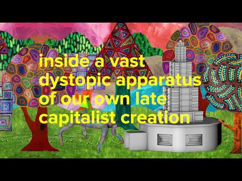
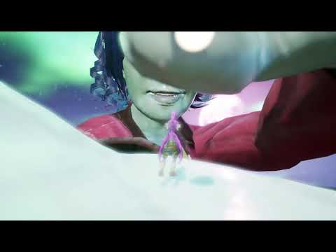
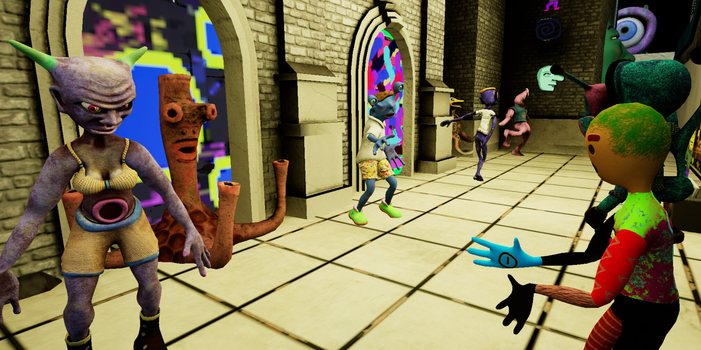

# Jeremy Couillard

**Tag tecnica/formato:** `videogioco-simulazione` `vr-ar` `installazione`
**Tag tema:** `fantascienza-speculativa` `mondi-virtuali-simulazione`
**Tag corso:** `TAD-DCV` `AVM`

## Biografia
Artista che realizza simulazioni e videogiochi narrativi interattivi.

## Poetica e ricerca
Couillard mescola fantascienza, umorismo assurdo e world-building speculativo in software e simulazioni interattive navigabili dallo spettatore. I suoi mondi sono popolati da personaggi/AI con logiche proprie (procrastinazione, pettegolezzo, missioni assurde), costruiti per essere lasciati "girare" a lungo, rivelando comportamenti diversi nel tempo — un world-building che privilegia il dispiegarsi processuale rispetto alla narrazione chiusa.

## Opere principali
### Sometimes to Deal With the Difficulty of Being Alive I Need to Believe There Is a Possibility That Life Is Not Real
**Descrizione:** software/simulazione ambientata a Polyp's Pond: tre AI (Smerga, Kaotoa, Skalitir), le più intelligenti sopravvissute a un apocalisse umana, costruiscono una macchina per generare altra vita artificiale; l'utente può abitare il corpo di una Tulpa generata da un'iterazione precedente della macchina, esplorare lo stagno, cambiare punto di vista o mettere in rete più computer.
**Lettura critica:** lasciata "girare" per un giorno intero, la simulazione rivela comportamenti emergenti diversi ogni volta — un'opera pensata per l'osservazione prolungata più che per la fruizione lineare.

**Approfondimento:** [YouTube — Sometimes...](https://www.youtube.com/watch?v=8wUiLcqLWnc)

### HOTR Home Furnishing
**Descrizione:** video ambientato in un futuro prossimo distopico in cui, dopo un salvataggio alieno dall'estinzione, l'1% più ricco viene impiegato in un negozio di arredamento in stile IKEA "su acido"; un alieno visita il negozio cercando una lampada.
**Lettura critica:** satira sul lavoro coatto e sulla banalizzazione del salvataggio/redenzione in chiave consumistica.

**Approfondimento:** [YouTube — HOTR Home Furnishing](https://www.youtube.com/watch?v=lwLx7-XLA1k)

### The Founders of Daytona Beach Also Founded Dayton, Ohio (2018)
**Descrizione:** opera VR interattiva in 3D (Zabludowicz Collection): lo spettatore, in forma disincarnata, fluttua tra creature aliene e scenari assurdi guidato da voci e frammenti audio da una radio, raccogliendo sette sillabe nascoste per tornare a una forma corporea.
**Lettura critica:** riferimenti a visioni e stati alterati di percezione (da mistici orientali a trader di borsa a figure storiche come William Blake) — la logica visiva onirica del videogioco come dispositivo di visione alterata.

**Approfondimento:** [zabludowiczcollection.com — 360: Jeremy Couillard](https://www.zabludowiczcollection.com/exhibitions/view/360-jeremy-couillard)

## Interviste e talk
- _Nessuna ancora: da aggiungere._

## Fonti
- [Manuale "Sometimes..." (PDF)](https://www.dropbox.com/s/fafvkvsbe9enjk2/SometimesGuideBook.pdf?dl=0)
- [HOTR Home Furnishing](https://www.youtube.com/watch?v=lwLx7-XLA1k&t=38s)
- [Sometimes — video](https://www.youtube.com/watch?v=8wUiLcqLWnc)
- [Rebirth redirect](https://www.youtube.com/watch?v=ccsmAYdZSJ0&t=52s)
- [jeremycouillard.com — sito ufficiale (ora individuato)](https://www.jeremycouillard.com)

## Crediti delle immagini
Immagine e link di approfondimento per ciascuna delle tre opere, inclusi sotto la relativa descrizione in "Opere principali". Trovato anche il sito ufficiale dell'artista, non individuato nella ricerca originale: [jeremycouillard.com](https://www.jeremycouillard.com).
- [Manuale "Sometimes..." (PDF)](https://www.dropbox.com/s/fafvkvsbe9enjk2/SometimesGuideBook.pdf?dl=0)
