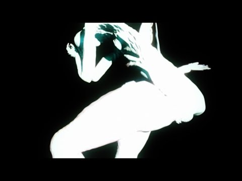
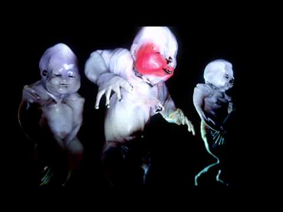
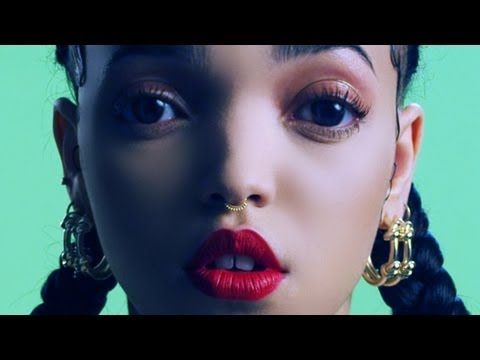
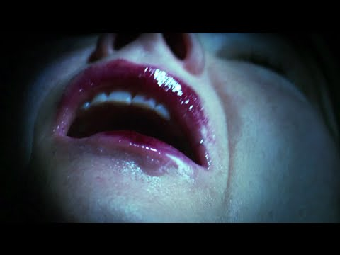
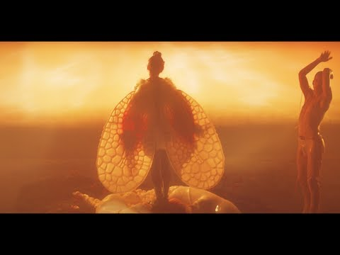
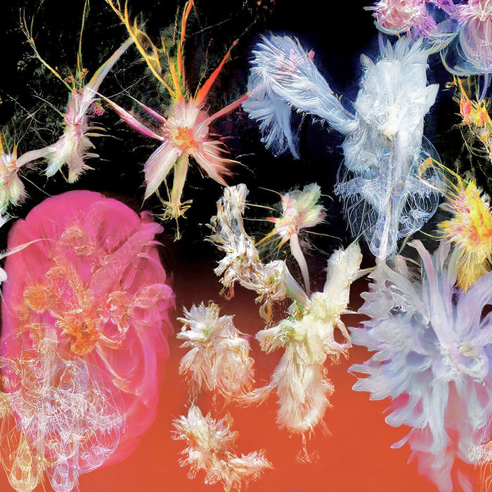

# Jesse Kanda

**Tag tecnica/formato:** `modellazione-3d` `video` `stampa-3d-scultura`
**Tag tema:** `corpo-identita` `genere-queerness`
**Tag corso:** `M3D`
**Stato:** da non attribuirgli Mutual Core di Björk (2012), diretto da Andrew Thomas Huang

## Biografia
Nome completo Jesse Soichiro Kanda, nato il 23 giugno 1987, nato in Giappone (Kanagawa) e cresciuto in parte in Canada (città non confermata con fonte diretta). Autodidatta, senza formazione artistica formale: inizia a condividere il proprio lavoro online attorno ai 13 anni, tramite DeviantArt e mp3.com, nei primi anni 2000. Vive e lavora a Londra (quartiere di Dalston). Incontra la musicista Alejandra Ghersi (Arca) in un forum di DeviantArt quando lui ha 15 anni e lei 13, anni prima di incontrarsi di persona; vivono insieme a Dalston, e Arca ha descritto pubblicamente il legame come "una questione d'amore, ma non d'amore romantico", definendo Kanda la propria "anima gemella" — una relazione creativa e intima la cui natura esatta va descritta con le stesse parole dell'artista, non presunta. Instaura inoltre un lungo sodalizio visivo/creativo con Björk, a partire circa dal 2015 (era di *Vulnicura*) fino a *Utopia* (2017) e oltre; WeTransfer ha prodotto una serie documentaria ("Work In Progress EP01") dedicata specificamente alla loro chimica creativa. Registra musica anche sotto lo pseudonimo **Doon Kanda**. Incluso nella scuderia della Nahmad Contemporary, che lo ha inserito nella collettiva "The Painter's New Tools" (2022, a cura di Eleanor Cayre e Dean Kissick), dedicata ad artisti che usano CGI/IA/strumenti digitali per ampliare cosa si intenda per "pittura".

## Poetica e ricerca
Kanda dichiara: "Mi interessa di più ciò che viene percepito come repellente quando in realtà non c'è alcuna ragione per esserlo. L'interno del nostro corpo è molto più bello della pelle che lo ricopre, eppure ne abbiamo paura. Quando vediamo sangue o organi, percepiamo dolore e pericolo." E ancora: "Parte del mio obiettivo è presentare cose 'disgustose' come qualcosa di bello." *Dazed*, nel profilo dedicatogli per la Dazed 100, descrive il suo repertorio come fatto di "bambini fantasma che si contorcono, spogliarelliste demoniache e bei momenti di quiete accidentale", sottolineando come sia formato in nulla ufficialmente ma autodidatta nel "design e nell'animazione 3D", contribuendo a creare universi visivi unici per Arca, Björk e FKA twigs. Il vocabolario critico ricorrente attraverso testate come *The Fader*, *Dazed*, *It's Nice That* e *SPIN* insiste su una dualità grottesco-bello, il body horror, il perturbante, l'ibridazione/trasformazione, l'ambiguità di genere, la distorsione dell'anatomia, la giustapposizione tra vita/morte e amore/paura.

## Opere principali
### Arca — Xen, copertina e video (2014)
**Descrizione:** Kanda crea la copertina dell'album e il concetto visivo per *Xen*, l'album di debutto di Arca, costruito attorno all'"alter ego infantile" omonimo di Arca — descritto come una figura dal genere ambiguo. Kanda: "Sono tutti ritratti di Xen." Dirige anche il video musicale di "Xen" (uscito il 17 novembre 2014), descritto da *The Fader* come "violento, sensuale" — Arca lo definisce "una gioia violenta che si riversa sul corpo, una celebrazione della sensualità e dello slacciarsi di fronte alla lotta".
**Lettura critica:** una delle collaborazioni fondative tra i due artisti — stabilisce il vocabolario visivo (corpo ambiguo, ibrido, trasformato) che caratterizzerà l'intera collaborazione successiva.
**Video:** [Xen, video ufficiale (YouTube)](https://www.youtube.com/watch?v=pcNG-zMlB8Q)

### Arca — TRAUMA, serie di cortometraggi (2014)
**Descrizione:** progetto sperimentale in due parti su tracce dal mixtape &&&&& di Arca (2013, "Knot" e "Harness"), che descrive una narrazione non lineare attorno alla morte di un "salaryman" e di un "bambino alla guida in stato di ebbrezza", dispiegata in un mondo subconscio. Scena 1: tre bambini "amorfi"/sfigurati che eseguono un'inquietante danza sincronizzata. Scena 2: filmato reale in primissimo piano di una bocca/faringe (lingua, corde vocali, ugola) che si muove a tempo di musica.
**Lettura critica:** *It's Nice That* osserva come il lavoro "porti una nuova, terrificante dimensione alla danza sincronizzata" — un esempio diretto dell'estetica del corpo interno reso visibile e disturbante.
**Video:** [TRAUMA Scene 1 (YouTube)](https://www.youtube.com/watch?v=NApVOHrbhqg)

### FKA twigs — Water Me, How's That, copertina di LP1 (2013-2014)
**Descrizione:** Kanda dirige entrambi i video (nel caso di "Water Me", co-diretto con la stessa FKA twigs — oltre 16 milioni di visualizzazioni su YouTube). "How's That" mostra un corpo generato al computer che si dissolve e si ricompone nello spazio vuoto — arti fluidi e mutevoli. Kanda scatta/crea anche il ritratto di copertina di *LP1* di FKA twigs — un'immagine ravvicinata, distorta, dall'aspetto "livido" del suo volto — che riceve una candidatura ai Grammy per il miglior Recording Package.
**Lettura critica:** la copertina di *LP1* applica per la prima volta su larga scala commerciale l'estetica della distorsione facciale/corporea che diventerà la firma dell'artista.

**Approfondimento:** [YouTube — Water Me](https://www.youtube.com/watch?v=kFtMl-uipA8)

### Björk — Mouth Mantra (2015)
**Descrizione:** video diretto da Kanda per *Vulnicura*, girato con 12 videocamere all'interno di una replica fisica della bocca di Björk alta 1,2 metri, in seguito pubblicato anche in versione a 360 gradi — una sequenza immersiva e viscerale dell'interno del corpo.
**Lettura critica:** ⚠️ l'identità visiva/copertina complessiva dell'album *Vulnicura* è opera di M/M (Paris) con fotografia di Inez & Vinoodh, non di Kanda — il suo contributo specifico a quell'era dell'album è questo video, non la copertina.
**Video:** [Mouth Mantra, video ufficiale (YouTube)](https://www.youtube.com/watch?v=j9wAeTW2GP8)

### Björk & Arca — Arisen My Senses, copertina di Utopia e video (2017)
**Descrizione:** Kanda progetta la copertina dell'album *Utopia*, che incorpora una maschera in silicone realizzata dal collaboratore/mask-maker di lunga data di Björk, James Merry. Co-dirige (con Björk e Arca) il video di "Arisen My Senses": Björk e Arca emergono da quello che viene descritto come un "grembo alieno"/crisalide luminosa in un mondo fantastico. Kanda ha dichiarato che l'opera è stata ispirata da lumache di mare leopardo e dalla carcassa di una creatura marina non identificata, arenata su una spiaggia indonesiana: "Era questo magnifico cumulo di pelle bianca, grasso e carne in una pozza di sangue su una spiaggia soleggiata. Mi ha davvero colpito... la combinazione di qualcosa di così catastrofico che è al tempo stesso così bello."
**Lettura critica:** l'opera in cui la dualità grottesco/bello, centrale nella poetica dell'artista, riceve la formulazione più esplicita e diretta nelle sue stesse parole.
**Video:** [Arisen My Senses, video ufficiale (YouTube)](https://www.youtube.com/watch?v=6VrqR_GfvzE)

### Doon Kanda — Lili (2024)
**Descrizione:** album più recente dell'artista sotto lo pseudonimo Doon Kanda, pubblicato il 27 agosto 2024 sulla propria etichetta Epic Collage — 11 tracce, con musica, testi, produzione e opere/video di accompagnamento interamente realizzati da Kanda stesso. Segue il precedente EP *heart* (2017) e l'album di debutto *Labyrinth*.
**Lettura critica:** dimostra come Kanda applichi lo stesso vocabolario visivo grottesco/bello sviluppato per altri artisti anche alla propria produzione musicale in prima persona.

**Approfondimento:** [doonkanda.bandcamp.com — Lili](https://doonkanda.bandcamp.com/album/lili)

## Interviste e talk
- [Dazed — intervista su Labyrinth/Doon Kanda](https://www.dazeddigital.com/beauty/article/46985/1/jesse-doon-kanda-artist-musician-labyrinth-debut-album-interview)

## Fonti
- [The Fader — pagina artista/tag](https://www.thefader.com/artist/jesse-kanda)
- [Dazed — profilo Dazed 100](https://www.dazeddigital.com/projects/article/29623/1/jesse-kanda)
- [It's Nice That — pagina artista](https://www.itsnicethat.com/articles/jesse-kanda)
- [FACT Magazine — su Mouth Mantra](https://www.factmag.com/2015/12/04/bjork-mouth-mantra-video-jesse-kanda/)
- [PAPER Magazine — su Arisen My Senses](https://www.papermag.com/bjork-arca-arisen-my-senses)
- [Nahmad Contemporary — pagina artista](https://www.nahmadcontemporary.com/artists/jesse-kanda-1)
- [designboom — panoramica su cortometraggi e altri lavori](https://www.designboom.com/design/jesse-kanda-short-films-and-other-work/)
- [LBBOnline — documentario WeTransfer su Björk e Kanda](https://lbbonline.com/news/bjork-and-jesse-kanda-explain-their-creative-chemistry-in-wetransfer-documentary-series)

## Crediti delle immagini
Immagine per ciascuna delle sei opere, inclusa sotto la relativa descrizione in "Opere principali", da YouTube e Bandcamp.
- [The Fader — pagina artista/tag](https://www.thefader.com/artist/jesse-kanda)
- [Dazed — profilo Dazed 100](https://www.dazeddigital.com/projects/article/29623/1/jesse-kanda)
- [Dazed — intervista su Labyrinth/Doon Kanda](https://www.dazeddigital.com/beauty/article/46985/1/jesse-doon-kanda-artist-musician-labyrinth-debut-album-interview)
