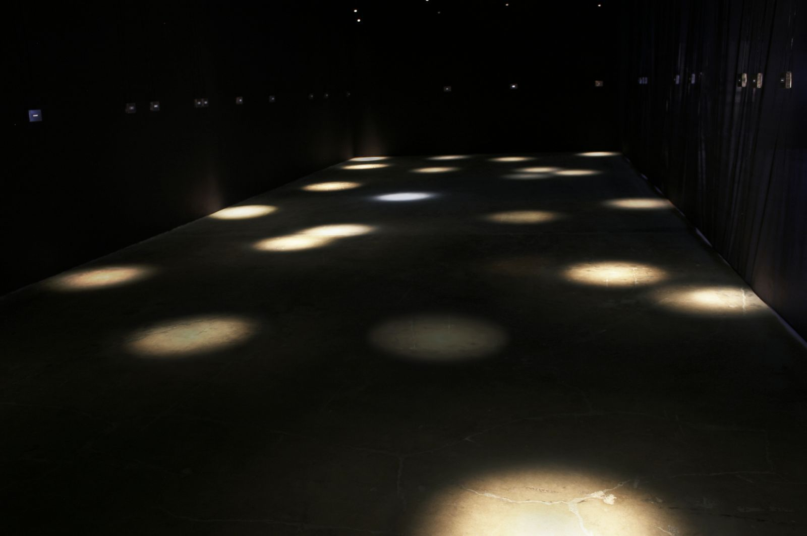
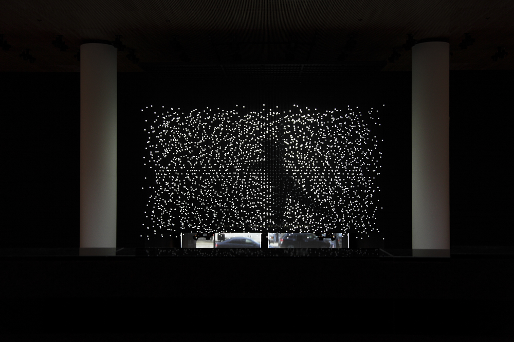
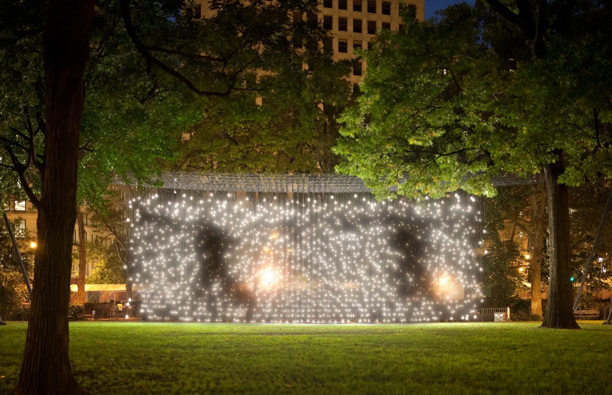
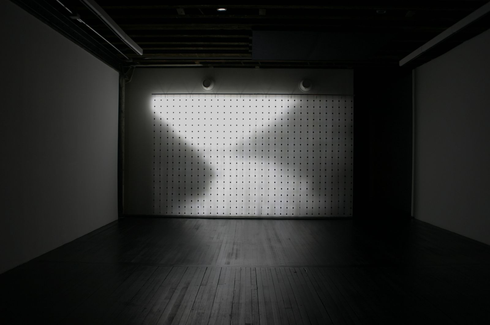
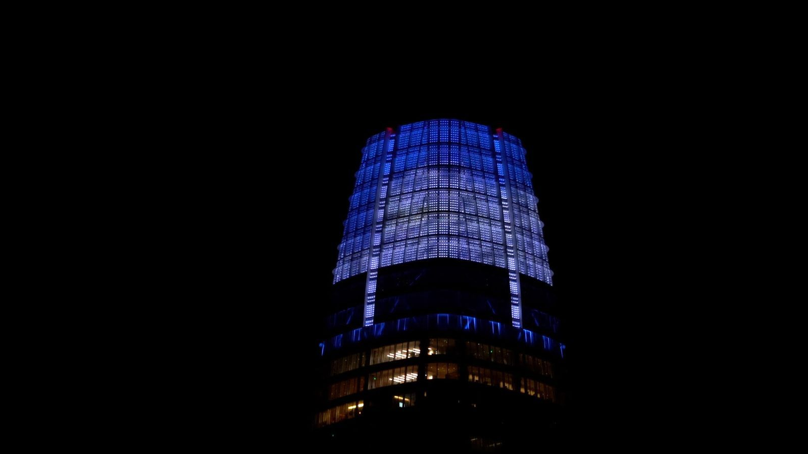
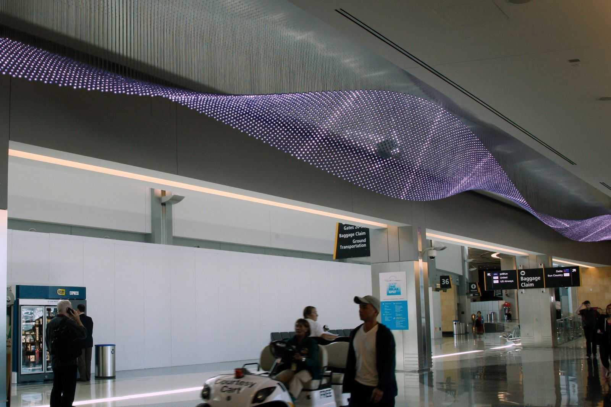

# Jim Campbell

**Tag tecnica/formato:** `installazione` `data-visualization` `procedurale-generativo`
**Tag tema:** `memoria-archivio` `storia-computer-grafica`

## Biografia
Nato nel 1956 a Chicago, Illinois. Consegue due lauree (B.S.) in Ingegneria Elettrica e Matematica al MIT (1978). Vive e lavora a San Francisco. Prima di dedicarsi interamente all'arte lavora per oltre vent'anni come ingegnere progettista ai Faroudja Labs (azienda californiana di tecnologia video), dove sviluppa circuiteria analogica e, in seguito, algoritmi digitali per la riduzione del rumore e il miglioramento dell'immagine video/HDTV, arrivando a detenere quasi venti brevetti in elaborazione video/immagine. Inizia come documentarista cinematografico; un progetto filmico personalmente difficile sul tema della malattia mentale lo spinge verso scienza e ingegneria. Comincia a realizzare installazioni elettroniche interattive attorno al 1988, si sposta verso la scultura elettronica attorno al 1990, e avvia le sue caratteristiche opere a matrice LED costruite su misura attorno al 1999-2000. Riconoscimenti: SECA (Society for the Encouragement of Contemporary Art) Electronic Media Award, SFMOMA (1996); Guggenheim Fellowship (2003-2004); Rockefeller Foundation Fellowship Award in Multimedia; tre borse della Daniel Langlois Foundation; 13° Bay Area Treasure Award del SFMOMA, alla carriera (2012). Opere nelle collezioni di SFMOMA, MoMA, Whitney Museum, Metropolitan Museum, Smithsonian American Art Museum, LACMA, UC Berkeley Art Museum/Pacific Film Archive, San Jose Museum of Art, ICP New York, J. Paul Getty Museum, Museum of Contemporary Art Sydney. Rappresentato a lungo dalla Hosfelt Gallery di San Francisco; dal 2026 anche dalla bitforms gallery di New York.

## Poetica e ricerca
Campbell progetta e costruisce elettronica su misura — riadattando tecnologia originariamente pensata per la trasmissione/archiviazione/visualizzazione dell'informazione — per costruire matrici LED a risoluzione estremamente bassa (spesso riducendo un'immagine da circa due milioni di pixel a poche migliaia, talvolta poche centinaia). Questo pone una domanda sperimentale diretta: quanta poca informazione visiva serve al cervello umano per riconoscere un volto, una figura in movimento, un gesto familiare? La fonte di ispirazione diretta e ben documentata è l'articolo di Leon Harmon "The Recognition of Faces" (*Scientific American*, novembre 1973, Bell Labs), che usava un celebre ritratto in scala di grigi di Abraham Lincoln a 252 pixel per studiare l'informazione minima necessaria al riconoscimento facciale — un riferimento che Campbell cita ripetutamente come formativo. La sua ricerca è stata inquadrata istituzionalmente come arte della "soglia"/liminale in due mostre-titolo separate: "Quantizing Effects: The Liminal Art of Jim Campbell" (SITE Santa Fe, 2005, con un saggio in catalogo del curatore indipendente Steve Dietz) e "Jim Campbell: Thresholds of Perception" (Telfair Museums, Savannah, curata da Harry DeLorme). Rudolf Frieling, curatore di media art del SFMOMA, che ha commissionato "Exploded Views" (2011-12) per l'atrio Haas del museo, descrive il lavoro come un'indagine sulle "sfumature della percezione". La critica Benjamin Sutton, su *Artnet News* (2014), osserva: "La bassa risoluzione è una sorta di tecnica universalizzante", discutendo come la rimozione del dettaglio renda l'opera più espressiva e archetipica. In un'intervista a *Interalia Magazine* ("Expressing to the Unconscious"), Campbell dichiara che le sue immagini in movimento a bassa risoluzione lavorano nella direzione opposta rispetto all'Espressionismo Astratto: invece che l'artista esprima un inconscio, è l'immagine a bassa risoluzione a "esprimersi verso l'inconscio" dello spettatore, producendo un'esperienza sentita più che analiticamente vista. Il monografico *Jim Campbell: Material Light* (Hatje Cantz, 2010) raccoglie saggi del curatore Smithsonian John G. Hanhardt, dello storico dell'arte Richard Shiff (University of Texas at Austin) e del teorico dei media Richard Shiff Grusin, co-autore di *Remediation: Understanding New Media*.

## Opere principali

### Last Day in the Beginning of March (2003)
**Descrizione:** installazione di 25-26 lampadine (le fonti divergono lievemente sul numero esatto), elettronica su misura, altoparlanti e suono, dimensioni variabili. Targhe a parete portano brevi frammenti di testo che descrivono momenti dell'ultimo giorno di vita del fratello dell'artista; le luci sopra si affievoliscono e lampeggiano secondo pattern legati al tempo di ricordi specifici, senza alcuna rappresentazione spaziale/visiva — puramente temporale ed emotiva. Campbell l'ha descritta come "una poesia o una sinfonia di luce" sulla morte del fratello. Mostrata per la prima volta nella mostra MATRIX 2003 "Memory Array" (UC Berkeley Art Museum); donata in seguito al BAMPFA.
**Lettura critica:** l'opera più esplicitamente dedicata alla memoria e al tempo nel corpus dell'artista — dimostra che il metodo della bassa risoluzione/quantizzazione può applicarsi non solo all'immagine ma anche al tempo stesso, codificato nel ritmo del lampeggiamento.

**Approfondimento:** [jimcampbell.tv — Last Day in the Beginning of March](https://www.jimcampbell.tv/portfolio/last-day-in-the-beginning-of-march)

### Exploded View (Commuters) / Exploded Views (2011)
**Descrizione:** esistono due presentazioni correlate ma distinte sotto titoli simili. Al Museum of the Moving Image, New York (agosto 2011): 1.152 LED bianchi sospesi che estrudono un'immagine 2D nello spazio 3D; dalla maggior parte delle angolazioni un campo casuale lampeggiante, da un punto di vista privilegiato pendolari della Grand Central Station diventano "a malapena decifrabili all'occhio ma stranamente comprensibili alla mente". Al SFMOMA (2011-12), nell'atrio Haas, commissionata dal curatore Rudolf Frieling: migliaia di sfere LED controllate al computer formano una matrice sospesa simile a un lampadario, che mostra quattro film in rotazione durante la mostra, "in parte scultura, in parte schermo cinematografico".
**Lettura critica:** entrambe le versioni condividono lo stesso principio — l'immagine esiste solo da un punto di vista specifico, altrimenti si dissolve in rumore casuale — ma applicato a scale e contesti istituzionali diversi.

**Approfondimento:** [jimcampbell.tv — Exploded Views](https://www.jimcampbell.tv/portfolio/exploded-views)

### Scattered Light (2010)
**Descrizione:** installazione all'aperto su larga scala in tre parti, Madison Square Park, Manhattan (21 ottobre 2010-28 febbraio 2011), con quasi 2.000 lampadine LED sospese singolarmente, a formare una matrice tridimensionale di circa 6 metri di altezza per 24 di larghezza. Dalla maggior parte delle angolazioni appare come un campo casuale di luci lampeggianti; da punti di vista specifici, si risolve un'immagine riconoscibile — figure simili a ombre basate su filmati di pendolari alla Grand Central Station. Descritta come la più grande opera pubblica di Campbell fino a quel momento.
**Lettura critica:** recensita da Charlie Finch su *Artnet Magazine* — porta il metodo della soglia percettiva dalla scala della galleria a quella del parco pubblico cittadino, con centinaia di passanti come pubblico non intenzionale.
**Video:** [documentazione notturna dell'installazione (Vimeo)](https://vimeo.com/21327143)

**Approfondimento:** [jimcampbell.tv — Scattered Light](https://www.jimcampbell.tv/portfolio/scattered-light)

### Home Movies, serie (dal 2006)
**Descrizione:** stringhe verticali di piccoli LED (ad esempio "Home Movies (300-1)", 2006, con 300 LED; "Home Movies (1040-1)", 2008) appese dal soffitto al pavimento, che proiettano/diffondono filmati amatoriali/familiari trovati (vacanze, compleanni, paesaggi) elaborati fino a renderli quasi illeggibili, simili a "una tenda di perline di luce". Opere successive della serie (come "Home Movies, Pause (David)", 2014) vengono descritte nella recensione di *Artnet* del 2014 come risolte in "immagini archetipiche dell'infanzia".
**Lettura critica:** applica il metodo della bassa risoluzione non a filmati anonimi ma a materiale familiare intimo — un ponte diretto tra il progetto tecnico dell'artista e la memoria personale, come già in *Last Day in the Beginning of March*.

**Approfondimento:** [jimcampbell.tv — Home Movies](https://www.jimcampbell.tv/portfolio/home-movies-series)

### Day for Night (2018, commissione pubblica permanente)
**Descrizione:** installazione permanente sulla corona della Salesforce Tower di San Francisco (ultimi sei piani circa, che si innalzano per 45 metri sopra il piano occupato più alto della torre di 326 metri). Circa 11.000 LED illuminano la corona esterna della torre con immagini in movimento a colori e bassa risoluzione; più videocamere posizionate in giro per San Francisco catturano i ritmi quotidiani della città (maree, vento, meteo, migrazione degli uccelli, attività umana); ogni notte viene mostrata una "sintesi" compressa di quella giornata, visibile fino a 32 km di distanza. Lanciata il 21 maggio 2018; riportata tra le opere di arte pubblica più alte/grandi al mondo.
**Lettura critica:** la scala urbana definitiva del metodo di Campbell — l'intera città diventa insieme fonte dei dati e pubblico dell'opera, in un ciclo quotidiano di cattura e restituzione.

**Approfondimento:** [jimcampbell.tv — Day for Night](https://www.jimcampbell.tv/portfolio/day-for-night)

### The Journey (2013-2014, San Diego International Airport)
**Descrizione:** oltre 40.000 sfere di vetro LED blu sospese (ciascuna di circa 4 cm di diametro) a formare un "nastro" di luce ondulato largo circa 1,8 metri e lungo 230 metri, che guida i passeggeri dal controllo di sicurezza all'area d'imbarco. Figure ombrose di persone che camminano, nuotano, danzano, e uccelli in volo sembrano muoversi attraverso il campo di luce mentre i viaggiatori vi passano sotto.
**Lettura critica:** un raro caso di opera di Campbell pensata per l'attraversamento fisico diretto, non solo per l'osservazione da un punto fisso — il visitatore diventa parte del "punto di vista" che risolve l'immagine muovendosi sotto di essa.

**Approfondimento:** [jimcampbell.tv — The Journey](https://www.jimcampbell.tv/portfolio/the-journey)

## Immagini

Immagine e link di approfondimento per ciascuna delle sei opere, inclusi sotto la relativa descrizione in "Opere principali", scaricate dal sito ufficiale [jimcampbell.tv](https://www.jimcampbell.tv).
- [SFMOMA — pagina artista](https://www.sfmoma.org/artist/Jim_Campbell/)
- [SFMOMA — Exploded Views, collezione](https://www.sfmoma.org/artwork/2012.154.A-G/)

## Fonti
- [jimcampbell.tv — sito ufficiale](https://www.jimcampbell.tv/about)
- [SFMOMA — pagina artista](https://www.sfmoma.org/artist/Jim_Campbell/)
- [SFMOMA — Exploded Views, collezione](https://www.sfmoma.org/artwork/2012.154.A-G/)
- [Whitney Museum — Ambiguous Icon #5, Running, Falling, collezione](https://whitney.org/collection/works/13823)
- [Daniel Langlois Foundation — biografia e analisi dell'opera](https://www.fondation-langlois.org/html/e/page.php?NumPage=77)
- [SITE Santa Fe — "Quantizing Effects: The Liminal Art of Jim Campbell" (2005)](https://www.sitesantafe.org/en/exhibitions/quantizing-effects-the-liminal-art-of-jim-campbell/)
- [Artnet News — Benjamin Sutton (2014)](https://news.artnet.com/market/why-is-jim-campbells-low-res-video-art-so-compelling-even-captivating-8270)
- [Interalia Magazine — intervista "Expressing to the Unconscious"](https://www.interaliamag.org/interviews/jim-campbell/)
- [Salesforce Tower — Day for Night](https://salesforcetower.com/artwork/)
- [IEEE Spectrum — profilo ingegnere-artista](https://spectrum.ieee.org/ee-turned-artist-lights-up-salesforce-tower)
- [Madison Square Park Conservancy — Scattered Light (PDF)](https://madisonsquarepark.org/wp-content/uploads/2021/03/Jim-Campbell_Scattered-Light.pdf)

---

## Appunti da organizzare
- Non citato in un programma specifico dei corsi — inserito dalla lista generale "da scrivere da zero" per la rilevanza nell'ambito della data art e della soglia di percezione dell'immagine a bassa risoluzione.
- ⚠️ Da verificare: numero esatto di lampadine in *Last Day in the Beginning of March* (25 secondo un'intervista dell'artista, 26 secondo un'altra fonte); dettagli specifici di un'eventuale commissione per il programma Riyadh Art (Arabia Saudita) — pagina artista trovata ma dettagli dell'opera non confermati.
- Video ulteriori da vedere in aula: [KQED, su The Journey (San Diego Airport)](https://www.kqed.org/arts/11086747/watch-jim-campbells-led-images-swimming-through-space); [SFMOMA, "Jim Campbell: Transmitted in Light" (profilo artista)](https://www.sfmoma.org/watch/jim-campbell-transmitted-in-light/).
