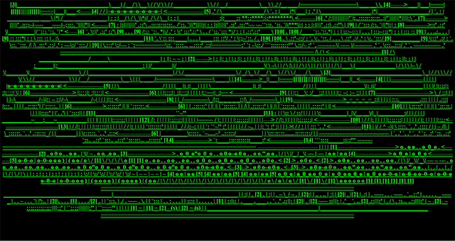
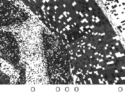
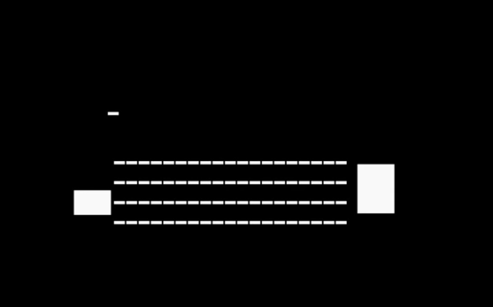
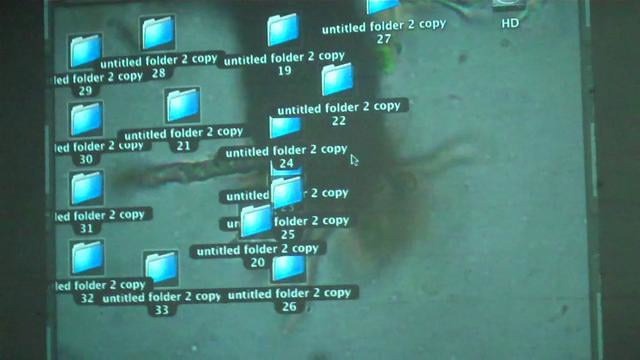
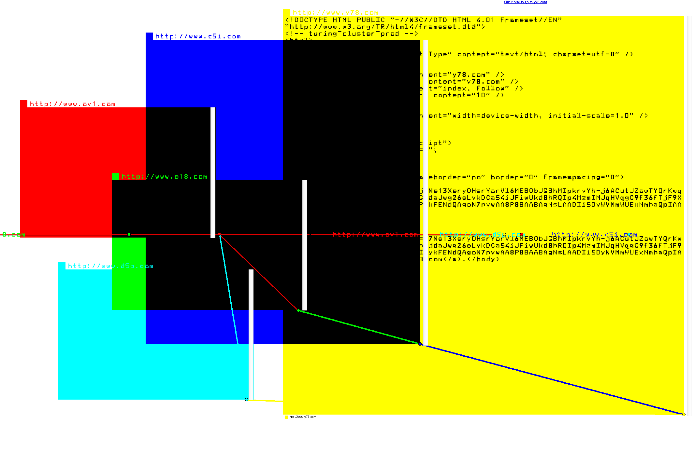
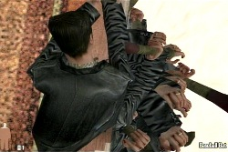
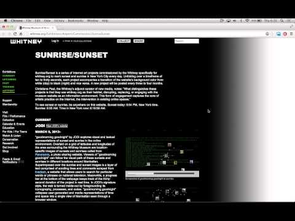

# JODI

**Tag tecnica/formato:** `net-art-sito-web` `videogioco-simulazione` `desktop-lecture-performance`
**Tag tema:** `economia-attenzione` `storia-computer-grafica` `performance-audiovisiva` `lecture-performance`

## Biografia
JODI è il duo formato da **Joan Heemskerk** (nata nel 1968 a Kaatsheuvel, Paesi Bassi) e **Dirk Paesmans** (nato nel 1965 a Bruxelles, Belgio). Si incontrano nel 1992 alla Jan van Eyck Academie di Maastricht, dove studiano fotografia e video; nel 1993 intraprendono una residenza di 18 mesi al CADRE (Computers in Art and Design Research) della San José State University, in Silicon Valley — il contesto in cui iniziano a lavorare con i media digitali e il web nascente. Il nome JODI nasce dalla contrazione di "Joan" e "Dirk". Il sito jodi.org è online dall'agosto 1995. Vivono e lavorano nei Paesi Bassi. SFMOMA li descrive come "programmatori e coder autodidatti" che "sezionano l'hardware e il software di computer, videogiochi, interfacce del browser web e piattaforme internet". Sono tra le figure fondative del movimento net.art della metà degli anni '90, accanto a Vuk Ćosić, Alexei Shulgin, Olia Lialina, Heath Bunting. Nel 1999 vincono il Webby Award nella categoria Net Art, con un discorso di accettazione di sole cinque parole (limite imposto dalla premiazione) diventato leggendario nell'ambiente. Nel 2014 vincono il primo Prix Net Art (Rhizome/New Museum e Tsinghua University Art and Science Media Lab), 10.000 dollari, giuria che include i curatori Michael Connor, Samantha Culp, Zhang Ga, Sabine Himmelsbach.

⚠️ Non verificato con fonte diretta: un'eventuale affiliazione didattica al Piet Zwart Institute di Rotterdam, riportata solo da fonti secondarie.

## Poetica e ricerca
JODI lavora smontando il funzionamento nascosto delle interfacce — codice sorgente, messaggi di errore, comportamento in crash — trasformandolo nel vero materiale visivo e concettuale dell'opera. La critica Rachel Greene, ex direttrice esecutiva di Rhizome.org, dedica loro ampio spazio nel libro *Internet Art* (Thames & Hudson, 2004), descrivendo la homepage di jodi.org come qualcosa che "sembra pura accozzaglia finché non si guarda il codice sorgente": nella pagina è nascosto, in un modo che costringe il browser a interpretare erroneamente i caratteri come HTML, un disegno ASCII che raffigura lo schema di una bomba all'idrogeno — un'immagine leggibile solo "visualizzando sorgente". La critica olandese Josephine Bosma, in *Nettitudes: Let's Talk Net Art* (NAi/Institute of Network Cultures, 2011), riporta la frustrazione degli stessi JODI per il modo in cui le mostre di net art (come la sezione dedicata a documenta X, 1997) li raggruppavano per tecnica ("la rete") invece che sui loro stessi termini artistici: a documenta X, costretti a presentare offline (su LAN) un'opera intrinsecamente fatta di link esterni, il lavoro andava continuamente in crash — un rifiuto, più che un fallimento tecnico, della cornice espositiva imposta. Electronic Arts Intermix (EAI) inquadra esplicitamente la loro pratica come "estetica del glitch". La teorica Rosa Menkman (già presente in questo database) cita JODI come influenza diretta sul proprio lavoro: la sua tesi di master del 2006 analizza proprio *Untitled Game* di JODI. In parallelo alla pratica sul web, JODI comincia a "moddare" videogiochi — Wolfenstein 3D (1993) e Quake I (1996) — trattati non come esperienze di gioco ma come sistemi di codice e motore grafico da smontare ed esporre. Le loro "desktop performance" dal vivo — connettere un computer a una videocamera davanti al pubblico e portare l'interfaccia al collasso — mettono in scena, come descrive il MoMA, il modo in cui "sistemi informatici apparentemente razionali possano provocare comportamenti irrazionali".

## Opere principali
### wwwwwwwww.jodi.org (1995)
**Descrizione:** il sito web originale del duo, online dall'agosto 1995: un paesaggio di pagine in HTML grezzo — colori che colano, animazioni, link rotti o privi di senso, immagini ASCII generate nascondendo nel codice sorgente uno schema di bomba all'idrogeno che il browser interpreta erroneamente come markup. Incluso nella sezione net art di documenta X (Kassel, 1997), curata da Simon Lamunière.
**Lettura critica:** opera fondativa del net.art storico — la superficie visibile (caos apparente) e il codice sorgente (immagine nascosta, deliberata) costituiscono due livelli di lettura sovrapposti, entrambi necessari per comprendere l'opera.

### Untitled Game (1996-2001)
**Descrizione:** serie di modifiche (comunemente citate come quattordici) del videogioco Quake I, che riducono la complessa grafica 3D del gioco ad ambienti geometrici quasi astratti in bianco, nero e grigio, mantenendo intatti gameplay e sonoro originali. Una delle varianti più note colloca il giocatore dentro un cubo vorticoso in bianco e nero, risultato di un glitch del motore grafico scoperto e sfruttato da JODI.
**Lettura critica:** oggetto di uno studio di conservazione interdisciplinare pubblicato da Rhizome — un caso di studio su come conservare un'opera che dipende da un motore di gioco obsoleto e da un glitch specifico di quella versione software.

**Approfondimento:** [EAI — Untitled Game](https://www.eai.org/titles/untitled-game)

### SOD (1999)
**Descrizione:** modifica di Wolfenstein 3D (1992): il mondo di gioco — un dungeon nazista da cui fuggire — viene decostruito in un labirinto architettonico quasi astratto di pattern geometrici in bianco, nero e grigio, disorientante ma ancora giocabile nella sua struttura. Conservata nella collezione permanente dello ZKM di Karlsruhe.
**Lettura critica:** lo ZKM descrive il risultato come "un labirinto quasi astratto di forme geometriche pure", "vagamente architettonico ed estremamente disorientante" — l'opera trasforma l'atto di giocare in un esercizio percettivo di spaesamento.

**Approfondimento:** [ZKM Karlsruhe — SOD](https://zkm.de/en/artworks/sod)

### My%sktop / My Desktop (2002-, "desktop performance")
**Descrizione:** performance dal vivo registrate collegando un Macintosh con Mac OS 9 (poi versioni successive) a una videocamera davanti al pubblico: JODI porta deliberatamente l'interfaccia al collasso — file che si aprono a ritmo vertiginoso, centinaia di finestre sovrapposte, suoni di errore di sistema in cascata. Presentata come installazione video a quattro schermi, in mostra permanente al MoMA di New York dal 2019.
**Lettura critica:** il MoMA la descrive come un'indagine su come "sistemi informatici apparentemente razionali possano provocare comportamenti irrazionali" — la performance rende visibile, in tempo reale, la fragilità dell'interfaccia che diamo per scontata.

**Approfondimento:** [MoMA — My%Desktop, collezione](https://www.moma.org/collection/works/193145)

### %WRONG Browser (2001-2011)
**Descrizione:** undici browser web alternativi/opere d'artista (wrongbrowser.org, wrongbrowser.com, wrongbrowser.co.kr, ecc.) che trasformano il contenuto di qualsiasi sito visitato in interfacce visive distorte nello stile JODI, dirottando l'interfaccia grafica del browser stesso e sovvertendo la logica predefinita della navigazione web. Oggetto di un progetto accademico di analisi e conservazione alla LMU di Monaco.
**Lettura critica:** sposta il gesto di manipolazione dal singolo sito al browser come tale — l'infrastruttura stessa attraverso cui si accede al web diventa il campo dell'intervento artistico.

### Max Payne Cheats Only (2008)
**Descrizione:** conclude la serie di appropriazioni videoludiche di JODI, questa volta a partire dal gioco Max Payne: il personaggio giocabile viene smontato e ricomposto in "micro-trattamenti" ripetitivi e privi di senso derivati dai codici cheat del gioco.
**Lettura critica:** segue le convenzioni della programmazione artistica per portare alle estreme conseguenze un metodo già collaudato — il cheat, pensato per aggirare le regole del gioco, diventa qui materiale compositivo.

**Approfondimento:** [EAI — Max Payne Cheats Only 1](https://www.eai.org/titles/max-payne-cheats-only-1)

### goodmorning goodnight (Whitney Artport, serie "Sunrise/Sunset")
**Descrizione:** commissione web per il sito del Whitney Museum: sovrappone foto di alba/tramonto geolocalizzate (da Panoramio) a testo scorrevole recuperato da Livedash (strumento di ricerca su sottotitoli TV), sincronizzato con una transizione cromatica giorno/notte dello sfondo del sito.
**Lettura critica:** applica l'estetica del "wrong"/glitch tipica di JODI a un contesto istituzionale — il sito di un museo — trasformandolo in un'opera che vive e cambia nel tempo reale della sua fruizione.

**Approfondimento:** [Whitney Museum — JODI: goodmorning goodnight](https://whitney.org/exhibitions/jodi)

## Interviste e talk
- _Nessuna ancora: da aggiungere._

## Fonti
- [SFMOMA — profilo artista](https://www.sfmoma.org/artist/jodi/)
- [Whitney Museum — profilo artista](https://whitney.org/artists/15261)
- [MoMA — profilo artista](https://www.moma.org/artists/48128-jodi)
- [MoMA — My Desktop, collezione](https://www.moma.org/collection/works/193145)
- [ZKM Karlsruhe — SOD](https://zkm.de/en/artwork/sod)
- [ICC Tokyo — SOD](https://www.ntticc.or.jp/en/archive/works/sod/)
- [HeK Basel — Max Payne Cheats Only](https://hek.ch/en/collection/artworks/max-payne-cheats-only/)
- [Rhizome — studio di conservazione su Untitled Game (PDF)](https://media.rhizome.org/artbase/documents/Untitled-Project:-A-Cross-Disciplinary-Investigation-of-JODI%E2%80%99s-Untitled-Game.pdf)
- [Rhizome — Prix Net Art 2014](https://rhizome.org/editorial/2014/oct/30/announcing-prix-net-art-awardees/)
- [Ed Halter, "JODI", 4Columns (2020)](https://www.4columns.org/halter-ed/jodi)
- [Electronic Arts Intermix — biografia](https://www.eai.org/artists/jodi/biography)
- [V2_ Lab for the Unstable Media — OSS/****](https://v2.nl/works/oss)

## Crediti delle immagini
Immagine per ciascuna delle sette opere, inclusa sotto la relativa descrizione in "Opere principali", da fonti museali (ZKM, MoMA, Monoskop), EAI e YouTube.
- [SFMOMA — profilo artista](https://www.sfmoma.org/artist/jodi/)
- [Whitney Museum — profilo artista](https://whitney.org/artists/15261)
- [MoMA — profilo artista](https://www.moma.org/artists/48128-jodi)
